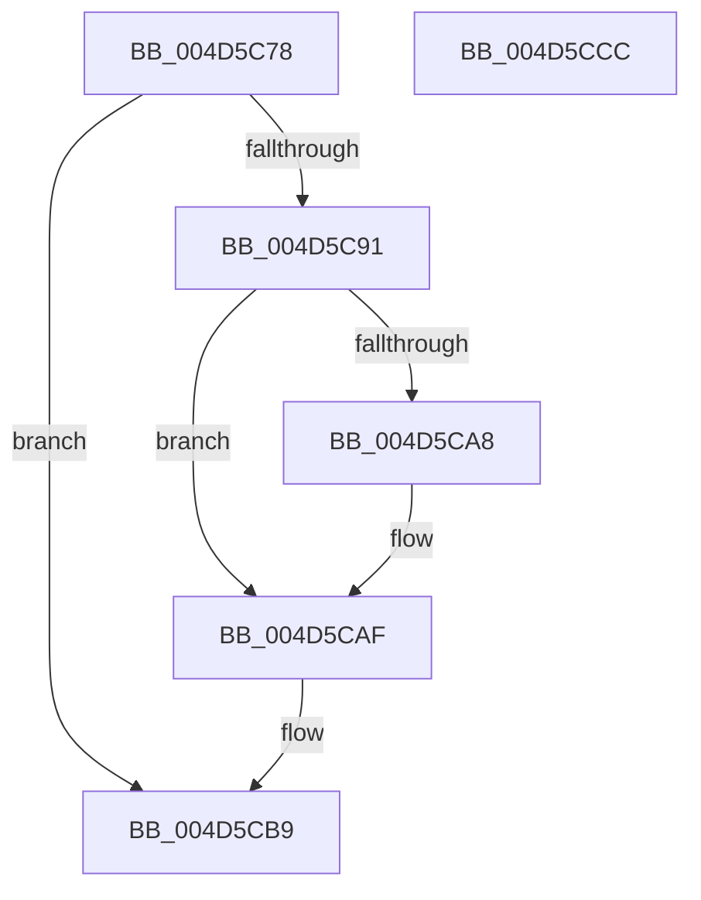

# PopDirectedDripsDiagGetDeviceActiveStamp

- RVA: `0x004D5C78`–`0x004D5CCD` (길이 `85` bytes)
- VA: `0x00000001404D5C78`
- 실행 섹션: `.text`
- PDB 이름 있음: `예`; PDB Function 태그: `아니요`
- unwind 정보 RVA: `0x00060BC4`
- 디코드: `24`개 명령, `85/85` bytes 표시
- 미해석 바이트: `0` (있으면 어셈블리에 `.byte`로 보존)

> 이 문서는 커널 이미지의 기계어와 PDB 기호를 분석해 생성했습니다. 4번과 5번은 함수 원형과 자료형을 바이너리 사용 방식에서 추정한 C 해석이며 원본 소스 복구 결과는 아닙니다.

## 1. Dependencies

- 직접 호출 지점: **2**; 고유 호출 대상: **2**
- 직접 호출자로 확인된 함수: **1**
- RIP 상대 이미지 참조: **0**

### Outgoing calls
- `0x004D5C9B` → [KeAcquireSpinLockRaiseToDpc](../20/KeAcquireSpinLockRaiseToDpc_function_00208470.md) (function, `0x00208470`)
- `0x004D5CB4` → [KeReleaseSpinLock](../39/KeReleaseSpinLock_function_00392BA0.md) (function, `0x00392BA0`)

### Direct callers
- [PopDirectedDripsDiagBroadcastTreeBegin](../../page/A9/PopDirectedDripsDiagBroadcastTreeBegin_function_00A955E8.md) at `0x00A956C8`

### Static image references
- 디코드된 RIP-relative 메모리 참조가 없습니다.

## 2. Other-region calls and transfers

- 다른 실행 섹션으로 향하는 call: **0**
- 별도 외부 분기/꼬리 이동을 확인하지 못했습니다.

## 3. Assembly (complete function range)

```asm
004D5C78  48 89 5C 24 08                  mov qword ptr [rsp + 8], rbx
004D5C7D  48 89 74 24 10                  mov qword ptr [rsp + 0x10], rsi
004D5C82  57                              push rdi
004D5C83  48 83 EC 20                     sub rsp, 0x20
004D5C87  33 DB                           xor ebx, ebx
004D5C89  48 8B F9                        mov rdi, rcx
004D5C8C  48 85 C9                        test rcx, rcx
004D5C8F  74 28                           je 0x1404d5cb9
004D5C91  48 8D B1 80 02 00 00            lea rsi, [rcx + 0x280]
004D5C98  48 8B CE                        mov rcx, rsi
004D5C9B  E8 D0 27 D3 FF                  call 0x140208470
004D5CA0  38 9F 88 02 00 00               cmp byte ptr [rdi + 0x288], bl
004D5CA6  74 07                           je 0x1404d5caf
004D5CA8  48 8B 9F 98 02 00 00            mov rbx, qword ptr [rdi + 0x298]
004D5CAF  8A D0                           mov dl, al
004D5CB1  48 8B CE                        mov rcx, rsi
004D5CB4  E8 E7 CE EB FF                  call 0x140392ba0
004D5CB9  48 8B 74 24 38                  mov rsi, qword ptr [rsp + 0x38]
004D5CBE  48 8B C3                        mov rax, rbx
004D5CC1  48 8B 5C 24 30                  mov rbx, qword ptr [rsp + 0x30]
004D5CC6  48 83 C4 20                     add rsp, 0x20
004D5CCA  5F                              pop rdi
004D5CCB  C3                              ret
004D5CCC  CC                              int3
```

## 4. C-style interpretation (structured pseudocode)

```c
__int64 __fastcall PopDirectedDripsDiagGetDeviceActiveStamp(__int64 a1)
{
    __int64 result;
    __int64 v_rbx;
    __int64 v_rsp;
    unsigned __int64 v_stack_p10;
    unsigned __int64 v_stack_p8;

    v_stack_p8 = v_rbx;
    v_stack_p10 = v_rsi;
    v_rsp = (v_rsp) - (32);
    v_rbx = 0;
    if (a1 == 0) goto loc_004D5CB9;
    result = KeAcquireSpinLockRaiseToDpc(a1 + 640, a2, a3, a4);
    if ((*(unsigned __int8 *)(a1 + 648)) != 0) {
        v_rbx = *(unsigned __int64 *)(a1 + 664);
    }
    result = KeReleaseSpinLock(a1 + 640, (unsigned __int8)(result), a3, a4);
loc_004D5CB9:
    v_rsp = (v_rsp) + (32);
    return v_rbx;
}
```

## 5. (Beta) C Style

```c
int64_t PopDirectedDripsDiagGetDeviceActiveStamp(void *Arg1)
{
    uint8_t *arg1 = (uint8_t *)Arg1;

    int64_t result;
    int64_t local_rbx;
    int64_t local_rsp;
    uint64_t v_stack_p10;
    uint64_t v_stack_p8;

    v_stack_p8 = local_rbx;
    v_stack_p10 = local_rsi;
    local_rsp = (local_rsp) - (32);
    local_rbx = 0;
    if (Arg1 == NULL) goto loc_004D5CB9;
    result = KeAcquireSpinLockRaiseToDpc(Arg1 + 640, a2, a3, a4);
    if ((*(uint8_t *)(arg1 + 0x288)) != 0) {
        local_rbx = *(uint64_t *)(arg1 + 0x298);
    }
    result = KeReleaseSpinLock(Arg1 + 640, (uint8_t)(result), a3, a4);
loc_004D5CB9:
    local_rsp = (local_rsp) + (32);
    return local_rbx;
}
```

### 관측된 메모리 오프셋

구조체 형식이 확인되지 않은 접근은 인자 기준의 오프셋으로만 기록했습니다.

| 기준 인자 | 오프셋 표현 | 폭 (bit) | 접근 |
|---|---:|---:|---|
| `Arg1` | `+ 0x288` | `8` | `R` |
| `Arg1` | `+ 0x298` | `64` | `R` |

## 6. Execution-region graph

[열기: 2D/3D 그래프와 함수 탐색 컨트롤 패널](../../../control-panel.html?section=text&rva=0x004D5C78&view=graph)

- 2D 그래프는 위에서 아래로 흐르고, 3D 그래프는 빈 공간을 드래그해 회전합니다. Shift+드래그는 이동, 휠은 확대·축소, 함수 노드 선택은 대상 보고서 이동입니다.

### Static fallback


