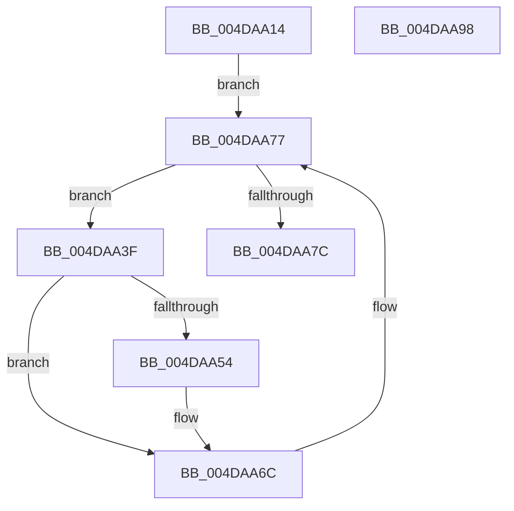

# PopFanSxExit

- RVA: `0x004DAA14`–`0x004DAA99` (길이 `133` bytes)
- VA: `0x00000001404DAA14`
- 실행 섹션: `.text`
- PDB 이름 있음: `예`; PDB Function 태그: `아니요`
- unwind 정보 RVA: `0x00060BC4`
- 디코드: `30`개 명령, `133/133` bytes 표시
- 미해석 바이트: `0` (있으면 어셈블리에 `.byte`로 보존)

> 이 문서는 커널 이미지의 기계어와 PDB 기호를 분석해 생성했습니다. 4번과 5번은 함수 원형과 자료형을 바이너리 사용 방식에서 추정한 C 해석이며 원본 소스 복구 결과는 아닙니다.

## 1. Dependencies

- 직접 호출 지점: **4**; 고유 호출 대상: **3**
- 직접 호출자로 확인된 함수: **1**
- RIP 상대 이미지 참조: **2**

### Outgoing calls
- `0x004DAA2A` → [PopAcquireRwLockShared](../2D/PopAcquireRwLockShared_function_002D9A40.md) (function, `0x002D9A40`)
- `0x004DAA49` → [PopAcquireRwLockExclusive](../43/PopAcquireRwLockExclusive_function_00430B44.md) (function, `0x00430B44`)
- `0x004DAA6F` → [PopReleaseRwLock](../2D/PopReleaseRwLock_function_002DFBBC.md) (function, `0x002DFBBC`)
- `0x004DAA83` → [PopReleaseRwLock](../2D/PopReleaseRwLock_function_002DFBBC.md) (function, `0x002DFBBC`)

### Direct callers
- [PopTransitionSystemPowerStateEx](../../pagelk/B7/PopTransitionSystemPowerStateEx_function_00B7E8C0.md) at `0x00B7F8AA`

### Static image references
- `0x004DAA23` → RVA `0x00F0C900` (`.data`; read)
- `0x004DAA2F` → RVA `0x00F0CE90` (`.data`; read)

## 2. Other-region calls and transfers

- 다른 실행 섹션으로 향하는 call: **0**
- 별도 외부 분기/꼬리 이동을 확인하지 못했습니다.

## 3. Assembly (complete function range)

```asm
004DAA14  48 89 5C 24 08                  mov qword ptr [rsp + 8], rbx
004DAA19  48 89 74 24 10                  mov qword ptr [rsp + 0x10], rsi
004DAA1E  57                              push rdi
004DAA1F  48 83 EC 20                     sub rsp, 0x20
004DAA23  48 8D 0D D6 1E A3 00            lea rcx, [rip + 0xa31ed6]
004DAA2A  E8 11 F0 DF FF                  call 0x1402d9a40
004DAA2F  48 8B 1D 5A 24 A3 00            mov rbx, qword ptr [rip + 0xa3245a]
004DAA36  48 8D 35 53 24 A3 00            lea rsi, [rip + 0xa32453]
004DAA3D  EB 38                           jmp 0x1404daa77
004DAA3F  48 8D BB 90 01 00 00            lea rdi, [rbx + 0x190]
004DAA46  48 8B CF                        mov rcx, rdi
004DAA49  E8 F6 60 F5 FF                  call 0x140430b44
004DAA4E  80 7B 58 00                     cmp byte ptr [rbx + 0x58], 0
004DAA52  74 18                           je 0x1404daa6c
004DAA54  48 A1 08 00 00 00 80 F7 FF FF   movabs rax, qword ptr [0xfffff78000000008]
004DAA5E  48 89 83 D0 00 00 00            mov qword ptr [rbx + 0xd0], rax
004DAA65  C6 83 C8 00 00 00 00            mov byte ptr [rbx + 0xc8], 0
004DAA6C  48 8B CF                        mov rcx, rdi
004DAA6F  E8 48 51 E0 FF                  call 0x1402dfbbc
004DAA74  48 8B 1B                        mov rbx, qword ptr [rbx]
004DAA77  48 3B DE                        cmp rbx, rsi
004DAA7A  75 C3                           jne 0x1404daa3f
004DAA7C  48 8D 0D 7D 1E A3 00            lea rcx, [rip + 0xa31e7d]
004DAA83  E8 34 51 E0 FF                  call 0x1402dfbbc
004DAA88  48 8B 5C 24 30                  mov rbx, qword ptr [rsp + 0x30]
004DAA8D  48 8B 74 24 38                  mov rsi, qword ptr [rsp + 0x38]
004DAA92  48 83 C4 20                     add rsp, 0x20
004DAA96  5F                              pop rdi
004DAA97  C3                              ret
004DAA98  CC                              int3
```

## 4. C-style interpretation (structured pseudocode)

```c
__int64 __fastcall PopFanSxExit(void)
{
    __int64 result;
    __int64 v_rsp;
    unsigned __int64 v_stack_p10;
    unsigned __int64 v_stack_p8;

    v_stack_p8 = v_rbx;
    v_stack_p10 = v_rsi;
    v_rsp = (v_rsp) - (32);
    result = PopAcquireRwLockShared(v_rip + 10690262, a2, a3, a4);
    goto loc_004DAA77;
loc_004DAA3F:
    result = PopAcquireRwLockExclusive(*(unsigned __int64 *)(v_rip + 10691674) + 400, a2, a3, a4);
    if ((*(unsigned __int8 *)(*(unsigned __int64 *)(v_rip + 10691674) + 88)) != 0) {
        *(unsigned __int64 *)(*(unsigned __int64 *)(v_rip + 10691674) + 208) = result;
        *(unsigned __int8 *)(*(unsigned __int64 *)(v_rip + 10691674) + 200) = 0;
    }
    result = PopReleaseRwLock(*(unsigned __int64 *)(v_rip + 10691674) + 400, a2, a3, a4);
loc_004DAA77:
    if ((*(unsigned __int64 *)(*(unsigned __int64 *)(v_rip + 10691674))) != (v_rip + 10691667)) goto loc_004DAA3F;
    result = PopReleaseRwLock(v_rip + 10690173, a2, a3, a4);
    v_rsp = (v_rsp) + (32);
    return result;
}
```

## 5. (Beta) C Style

```c
void PopFanSxExit(void)
{
    int64_t result;
    int64_t local_rsp;
    uint64_t v_stack_p10;
    uint64_t v_stack_p8;

    v_stack_p8 = local_rbx;
    v_stack_p10 = local_rsi;
    local_rsp = (local_rsp) - (32);
    result = PopAcquireRwLockShared(v_rip + 10690262, a2, a3, a4);
    goto loc_004DAA77;
loc_004DAA3F:
    result = PopAcquireRwLockExclusive(*(uint64_t *)(v_rip + 0xA3245A) + 400, a2, a3, a4);
    if ((*(uint8_t *)(*(uint64_t *)(v_rip + 0xA3245A) + 0x58)) != 0) {
        *(uint64_t *)(*(uint64_t *)(v_rip + 0xA3245A) + 0xD0) = result;
        *(uint8_t *)(*(uint64_t *)(v_rip + 0xA3245A) + 0xC8) = 0;
    }
    result = PopReleaseRwLock(*(uint64_t *)(v_rip + 0xA3245A) + 400, a2, a3, a4);
loc_004DAA77:
    if ((*(uint64_t *)(*(uint64_t *)(v_rip + 0xA3245A))) != (v_rip + 10691667)) goto loc_004DAA3F;
    result = PopReleaseRwLock(v_rip + 10690173, a2, a3, a4);
    local_rsp = (local_rsp) + (32);
    return result;
}
```

## 6. Execution-region graph

[열기: 2D/3D 그래프와 함수 탐색 컨트롤 패널](../../../control-panel.html?section=text&rva=0x004DAA14&view=graph)

- 2D 그래프는 위에서 아래로 흐르고, 3D 그래프는 빈 공간을 드래그해 회전합니다. Shift+드래그는 이동, 휠은 확대·축소, 함수 노드 선택은 대상 보고서 이동입니다.

### Static fallback


