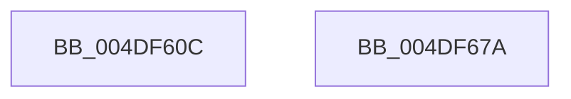

# PopFlushAndHold

- RVA: `0x004DF60C`–`0x004DF67B` (길이 `111` bytes)
- VA: `0x00000001404DF60C`
- 실행 섹션: `.text`
- PDB 이름 있음: `예`; PDB Function 태그: `아니요`
- unwind 정보 RVA: `0x000A40A0`
- 디코드: `26`개 명령, `111/111` bytes 표시
- 미해석 바이트: `0` (있으면 어셈블리에 `.byte`로 보존)

> 이 문서는 커널 이미지의 기계어와 PDB 기호를 분석해 생성했습니다. 4번과 5번은 함수 원형과 자료형을 바이너리 사용 방식에서 추정한 C 해석이며 원본 소스 복구 결과는 아닙니다.

## 1. Dependencies

- 직접 호출 지점: **2**; 고유 호출 대상: **2**
- 직접 호출자로 확인된 함수: **1**
- RIP 상대 이미지 참조: **1**

### Outgoing calls
- `0x004DF663` → [ZwDeviceIoControlFile](../6A/ZwDeviceIoControlFile_function_006AD1B0.md) (function, `0x006AD1B0`)
- `0x004DF670` → [_security_check_cookie](../6A/_security_check_cookie_function_006AC640.md) (function, `0x006AC640`)

### Direct callers
- [PopFlushVolumeWorker](../../pagelk/B7/PopFlushVolumeWorker_function_00B7AEB0.md) at `0x00B7B05A`

### Static image references
- `0x004DF613` → RVA `0x00E0A740` (`.data`; read)

## 2. Other-region calls and transfers

- 다른 실행 섹션으로 향하는 call: **0**
- 별도 외부 분기/꼬리 이동을 확인하지 못했습니다.

## 3. Assembly (complete function range)

```asm
004DF60C  4C 8B DC                        mov r11, rsp
004DF60F  48 83 EC 78                     sub rsp, 0x78
004DF613  48 8B 05 26 B1 92 00            mov rax, qword ptr [rip + 0x92b126]
004DF61A  48 33 C4                        xor rax, rsp
004DF61D  48 89 44 24 68                  mov qword ptr [rsp + 0x68], rax
004DF622  45 33 C0                        xor r8d, r8d
004DF625  49 8D 43 D8                     lea rax, [r11 - 0x28]
004DF629  45 89 43 D0                     mov dword ptr [r11 - 0x30], r8d
004DF62D  45 33 C9                        xor r9d, r9d
004DF630  4D 89 43 C8                     mov qword ptr [r11 - 0x38], r8
004DF634  C7 44 24 38 18 00 00 00         mov dword ptr [rsp + 0x38], 0x18
004DF63C  49 89 43 B8                     mov qword ptr [r11 - 0x48], rax
004DF640  4D 89 43 D8                     mov qword ptr [r11 - 0x28], r8
004DF644  4D 89 43 E0                     mov qword ptr [r11 - 0x20], r8
004DF648  83 4C 24 64 FF                  or dword ptr [rsp + 0x64], 0xffffffff
004DF64D  C7 44 24 28 00 C0 53 00         mov dword ptr [rsp + 0x28], 0x53c000
004DF655  49 89 53 A8                     mov qword ptr [r11 - 0x58], rdx
004DF659  33 D2                           xor edx, edx
004DF65B  C7 44 24 60 01 00 00 00         mov dword ptr [rsp + 0x60], 1
004DF663  E8 48 DB 1C 00                  call 0x1406ad1b0
004DF668  48 8B 4C 24 68                  mov rcx, qword ptr [rsp + 0x68]
004DF66D  48 33 CC                        xor rcx, rsp
004DF670  E8 CB CF 1C 00                  call 0x1406ac640
004DF675  48 83 C4 78                     add rsp, 0x78
004DF679  C3                              ret
004DF67A  CC                              int3
```

## 4. C-style interpretation (structured pseudocode)

```c
__int64 __fastcall PopFlushAndHold(__int64 a1, __int64 a2, int a3, int a4)
{
    __int64 result;
    __int64 v_rsp;
    unsigned __int64 v_stack_m10;
    unsigned int v_stack_m14;
    unsigned int v_stack_m18;
    unsigned int v_stack_m40;
    unsigned int v_stack_m50;

    v_rsp = (v_rsp) - (120);
    result = (*(unsigned __int64 *)(v_rip + 9613606)) ^ (v_rsp);
    v_stack_m10 = result;
    a3 = 0;
    *(unsigned int *)(v_rsp - 48) = 0;
    a4 = 0;
    *(unsigned __int64 *)(v_rsp - 56) = 0;
    v_stack_m40 = 24;
    *(unsigned __int64 *)(v_rsp - 72) = v_rsp - 40;
    *(unsigned __int64 *)(v_rsp - 40) = 0;
    *(unsigned __int64 *)(v_rsp - 32) = 0;
    v_stack_m50 = 0x53C000ULL;
    *(unsigned __int64 *)(v_rsp - 88) = a2;
    a2 = 0;
    v_stack_m18 = 1;
    result = ZwDeviceIoControlFile(a1, a2, a3, a4);
    a1 = (v_stack_m10) ^ (v_rsp);
    result = _security_check_cookie(a1, a2, a3, a4);
    v_rsp = (v_rsp) + (120);
    return result;
}
```

## 5. (Beta) C Style

```c
int64_t PopFlushAndHold(int64_t Arg1, int64_t Arg2, int32_t Arg3, int32_t Arg4)
{
    int64_t result;
    int64_t local_rsp;
    uint64_t v_stack_m10;
    uint32_t v_stack_m14;
    uint32_t v_stack_m18;
    uint32_t v_stack_m40;
    uint32_t v_stack_m50;

    local_rsp = (local_rsp) - (120);
    result = (*(uint64_t *)(v_rip + 0x92B126)) ^ (local_rsp);
    v_stack_m10 = result;
    Arg3 = 0;
    *(uint32_t *)(local_rsp - 0x30) = 0;
    Arg4 = 0;
    *(uint64_t *)(local_rsp - 0x38) = 0;
    v_stack_m40 = 24;
    *(uint64_t *)(local_rsp - 0x48) = local_rsp - 40;
    *(uint64_t *)(local_rsp - 0x28) = 0;
    *(uint64_t *)(local_rsp - 0x20) = 0;
    v_stack_m50 = 0x53C000ULL;
    *(uint64_t *)(local_rsp - 0x58) = Arg2;
    Arg2 = 0;
    v_stack_m18 = 1;
    result = ZwDeviceIoControlFile(Arg1, Arg2, Arg3, Arg4);
    Arg1 = (v_stack_m10) ^ (local_rsp);
    result = _security_check_cookie(Arg1, Arg2, Arg3, Arg4);
    local_rsp = (local_rsp) + (120);
    return result;
}
```

## 6. Execution-region graph

[열기: 2D/3D 그래프와 함수 탐색 컨트롤 패널](../../../control-panel.html?section=text&rva=0x004DF60C&view=graph)

- 2D 그래프는 위에서 아래로 흐르고, 3D 그래프는 빈 공간을 드래그해 회전합니다. Shift+드래그는 이동, 휠은 확대·축소, 함수 노드 선택은 대상 보고서 이동입니다.

### Static fallback


