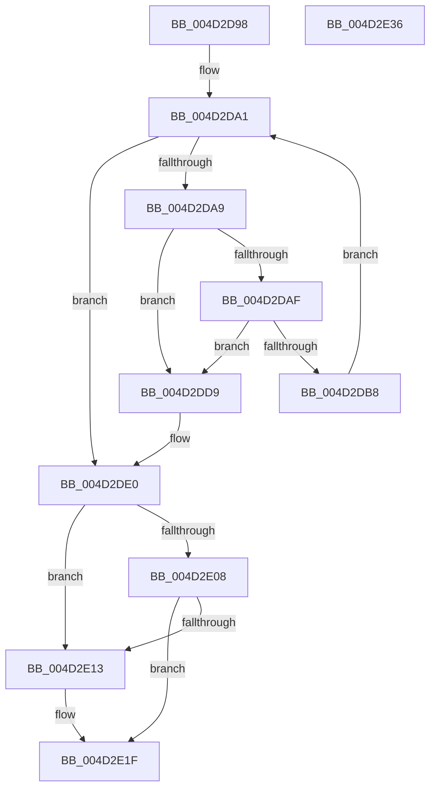

# PopFxDestroyDirectedDripsCandidateDeviceList

- RVA: `0x004D2D98`–`0x004D2E37` (길이 `159` bytes)
- VA: `0x00000001404D2D98`
- 실행 섹션: `.text`
- PDB 이름 있음: `예`; PDB Function 태그: `아니요`
- unwind 정보 RVA: `0x0005CF00`
- 디코드: `42`개 명령, `159/159` bytes 표시
- 미해석 바이트: `0` (있으면 어셈블리에 `.byte`로 보존)

> 이 문서는 커널 이미지의 기계어와 PDB 기호를 분석해 생성했습니다. 4번과 5번은 함수 원형과 자료형을 바이너리 사용 방식에서 추정한 C 해석이며 원본 소스 복구 결과는 아닙니다.

## 1. Dependencies

- 직접 호출 지점: **4**; 고유 호출 대상: **4**
- 직접 호출자로 확인된 함수: **1**
- RIP 상대 이미지 참조: **1**

### Outgoing calls
- `0x004D2DD2` → [PopFxDereferenceDevice](../27/PopFxDereferenceDevice_function_0027038C.md) (function, `0x0027038C`)
- `0x004D2E1A` → [ExfReleasePushLock](../26/ExfReleasePushLock_function_002638D0.md) (function, `0x002638D0`)
- `0x004D2E26` → [KeAbPostRelease](../2E/KeAbPostRelease_function_002E1600.md) (function, `0x002E1600`)
- `0x004D2E2B` → [KeLeaveCriticalRegion](../25/KeLeaveCriticalRegion_function_0025D8B0.md) (function, `0x0025D8B0`)

### Direct callers
- [PopDirectedDripsInitializeBroadcast](../../page/A4/PopDirectedDripsInitializeBroadcast_function_00A4D634.md) at `0x00A4D789`

### Static image references
- `0x004D2DE0` → RVA `0x00F0E4C0` (`.data`; read)

## 2. Other-region calls and transfers

- 다른 실행 섹션으로 향하는 call: **0**
- 별도 외부 분기/꼬리 이동을 확인하지 못했습니다.

## 3. Assembly (complete function range)

```asm
004D2D98  40 53                           push rbx
004D2D9A  48 83 EC 20                     sub rsp, 0x20
004D2D9E  48 8B D9                        mov rbx, rcx
004D2DA1  48 8B 0B                        mov rcx, qword ptr [rbx]
004D2DA4  48 3B CB                        cmp rcx, rbx
004D2DA7  74 37                           je 0x1404d2de0
004D2DA9  48 39 59 08                     cmp qword ptr [rcx + 8], rbx
004D2DAD  75 2A                           jne 0x1404d2dd9
004D2DAF  48 8B 01                        mov rax, qword ptr [rcx]
004D2DB2  48 39 48 08                     cmp qword ptr [rax + 8], rcx
004D2DB6  75 21                           jne 0x1404d2dd9
004D2DB8  48 89 03                        mov qword ptr [rbx], rax
004D2DBB  BA 03 00 00 00                  mov edx, 3
004D2DC0  48 89 58 08                     mov qword ptr [rax + 8], rbx
004D2DC4  48 89 49 08                     mov qword ptr [rcx + 8], rcx
004D2DC8  48 89 09                        mov qword ptr [rcx], rcx
004D2DCB  48 81 C1 70 FC FF FF            add rcx, -0x390
004D2DD2  E8 B5 D5 D9 FF                  call 0x14027038c
004D2DD7  EB C8                           jmp 0x1404d2da1
004D2DD9  B9 03 00 00 00                  mov ecx, 3
004D2DDE  CD 29                           int 0x29
004D2DE0  0F 0D 0D D9 B6 A3 00            prefetchw byte ptr [rip + 0xa3b6d9]
004D2DE7  48 8B 05 D2 B6 A3 00            mov rax, qword ptr [rip + 0xa3b6d2]
004D2DEE  45 33 C0                        xor r8d, r8d
004D2DF1  48 8B C8                        mov rcx, rax
004D2DF4  48 83 E1 F0                     and rcx, 0xfffffffffffffff0
004D2DF8  48 83 F9 10                     cmp rcx, 0x10
004D2DFC  48 8D 50 F0                     lea rdx, [rax - 0x10]
004D2E00  49 0F 46 D0                     cmovbe rdx, r8
004D2E04  A8 02                           test al, 2
004D2E06  75 0B                           jne 0x1404d2e13
004D2E08  F0 48 0F B1 15 AF B6 A3 00      lock cmpxchg qword ptr [rip + 0xa3b6af], rdx
004D2E11  74 0C                           je 0x1404d2e1f
004D2E13  48 8D 0D A6 B6 A3 00            lea rcx, [rip + 0xa3b6a6]
004D2E1A  E8 B1 0A D9 FF                  call 0x1402638d0
004D2E1F  48 8D 0D 9A B6 A3 00            lea rcx, [rip + 0xa3b69a]
004D2E26  E8 D5 E7 E0 FF                  call 0x1402e1600
004D2E2B  E8 80 AA D8 FF                  call 0x14025d8b0
004D2E30  48 83 C4 20                     add rsp, 0x20
004D2E34  5B                              pop rbx
004D2E35  C3                              ret
004D2E36  CC                              int3
```

## 4. C-style interpretation (structured pseudocode)

```c
__int64 __fastcall PopFxDestroyDirectedDripsCandidateDeviceList(__int64 a1, __int64 a2, int a3)
{
    __int64 result;
    __int64 v_rsp;

    v_rsp = (v_rsp) - (32);
loc_004D2DA1:
    if ((*(unsigned __int64 *)(a1)) == a1) goto loc_004D2DE0;
    if ((*(unsigned __int64 *)(*(unsigned __int64 *)(a1) + 8)) != a1) goto loc_004D2DD9;
    if ((*(unsigned __int64 *)(*(unsigned __int64 *)(*(unsigned __int64 *)(a1)) + 8)) != (*(unsigned __int64 *)(a1))) goto loc_004D2DD9;
    *(unsigned __int64 *)(a1) = *(unsigned __int64 *)(*(unsigned __int64 *)(a1));
    *(unsigned __int64 *)(*(unsigned __int64 *)(*(unsigned __int64 *)(a1)) + 8) = a1;
    *(unsigned __int64 *)(*(unsigned __int64 *)(a1) + 8) = *(unsigned __int64 *)(a1);
    *(unsigned __int64 *)(*(unsigned __int64 *)(a1)) = *(unsigned __int64 *)(a1);
    a1 = (*(unsigned __int64 *)(a1)) + (-912);
    result = PopFxDereferenceDevice(a1, 3, a3, a4);
    goto loc_004D2DA1;
loc_004D2DD9:
loc_004D2DE0:
    a3 = 0;
    a1 = (*(unsigned __int64 *)(v_rip + 10729170)) & (-16);
    a2 = *(unsigned __int64 *)(v_rip + 10729170) - 16;
    if (a1 <= 16) { a2 = 0; }
    if ((((unsigned __int8)(*(unsigned __int64 *)(v_rip + 10729170))) & (2)) != 0) goto loc_004D2E13;
    result = *(unsigned __int64 *)(v_rip + 10729170);
    if ((((unsigned __int8)(*(unsigned __int64 *)(v_rip + 10729170))) & (2)) != 0) {
        a1 = v_rip + 10729126;
        result = ExfReleasePushLock(a1, a2, a3, a4);
    }
    result = KeAbPostRelease(v_rip + 10729114, a2, a3, a4);
    result = KeLeaveCriticalRegion(v_rip + 10729114, a2, a3, a4);
    v_rsp = (v_rsp) + (32);
    return result;
}
```

## 5. (Beta) C Style

```c
int64_t PopFxDestroyDirectedDripsCandidateDeviceList(void *Arg1, int64_t Arg2, int32_t Arg3)
{
    uint8_t *arg1 = (uint8_t *)Arg1;

    int64_t result;
    int64_t local_rsp;

    local_rsp = (local_rsp) - (32);
loc_004D2DA1:
    if ((*(uint64_t *)(arg1)) == Arg1) goto loc_004D2DE0;
    if ((*(uint64_t *)(*(uint64_t *)(arg1) + 0x8)) != Arg1) goto loc_004D2DD9;
    if ((*(uint64_t *)(*(uint64_t *)(*(uint64_t *)(arg1)) + 0x8)) != (*(uint64_t *)(arg1))) goto loc_004D2DD9;
    *(uint64_t *)(arg1) = *(uint64_t *)(*(uint64_t *)(arg1));
    *(void **)(*(uint64_t *)(*(uint64_t *)(arg1)) + 0x8) = Arg1;
    *(uint64_t *)(*(uint64_t *)(arg1) + 0x8) = *(uint64_t *)(arg1);
    *(uint64_t *)(*(uint64_t *)(arg1)) = *(uint64_t *)(arg1);
    Arg1 = (*(uint64_t *)(arg1)) + (-912);
    result = PopFxDereferenceDevice(Arg1, 3, Arg3, a4);
    goto loc_004D2DA1;
loc_004D2DD9:
loc_004D2DE0:
    Arg3 = 0;
    Arg1 = (*(uint64_t *)(v_rip + 0xA3B6D2)) & (-16);
    Arg2 = *(uint64_t *)(v_rip + 0xA3B6D2) - 16;
    if (Arg1 <= 16) { Arg2 = 0; }
    if ((((uint8_t)(*(uint64_t *)(v_rip + 0xA3B6D2))) & (2)) != 0) goto loc_004D2E13;
    result = *(uint64_t *)(v_rip + 0xA3B6D2);
    if ((((uint8_t)(*(uint64_t *)(v_rip + 0xA3B6D2))) & (2)) != 0) {
        Arg1 = v_rip + 10729126;
        result = ExfReleasePushLock(Arg1, Arg2, Arg3, a4);
    }
    result = KeAbPostRelease(v_rip + 10729114, Arg2, Arg3, a4);
    result = KeLeaveCriticalRegion(v_rip + 10729114, Arg2, Arg3, a4);
    local_rsp = (local_rsp) + (32);
    return result;
}
```

### 관측된 메모리 오프셋

구조체 형식이 확인되지 않은 접근은 인자 기준의 오프셋으로만 기록했습니다.

| 기준 인자 | 오프셋 표현 | 폭 (bit) | 접근 |
|---|---:|---:|---|
| `Arg1` | `+ 0x0` | `64` | `R` |
| `Arg1` | `+ 0x0` | `64` | `W` |

## 6. Execution-region graph

[열기: 2D/3D 그래프와 함수 탐색 컨트롤 패널](../../../control-panel.html?section=text&rva=0x004D2D98&view=graph)

- 2D 그래프는 위에서 아래로 흐르고, 3D 그래프는 빈 공간을 드래그해 회전합니다. Shift+드래그는 이동, 휠은 확대·축소, 함수 노드 선택은 대상 보고서 이동입니다.

### Static fallback


