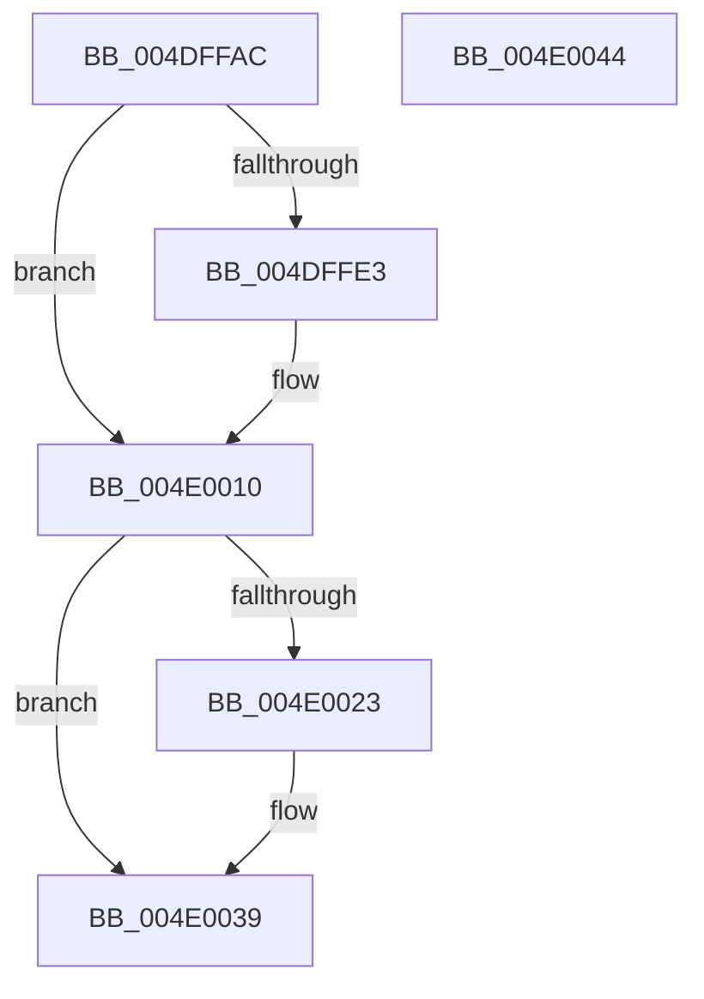

# PopHaltDeviceIdle

- RVA: `0x004DFFAC`–`0x004E0045` (길이 `153` bytes)
- VA: `0x00000001404DFFAC`
- 실행 섹션: `.text`
- PDB 이름 있음: `예`; PDB Function 태그: `아니요`
- unwind 정보 RVA: `0x000ACCDC`
- 디코드: `40`개 명령, `153/153` bytes 표시
- 미해석 바이트: `0` (있으면 어셈블리에 `.byte`로 보존)

> 이 문서는 커널 이미지의 기계어와 PDB 기호를 분석해 생성했습니다. 4번과 5번은 함수 원형과 자료형을 바이너리 사용 방식에서 추정한 C 해석이며 원본 소스 복구 결과는 아닙니다.

## 1. Dependencies

- 직접 호출 지점: **3**; 고유 호출 대상: **3**
- 직접 호출자로 확인된 함수: **1**
- RIP 상대 이미지 참조: **4**

### Outgoing calls
- `0x004DFFCF` → [KeAcquireSpinLockRaiseToDpc](../20/KeAcquireSpinLockRaiseToDpc_function_00208470.md) (function, `0x00208470`)
- `0x004E0019` → [KeReleaseSpinLock](../39/KeReleaseSpinLock_function_00392BA0.md) (function, `0x00392BA0`)
- `0x004E0034` → [KeWaitForSingleObject](../20/KeWaitForSingleObject_function_0020E6B0.md) (function, `0x0020E6B0`)

### Direct callers
- [PoInitializeBroadcast](../../page/A4/PoInitializeBroadcast_function_00A4DD98.md) at `0x00A4DE66`

### Static image references
- `0x004DFFBC` → RVA `0x00F0CBA0` (`.data`; read)
- `0x004DFFD4` → RVA `0x00E676A0` (`.data`; read)
- `0x004DFFDA` → RVA `0x00E676A4` (`.data`; write)
- `0x004E0009` → RVA `0x00E67698` (`.data`; write)

## 2. Other-region calls and transfers

- 다른 실행 섹션으로 향하는 call: **0**
- 별도 외부 분기/꼬리 이동을 확인하지 못했습니다.

## 3. Assembly (complete function range)

```asm
004DFFAC  48 89 5C 24 08                  mov qword ptr [rsp + 8], rbx
004DFFB1  55                              push rbp
004DFFB2  48 8B EC                        mov rbp, rsp
004DFFB5  48 83 EC 50                     sub rsp, 0x50
004DFFB9  0F 57 C0                        xorps xmm0, xmm0
004DFFBC  48 8D 0D DD CB A2 00            lea rcx, [rip + 0xa2cbdd]
004DFFC3  33 C0                           xor eax, eax
004DFFC5  33 DB                           xor ebx, ebx
004DFFC7  0F 11 45 E0                     movups xmmword ptr [rbp - 0x20], xmm0
004DFFCB  48 89 45 F0                     mov qword ptr [rbp - 0x10], rax
004DFFCF  E8 9C 84 D2 FF                  call 0x140208470
004DFFD4  39 1D C6 76 98 00               cmp dword ptr [rip + 0x9876c6], ebx
004DFFDA  C6 05 C3 76 98 00 01            mov byte ptr [rip + 0x9876c3], 1
004DFFE1  76 2D                           jbe 0x1404e0010
004DFFE3  83 65 E4 00                     and dword ptr [rbp - 0x1c], 0
004DFFE7  48 8D 4D E8                     lea rcx, [rbp - 0x18]
004DFFEB  48 89 4D F0                     mov qword ptr [rbp - 0x10], rcx
004DFFEF  48 8D 55 E0                     lea rdx, [rbp - 0x20]
004DFFF3  48 8D 4D E8                     lea rcx, [rbp - 0x18]
004DFFF7  66 C7 45 E0 01 00               mov word ptr [rbp - 0x20], 1
004DFFFD  48 89 4D E8                     mov qword ptr [rbp - 0x18], rcx
004E0001  48 8D 5D E0                     lea rbx, [rbp - 0x20]
004E0005  C6 45 E2 06                     mov byte ptr [rbp - 0x1e], 6
004E0009  48 89 15 88 76 98 00            mov qword ptr [rip + 0x987688], rdx
004E0010  8A D0                           mov dl, al
004E0012  48 8D 0D 87 CB A2 00            lea rcx, [rip + 0xa2cb87]
004E0019  E8 82 2B EB FF                  call 0x140392ba0
004E001E  48 85 DB                        test rbx, rbx
004E0021  74 16                           je 0x1404e0039
004E0023  48 83 64 24 20 00               and qword ptr [rsp + 0x20], 0
004E0029  45 33 C9                        xor r9d, r9d
004E002C  45 33 C0                        xor r8d, r8d
004E002F  33 D2                           xor edx, edx
004E0031  48 8B CB                        mov rcx, rbx
004E0034  E8 77 E6 D2 FF                  call 0x14020e6b0
004E0039  48 8B 5C 24 60                  mov rbx, qword ptr [rsp + 0x60]
004E003E  48 83 C4 50                     add rsp, 0x50
004E0042  5D                              pop rbp
004E0043  C3                              ret
004E0044  CC                              int3
```

## 4. C-style interpretation (structured pseudocode)

```c
__int64 __fastcall PopHaltDeviceIdle(__int64 a1, __int64 a2, int a3, int a4)
{
    __int64 result;
    __int64 v_rbx;
    __int64 v_rsp;
    unsigned __int64 v_stack_m18;
    unsigned __int64 v_stack_m20;
    unsigned int v_stack_m24;
    unsigned __int8 v_stack_m26;
    unsigned __int64 v_stack_m28;
    unsigned __int64 v_stack_m38;
    unsigned __int64 v_stack_p8;

    v_stack_p8 = v_rbx;
    v_rsp = (v_rsp) - (80);
    result = 0;
    v_rbx = 0;
    v_stack_m28 = v_xmm0;
    v_stack_m18 = 0;
    result = KeAcquireSpinLockRaiseToDpc(v_rip + 10669021, a2, a3, a4);
    *(unsigned __int8 *)(v_rip + 9991875) = 1;
    if ((*(unsigned int *)(v_rip + 9991878)) >= = 0) {
        a1 = v_stack_m20;
        v_stack_m18 = a1;
        a2 = v_stack_m28;
        a1 = v_stack_m20;
        v_stack_m28 = 1;
        v_stack_m20 = a1;
        v_rbx = v_stack_m28;
        v_stack_m26 = 6;
        *(unsigned __int64 *)(v_rip + 9991816) = a2;
    }
    result = KeReleaseSpinLock(v_rip + 10668935, (unsigned __int8)(result), a3, a4);
    if (v_rbx != 0) {
        a4 = 0;
        a3 = 0;
        a2 = 0;
        a1 = v_rbx;
        result = KeWaitForSingleObject(a1, a2, a3, a4);
    }
    v_rsp = (v_rsp) + (80);
    return result;
}
```

## 5. (Beta) C Style

```c
int64_t PopHaltDeviceIdle(int64_t Arg1, int64_t Arg2, int32_t Arg3, int32_t Arg4)
{
    int64_t result;
    int64_t local_rbx;
    int64_t local_rsp;
    uint64_t v_stack_m18;
    uint64_t v_stack_m20;
    uint32_t v_stack_m24;
    uint8_t v_stack_m26;
    uint64_t v_stack_m28;
    uint64_t v_stack_m38;
    uint64_t v_stack_p8;

    v_stack_p8 = local_rbx;
    local_rsp = (local_rsp) - (80);
    result = 0;
    local_rbx = 0;
    v_stack_m28 = v_xmm0;
    v_stack_m18 = 0;
    result = KeAcquireSpinLockRaiseToDpc(v_rip + 10669021, Arg2, Arg3, Arg4);
    *(uint8_t *)(v_rip + 0x9876C3) = 1;
    if ((*(uint32_t *)(v_rip + 0x9876C6)) >= = 0) {
        Arg1 = v_stack_m20;
        v_stack_m18 = Arg1;
        Arg2 = v_stack_m28;
        Arg1 = v_stack_m20;
        v_stack_m28 = 1;
        v_stack_m20 = Arg1;
        local_rbx = v_stack_m28;
        v_stack_m26 = 6;
        *(uint64_t *)(v_rip + 0x987688) = Arg2;
    }
    result = KeReleaseSpinLock(v_rip + 10668935, (uint8_t)(result), Arg3, Arg4);
    if (local_rbx != 0) {
        Arg4 = 0;
        Arg3 = 0;
        Arg2 = 0;
        Arg1 = local_rbx;
        result = KeWaitForSingleObject(Arg1, Arg2, Arg3, Arg4);
    }
    local_rsp = (local_rsp) + (80);
    return result;
}
```

## 6. Execution-region graph

[열기: 2D/3D 그래프와 함수 탐색 컨트롤 패널](../../../control-panel.html?section=text&rva=0x004DFFAC&view=graph)

- 2D 그래프는 위에서 아래로 흐르고, 3D 그래프는 빈 공간을 드래그해 회전합니다. Shift+드래그는 이동, 휠은 확대·축소, 함수 노드 선택은 대상 보고서 이동입니다.

### Static fallback


