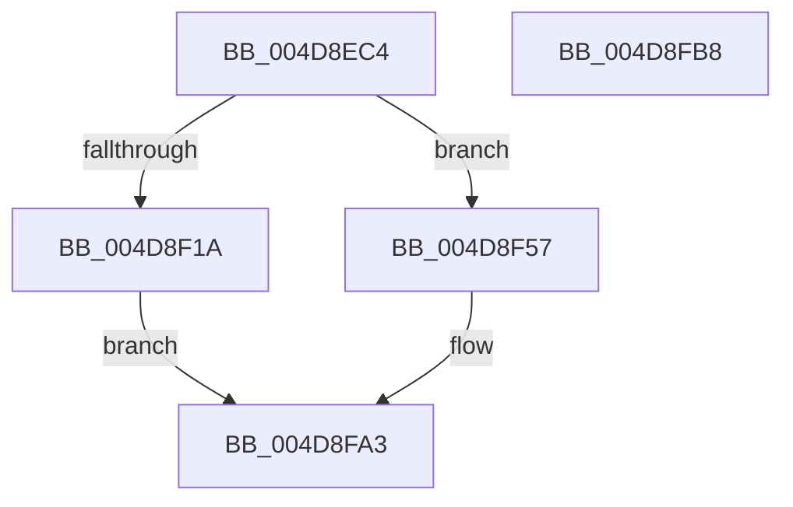

# PopPepCompleteComponentIdleState

- RVA: `0x004D8EC4`–`0x004D8FB9` (길이 `245` bytes)
- VA: `0x00000001404D8EC4`
- 실행 섹션: `.text`
- PDB 이름 있음: `예`; PDB Function 태그: `아니요`
- unwind 정보 RVA: `0x000A7960`
- 디코드: `62`개 명령, `245/245` bytes 표시
- 미해석 바이트: `0` (있으면 어셈블리에 `.byte`로 보존)

> 이 문서는 커널 이미지의 기계어와 PDB 기호를 분석해 생성했습니다. 4번과 5번은 함수 원형과 자료형을 바이너리 사용 방식에서 추정한 C 해석이며 원본 소스 복구 결과는 아닙니다.

## 1. Dependencies

- 직접 호출 지점: **6**; 고유 호출 대상: **5**
- 직접 호출자로 확인된 함수: **1**
- RIP 상대 이미지 참조: **0**

### Outgoing calls
- `0x004D8F08` → [PopPepLockActivityLink](../26/PopPepLockActivityLink_function_0026F7A0.md) (function, `0x0026F7A0`)
- `0x004D8F3D` → [PopPepRequestWork](../39/PopPepRequestWork_function_003986F0.md) (function, `0x003986F0`)
- `0x004D8F50` → [PopPepReleaseActivityLink](../24/PopPepReleaseActivityLink_function_0024CC90.md) (function, `0x0024CC90`)
- `0x004D8F65` → [PopPepReleaseActivityLink](../24/PopPepReleaseActivityLink_function_0024CC90.md) (function, `0x0024CC90`)
- `0x004D8F80` → [PopPepProcessEvent](../24/PopPepProcessEvent_function_0024B930.md) (function, `0x0024B930`)
- `0x004D8F9E` → [PopPlNotifyDeviceFState](../2B/PopPlNotifyDeviceFState_function_002BE034.md) (function, `0x002BE034`)

### Direct callers
- [sub_002BD95A](../2B/Unknown_function_002BD95A.md) at `0x002BDDB6`

### Static image references
- 디코드된 RIP-relative 메모리 참조가 없습니다.

## 2. Other-region calls and transfers

- 다른 실행 섹션으로 향하는 call: **0**
- 별도 외부 분기/꼬리 이동을 확인하지 못했습니다.

## 3. Assembly (complete function range)

```asm
004D8EC4  48 8B C4                        mov rax, rsp
004D8EC7  48 89 58 08                     mov qword ptr [rax + 8], rbx
004D8ECB  48 89 68 18                     mov qword ptr [rax + 0x18], rbp
004D8ECF  48 89 70 20                     mov qword ptr [rax + 0x20], rsi
004D8ED3  57                              push rdi
004D8ED4  48 83 EC 30                     sub rsp, 0x30
004D8ED8  8B F2                           mov esi, edx
004D8EDA  48 8D 99 C0 00 00 00            lea rbx, [rcx + 0xc0]
004D8EE1  4C 69 C6 D0 00 00 00            imul r8, rsi, 0xd0
004D8EE8  41 B9 01 00 00 00               mov r9d, 1
004D8EEE  C6 40 10 00                     mov byte ptr [rax + 0x10], 0
004D8EF2  49 03 D8                        add rbx, r8
004D8EF5  48 8D 40 10                     lea rax, [rax + 0x10]
004D8EF9  48 8B D3                        mov rdx, rbx
004D8EFC  48 89 44 24 20                  mov qword ptr [rsp + 0x20], rax
004D8F01  48 8B F9                        mov rdi, rcx
004D8F04  45 8D 41 05                     lea r8d, [r9 + 5]
004D8F08  E8 93 68 D9 FF                  call 0x14026f7a0
004D8F0D  48 8B 4B 40                     mov rcx, qword ptr [rbx + 0x40]
004D8F11  40 8A E8                        mov bpl, al
004D8F14  83 79 0C 01                     cmp dword ptr [rcx + 0xc], 1
004D8F18  75 3D                           jne 0x1404d8f57
004D8F1A  C7 41 0C 02 00 00 00            mov dword ptr [rcx + 0xc], 2
004D8F21  8B 57 78                        mov edx, dword ptr [rdi + 0x78]
004D8F24  03 53 68                        add edx, dword ptr [rbx + 0x68]
004D8F27  48 8B 43 40                     mov rax, qword ptr [rbx + 0x40]
004D8F2B  83 08 08                        or dword ptr [rax], 8
004D8F2E  F0 FF 43 68                     lock inc dword ptr [rbx + 0x68]
004D8F32  44 8B 47 78                     mov r8d, dword ptr [rdi + 0x78]
004D8F36  44 03 43 68                     add r8d, dword ptr [rbx + 0x68]
004D8F3A  48 8B CF                        mov rcx, rdi
004D8F3D  E8 AE F7 EB FF                  call 0x1403986f0
004D8F42  44 8A 4C 24 48                  mov r9b, byte ptr [rsp + 0x48]
004D8F47  44 8A C5                        mov r8b, bpl
004D8F4A  48 8B D3                        mov rdx, rbx
004D8F4D  48 8B CF                        mov rcx, rdi
004D8F50  E8 3B 3D D7 FF                  call 0x14024cc90
004D8F55  EB 4C                           jmp 0x1404d8fa3
004D8F57  44 8A 4C 24 48                  mov r9b, byte ptr [rsp + 0x48]
004D8F5C  44 8A C5                        mov r8b, bpl
004D8F5F  48 8B D3                        mov rdx, rbx
004D8F62  48 8B CF                        mov rcx, rdi
004D8F65  E8 26 3D D7 FF                  call 0x14024cc90
004D8F6A  48 83 64 24 28 00               and qword ptr [rsp + 0x28], 0
004D8F70  41 B9 06 00 00 00               mov r9d, 6
004D8F76  48 8B D3                        mov rdx, rbx
004D8F79  48 8B CF                        mov rcx, rdi
004D8F7C  45 8D 41 FB                     lea r8d, [r9 - 5]
004D8F80  E8 AB 29 D7 FF                  call 0x14024b930
004D8F85  44 8B 8B B0 00 00 00            mov r9d, dword ptr [rbx + 0xb0]
004D8F8C  8B D6                           mov edx, esi
004D8F8E  44 8B 83 B4 00 00 00            mov r8d, dword ptr [rbx + 0xb4]
004D8F95  48 8B 4F 20                     mov rcx, qword ptr [rdi + 0x20]
004D8F99  C6 44 24 20 01                  mov byte ptr [rsp + 0x20], 1
004D8F9E  E8 91 50 DE FF                  call 0x1402be034
004D8FA3  48 8B 5C 24 40                  mov rbx, qword ptr [rsp + 0x40]
004D8FA8  48 8B 6C 24 50                  mov rbp, qword ptr [rsp + 0x50]
004D8FAD  48 8B 74 24 58                  mov rsi, qword ptr [rsp + 0x58]
004D8FB2  48 83 C4 30                     add rsp, 0x30
004D8FB6  5F                              pop rdi
004D8FB7  C3                              ret
004D8FB8  CC                              int3
```

## 4. C-style interpretation (structured pseudocode)

```c
__int64 __fastcall PopPepCompleteComponentIdleState(__int64 a1, int a2)
{
    __int64 result;
    __int64 v_rbx;
    __int64 v_rsp;
    unsigned __int64 v_stack_m10;
    unsigned __int64 v_stack_m18;
    unsigned __int8 v_stack_p10;
    unsigned __int64 v_stack_p18;
    unsigned __int64 v_stack_p20;
    unsigned __int64 v_stack_p8;

    *(unsigned __int64 *)(v_rsp + 8) = v_rbx;
    *(unsigned __int64 *)(v_rsp + 24) = v_rbp;
    *(unsigned __int64 *)(v_rsp + 32) = v_rsi;
    v_rsp = (v_rsp) - (48);
    a3 = (a3) * ((unsigned int)(a2));
    *(unsigned __int8 *)(v_rsp + 16) = 0;
    v_rbx = (a1 + 192) + (a3);
    v_stack_m18 = v_rsp + 16;
    result = PopPepLockActivityLink(a1, v_rbx, 1 + 5, 1);
    if ((*(unsigned int *)(*(unsigned __int64 *)(v_rbx + 64) + 12)) != 1) goto loc_004D8F57;
    *(unsigned int *)(*(unsigned __int64 *)(v_rbx + 64) + 12) = 2;
    a2 = (unsigned int)(((unsigned int)(*(unsigned int *)(a1 + 120))) + (*(unsigned int *)(v_rbx + 104)));
    a3 = (unsigned int)(((unsigned int)(*(unsigned int *)(a1 + 120))) + (*(unsigned int *)(v_rbx + 104)));
    result = PopPepRequestWork(a1, a2, a3, 1);
    result = PopPepReleaseActivityLink(a1, v_rbx, (unsigned __int8)((unsigned __int8)(result)), v_stack_p10);
    goto loc_004D8FA3;
loc_004D8F57:
    result = PopPepReleaseActivityLink(a1, v_rbx, (unsigned __int8)((unsigned __int8)(result)), v_stack_p10);
    result = PopPepProcessEvent(a1, v_rbx, 6 - 5, 6);
    v_stack_m18 = 1;
    result = PopPlNotifyDeviceFState(*(unsigned __int64 *)(a1 + 32), (unsigned int)((unsigned int)((unsigned int)(a2))), (unsigned int)(*(unsigned int *)(v_rbx + 180)), (unsigned int)(*(unsigned int *)(v_rbx + 176)));
loc_004D8FA3:
    v_rsp = (v_rsp) + (48);
    return result;
}
```

## 5. (Beta) C Style

```c
int64_t PopPepCompleteComponentIdleState(void *Arg1, int32_t Arg2)
{
    uint8_t *arg1 = (uint8_t *)Arg1;

    int64_t result;
    int64_t local_rbx;
    int64_t local_rsp;
    uint64_t v_stack_m10;
    uint64_t v_stack_m18;
    uint8_t v_stack_p10;
    uint64_t v_stack_p18;
    uint64_t v_stack_p20;
    uint64_t v_stack_p8;

    *(uint64_t *)(local_rsp + 0x8) = local_rbx;
    *(uint64_t *)(local_rsp + 0x18) = local_rbp;
    *(uint64_t *)(local_rsp + 0x20) = local_rsi;
    local_rsp = (local_rsp) - (48);
    a3 = (a3) * ((uint32_t)(Arg2));
    *(uint8_t *)(local_rsp + 0x10) = 0;
    local_rbx = (Arg1 + 192) + (a3);
    v_stack_m18 = local_rsp + 16;
    result = PopPepLockActivityLink(Arg1, local_rbx, 1 + 5, 1);
    if ((*(uint32_t *)(*(uint64_t *)(local_rbx + 0x40) + 0xC)) != 1) goto loc_004D8F57;
    *(uint32_t *)(*(uint64_t *)(local_rbx + 0x40) + 0xC) = 2;
    Arg2 = (uint32_t)(((uint32_t)(*(uint32_t *)(arg1 + 0x78))) + (*(uint32_t *)(local_rbx + 0x68)));
    a3 = (uint32_t)(((uint32_t)(*(uint32_t *)(arg1 + 0x78))) + (*(uint32_t *)(local_rbx + 0x68)));
    result = PopPepRequestWork(Arg1, Arg2, a3, 1);
    result = PopPepReleaseActivityLink(Arg1, local_rbx, (uint8_t)((uint8_t)(result)), v_stack_p10);
    goto loc_004D8FA3;
loc_004D8F57:
    result = PopPepReleaseActivityLink(Arg1, local_rbx, (uint8_t)((uint8_t)(result)), v_stack_p10);
    result = PopPepProcessEvent(Arg1, local_rbx, 6 - 5, 6);
    v_stack_m18 = 1;
    result = PopPlNotifyDeviceFState(*(uint64_t *)(arg1 + 0x20), (uint32_t)((uint32_t)((uint32_t)(Arg2))), (uint32_t)(*(uint32_t *)(local_rbx + 0xB4)), (uint32_t)(*(uint32_t *)(local_rbx + 0xB0)));
loc_004D8FA3:
    local_rsp = (local_rsp) + (48);
    return result;
}
```

### 관측된 메모리 오프셋

구조체 형식이 확인되지 않은 접근은 인자 기준의 오프셋으로만 기록했습니다.

| 기준 인자 | 오프셋 표현 | 폭 (bit) | 접근 |
|---|---:|---:|---|
| `Arg1` | `+ 0x20` | `64` | `R` |
| `Arg1` | `+ 0x40` | `64` | `R` |
| `Arg1` | `+ 0x68` | `32` | `R` |
| `Arg1` | `+ 0x68` | `32` | `R/W` |
| `Arg1` | `+ 0x78` | `32` | `R` |
| `Arg1` | `+ 0xB0` | `32` | `R` |
| `Arg1` | `+ 0xB4` | `32` | `R` |
| `Arg1` | `+ 0xC0` | `64` | `R` |

## 6. Execution-region graph

[열기: 2D/3D 그래프와 함수 탐색 컨트롤 패널](../../../control-panel.html?section=text&rva=0x004D8EC4&view=graph)

- 2D 그래프는 위에서 아래로 흐르고, 3D 그래프는 빈 공간을 드래그해 회전합니다. Shift+드래그는 이동, 휠은 확대·축소, 함수 노드 선택은 대상 보고서 이동입니다.

### Static fallback


