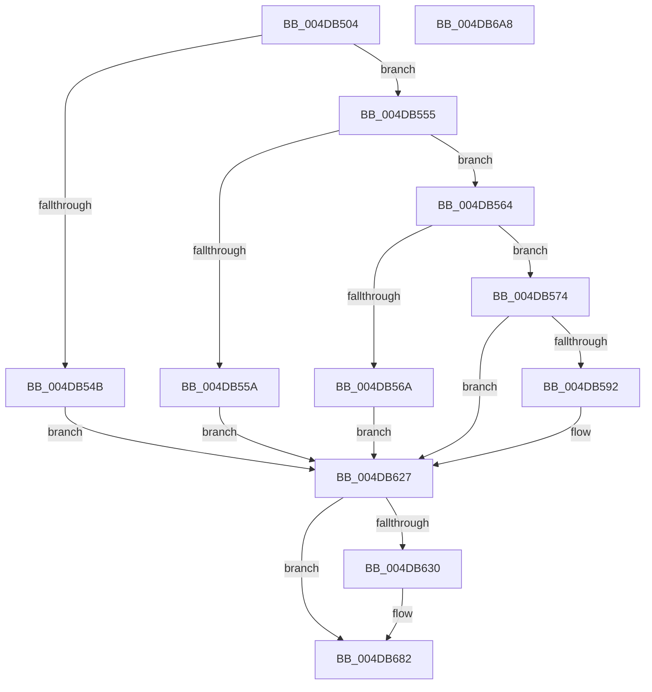

# PopPlRegisterPowerPlane

- RVA: `0x004DB504`–`0x004DB6A9` (길이 `421` bytes)
- VA: `0x00000001404DB504`
- 실행 섹션: `.text`
- PDB 이름 있음: `예`; PDB Function 태그: `아니요`
- unwind 정보 RVA: `0x000BEA50`
- 디코드: `101`개 명령, `421/421` bytes 표시
- 미해석 바이트: `0` (있으면 어셈블리에 `.byte`로 보존)

> 이 문서는 커널 이미지의 기계어와 PDB 기호를 분석해 생성했습니다. 4번과 5번은 함수 원형과 자료형을 바이너리 사용 방식에서 추정한 C 해석이며 원본 소스 복구 결과는 아닙니다.

## 1. Dependencies

- 직접 호출 지점: **7**; 고유 호출 대상: **5**
- 직접 호출자로 확인된 함수: **1**
- RIP 상대 이미지 참조: **9**

### Outgoing calls
- `0x004DB583` → [PopPlInitPowerPlane](../../page/77/PopPlInitPowerPlane_function_00772438.md) (function, `0x00772438`)
- `0x004DB5C9` → [PopPepIterateDeviceList](../5D/PopPepIterateDeviceList_function_005DCC84.md) (function, `0x005DCC84`)
- `0x004DB5F6` → [PopPepIterateDeviceList](../5D/PopPepIterateDeviceList_function_005DCC84.md) (function, `0x005DCC84`)
- `0x004DB5FE` → [PopPlTraceLogPowerPlane](../5D/PopPlTraceLogPowerPlane_function_005DDFB4.md) (function, `0x005DDFB4`)
- `0x004DB622` → [PopPepIterateDeviceList](../5D/PopPepIterateDeviceList_function_005DCC84.md) (function, `0x005DCC84`)
- `0x004DB67D` → [tlgWriteEx_EtwWriteEx](../4A/tlgWriteEx_EtwWriteEx_function_004AA348.md) (function, `0x004AA348`)
- `0x004DB68B` → [_security_check_cookie](../6A/_security_check_cookie_function_006AC640.md) (function, `0x006AC640`)

### Direct callers
- [PopPowerInformationInternal](../../page/A8/PopPowerInformationInternal_function_00A8B7C0.md) at `0x00A8C92B`

### Static image references
- `0x004DB51E` → RVA `0x00E0A740` (`.data`; read)
- `0x004DB533` → RVA `0x00F070C0` (`.data`; read)
- `0x004DB59E` → RVA `0x005DD8F0` (`PopPlActivateDeviceIterator`; read)
- `0x004DB5D7` → RVA `0x005DDB90` (`PopPlPublishInitialPowerDraw`; read)
- `0x004DB5E3` → RVA `0x005DDE20` (`PopPlRegisterDeviceIterator`; read)
- `0x004DB5EA` → RVA `0x005DDA00` (`PopPlCommitPowerPlaneRegistration`; read)
- `0x004DB60F` → RVA `0x005DDA40` (`PopPlIdleDeviceIterator`; read)
- `0x004DB627` → RVA `0x00E07748` (`.data`; read)
- `0x004DB63C` → RVA `0x0005098C` (`.rdata`; read)

## 2. Other-region calls and transfers

- 다른 실행 섹션으로 향하는 call: **1**
  - `0x004DB583` → [PopPlInitPowerPlane](../../page/77/PopPlInitPowerPlane_function_00772438.md) (`.text` → `PAGE`)
- 별도 외부 분기/꼬리 이동을 확인하지 못했습니다.

## 3. Assembly (complete function range)

```asm
004DB504  48 89 5C 24 18                  mov qword ptr [rsp + 0x18], rbx
004DB509  48 89 74 24 20                  mov qword ptr [rsp + 0x20], rsi
004DB50E  55                              push rbp
004DB50F  57                              push rdi
004DB510  41 57                           push r15
004DB512  48 8D 6C 24 B9                  lea rbp, [rsp - 0x47]
004DB517  48 81 EC B0 00 00 00            sub rsp, 0xb0
004DB51E  48 8B 05 1B F2 92 00            mov rax, qword ptr [rip + 0x92f21b]
004DB525  48 33 C4                        xor rax, rsp
004DB528  48 89 45 37                     mov qword ptr [rbp + 0x37], rax
004DB52C  48 83 65 DF 00                  and qword ptr [rbp - 0x21], 0
004DB531  33 C0                           xor eax, eax
004DB533  48 39 05 86 BB A2 00            cmp qword ptr [rip + 0xa2bb86], rax
004DB53A  48 8B F1                        mov rsi, rcx
004DB53D  48 89 45 EB                     mov qword ptr [rbp - 0x15], rax
004DB541  48 89 45 E7                     mov qword ptr [rbp - 0x19], rax
004DB545  44 8D 78 01                     lea r15d, [rax + 1]
004DB549  74 0A                           je 0x1404db555
004DB54B  BF 38 00 00 C0                  mov edi, 0xc0000038
004DB550  E9 D2 00 00 00                  jmp 0x1404db627
004DB555  39 41 04                        cmp dword ptr [rcx + 4], eax
004DB558  74 0A                           je 0x1404db564
004DB55A  BF 59 00 00 C0                  mov edi, 0xc0000059
004DB55F  E9 C3 00 00 00                  jmp 0x1404db627
004DB564  48 39 41 10                     cmp qword ptr [rcx + 0x10], rax
004DB568  75 0A                           jne 0x1404db574
004DB56A  BF 0D 00 00 C0                  mov edi, 0xc000000d
004DB56F  E9 B3 00 00 00                  jmp 0x1404db627
004DB574  4C 8D 04 0A                     lea r8, [rdx + rcx]
004DB578  48 83 C1 18                     add rcx, 0x18
004DB57C  48 8B D6                        mov rdx, rsi
004DB57F  4C 8D 4D DF                     lea r9, [rbp - 0x21]
004DB583  E8 B0 6E 29 00                  call 0x140772438
004DB588  8B F8                           mov edi, eax
004DB58A  85 C0                           test eax, eax
004DB58C  0F 88 95 00 00 00               js 0x1404db627
004DB592  48 8B 4E 08                     mov rcx, qword ptr [rsi + 8]
004DB596  48 8D 45 E7                     lea rax, [rbp - 0x19]
004DB59A  48 8B 5D DF                     mov rbx, qword ptr [rbp - 0x21]
004DB59E  48 8D 15 4B 23 10 00            lea rdx, [rip + 0x10234b]
004DB5A5  48 89 44 24 30                  mov qword ptr [rsp + 0x30], rax
004DB5AA  45 33 C0                        xor r8d, r8d
004DB5AD  C6 44 24 28 00                  mov byte ptr [rsp + 0x28], 0
004DB5B2  44 88 7C 24 20                  mov byte ptr [rsp + 0x20], r15b
004DB5B7  48 89 4B 20                     mov qword ptr [rbx + 0x20], rcx
004DB5BB  48 8B 4E 10                     mov rcx, qword ptr [rsi + 0x10]
004DB5BF  48 89 4B 28                     mov qword ptr [rbx + 0x28], rcx
004DB5C3  33 C9                           xor ecx, ecx
004DB5C5  48 89 5D EF                     mov qword ptr [rbp - 0x11], rbx
004DB5C9  E8 B6 16 10 00                  call 0x1405dcc84
004DB5CE  48 8D 45 E7                     lea rax, [rbp - 0x19]
004DB5D2  48 89 44 24 30                  mov qword ptr [rsp + 0x30], rax
004DB5D7  4C 8D 05 B2 25 10 00            lea r8, [rip + 0x1025b2]
004DB5DE  C6 44 24 28 00                  mov byte ptr [rsp + 0x28], 0
004DB5E3  48 8D 15 36 28 10 00            lea rdx, [rip + 0x102836]
004DB5EA  48 8D 0D 0F 24 10 00            lea rcx, [rip + 0x10240f]
004DB5F1  C6 44 24 20 00                  mov byte ptr [rsp + 0x20], 0
004DB5F6  E8 89 16 10 00                  call 0x1405dcc84
004DB5FB  48 8B CB                        mov rcx, rbx
004DB5FE  E8 B1 29 10 00                  call 0x1405ddfb4
004DB603  48 8D 45 E7                     lea rax, [rbp - 0x19]
004DB607  45 33 C0                        xor r8d, r8d
004DB60A  48 89 44 24 30                  mov qword ptr [rsp + 0x30], rax
004DB60F  48 8D 15 2A 24 10 00            lea rdx, [rip + 0x10242a]
004DB616  44 88 7C 24 28                  mov byte ptr [rsp + 0x28], r15b
004DB61B  33 C9                           xor ecx, ecx
004DB61D  C6 44 24 20 00                  mov byte ptr [rsp + 0x20], 0
004DB622  E8 5D 16 10 00                  call 0x1405dcc84
004DB627  83 3D 1A C1 92 00 05            cmp dword ptr [rip + 0x92c11a], 5
004DB62E  76 52                           jbe 0x1404db682
004DB630  83 65 23 00                     and dword ptr [rbp + 0x23], 0
004DB634  48 8D 45 D7                     lea rax, [rbp - 0x29]
004DB638  83 65 33 00                     and dword ptr [rbp + 0x33], 0
004DB63C  48 8D 15 49 53 B7 FF            lea rdx, [rip - 0x48acb7]
004DB643  48 89 45 17                     mov qword ptr [rbp + 0x17], rax
004DB647  B9 04 00 00 00                  mov ecx, 4
004DB64C  48 8D 45 DF                     lea rax, [rbp - 0x21]
004DB650  89 4D 2F                        mov dword ptr [rbp + 0x2f], ecx
004DB653  48 89 45 27                     mov qword ptr [rbp + 0x27], rax
004DB657  45 8B CF                        mov r9d, r15d
004DB65A  48 8D 45 F7                     lea rax, [rbp - 9]
004DB65E  66 44 89 7D D7                  mov word ptr [rbp - 0x29], r15w
004DB663  48 89 44 24 38                  mov qword ptr [rsp + 0x38], rax
004DB668  89 4C 24 30                     mov dword ptr [rsp + 0x30], ecx
004DB66C  48 8D 0D D5 C0 92 00            lea rcx, [rip + 0x92c0d5]
004DB673  C7 45 1F 02 00 00 00            mov dword ptr [rbp + 0x1f], 2
004DB67A  89 7D DF                        mov dword ptr [rbp - 0x21], edi
004DB67D  E8 C6 EC FC FF                  call 0x1404aa348
004DB682  8B C7                           mov eax, edi
004DB684  48 8B 4D 37                     mov rcx, qword ptr [rbp + 0x37]
004DB688  48 33 CC                        xor rcx, rsp
004DB68B  E8 B0 0F 1D 00                  call 0x1406ac640
004DB690  4C 8D 9C 24 B0 00 00 00         lea r11, [rsp + 0xb0]
004DB698  49 8B 5B 30                     mov rbx, qword ptr [r11 + 0x30]
004DB69C  49 8B 73 38                     mov rsi, qword ptr [r11 + 0x38]
004DB6A0  49 8B E3                        mov rsp, r11
004DB6A3  41 5F                           pop r15
004DB6A5  5F                              pop rdi
004DB6A6  5D                              pop rbp
004DB6A7  C3                              ret
004DB6A8  CC                              int3
```

## 4. C-style interpretation (structured pseudocode)

```c
__int64 __fastcall PopPlRegisterPowerPlane(__int64 a1, __int64 a2)
{
    __int64 result;
    __int64 v_rbx;
    __int64 v_rsp;
    unsigned __int64 v_stack_m18;
    unsigned __int64 v_stack_m28;
    unsigned int v_stack_m2C;
    unsigned int v_stack_m30;
    unsigned __int64 v_stack_m38;
    unsigned int v_stack_m3C;
    unsigned int v_stack_m40;
    unsigned __int64 v_stack_m48;
    unsigned __int64 v_stack_m5F;
    unsigned __int64 v_stack_m68;
    unsigned __int64 v_stack_m70;
    unsigned __int64 v_stack_m74;
    unsigned __int64 v_stack_m78;
    unsigned __int64 v_stack_m80;
    unsigned __int64 v_stack_m88;
    unsigned __int64 v_stack_m90;
    unsigned __int64 v_stack_m98;
    unsigned __int8 v_stack_mA0;
    unsigned __int8 v_stack_mA8;
    unsigned __int64 v_stack_p18;
    unsigned __int64 v_stack_p20;

    v_stack_p18 = v_rbx;
    v_stack_p20 = v_rsi;
    v_rsp = (v_rsp) - (176);
    result = (*(unsigned __int64 *)(v_rip + 9630235)) ^ (v_rsp);
    v_stack_m28 = result;
    result = 0;
    v_stack_m74 = 0;
    v_stack_m78 = 0;
    if ((*(unsigned __int64 *)(v_rip + 10664838)) == 0) goto loc_004DB555;
    goto loc_004DB627;
loc_004DB555:
    if ((*(unsigned int *)(a1 + 4)) == 0) goto loc_004DB564;
    goto loc_004DB627;
loc_004DB564:
    if ((*(unsigned __int64 *)(a1 + 16)) != 0) goto loc_004DB574;
    goto loc_004DB627;
loc_004DB574:
    a1 = (a1) + (24);
    result = PopPlInitPowerPlane(a1, a1, a2 + a1 * 1, v_stack_m80);
    if (!(sign_flag)) {
        a1 = *(unsigned __int64 *)(a1 + 8);
        result = v_stack_m78;
        v_rbx = v_stack_m80;
        a2 = v_rip + 1057611;
        v_stack_m98 = result;
        a3 = 0;
        v_stack_mA0 = 0;
        v_stack_mA8 = (unsigned __int8)(result + 1);
        *(unsigned __int64 *)(v_rbx + 32) = a1;
        a1 = *(unsigned __int64 *)(a1 + 16);
        *(unsigned __int64 *)(v_rbx + 40) = a1;
        a1 = 0;
        v_stack_m70 = v_rbx;
        result = PopPepIterateDeviceList(a1, a2, a3, v_stack_m80);
        result = v_stack_m78;
        v_stack_m98 = result;
        a3 = v_rip + 1058226;
        v_stack_mA0 = 0;
        a2 = v_rip + 1058870;
        a1 = v_rip + 1057807;
        v_stack_mA8 = 0;
        result = PopPepIterateDeviceList(a1, a2, a3, v_stack_m80);
        a1 = v_rbx;
        result = PopPlTraceLogPowerPlane(a1, a2, a3, v_stack_m80);
        result = v_stack_m78;
        a3 = 0;
        v_stack_m98 = result;
        a2 = v_rip + 1057834;
        v_stack_mA0 = (unsigned __int8)(result + 1);
        a1 = 0;
        v_stack_mA8 = 0;
        result = PopPepIterateDeviceList(a1, a2, a3, v_stack_m80);
    }
    if ((*(unsigned int *)(v_rip + 9617690)) >= = 5) {
        result = v_stack_m88;
        a2 = v_rip - 4762807;
        v_stack_m48 = result;
        a1 = 4;
        result = v_stack_m80;
        v_stack_m30 = (unsigned int)(a1);
        v_stack_m38 = result;
        a4 = (unsigned int)(result + 1);
        result = v_stack_m68;
        v_stack_m88 = (unsigned __int16)(result + 1);
        v_stack_m90 = result;
        v_stack_m98 = (unsigned int)(a1);
        a1 = v_rip + 9617621;
        v_stack_m40 = 2;
        v_stack_m80 = (unsigned int)((unsigned int)((unsigned int)(result)));
        result = tlgWriteEx_EtwWriteEx(a1, a2, a3, a4);
    }
    a1 = (v_stack_m28) ^ (v_rsp);
    result = _security_check_cookie(a1, a2, a3, a4);
    return result;
}
```

## 5. (Beta) C Style

```c
int64_t PopPlRegisterPowerPlane(void *Arg1, void *Arg2)
{
    uint8_t *arg1 = (uint8_t *)Arg1;
    uint8_t *arg2 = (uint8_t *)Arg2;

    int64_t result;
    int64_t local_rbx;
    int64_t local_rsp;
    uint64_t v_stack_m18;
    uint64_t v_stack_m28;
    uint32_t v_stack_m2C;
    uint32_t v_stack_m30;
    uint64_t v_stack_m38;
    uint32_t v_stack_m3C;
    uint32_t v_stack_m40;
    uint64_t v_stack_m48;
    uint64_t v_stack_m5F;
    uint64_t v_stack_m68;
    uint64_t v_stack_m70;
    uint64_t v_stack_m74;
    uint64_t v_stack_m78;
    uint64_t v_stack_m80;
    uint64_t v_stack_m88;
    uint64_t v_stack_m90;
    uint64_t v_stack_m98;
    uint8_t v_stack_mA0;
    uint8_t v_stack_mA8;
    uint64_t v_stack_p18;
    uint64_t v_stack_p20;

    v_stack_p18 = local_rbx;
    v_stack_p20 = local_rsi;
    local_rsp = (local_rsp) - (176);
    result = (*(uint64_t *)(v_rip + 0x92F21B)) ^ (local_rsp);
    v_stack_m28 = result;
    result = 0;
    v_stack_m74 = 0;
    v_stack_m78 = 0;
    if ((*(uint64_t *)(v_rip + 0xA2BB86)) == 0) goto loc_004DB555;
    goto loc_004DB627;
loc_004DB555:
    if ((*(uint32_t *)(arg1 + 0x4)) == 0) goto loc_004DB564;
    goto loc_004DB627;
loc_004DB564:
    if ((*(uint64_t *)(arg1 + 0x10)) != 0) goto loc_004DB574;
    goto loc_004DB627;
loc_004DB574:
    Arg1 = (Arg1) + (24);
    result = PopPlInitPowerPlane(Arg1, Arg1, Arg2 + Arg1 * 1, v_stack_m80);
    if (!(sign_flag)) {
        Arg1 = *(uint64_t *)(arg1 + 0x8);
        result = v_stack_m78;
        local_rbx = v_stack_m80;
        Arg2 = v_rip + 1057611;
        v_stack_m98 = result;
        a3 = 0;
        v_stack_mA0 = 0;
        v_stack_mA8 = (uint8_t)(result + 1);
        *(void **)(local_rbx + 0x20) = Arg1;
        Arg1 = *(uint64_t *)(arg1 + 0x10);
        *(void **)(local_rbx + 0x28) = Arg1;
        Arg1 = 0;
        v_stack_m70 = local_rbx;
        result = PopPepIterateDeviceList(Arg1, Arg2, a3, v_stack_m80);
        result = v_stack_m78;
        v_stack_m98 = result;
        a3 = v_rip + 1058226;
        v_stack_mA0 = 0;
        Arg2 = v_rip + 1058870;
        Arg1 = v_rip + 1057807;
        v_stack_mA8 = 0;
        result = PopPepIterateDeviceList(Arg1, Arg2, a3, v_stack_m80);
        Arg1 = local_rbx;
        result = PopPlTraceLogPowerPlane(Arg1, Arg2, a3, v_stack_m80);
        result = v_stack_m78;
        a3 = 0;
        v_stack_m98 = result;
        Arg2 = v_rip + 1057834;
        v_stack_mA0 = (uint8_t)(result + 1);
        Arg1 = 0;
        v_stack_mA8 = 0;
        result = PopPepIterateDeviceList(Arg1, Arg2, a3, v_stack_m80);
    }
    if ((*(uint32_t *)(v_rip + 0x92C11A)) >= = 5) {
        result = v_stack_m88;
        Arg2 = v_rip - 4762807;
        v_stack_m48 = result;
        Arg1 = 4;
        result = v_stack_m80;
        v_stack_m30 = (uint32_t)(Arg1);
        v_stack_m38 = result;
        a4 = (uint32_t)(result + 1);
        result = v_stack_m68;
        v_stack_m88 = (uint16_t)(result + 1);
        v_stack_m90 = result;
        v_stack_m98 = (uint32_t)(Arg1);
        Arg1 = v_rip + 9617621;
        v_stack_m40 = 2;
        v_stack_m80 = (uint32_t)((uint32_t)((uint32_t)(result)));
        result = tlgWriteEx_EtwWriteEx(Arg1, Arg2, a3, a4);
    }
    Arg1 = (v_stack_m28) ^ (local_rsp);
    result = _security_check_cookie(Arg1, Arg2, a3, a4);
    return result;
}
```

### 관측된 메모리 오프셋

구조체 형식이 확인되지 않은 접근은 인자 기준의 오프셋으로만 기록했습니다.

| 기준 인자 | 오프셋 표현 | 폭 (bit) | 접근 |
|---|---:|---:|---|
| `Arg1` | `+ 0x4` | `32` | `R` |
| `Arg1` | `+ 0x8` | `64` | `R` |
| `Arg1` | `+ 0x10` | `64` | `R` |
| `Arg2` | `+ 0x0 + rcx*1` | `64` | `R` |

## 6. Execution-region graph

[열기: 2D/3D 그래프와 함수 탐색 컨트롤 패널](../../../control-panel.html?section=text&rva=0x004DB504&view=graph)

- 2D 그래프는 위에서 아래로 흐르고, 3D 그래프는 빈 공간을 드래그해 회전합니다. Shift+드래그는 이동, 휠은 확대·축소, 함수 노드 선택은 대상 보고서 이동입니다.

### Static fallback


