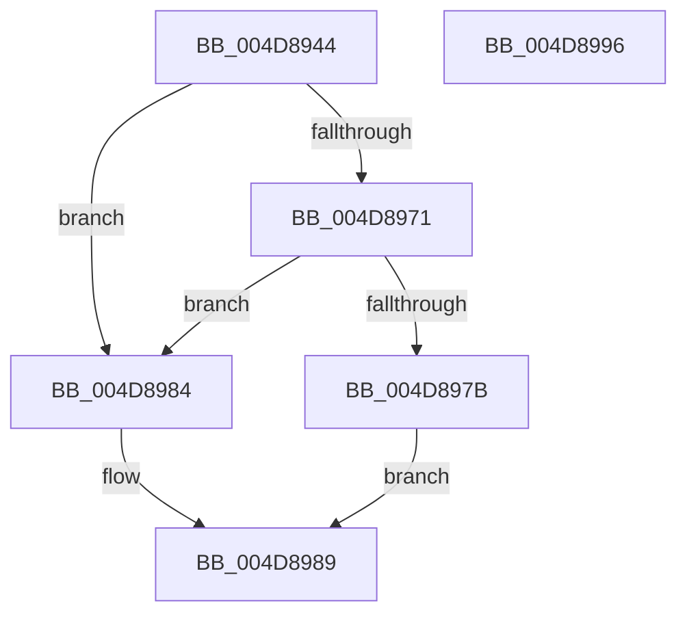

# PopPluginRegisterCrashdumpDevice

- RVA: `0x004D8944`–`0x004D8997` (길이 `83` bytes)
- VA: `0x00000001404D8944`
- 실행 섹션: `.text`
- PDB 이름 있음: `예`; PDB Function 태그: `아니요`
- unwind 정보 RVA: `0x00084AC0`
- 디코드: `26`개 명령, `83/83` bytes 표시
- 미해석 바이트: `0` (있으면 어셈블리에 `.byte`로 보존)

> 이 문서는 커널 이미지의 기계어와 PDB 기호를 분석해 생성했습니다. 4번과 5번은 함수 원형과 자료형을 바이너리 사용 방식에서 추정한 C 해석이며 원본 소스 복구 결과는 아닙니다.

## 1. Dependencies

- 직접 호출 지점: **1**; 고유 호출 대상: **1**
- 직접 호출자로 확인된 함수: **1**
- RIP 상대 이미지 참조: **0**

### Outgoing calls
- `0x004D8968` → [guard_dispatch_icall](../6B/guard_dispatch_icall_function_006BAAD0.md) (function, `0x006BAAD0`)

### Direct callers
- [PoFxRegisterCrashdumpDevice](../../page/AC/PoFxRegisterCrashdumpDevice_function_00AC2870.md) at `0x00AC289A`

### Static image references
- 디코드된 RIP-relative 메모리 참조가 없습니다.

## 2. Other-region calls and transfers

- 다른 실행 섹션으로 향하는 call: **0**
- 별도 외부 분기/꼬리 이동을 확인하지 못했습니다.

## 3. Assembly (complete function range)

```asm
004D8944  4C 8B DC                        mov r11, rsp
004D8947  49 89 5B 08                     mov qword ptr [r11 + 8], rbx
004D894B  57                              push rdi
004D894C  48 83 EC 30                     sub rsp, 0x30
004D8950  48 8B 41 60                     mov rax, qword ptr [rcx + 0x60]
004D8954  33 DB                           xor ebx, ebx
004D8956  49 89 53 F0                     mov qword ptr [r11 - 0x10], rdx
004D895A  49 8B F8                        mov rdi, r8
004D895D  49 8D 53 E8                     lea rdx, [r11 - 0x18]
004D8961  49 89 5B E8                     mov qword ptr [r11 - 0x18], rbx
004D8965  8D 4B 19                        lea ecx, [rbx + 0x19]
004D8968  E8 63 21 1E 00                  call 0x1406baad0
004D896D  84 C0                           test al, al
004D896F  74 13                           je 0x1404d8984
004D8971  48 8B 44 24 20                  mov rax, qword ptr [rsp + 0x20]
004D8976  48 85 C0                        test rax, rax
004D8979  74 09                           je 0x1404d8984
004D897B  48 89 87 78 02 00 00            mov qword ptr [rdi + 0x278], rax
004D8982  EB 05                           jmp 0x1404d8989
004D8984  BB BB 00 00 C0                  mov ebx, 0xc00000bb
004D8989  8B C3                           mov eax, ebx
004D898B  48 8B 5C 24 40                  mov rbx, qword ptr [rsp + 0x40]
004D8990  48 83 C4 30                     add rsp, 0x30
004D8994  5F                              pop rdi
004D8995  C3                              ret
004D8996  CC                              int3
```

## 4. C-style interpretation (structured pseudocode)

```c
__int64 __fastcall PopPluginRegisterCrashdumpDevice(__int64 a1, __int64 a2, __int64 a3)
{
    __int64 result;
    __int64 v_rbx;
    __int64 v_rsp;
    unsigned __int64 v_stack_m18;
    unsigned __int64 v_stack_p8;

    *(unsigned __int64 *)(v_rsp + 8) = v_rbx;
    v_rsp = (v_rsp) - (48);
    v_rbx = 0;
    *(unsigned __int64 *)(v_rsp - 16) = a2;
    *(unsigned __int64 *)(v_rsp - 24) = 0;
    result = guard_dispatch_icall(v_rbx + 25, v_rsp - 24, a3, a4);
    if ((unsigned __int8)(result) == 0) goto loc_004D8984;
    if (v_stack_m18 == 0) goto loc_004D8984;
    *(unsigned __int64 *)(a3 + 632) = v_stack_m18;
    goto loc_004D8989;
loc_004D8984:
loc_004D8989:
    v_rsp = (v_rsp) + (48);
    return (unsigned int)((unsigned int)((unsigned int)(0xC00000BBULL)));
}
```

## 5. (Beta) C Style

```c
int64_t PopPluginRegisterCrashdumpDevice(void *Arg1, int64_t Arg2, void *Arg3)
{
    uint8_t *arg1 = (uint8_t *)Arg1;
    uint8_t *arg3 = (uint8_t *)Arg3;

    int64_t result;
    int64_t local_rbx;
    int64_t local_rsp;
    uint64_t v_stack_m18;
    uint64_t v_stack_p8;

    *(uint64_t *)(local_rsp + 0x8) = local_rbx;
    local_rsp = (local_rsp) - (48);
    local_rbx = 0;
    *(uint64_t *)(local_rsp - 0x10) = Arg2;
    *(uint64_t *)(local_rsp - 0x18) = 0;
    result = guard_dispatch_icall(local_rbx + 25, local_rsp - 24, Arg3, a4);
    if ((uint8_t)(result) == 0) goto loc_004D8984;
    if (v_stack_m18 == 0) goto loc_004D8984;
    *(uint64_t *)(arg3 + 0x278) = v_stack_m18;
    goto loc_004D8989;
loc_004D8984:
loc_004D8989:
    local_rsp = (local_rsp) + (48);
    return (uint32_t)((uint32_t)((uint32_t)(0xC00000BBULL)));
}
```

### 관측된 메모리 오프셋

구조체 형식이 확인되지 않은 접근은 인자 기준의 오프셋으로만 기록했습니다.

| 기준 인자 | 오프셋 표현 | 폭 (bit) | 접근 |
|---|---:|---:|---|
| `Arg1` | `+ 0x60` | `64` | `R` |
| `Arg3` | `+ 0x278` | `64` | `W` |

## 6. Execution-region graph

[열기: 2D/3D 그래프와 함수 탐색 컨트롤 패널](../../../control-panel.html?section=text&rva=0x004D8944&view=graph)

- 2D 그래프는 위에서 아래로 흐르고, 3D 그래프는 빈 공간을 드래그해 회전합니다. Shift+드래그는 이동, 휠은 확대·축소, 함수 노드 선택은 대상 보고서 이동입니다.

### Static fallback


