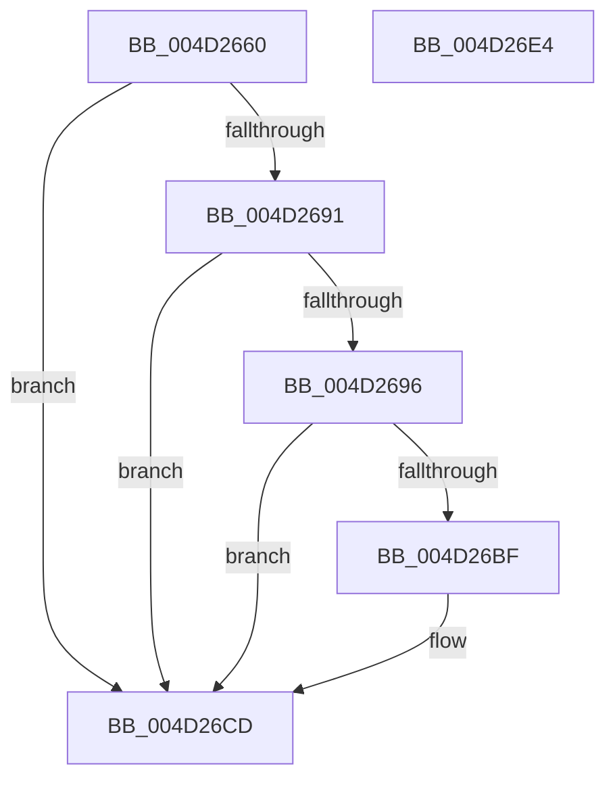

# PopPluginRequestDeviceIdleConstraints

- RVA: `0x004D2660`–`0x004D26E5` (길이 `133` bytes)
- VA: `0x00000001404D2660`
- 실행 섹션: `.text`
- PDB 이름 있음: `예`; PDB Function 태그: `아니요`
- unwind 정보 RVA: `0x0007D3C0`
- 디코드: `39`개 명령, `133/133` bytes 표시
- 미해석 바이트: `0` (있으면 어셈블리에 `.byte`로 보존)

> 이 문서는 커널 이미지의 기계어와 PDB 기호를 분석해 생성했습니다. 4번과 5번은 함수 원형과 자료형을 바이너리 사용 방식에서 추정한 C 해석이며 원본 소스 복구 결과는 아닙니다.

## 1. Dependencies

- 직접 호출 지점: **2**; 고유 호출 대상: **2**
- 직접 호출자로 확인된 함수: **1**
- RIP 상대 이미지 참조: **1**

### Outgoing calls
- `0x004D26B4` → [guard_dispatch_icall](../6B/guard_dispatch_icall_function_006BAAD0.md) (function, `0x006BAAD0`)
- `0x004D26C8` → [PopDiagTraceFxDeviceIdleConstraints](../5D/PopDiagTraceFxDeviceIdleConstraints_function_005D6954.md) (function, `0x005D6954`)

### Direct callers
- [PopPepInitializeVetoMasks](../4C/PopPepInitializeVetoMasks_function_004C9350.md) at `0x004C9541`

### Static image references
- `0x004D2682` → RVA `0x00E676B8` (`.data`; read)

## 2. Other-region calls and transfers

- 다른 실행 섹션으로 향하는 call: **0**
- 별도 외부 분기/꼬리 이동을 확인하지 못했습니다.

## 3. Assembly (complete function range)

```asm
004D2660  4C 8B DC                        mov r11, rsp
004D2663  49 89 5B 08                     mov qword ptr [r11 + 8], rbx
004D2667  49 89 6B 10                     mov qword ptr [r11 + 0x10], rbp
004D266B  49 89 73 18                     mov qword ptr [r11 + 0x18], rsi
004D266F  57                              push rdi
004D2670  48 83 EC 40                     sub rsp, 0x40
004D2674  83 64 24 34 00                  and dword ptr [rsp + 0x34], 0
004D2679  32 DB                           xor bl, bl
004D267B  4C 8B 49 40                     mov r9, qword ptr [rcx + 0x40]
004D267F  41 8B F0                        mov esi, r8d
004D2682  4C 3B 0D 2F 50 99 00            cmp r9, qword ptr [rip + 0x99502f]
004D2689  48 8B EA                        mov rbp, rdx
004D268C  48 8B F9                        mov rdi, rcx
004D268F  75 3C                           jne 0x1404d26cd
004D2691  4D 85 C9                        test r9, r9
004D2694  74 37                           je 0x1404d26cd
004D2696  48 8B 41 48                     mov rax, qword ptr [rcx + 0x48]
004D269A  B9 1A 00 00 00                  mov ecx, 0x1a
004D269F  49 89 53 E0                     mov qword ptr [r11 - 0x20], rdx
004D26A3  49 8D 53 D8                     lea rdx, [r11 - 0x28]
004D26A7  49 89 43 D8                     mov qword ptr [r11 - 0x28], rax
004D26AB  44 89 44 24 30                  mov dword ptr [rsp + 0x30], r8d
004D26B0  49 8B 41 60                     mov rax, qword ptr [r9 + 0x60]
004D26B4  E8 17 84 1E 00                  call 0x1406baad0
004D26B9  8A D8                           mov bl, al
004D26BB  84 C0                           test al, al
004D26BD  74 0E                           je 0x1404d26cd
004D26BF  44 8B C6                        mov r8d, esi
004D26C2  48 8B D5                        mov rdx, rbp
004D26C5  48 8B CF                        mov rcx, rdi
004D26C8  E8 87 42 10 00                  call 0x1405d6954
004D26CD  48 8B 6C 24 58                  mov rbp, qword ptr [rsp + 0x58]
004D26D2  8A C3                           mov al, bl
004D26D4  48 8B 5C 24 50                  mov rbx, qword ptr [rsp + 0x50]
004D26D9  48 8B 74 24 60                  mov rsi, qword ptr [rsp + 0x60]
004D26DE  48 83 C4 40                     add rsp, 0x40
004D26E2  5F                              pop rdi
004D26E3  C3                              ret
004D26E4  CC                              int3
```

## 4. C-style interpretation (structured pseudocode)

```c
__int64 __fastcall PopPluginRequestDeviceIdleConstraints(__int64 a1, __int64 a2, int a3)
{
    __int64 result;
    __int64 v_rbx;
    __int64 v_rsp;
    unsigned int v_stack_m14;
    unsigned int v_stack_m18;
    unsigned __int64 v_stack_p10;
    unsigned __int64 v_stack_p18;
    unsigned __int64 v_stack_p8;

    *(unsigned __int64 *)(v_rsp + 8) = v_rbx;
    *(unsigned __int64 *)(v_rsp + 16) = v_rbp;
    *(unsigned __int64 *)(v_rsp + 24) = v_rsi;
    v_rsp = (v_rsp) - (64);
    v_rbx = 0;
    if ((*(unsigned __int64 *)(a1 + 64)) != (*(unsigned __int64 *)(v_rip + 10047535))) goto loc_004D26CD;
    if (*(unsigned __int64 *)(a1 + 64) == 0) goto loc_004D26CD;
    *(unsigned __int64 *)(v_rsp - 32) = a2;
    *(unsigned __int64 *)(v_rsp - 40) = *(unsigned __int64 *)(a1 + 72);
    v_stack_m18 = a3;
    result = guard_dispatch_icall(26, v_rsp - 40, a3, *(unsigned __int64 *)(a1 + 64));
    if ((unsigned __int8)(result) != 0) {
        a3 = (unsigned int)((unsigned int)(a3));
        a2 = a2;
        a1 = a1;
        result = PopDiagTraceFxDeviceIdleConstraints(a1, a2, a3, *(unsigned __int64 *)(a1 + 64));
    }
    v_rsp = (v_rsp) + (64);
    return (unsigned __int8)((unsigned __int8)(result));
}
```

## 5. (Beta) C Style

```c
int64_t PopPluginRequestDeviceIdleConstraints(void *Arg1, int64_t Arg2, int32_t Arg3)
{
    uint8_t *arg1 = (uint8_t *)Arg1;

    int64_t result;
    int64_t local_rbx;
    int64_t local_rsp;
    uint32_t v_stack_m14;
    uint32_t v_stack_m18;
    uint64_t v_stack_p10;
    uint64_t v_stack_p18;
    uint64_t v_stack_p8;

    *(uint64_t *)(local_rsp + 0x8) = local_rbx;
    *(uint64_t *)(local_rsp + 0x10) = local_rbp;
    *(uint64_t *)(local_rsp + 0x18) = local_rsi;
    local_rsp = (local_rsp) - (64);
    local_rbx = 0;
    if ((*(uint64_t *)(arg1 + 0x40)) != (*(uint64_t *)(v_rip + 0x99502F))) goto loc_004D26CD;
    if (*(uint64_t *)(arg1 + 0x40) == 0) goto loc_004D26CD;
    *(uint64_t *)(local_rsp - 0x20) = Arg2;
    *(uint64_t *)(local_rsp - 0x28) = *(uint64_t *)(arg1 + 0x48);
    v_stack_m18 = Arg3;
    result = guard_dispatch_icall(26, local_rsp - 40, Arg3, *(uint64_t *)(arg1 + 0x40));
    if ((uint8_t)(result) != 0) {
        Arg3 = (uint32_t)((uint32_t)(Arg3));
        Arg2 = Arg2;
        Arg1 = Arg1;
        result = PopDiagTraceFxDeviceIdleConstraints(Arg1, Arg2, Arg3, *(uint64_t *)(arg1 + 0x40));
    }
    local_rsp = (local_rsp) + (64);
    return (uint8_t)((uint8_t)(result));
}
```

### 관측된 메모리 오프셋

구조체 형식이 확인되지 않은 접근은 인자 기준의 오프셋으로만 기록했습니다.

| 기준 인자 | 오프셋 표현 | 폭 (bit) | 접근 |
|---|---:|---:|---|
| `Arg1` | `+ 0x40` | `64` | `R` |
| `Arg1` | `+ 0x48` | `64` | `R` |

## 6. Execution-region graph

[열기: 2D/3D 그래프와 함수 탐색 컨트롤 패널](../../../control-panel.html?section=text&rva=0x004D2660&view=graph)

- 2D 그래프는 위에서 아래로 흐르고, 3D 그래프는 빈 공간을 드래그해 회전합니다. Shift+드래그는 이동, 휠은 확대·축소, 함수 노드 선택은 대상 보고서 이동입니다.

### Static fallback


