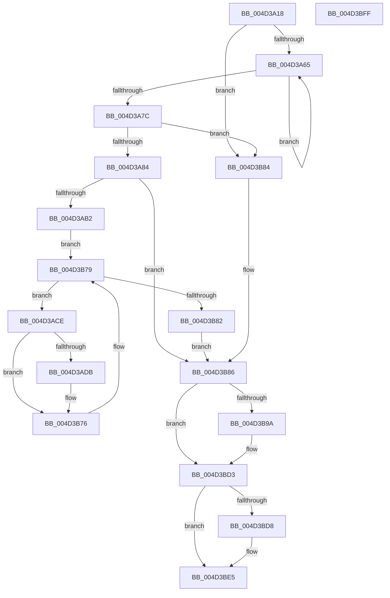

# PopRecordPowerWatchdogBlackboxInformation

- RVA: `0x004D3A18`–`0x004D3C00` (길이 `488` bytes)
- VA: `0x00000001404D3A18`
- 실행 섹션: `.text`
- PDB 이름 있음: `예`; PDB Function 태그: `아니요`
- unwind 정보 RVA: `0x000BDF80`
- 디코드: `116`개 명령, `488/488` bytes 표시
- 미해석 바이트: `0` (있으면 어셈블리에 `.byte`로 보존)

> 이 문서는 커널 이미지의 기계어와 PDB 기호를 분석해 생성했습니다. 4번과 5번은 함수 원형과 자료형을 바이너리 사용 방식에서 추정한 C 해석이며 원본 소스 복구 결과는 아닙니다.

## 1. Dependencies

- 직접 호출 지점: **6**; 고유 호출 대상: **6**
- 직접 호출자로 확인된 함수: **1**
- RIP 상대 이미지 참조: **2**

### Outgoing calls
- `0x004D3A42` → [KeAcquireSpinLockRaiseToDpc](../20/KeAcquireSpinLockRaiseToDpc_function_00208470.md) (function, `0x00208470`)
- `0x004D3AA1` → [ExAllocatePool2](../../poolcode/B8/ExAllocatePool2_function_00B820F0.md) (function, `0x00B820F0`)
- `0x004D3AF1` → [RtlGetInterruptTimePrecise](../20/RtlGetInterruptTimePrecise_function_0020A4C0.md) (function, `0x0020A4C0`)
- `0x004D3B90` → [KeReleaseSpinLock](../39/KeReleaseSpinLock_function_00392BA0.md) (function, `0x00392BA0`)
- `0x004D3BCE` → [NtPowerInformation](../../page/95/NtPowerInformation_function_00955D80.md) (function, `0x00955D80`)
- `0x004D3BE0` → [ExFreePoolWithTag](../../poolcode/B8/ExFreePoolWithTag_function_00B82870.md) (function, `0x00B82870`)

### Direct callers
- [PopRecordPoBlackboxInformation](../../page/77/PopRecordPoBlackboxInformation_function_007731D8.md) at `0x007731E6`

### Static image references
- `0x004D3A33` → RVA `0x00F083F8` (`.data`; read)
- `0x004D3A47` → RVA `0x00F08400` (`.data`; read)

## 2. Other-region calls and transfers

- 다른 실행 섹션으로 향하는 call: **3**
  - `0x004D3AA1` → [ExAllocatePool2](../../poolcode/B8/ExAllocatePool2_function_00B820F0.md) (`.text` → `POOLCODE`)
  - `0x004D3BCE` → [NtPowerInformation](../../page/95/NtPowerInformation_function_00955D80.md) (`.text` → `PAGE`)
  - `0x004D3BE0` → [ExFreePoolWithTag](../../poolcode/B8/ExFreePoolWithTag_function_00B82870.md) (`.text` → `POOLCODE`)
- 별도 외부 분기/꼬리 이동을 확인하지 못했습니다.

## 3. Assembly (complete function range)

```asm
004D3A18  48 8B C4                        mov rax, rsp
004D3A1B  48 89 58 10                     mov qword ptr [rax + 0x10], rbx
004D3A1F  48 89 68 18                     mov qword ptr [rax + 0x18], rbp
004D3A23  48 89 70 20                     mov qword ptr [rax + 0x20], rsi
004D3A27  57                              push rdi
004D3A28  41 54                           push r12
004D3A2A  41 56                           push r14
004D3A2C  48 83 EC 50                     sub rsp, 0x50
004D3A30  0F 57 C0                        xorps xmm0, xmm0
004D3A33  48 8D 0D BE 49 A3 00            lea rcx, [rip + 0xa349be]
004D3A3A  0F 11 40 C8                     movups xmmword ptr [rax - 0x38], xmm0
004D3A3E  0F 11 40 D8                     movups xmmword ptr [rax - 0x28], xmm0
004D3A42  E8 29 4A D3 FF                  call 0x140208470
004D3A47  4C 8B 05 B2 49 A3 00            mov r8, qword ptr [rip + 0xa349b2]
004D3A4E  4C 8D 25 AB 49 A3 00            lea r12, [rip + 0xa349ab]
004D3A55  33 F6                           xor esi, esi
004D3A57  33 DB                           xor ebx, ebx
004D3A59  40 8A E8                        mov bpl, al
004D3A5C  4D 3B C4                        cmp r8, r12
004D3A5F  0F 84 1F 01 00 00               je 0x1404d3b84
004D3A65  41 38 98 D0 00 00 00            cmp byte ptr [r8 + 0xd0], bl
004D3A6C  8D 56 01                        lea edx, [rsi + 1]
004D3A6F  4D 8B 00                        mov r8, qword ptr [r8]
004D3A72  0F 44 D6                        cmove edx, esi
004D3A75  8B F2                           mov esi, edx
004D3A77  4D 3B C4                        cmp r8, r12
004D3A7A  75 E9                           jne 0x1404d3a65
004D3A7C  85 D2                           test edx, edx
004D3A7E  0F 84 00 01 00 00               je 0x1404d3b84
004D3A84  8D 42 FF                        lea eax, [rdx - 1]
004D3A87  41 B8 50 4F 42 42               mov r8d, 0x42424f50
004D3A8D  48 8D 3C 80                     lea rdi, [rax + rax*4]
004D3A91  B9 40 00 00 00                  mov ecx, 0x40
004D3A96  48 C1 E7 04                     shl rdi, 4
004D3A9A  48 83 C7 60                     add rdi, 0x60
004D3A9E  48 8B D7                        mov rdx, rdi
004D3AA1  E8 4A E6 6A 00                  call 0x140b820f0
004D3AA6  48 8B D8                        mov rbx, rax
004D3AA9  48 85 C0                        test rax, rax
004D3AAC  0F 84 D4 00 00 00               je 0x1404d3b86
004D3AB2  C7 00 01 00 00 00               mov dword ptr [rax], 1
004D3AB8  4C 8D 70 10                     lea r14, [rax + 0x10]
004D3ABC  89 78 04                        mov dword ptr [rax + 4], edi
004D3ABF  89 70 08                        mov dword ptr [rax + 8], esi
004D3AC2  48 8B 35 37 49 A3 00            mov rsi, qword ptr [rip + 0xa34937]
004D3AC9  E9 AB 00 00 00                  jmp 0x1404d3b79
004D3ACE  80 BE D0 00 00 00 00            cmp byte ptr [rsi + 0xd0], 0
004D3AD5  0F 84 9B 00 00 00               je 0x1404d3b76
004D3ADB  8B 46 10                        mov eax, dword ptr [rsi + 0x10]
004D3ADE  48 8D 4C 24 70                  lea rcx, [rsp + 0x70]
004D3AE3  41 89 06                        mov dword ptr [r14], eax
004D3AE6  48 8B 86 20 01 00 00            mov rax, qword ptr [rsi + 0x120]
004D3AED  49 89 46 48                     mov qword ptr [r14 + 0x48], rax
004D3AF1  E8 CA 69 D3 FF                  call 0x14020a4c0
004D3AF6  48 8B C8                        mov rcx, rax
004D3AF9  48 B8 4B 59 86 38 D6 C5 6D 34   movabs rax, 0x346dc5d63886594b
004D3B03  48 2B 8E 28 01 00 00            sub rcx, qword ptr [rsi + 0x128]
004D3B0A  48 F7 E1                        mul rcx
004D3B0D  48 8D 8E D8 00 00 00            lea rcx, [rsi + 0xd8]
004D3B14  48 C1 EA 0B                     shr rdx, 0xb
004D3B18  41 89 56 04                     mov dword ptr [r14 + 4], edx
004D3B1C  8B 01                           mov eax, dword ptr [rcx]
004D3B1E  41 89 46 08                     mov dword ptr [r14 + 8], eax
004D3B22  8B 86 E0 00 00 00               mov eax, dword ptr [rsi + 0xe0]
004D3B28  41 89 46 0C                     mov dword ptr [r14 + 0xc], eax
004D3B2C  48 8B 86 E8 00 00 00            mov rax, qword ptr [rsi + 0xe8]
004D3B33  49 89 46 10                     mov qword ptr [r14 + 0x10], rax
004D3B37  48 8B 86 F0 00 00 00            mov rax, qword ptr [rsi + 0xf0]
004D3B3E  49 89 46 18                     mov qword ptr [r14 + 0x18], rax
004D3B42  48 8B 86 F8 00 00 00            mov rax, qword ptr [rsi + 0xf8]
004D3B49  49 89 46 20                     mov qword ptr [r14 + 0x20], rax
004D3B4D  48 8B 86 00 01 00 00            mov rax, qword ptr [rsi + 0x100]
004D3B54  49 89 46 28                     mov qword ptr [r14 + 0x28], rax
004D3B58  49 89 4E 40                     mov qword ptr [r14 + 0x40], rcx
004D3B5C  48 8B 86 10 01 00 00            mov rax, qword ptr [rsi + 0x110]
004D3B63  49 89 46 30                     mov qword ptr [r14 + 0x30], rax
004D3B67  48 8B 86 18 01 00 00            mov rax, qword ptr [rsi + 0x118]
004D3B6E  49 89 46 38                     mov qword ptr [r14 + 0x38], rax
004D3B72  49 83 C6 50                     add r14, 0x50
004D3B76  48 8B 36                        mov rsi, qword ptr [rsi]
004D3B79  49 3B F4                        cmp rsi, r12
004D3B7C  0F 85 4C FF FF FF               jne 0x1404d3ace
004D3B82  EB 02                           jmp 0x1404d3b86
004D3B84  33 FF                           xor edi, edi
004D3B86  40 8A D5                        mov dl, bpl
004D3B89  48 8D 0D 68 48 A3 00            lea rcx, [rip + 0xa34868]
004D3B90  E8 0B F0 EB FF                  call 0x140392ba0
004D3B95  48 85 FF                        test rdi, rdi
004D3B98  74 39                           je 0x1404d3bd3
004D3B9A  48 83 64 24 40 00               and qword ptr [rsp + 0x40], 0
004D3BA0  48 8D 54 24 30                  lea rdx, [rsp + 0x30]
004D3BA5  83 64 24 4C 00                  and dword ptr [rsp + 0x4c], 0
004D3BAA  45 33 C9                        xor r9d, r9d
004D3BAD  83 64 24 20 00                  and dword ptr [rsp + 0x20], 0
004D3BB2  8B C7                           mov eax, edi
004D3BB4  C7 44 24 48 08 00 00 00         mov dword ptr [rsp + 0x48], 8
004D3BBC  45 8D 41 20                     lea r8d, [r9 + 0x20]
004D3BC0  48 89 5C 24 30                  mov qword ptr [rsp + 0x30], rbx
004D3BC5  41 8D 49 5E                     lea ecx, [r9 + 0x5e]
004D3BC9  48 89 44 24 38                  mov qword ptr [rsp + 0x38], rax
004D3BCE  E8 AD 21 48 00                  call 0x140955d80
004D3BD3  48 85 DB                        test rbx, rbx
004D3BD6  74 0D                           je 0x1404d3be5
004D3BD8  BA 50 4F 42 42                  mov edx, 0x42424f50
004D3BDD  48 8B CB                        mov rcx, rbx
004D3BE0  E8 8B EC 6A 00                  call 0x140b82870
004D3BE5  4C 8D 5C 24 50                  lea r11, [rsp + 0x50]
004D3BEA  49 8B 5B 28                     mov rbx, qword ptr [r11 + 0x28]
004D3BEE  49 8B 6B 30                     mov rbp, qword ptr [r11 + 0x30]
004D3BF2  49 8B 73 38                     mov rsi, qword ptr [r11 + 0x38]
004D3BF6  49 8B E3                        mov rsp, r11
004D3BF9  41 5E                           pop r14
004D3BFB  41 5C                           pop r12
004D3BFD  5F                              pop rdi
004D3BFE  C3                              ret
004D3BFF  CC                              int3
```

## 4. C-style interpretation (structured pseudocode)

```c
__int64 __fastcall PopRecordPowerWatchdogBlackboxInformation(__int64 a1, __int64 a2, __int64 a3, int a4)
{
    __int64 result;
    __int64 v_r14;
    __int64 v_rbx;
    __int64 v_rdi;
    __int64 v_rsi;
    __int64 v_rsp;
    unsigned __int64 v_stack_m18;
    unsigned int v_stack_m1C;
    unsigned int v_stack_m20;
    unsigned __int64 v_stack_m28;
    unsigned __int64 v_stack_m30;
    unsigned __int64 v_stack_m38;
    unsigned int v_stack_m48;
    unsigned __int64 v_stack_p8;

    *(unsigned __int64 *)(v_rsp + 16) = v_rbx;
    *(unsigned __int64 *)(v_rsp + 24) = v_rbp;
    *(unsigned __int64 *)(v_rsp + 32) = v_rsi;
    v_rsp = (v_rsp) - (80);
    *(unsigned __int64 *)(v_rsp - 56) = v_xmm0;
    *(unsigned __int64 *)(v_rsp - 40) = v_xmm0;
    result = KeAcquireSpinLockRaiseToDpc(v_rip + 10701246, a2, a3, a4);
    v_rsi = 0;
    v_rbx = 0;
    if ((*(unsigned __int64 *)(v_rip + 10701234)) == (v_rip + 10701227)) goto loc_004D3B84;
loc_004D3A65:
    a2 = v_rsi + 1;
    if ((*(unsigned __int8 *)(*(unsigned __int64 *)(v_rip + 10701234) + 208)) == 0) { a2 = 0; }
    if ((*(unsigned __int64 *)(*(unsigned __int64 *)(v_rip + 10701234))) != (v_rip + 10701227)) goto loc_004D3A65;
    if ((unsigned int)(a2) == 0) goto loc_004D3B84;
    v_rdi = (a2 - 1 + a2 - 1 * 4) << (4);
    v_rdi = (v_rdi) + (96);
    result = ExAllocatePool2(64, v_rdi, (unsigned int)(0x42424F50ULL), a4);
    if (result == 0) goto loc_004D3B86;
    *(unsigned int *)(result) = 1;
    *(unsigned int *)(result + 4) = (unsigned int)(v_rdi);
    *(unsigned int *)(result + 8) = (unsigned int)((unsigned int)((unsigned int)(a2)));
    goto loc_004D3B79;
loc_004D3ACE:
    v_r14 = result + 16;
    if ((*(unsigned __int8 *)(*(unsigned __int64 *)(v_rip + 10701111) + 208)) != 0) {
        result = *(unsigned int *)(*(unsigned __int64 *)(v_rip + 10701111) + 16);
        a1 = v_stack_p8;
        *(unsigned int *)(result + 16) = (unsigned int)(result);
        result = *(unsigned __int64 *)(*(unsigned __int64 *)(v_rip + 10701111) + 288);
        *(unsigned __int64 *)(result + 16 + 72) = result;
        result = RtlGetInterruptTimePrecise(a1, v_rdi, (unsigned int)(0x42424F50ULL), a4);
        a1 = result;
        a1 = (a1) - (*(unsigned __int64 *)(*(unsigned __int64 *)(v_rip + 10701111) + 296));
        a1 = *(unsigned __int64 *)(v_rip + 10701111) + 216;
        a2 = (v_rdi) >> (11);
        *(unsigned int *)(result + 16 + 4) = (unsigned int)(a2);
        result = *(unsigned int *)(a1);
        *(unsigned int *)(result + 16 + 8) = (unsigned int)(result);
        result = *(unsigned int *)(*(unsigned __int64 *)(v_rip + 10701111) + 224);
        *(unsigned int *)(result + 16 + 12) = (unsigned int)(result);
        result = *(unsigned __int64 *)(*(unsigned __int64 *)(v_rip + 10701111) + 232);
        *(unsigned __int64 *)(result + 16 + 16) = result;
        result = *(unsigned __int64 *)(*(unsigned __int64 *)(v_rip + 10701111) + 240);
        *(unsigned __int64 *)(result + 16 + 24) = result;
        result = *(unsigned __int64 *)(*(unsigned __int64 *)(v_rip + 10701111) + 248);
        *(unsigned __int64 *)(result + 16 + 32) = result;
        result = *(unsigned __int64 *)(*(unsigned __int64 *)(v_rip + 10701111) + 256);
        *(unsigned __int64 *)(result + 16 + 40) = result;
        *(unsigned __int64 *)(result + 16 + 64) = a1;
        result = *(unsigned __int64 *)(*(unsigned __int64 *)(v_rip + 10701111) + 272);
        *(unsigned __int64 *)(result + 16 + 48) = result;
        result = *(unsigned __int64 *)(*(unsigned __int64 *)(v_rip + 10701111) + 280);
        *(unsigned __int64 *)(result + 16 + 56) = result;
        v_r14 = (result + 16) + (80);
    }
loc_004D3B79:
    if ((*(unsigned __int64 *)(*(unsigned __int64 *)(v_rip + 10701111))) != (v_rip + 10701227)) goto loc_004D3ACE;
    goto loc_004D3B86;
loc_004D3B84:
    v_rdi = 0;
loc_004D3B86:
    result = KeReleaseSpinLock(v_rip + 10700904, (unsigned __int8)((unsigned __int8)(result)), (unsigned int)(0x42424F50ULL), a4);
    if (0 != 0) {
        a2 = v_stack_m38;
        a4 = 0;
        result = 0;
        v_stack_m20 = 8;
        a3 = a4 + 32;
        v_stack_m38 = result;
        a1 = a4 + 94;
        v_stack_m30 = result;
        result = NtPowerInformation(a1, a2, a3, a4);
    }
    if (result != 0) {
        a2 = 0x42424F50ULL;
        a1 = result;
        result = ExFreePoolWithTag(a1, a2, a3, a4);
    }
    return result;
}
```

## 5. (Beta) C Style

```c
int64_t PopRecordPowerWatchdogBlackboxInformation(int64_t Arg1, int64_t Arg2, int64_t Arg3, int32_t Arg4)
{
    int64_t result;
    int64_t local_r14;
    int64_t local_rbx;
    int64_t local_rdi;
    int64_t local_rsi;
    int64_t local_rsp;
    uint64_t v_stack_m18;
    uint32_t v_stack_m1C;
    uint32_t v_stack_m20;
    uint64_t v_stack_m28;
    uint64_t v_stack_m30;
    uint64_t v_stack_m38;
    uint32_t v_stack_m48;
    uint64_t v_stack_p8;

    *(uint64_t *)(local_rsp + 0x10) = local_rbx;
    *(uint64_t *)(local_rsp + 0x18) = local_rbp;
    *(uint64_t *)(local_rsp + 0x20) = local_rsi;
    local_rsp = (local_rsp) - (80);
    *(uint64_t *)(local_rsp - 0x38) = v_xmm0;
    *(uint64_t *)(local_rsp - 0x28) = v_xmm0;
    result = KeAcquireSpinLockRaiseToDpc(v_rip + 10701246, Arg2, Arg3, Arg4);
    local_rsi = 0;
    local_rbx = 0;
    if ((*(uint64_t *)(v_rip + 0xA349B2)) == (v_rip + 10701227)) goto loc_004D3B84;
loc_004D3A65:
    Arg2 = local_rsi + 1;
    if ((*(uint8_t *)(*(uint64_t *)(v_rip + 0xA349B2) + 0xD0)) == 0) { Arg2 = 0; }
    if ((*(uint64_t *)(*(uint64_t *)(v_rip + 0xA349B2))) != (v_rip + 10701227)) goto loc_004D3A65;
    if ((uint32_t)(Arg2) == 0) goto loc_004D3B84;
    local_rdi = (Arg2 - 1 + Arg2 - 1 * 4) << (4);
    local_rdi = (local_rdi) + (96);
    result = ExAllocatePool2(64, local_rdi, (uint32_t)(0x42424F50ULL), Arg4);
    if (result == 0) goto loc_004D3B86;
    *(uint32_t *)(result) = 1;
    *(uint32_t *)(result + 0x4) = (uint32_t)(local_rdi);
    *(uint32_t *)(result + 0x8) = (uint32_t)((uint32_t)((uint32_t)(Arg2)));
    goto loc_004D3B79;
loc_004D3ACE:
    local_r14 = result + 16;
    if ((*(uint8_t *)(*(uint64_t *)(v_rip + 0xA34937) + 0xD0)) != 0) {
        result = *(uint32_t *)(*(uint64_t *)(v_rip + 0xA34937) + 0x10);
        Arg1 = v_stack_p8;
        *(uint32_t *)(result + 0x10) = (uint32_t)(result);
        result = *(uint64_t *)(*(uint64_t *)(v_rip + 0xA34937) + 0x120);
        *(uint64_t *)(result + 0x10 + 0x48) = result;
        result = RtlGetInterruptTimePrecise(Arg1, local_rdi, (uint32_t)(0x42424F50ULL), Arg4);
        Arg1 = result;
        Arg1 = (Arg1) - (*(uint64_t *)(*(uint64_t *)(v_rip + 0xA34937) + 0x128));
        Arg1 = *(uint64_t *)(v_rip + 0xA34937) + 216;
        Arg2 = (local_rdi) >> (11);
        *(uint32_t *)(result + 0x10 + 0x4) = (uint32_t)(Arg2);
        result = *(uint32_t *)(Arg1);
        *(uint32_t *)(result + 0x10 + 0x8) = (uint32_t)(result);
        result = *(uint32_t *)(*(uint64_t *)(v_rip + 0xA34937) + 0xE0);
        *(uint32_t *)(result + 0x10 + 0xC) = (uint32_t)(result);
        result = *(uint64_t *)(*(uint64_t *)(v_rip + 0xA34937) + 0xE8);
        *(uint64_t *)(result + 0x10 + 0x10) = result;
        result = *(uint64_t *)(*(uint64_t *)(v_rip + 0xA34937) + 0xF0);
        *(uint64_t *)(result + 0x10 + 0x18) = result;
        result = *(uint64_t *)(*(uint64_t *)(v_rip + 0xA34937) + 0xF8);
        *(uint64_t *)(result + 0x10 + 0x20) = result;
        result = *(uint64_t *)(*(uint64_t *)(v_rip + 0xA34937) + 0x100);
        *(uint64_t *)(result + 0x10 + 0x28) = result;
        *(uint64_t *)(result + 0x10 + 0x40) = Arg1;
        result = *(uint64_t *)(*(uint64_t *)(v_rip + 0xA34937) + 0x110);
        *(uint64_t *)(result + 0x10 + 0x30) = result;
        result = *(uint64_t *)(*(uint64_t *)(v_rip + 0xA34937) + 0x118);
        *(uint64_t *)(result + 0x10 + 0x38) = result;
        local_r14 = (result + 16) + (80);
    }
loc_004D3B79:
    if ((*(uint64_t *)(*(uint64_t *)(v_rip + 0xA34937))) != (v_rip + 10701227)) goto loc_004D3ACE;
    goto loc_004D3B86;
loc_004D3B84:
    local_rdi = 0;
loc_004D3B86:
    result = KeReleaseSpinLock(v_rip + 10700904, (uint8_t)((uint8_t)(result)), (uint32_t)(0x42424F50ULL), Arg4);
    if (0 != 0) {
        Arg2 = v_stack_m38;
        Arg4 = 0;
        result = 0;
        v_stack_m20 = 8;
        Arg3 = Arg4 + 32;
        v_stack_m38 = result;
        Arg1 = Arg4 + 94;
        v_stack_m30 = result;
        result = NtPowerInformation(Arg1, Arg2, Arg3, Arg4);
    }
    if (result != 0) {
        Arg2 = 0x42424F50ULL;
        Arg1 = result;
        result = ExFreePoolWithTag(Arg1, Arg2, Arg3, Arg4);
    }
    return result;
}
```

## 6. Execution-region graph

[열기: 2D/3D 그래프와 함수 탐색 컨트롤 패널](../../../control-panel.html?section=text&rva=0x004D3A18&view=graph)

- 2D 그래프는 위에서 아래로 흐르고, 3D 그래프는 빈 공간을 드래그해 회전합니다. Shift+드래그는 이동, 휠은 확대·축소, 함수 노드 선택은 대상 보고서 이동입니다.

### Static fallback


