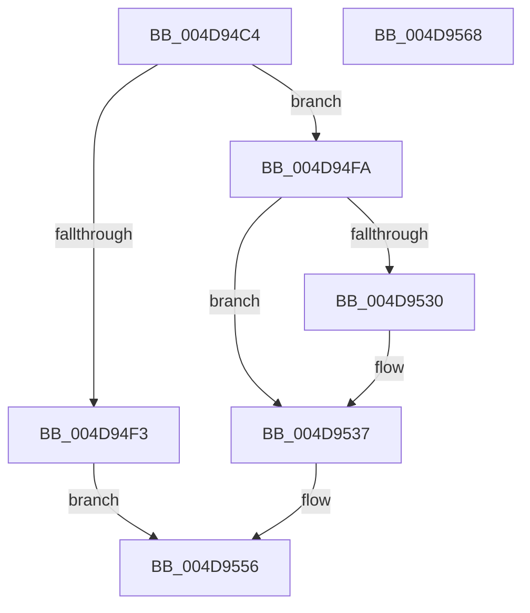

# PopShutdownListenerInsertCallback

- RVA: `0x004D94C4`–`0x004D9569` (길이 `165` bytes)
- VA: `0x00000001404D94C4`
- 실행 섹션: `.text`
- PDB 이름 있음: `예`; PDB Function 태그: `아니요`
- unwind 정보 RVA: `0x00060BC4`
- 디코드: `43`개 명령, `165/165` bytes 표시
- 미해석 바이트: `0` (있으면 어셈블리에 `.byte`로 보존)

> 이 문서는 커널 이미지의 기계어와 PDB 기호를 분석해 생성했습니다. 4번과 5번은 함수 원형과 자료형을 바이너리 사용 방식에서 추정한 C 해석이며 원본 소스 복구 결과는 아닙니다.

## 1. Dependencies

- 직접 호출 지점: **3**; 고유 호출 대상: **3**
- 직접 호출자로 확인된 함수: **1**
- RIP 상대 이미지 참조: **4**

### Outgoing calls
- `0x004D94E4` → [ExAllocatePool2](../../poolcode/B8/ExAllocatePool2_function_00B820F0.md) (function, `0x00B820F0`)
- `0x004D9518` → [KeAcquireSpinLockRaiseToDpc](../20/KeAcquireSpinLockRaiseToDpc_function_00208470.md) (function, `0x00208470`)
- `0x004D9551` → [KeReleaseSpinLock](../39/KeReleaseSpinLock_function_00392BA0.md) (function, `0x00392BA0`)

### Direct callers
- [NtPowerInformation](../../page/95/NtPowerInformation_function_00955D80.md) at `0x0095705C`

### Static image references
- `0x004D94FD` → RVA `0x00F092E0` (`.data`; read)
- `0x004D951D` → RVA `0x00F092D8` (`.data`; read)
- `0x004D9524` → RVA `0x00F092D0` (`.data`; read)
- `0x004D954A` → RVA `0x00F092D8` (`.data`; write)

## 2. Other-region calls and transfers

- 다른 실행 섹션으로 향하는 call: **1**
  - `0x004D94E4` → [ExAllocatePool2](../../poolcode/B8/ExAllocatePool2_function_00B820F0.md) (`.text` → `POOLCODE`)
- 별도 외부 분기/꼬리 이동을 확인하지 못했습니다.

## 3. Assembly (complete function range)

```asm
004D94C4  48 89 5C 24 08                  mov qword ptr [rsp + 8], rbx
004D94C9  48 89 74 24 10                  mov qword ptr [rsp + 0x10], rsi
004D94CE  57                              push rdi
004D94CF  48 83 EC 20                     sub rsp, 0x20
004D94D3  BA 28 00 00 00                  mov edx, 0x28
004D94D8  48 8B F1                        mov rsi, rcx
004D94DB  41 B8 4D 65 6D 20               mov r8d, 0x206d654d
004D94E1  8D 4A 18                        lea ecx, [rdx + 0x18]
004D94E4  E8 07 8C 6A 00                  call 0x140b820f0
004D94E9  33 FF                           xor edi, edi
004D94EB  48 8B D8                        mov rbx, rax
004D94EE  48 85 C0                        test rax, rax
004D94F1  75 07                           jne 0x1404d94fa
004D94F3  BF 9A 00 00 C0                  mov edi, 0xc000009a
004D94F8  EB 5C                           jmp 0x1404d9556
004D94FA  48 8B 06                        mov rax, qword ptr [rsi]
004D94FD  48 8D 0D DC FD A2 00            lea rcx, [rip + 0xa2fddc]
004D9504  48 89 43 10                     mov qword ptr [rbx + 0x10], rax
004D9508  48 8B 46 08                     mov rax, qword ptr [rsi + 8]
004D950C  48 89 43 18                     mov qword ptr [rbx + 0x18], rax
004D9510  48 8B 46 10                     mov rax, qword ptr [rsi + 0x10]
004D9514  48 89 43 20                     mov qword ptr [rbx + 0x20], rax
004D9518  E8 53 EF D2 FF                  call 0x140208470
004D951D  48 8B 0D B4 FD A2 00            mov rcx, qword ptr [rip + 0xa2fdb4]
004D9524  48 8D 15 A5 FD A2 00            lea rdx, [rip + 0xa2fda5]
004D952B  48 39 11                        cmp qword ptr [rcx], rdx
004D952E  74 07                           je 0x1404d9537
004D9530  B9 03 00 00 00                  mov ecx, 3
004D9535  CD 29                           int 0x29
004D9537  48 89 13                        mov qword ptr [rbx], rdx
004D953A  8A D0                           mov dl, al
004D953C  48 89 4B 08                     mov qword ptr [rbx + 8], rcx
004D9540  48 89 19                        mov qword ptr [rcx], rbx
004D9543  48 8D 0D 96 FD A2 00            lea rcx, [rip + 0xa2fd96]
004D954A  48 89 1D 87 FD A2 00            mov qword ptr [rip + 0xa2fd87], rbx
004D9551  E8 4A 96 EB FF                  call 0x140392ba0
004D9556  48 8B 5C 24 30                  mov rbx, qword ptr [rsp + 0x30]
004D955B  8B C7                           mov eax, edi
004D955D  48 8B 74 24 38                  mov rsi, qword ptr [rsp + 0x38]
004D9562  48 83 C4 20                     add rsp, 0x20
004D9566  5F                              pop rdi
004D9567  C3                              ret
004D9568  CC                              int3
```

## 4. C-style interpretation (structured pseudocode)

```c
__int64 __fastcall PopShutdownListenerInsertCallback(__int64 a1)
{
    __int64 result;
    __int64 v_rdi;
    __int64 v_rsp;
    unsigned __int64 v_stack_p10;
    unsigned __int64 v_stack_p8;

    v_stack_p8 = v_rbx;
    v_stack_p10 = v_rsi;
    v_rsp = (v_rsp) - (32);
    result = ExAllocatePool2(40 + 24, 40, (unsigned int)(0x206D654DULL), a4);
    v_rdi = 0;
    if (result != 0) goto loc_004D94FA;
    goto loc_004D9556;
loc_004D94FA:
    *(unsigned __int64 *)(result + 16) = *(unsigned __int64 *)(a1);
    *(unsigned __int64 *)(result + 24) = *(unsigned __int64 *)(a1 + 8);
    *(unsigned __int64 *)(result + 32) = *(unsigned __int64 *)(a1 + 16);
    result = KeAcquireSpinLockRaiseToDpc(v_rip + 10681820, 40, (unsigned int)(0x206D654DULL), a4);
    if ((*(unsigned __int64 *)(*(unsigned __int64 *)(v_rip + 10681780))) != (v_rip + 10681765)) {
        a1 = 3;
    }
    *(unsigned __int64 *)(result) = v_rip + 10681765;
    *(unsigned __int64 *)(result + 8) = a1;
    *(unsigned __int64 *)(a1) = result;
    *(unsigned __int64 *)(v_rip + 10681735) = result;
    result = KeReleaseSpinLock(v_rip + 10681750, (unsigned __int8)(result), (unsigned int)(0x206D654DULL), a4);
loc_004D9556:
    v_rsp = (v_rsp) + (32);
    return (unsigned int)((unsigned int)((unsigned int)(0xC000009AULL)));
}
```

## 5. (Beta) C Style

```c
int64_t PopShutdownListenerInsertCallback(void *Arg1)
{
    uint8_t *arg1 = (uint8_t *)Arg1;

    int64_t result;
    int64_t local_rdi;
    int64_t local_rsp;
    uint64_t v_stack_p10;
    uint64_t v_stack_p8;

    v_stack_p8 = local_rbx;
    v_stack_p10 = local_rsi;
    local_rsp = (local_rsp) - (32);
    result = ExAllocatePool2(40 + 24, 40, (uint32_t)(0x206D654DULL), a4);
    local_rdi = 0;
    if (result != 0) goto loc_004D94FA;
    goto loc_004D9556;
loc_004D94FA:
    *(uint64_t *)(result + 0x10) = *(uint64_t *)(arg1);
    *(uint64_t *)(result + 0x18) = *(uint64_t *)(arg1 + 0x8);
    *(uint64_t *)(result + 0x20) = *(uint64_t *)(arg1 + 0x10);
    result = KeAcquireSpinLockRaiseToDpc(v_rip + 10681820, 40, (uint32_t)(0x206D654DULL), a4);
    if ((*(uint64_t *)(*(uint64_t *)(v_rip + 0xA2FDB4))) != (v_rip + 10681765)) {
        Arg1 = 3;
    }
    *(uint64_t *)(result) = v_rip + 10681765;
    *(void **)(result + 0x8) = Arg1;
    *(uint64_t *)(arg1) = result;
    *(uint64_t *)(v_rip + 0xA2FD87) = result;
    result = KeReleaseSpinLock(v_rip + 10681750, (uint8_t)(result), (uint32_t)(0x206D654DULL), a4);
loc_004D9556:
    local_rsp = (local_rsp) + (32);
    return (uint32_t)((uint32_t)((uint32_t)(0xC000009AULL)));
}
```

### 관측된 메모리 오프셋

구조체 형식이 확인되지 않은 접근은 인자 기준의 오프셋으로만 기록했습니다.

| 기준 인자 | 오프셋 표현 | 폭 (bit) | 접근 |
|---|---:|---:|---|
| `Arg1` | `+ 0x0` | `64` | `R` |
| `Arg1` | `+ 0x8` | `64` | `R` |
| `Arg1` | `+ 0x10` | `64` | `R` |

## 6. Execution-region graph

[열기: 2D/3D 그래프와 함수 탐색 컨트롤 패널](../../../control-panel.html?section=text&rva=0x004D94C4&view=graph)

- 2D 그래프는 위에서 아래로 흐르고, 3D 그래프는 빈 공간을 드래그해 회전합니다. Shift+드래그는 이동, 휠은 확대·축소, 함수 노드 선택은 대상 보고서 이동입니다.

### Static fallback


