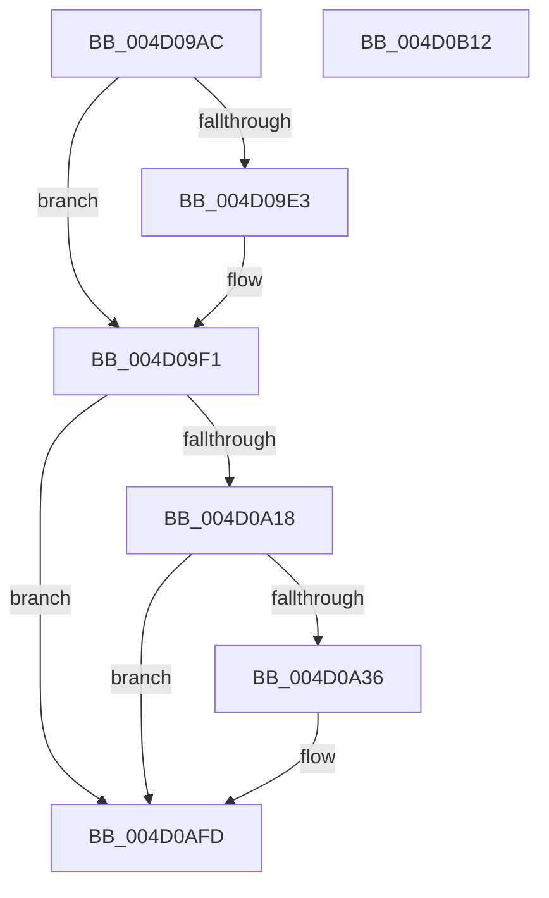

# PopTracePowerReconfig

- RVA: `0x004D09AC`–`0x004D0B13` (길이 `359` bytes)
- VA: `0x00000001404D09AC`
- 실행 섹션: `.text`
- PDB 이름 있음: `예`; PDB Function 태그: `아니요`
- unwind 정보 RVA: `0x000BCC84`
- 디코드: `76`개 명령, `359/359` bytes 표시
- 미해석 바이트: `0` (있으면 어셈블리에 `.byte`로 보존)

> 이 문서는 커널 이미지의 기계어와 PDB 기호를 분석해 생성했습니다. 4번과 5번은 함수 원형과 자료형을 바이너리 사용 방식에서 추정한 C 해석이며 원본 소스 복구 결과는 아닙니다.

## 1. Dependencies

- 직접 호출 지점: **3**; 고유 호출 대상: **3**
- 직접 호출자로 확인된 함수: **1**
- RIP 상대 이미지 참조: **9**

### Outgoing calls
- `0x004D0A29` → [tlgKeywordOn](../42/tlgKeywordOn_function_0042EAA0.md) (function, `0x0042EAA0`)
- `0x004D0AF8` → [tlgWriteTransfer_EtwWriteTransfer](../42/tlgWriteTransfer_EtwWriteTransfer_function_004260E0.md) (function, `0x004260E0`)
- `0x004D0B04` → [_security_check_cookie](../6A/_security_check_cookie_function_006AC640.md) (function, `0x006AC640`)

### Direct callers
- [PopBatteryApplyCompositeState](../../page/AE/PopBatteryApplyCompositeState_function_00AE0CD0.md) at `0x00AE140B`

### Static image references
- `0x004D09BA` → RVA `0x00E0A740` (`.data`; read)
- `0x004D09C8` → RVA `0x00F0C060` (`.data`; read)
- `0x004D09D2` → RVA `0x00F0C0A0` (`.data`; read)
- `0x004D09E3` → RVA `0x00F0C064` (`.data`; read)
- `0x004D0A08` → RVA `0x00E07748` (`.data`; read)
- `0x004D0A42` → RVA `0x0004B097` (`.rdata`; read)
- `0x004D0A49` → RVA `0x00F0C034` (`.data`; read)
- `0x004D0A8C` → RVA `0x00F0C208` (`.data`; read)
- `0x004D0A9E` → RVA `0x00F0C21C` (`.data`; read)

## 2. Other-region calls and transfers

- 다른 실행 섹션으로 향하는 call: **0**
- 별도 외부 분기/꼬리 이동을 확인하지 못했습니다.

## 3. Assembly (complete function range)

```asm
004D09AC  40 55                           push rbp
004D09AE  48 8D 6C 24 A9                  lea rbp, [rsp - 0x57]
004D09B3  48 81 EC F0 00 00 00            sub rsp, 0xf0
004D09BA  48 8B 05 7F 9D 93 00            mov rax, qword ptr [rip + 0x939d7f]
004D09C1  48 33 C4                        xor rax, rsp
004D09C4  48 89 45 47                     mov qword ptr [rbp + 0x47], rax
004D09C8  44 8B 05 91 B6 A3 00            mov r8d, dword ptr [rip + 0xa3b691]
004D09CF  45 33 D2                        xor r10d, r10d
004D09D2  8B 0D C8 B6 A3 00               mov ecx, dword ptr [rip + 0xa3b6c8]
004D09D8  41 83 E0 01                     and r8d, 1
004D09DC  45 8B CA                        mov r9d, r10d
004D09DF  85 C9                           test ecx, ecx
004D09E1  74 0E                           je 0x1404d09f1
004D09E3  6B 05 7A B6 A3 00 64            imul eax, dword ptr [rip + 0xa3b67a], 0x64
004D09EA  33 D2                           xor edx, edx
004D09EC  F7 F1                           div ecx
004D09EE  44 8B C8                        mov r9d, eax
004D09F1  48 B9 14 00 00 00 80 F7 FF FF   movabs rcx, 0xfffff78000000014
004D09FB  48 8B 09                        mov rcx, qword ptr [rcx]
004D09FE  48 8B D1                        mov rdx, rcx
004D0A01  89 4D AF                        mov dword ptr [rbp - 0x51], ecx
004D0A04  48 C1 EA 20                     shr rdx, 0x20
004D0A08  83 3D 39 6D 93 00 05            cmp dword ptr [rip + 0x936d39], 5
004D0A0F  89 55 B3                        mov dword ptr [rbp - 0x4d], edx
004D0A12  0F 86 E5 00 00 00               jbe 0x1404d0afd
004D0A18  48 BA 00 00 00 00 00 40 00 00   movabs rdx, 0x400000000000
004D0A22  48 8D 0D 1F 6D 93 00            lea rcx, [rip + 0x936d1f]
004D0A29  E8 72 E0 F5 FF                  call 0x14042eaa0
004D0A2E  84 C0                           test al, al
004D0A30  0F 84 C7 00 00 00               je 0x1404d0afd
004D0A36  48 8D 45 AF                     lea rax, [rbp - 0x51]
004D0A3A  44 89 4D 9F                     mov dword ptr [rbp - 0x61], r9d
004D0A3E  48 89 45 D7                     mov qword ptr [rbp - 0x29], rax
004D0A42  48 8D 15 4E A6 B7 FF            lea rdx, [rip - 0x4859b2]
004D0A49  8B 05 E5 B5 A3 00               mov eax, dword ptr [rip + 0xa3b5e5]
004D0A4F  48 8D 0D F2 6C 93 00            lea rcx, [rip + 0x936cf2]
004D0A56  89 45 97                        mov dword ptr [rbp - 0x69], eax
004D0A59  45 33 C9                        xor r9d, r9d
004D0A5C  48 8D 45 97                     lea rax, [rbp - 0x69]
004D0A60  44 89 45 A3                     mov dword ptr [rbp - 0x5d], r8d
004D0A64  48 89 45 E7                     mov qword ptr [rbp - 0x19], rax
004D0A68  45 33 C0                        xor r8d, r8d
004D0A6B  8B 05 2F B6 A3 00               mov eax, dword ptr [rip + 0xa3b62f]
004D0A71  89 45 9B                        mov dword ptr [rbp - 0x65], eax
004D0A74  48 8D 45 9B                     lea rax, [rbp - 0x65]
004D0A78  48 89 45 F7                     mov qword ptr [rbp - 9], rax
004D0A7C  48 8D 45 9F                     lea rax, [rbp - 0x61]
004D0A80  48 89 45 07                     mov qword ptr [rbp + 7], rax
004D0A84  48 8D 45 A3                     lea rax, [rbp - 0x5d]
004D0A88  48 89 45 17                     mov qword ptr [rbp + 0x17], rax
004D0A8C  0F B6 05 75 B7 A3 00            movzx eax, byte ptr [rip + 0xa3b775]
004D0A93  89 45 A7                        mov dword ptr [rbp - 0x59], eax
004D0A96  48 8D 45 A7                     lea rax, [rbp - 0x59]
004D0A9A  48 89 45 27                     mov qword ptr [rbp + 0x27], rax
004D0A9E  8B 05 78 B7 A3 00               mov eax, dword ptr [rip + 0xa3b778]
004D0AA4  89 45 AB                        mov dword ptr [rbp - 0x55], eax
004D0AA7  48 8D 45 AB                     lea rax, [rbp - 0x55]
004D0AAB  48 89 45 37                     mov qword ptr [rbp + 0x37], rax
004D0AAF  48 8D 45 B7                     lea rax, [rbp - 0x49]
004D0AB3  48 89 44 24 28                  mov qword ptr [rsp + 0x28], rax
004D0AB8  C7 44 24 20 09 00 00 00         mov dword ptr [rsp + 0x20], 9
004D0AC0  48 C7 45 DF 08 00 00 00         mov qword ptr [rbp - 0x21], 8
004D0AC8  48 C7 45 EF 04 00 00 00         mov qword ptr [rbp - 0x11], 4
004D0AD0  48 C7 45 FF 04 00 00 00         mov qword ptr [rbp - 1], 4
004D0AD8  48 C7 45 0F 04 00 00 00         mov qword ptr [rbp + 0xf], 4
004D0AE0  48 C7 45 1F 04 00 00 00         mov qword ptr [rbp + 0x1f], 4
004D0AE8  48 C7 45 2F 04 00 00 00         mov qword ptr [rbp + 0x2f], 4
004D0AF0  48 C7 45 3F 04 00 00 00         mov qword ptr [rbp + 0x3f], 4
004D0AF8  E8 E3 55 F5 FF                  call 0x1404260e0
004D0AFD  48 8B 4D 47                     mov rcx, qword ptr [rbp + 0x47]
004D0B01  48 33 CC                        xor rcx, rsp
004D0B04  E8 37 BB 1D 00                  call 0x1406ac640
004D0B09  48 81 C4 F0 00 00 00            add rsp, 0xf0
004D0B10  5D                              pop rbp
004D0B11  C3                              ret
004D0B12  CC                              int3
```

## 4. C-style interpretation (structured pseudocode)

```c
__int64 __fastcall PopTracePowerReconfig(__int64 a1, int a2)
{
    __int64 result;
    __int64 v_r10;
    __int64 v_rsp;
    unsigned __int64 v_stack_m18;
    unsigned __int64 v_stack_m20;
    unsigned __int64 v_stack_m28;
    unsigned __int64 v_stack_m30;
    unsigned __int64 v_stack_m38;
    unsigned __int64 v_stack_m40;
    unsigned __int64 v_stack_m48;
    unsigned __int64 v_stack_m50;
    unsigned __int64 v_stack_m58;
    unsigned __int64 v_stack_m5F;
    unsigned __int64 v_stack_m60;
    unsigned __int64 v_stack_m68;
    unsigned __int64 v_stack_m70;
    unsigned __int64 v_stack_m78;
    unsigned __int64 v_stack_m80;
    unsigned __int64 v_stack_m88;
    unsigned __int64 v_stack_mA8;
    unsigned int v_stack_mAC;
    unsigned int v_stack_mB0;
    unsigned int v_stack_mB4;
    unsigned int v_stack_mB8;
    unsigned int v_stack_mBC;
    unsigned int v_stack_mC0;
    unsigned int v_stack_mC4;
    unsigned int v_stack_mC8;
    unsigned __int64 v_stack_mD0;
    unsigned int v_stack_mD8;

    v_rsp = (v_rsp) - (240);
    result = (*(unsigned __int64 *)(v_rip + 9674111)) ^ (v_rsp);
    v_stack_m18 = result;
    v_r10 = 0;
    a3 = (unsigned int)(((unsigned int)(*(unsigned int *)(v_rip + 10729105))) & (1));
    if ((unsigned int)((unsigned int)(*(unsigned int *)(v_rip + 10729160))) != 0) {
        result = (unsigned int)((result) * (*(unsigned int *)(v_rip + 10729082)));
        a2 = 0;
        a4 = (unsigned int)(result);
    }
    v_stack_mB0 = (unsigned int)(*(unsigned __int64 *)((unsigned int)(*(unsigned int *)(v_rip + 10729160))));
    a2 = (*(unsigned __int64 *)((unsigned int)(*(unsigned int *)(v_rip + 10729160)))) >> (32);
    v_stack_mAC = a2;
    if ((*(unsigned int *)(v_rip + 9661753)) <= 5) goto loc_004D0AFD;
    result = tlgKeywordOn(v_rip + 9661727, a2, a3, a4);
    if ((unsigned __int8)(result) != 0) {
        result = v_stack_mB0;
        v_stack_mC0 = (unsigned int)(a4);
        v_stack_m88 = result;
        a2 = v_rip - 4741554;
        result = *(unsigned int *)(v_rip + 10728933);
        a1 = v_rip + 9661682;
        v_stack_mC8 = (unsigned int)(result);
        a4 = 0;
        result = v_stack_mC8;
        v_stack_mBC = (unsigned int)(a3);
        v_stack_m78 = result;
        a3 = 0;
        result = *(unsigned int *)(v_rip + 10729007);
        v_stack_mC4 = (unsigned int)(result);
        result = v_stack_mC4;
        v_stack_m68 = result;
        result = v_stack_mC0;
        v_stack_m58 = result;
        result = v_stack_mBC;
        v_stack_m48 = result;
        result = *(unsigned __int8 *)(v_rip + 10729333);
        v_stack_mB8 = (unsigned int)(result);
        result = v_stack_mB8;
        v_stack_m38 = result;
        result = *(unsigned int *)(v_rip + 10729336);
        v_stack_mB4 = (unsigned int)(result);
        result = v_stack_mB4;
        v_stack_m28 = result;
        result = v_stack_mA8;
        v_stack_mD0 = result;
        v_stack_mD8 = 9;
        v_stack_m80 = 8;
        v_stack_m70 = 4;
        v_stack_m60 = 4;
        v_stack_m50 = 4;
        v_stack_m40 = 4;
        v_stack_m30 = 4;
        v_stack_m20 = 4;
        result = tlgWriteTransfer_EtwWriteTransfer(a1, a2, a3, a4);
    }
    a1 = (v_stack_m18) ^ (v_rsp);
    result = _security_check_cookie(a1, a2, a3, a4);
    v_rsp = (v_rsp) + (240);
    return result;
}
```

## 5. (Beta) C Style

```c
int64_t PopTracePowerReconfig(int64_t Arg1, int32_t Arg2)
{
    int64_t result;
    int64_t local_r10;
    int64_t local_rsp;
    uint64_t v_stack_m18;
    uint64_t v_stack_m20;
    uint64_t v_stack_m28;
    uint64_t v_stack_m30;
    uint64_t v_stack_m38;
    uint64_t v_stack_m40;
    uint64_t v_stack_m48;
    uint64_t v_stack_m50;
    uint64_t v_stack_m58;
    uint64_t v_stack_m5F;
    uint64_t v_stack_m60;
    uint64_t v_stack_m68;
    uint64_t v_stack_m70;
    uint64_t v_stack_m78;
    uint64_t v_stack_m80;
    uint64_t v_stack_m88;
    uint64_t v_stack_mA8;
    uint32_t v_stack_mAC;
    uint32_t v_stack_mB0;
    uint32_t v_stack_mB4;
    uint32_t v_stack_mB8;
    uint32_t v_stack_mBC;
    uint32_t v_stack_mC0;
    uint32_t v_stack_mC4;
    uint32_t v_stack_mC8;
    uint64_t v_stack_mD0;
    uint32_t v_stack_mD8;

    local_rsp = (local_rsp) - (240);
    result = (*(uint64_t *)(v_rip + 0x939D7F)) ^ (local_rsp);
    v_stack_m18 = result;
    local_r10 = 0;
    a3 = (uint32_t)(((uint32_t)(*(uint32_t *)(v_rip + 0xA3B691))) & (1));
    if ((uint32_t)((uint32_t)(*(uint32_t *)(v_rip + 0xA3B6C8))) != 0) {
        result = (uint32_t)((result) * (*(uint32_t *)(v_rip + 0xA3B67A)));
        Arg2 = 0;
        a4 = (uint32_t)(result);
    }
    v_stack_mB0 = (uint32_t)(*(uint64_t *)((uint32_t)(*(uint32_t *)(v_rip + 0xA3B6C8))));
    Arg2 = (*(uint64_t *)((uint32_t)(*(uint32_t *)(v_rip + 0xA3B6C8)))) >> (32);
    v_stack_mAC = Arg2;
    if ((*(uint32_t *)(v_rip + 0x936D39)) <= 5) goto loc_004D0AFD;
    result = tlgKeywordOn(v_rip + 9661727, Arg2, a3, a4);
    if ((uint8_t)(result) != 0) {
        result = v_stack_mB0;
        v_stack_mC0 = (uint32_t)(a4);
        v_stack_m88 = result;
        Arg2 = v_rip - 4741554;
        result = *(uint32_t *)(v_rip + 0xA3B5E5);
        Arg1 = v_rip + 9661682;
        v_stack_mC8 = (uint32_t)(result);
        a4 = 0;
        result = v_stack_mC8;
        v_stack_mBC = (uint32_t)(a3);
        v_stack_m78 = result;
        a3 = 0;
        result = *(uint32_t *)(v_rip + 0xA3B62F);
        v_stack_mC4 = (uint32_t)(result);
        result = v_stack_mC4;
        v_stack_m68 = result;
        result = v_stack_mC0;
        v_stack_m58 = result;
        result = v_stack_mBC;
        v_stack_m48 = result;
        result = *(uint8_t *)(v_rip + 0xA3B775);
        v_stack_mB8 = (uint32_t)(result);
        result = v_stack_mB8;
        v_stack_m38 = result;
        result = *(uint32_t *)(v_rip + 0xA3B778);
        v_stack_mB4 = (uint32_t)(result);
        result = v_stack_mB4;
        v_stack_m28 = result;
        result = v_stack_mA8;
        v_stack_mD0 = result;
        v_stack_mD8 = 9;
        v_stack_m80 = 8;
        v_stack_m70 = 4;
        v_stack_m60 = 4;
        v_stack_m50 = 4;
        v_stack_m40 = 4;
        v_stack_m30 = 4;
        v_stack_m20 = 4;
        result = tlgWriteTransfer_EtwWriteTransfer(Arg1, Arg2, a3, a4);
    }
    Arg1 = (v_stack_m18) ^ (local_rsp);
    result = _security_check_cookie(Arg1, Arg2, a3, a4);
    local_rsp = (local_rsp) + (240);
    return result;
}
```

## 6. Execution-region graph

[열기: 2D/3D 그래프와 함수 탐색 컨트롤 패널](../../../control-panel.html?section=text&rva=0x004D09AC&view=graph)

- 2D 그래프는 위에서 아래로 흐르고, 3D 그래프는 빈 공간을 드래그해 회전합니다. Shift+드래그는 이동, 휠은 확대·축소, 함수 노드 선택은 대상 보고서 이동입니다.

### Static fallback


