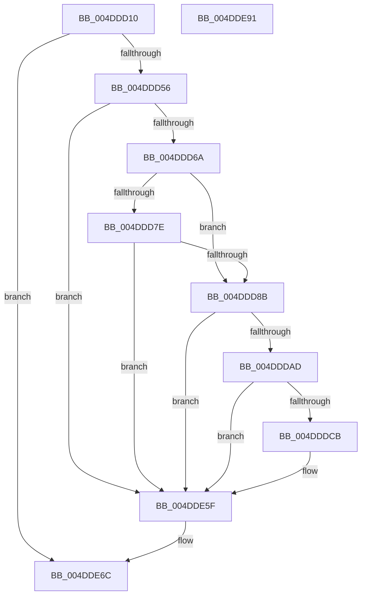

# PopTraceThermalZonePassiveHistogram

- RVA: `0x004DDD10`–`0x004DDE92` (길이 `386` bytes)
- VA: `0x00000001404DDD10`
- 실행 섹션: `.text`
- PDB 이름 있음: `예`; PDB Function 태그: `아니요`
- unwind 정보 RVA: `0x000BEBDC`
- 디코드: `81`개 명령, `386/386` bytes 표시
- 미해석 바이트: `0` (있으면 어셈블리에 `.byte`로 보존)

> 이 문서는 커널 이미지의 기계어와 PDB 기호를 분석해 생성했습니다. 4번과 5번은 함수 원형과 자료형을 바이너리 사용 방식에서 추정한 C 해석이며 원본 소스 복구 결과는 아닙니다.

## 1. Dependencies

- 직접 호출 지점: **7**; 고유 호출 대상: **7**
- 직접 호출자로 확인된 함수: **3**
- RIP 상대 이미지 참조: **6**

### Outgoing calls
- `0x004DDD45` → [IoGetDeviceAttachmentBaseRefWithTag](../27/IoGetDeviceAttachmentBaseRefWithTag_function_00272788.md) (function, `0x00272788`)
- `0x004DDD75` → [PopDiagSnapPassiveHistogram](../4B/PopDiagSnapPassiveHistogram_function_004BDA50.md) (function, `0x004BDA50`)
- `0x004DDDBE` → [tlgKeywordOn](../42/tlgKeywordOn_function_0042EAA0.md) (function, `0x0042EAA0`)
- `0x004DDE06` → [tlgCreate1Sz_wchar_t](../42/tlgCreate1Sz_wchar_t_function_00426198.md) (function, `0x00426198`)
- `0x004DDE5A` → [tlgWriteTransfer_EtwWriteTransfer](../42/tlgWriteTransfer_EtwWriteTransfer_function_004260E0.md) (function, `0x004260E0`)
- `0x004DDE67` → [ObfDereferenceObjectWithTag](../2F/ObfDereferenceObjectWithTag_function_002F78E0.md) (function, `0x002F78E0`)
- `0x004DDE73` → [_security_check_cookie](../6A/_security_check_cookie_function_006AC640.md) (function, `0x006AC640`)

### Direct callers
- [PopThermalSxEntry](../4E/PopThermalSxEntry_function_004E3D20.md) at `0x004E3DB3`
- [PopThermalTelemetryWorker](../5D/PopThermalTelemetryWorker_function_005D57F0.md) at `0x005D5854`
- [PopThermalZoneRemove](../../page/75/PopThermalZoneRemove_function_0075FAD0.md) at `0x0075FB22`

### Static image references
- `0x004DDD2B` → RVA `0x00E0A740` (`.data`; read)
- `0x004DDD7E` → RVA `0x00E0B564` (`.data`; read)
- `0x004DDD92` → RVA `0x006C8EC0` (` ?? ::FNODOBFM::`string'`; read)
- `0x004DDDA0` → RVA `0x00E07748` (`.data`; read)
- `0x004DDE0F` → RVA `0x00F0C940` (`.data`; read)
- `0x004DDE22` → RVA `0x0004AD35` (`.rdata`; read)

## 2. Other-region calls and transfers

- 다른 실행 섹션으로 향하는 call: **0**
- 별도 외부 분기/꼬리 이동을 확인하지 못했습니다.

## 3. Assembly (complete function range)

```asm
004DDD10  48 8B C4                        mov rax, rsp
004DDD13  48 89 58 10                     mov qword ptr [rax + 0x10], rbx
004DDD17  48 89 70 18                     mov qword ptr [rax + 0x18], rsi
004DDD1B  48 89 78 20                     mov qword ptr [rax + 0x20], rdi
004DDD1F  55                              push rbp
004DDD20  48 8D 68 E8                     lea rbp, [rax - 0x18]
004DDD24  48 81 EC 10 01 00 00            sub rsp, 0x110
004DDD2B  48 8B 05 0E CA 92 00            mov rax, qword ptr [rip + 0x92ca0e]
004DDD32  48 33 C4                        xor rax, rsp
004DDD35  48 89 45 00                     mov qword ptr [rbp], rax
004DDD39  48 8B F9                        mov rdi, rcx
004DDD3C  BA 50 6F 44 67                  mov edx, 0x67446f50
004DDD41  48 8B 49 30                     mov rcx, qword ptr [rcx + 0x30]
004DDD45  E8 3E 4A D9 FF                  call 0x140272788
004DDD4A  48 8B D8                        mov rbx, rax
004DDD4D  48 85 C0                        test rax, rax
004DDD50  0F 84 16 01 00 00               je 0x1404dde6c
004DDD56  48 8B 88 38 01 00 00            mov rcx, qword ptr [rax + 0x138]
004DDD5D  48 8B 71 28                     mov rsi, qword ptr [rcx + 0x28]
004DDD61  48 85 F6                        test rsi, rsi
004DDD64  0F 84 F5 00 00 00               je 0x1404dde5f
004DDD6A  48 8D 8F F8 01 00 00            lea rcx, [rdi + 0x1f8]
004DDD71  48 8D 55 A0                     lea rdx, [rbp - 0x60]
004DDD75  E8 D6 FC FD FF                  call 0x1404bda50
004DDD7A  84 C0                           test al, al
004DDD7C  75 0D                           jne 0x1404ddd8b
004DDD7E  83 3D DF D7 92 00 00            cmp dword ptr [rip + 0x92d7df], 0
004DDD85  0F 84 D4 00 00 00               je 0x1404dde5f
004DDD8B  48 8B 87 18 04 00 00            mov rax, qword ptr [rdi + 0x418]
004DDD92  4C 8D 05 27 B1 1E 00            lea r8, [rip + 0x1eb127]
004DDD99  48 85 C0                        test rax, rax
004DDD9C  4C 0F 45 C0                     cmovne r8, rax
004DDDA0  83 3D A1 99 92 00 05            cmp dword ptr [rip + 0x9299a1], 5
004DDDA7  0F 86 B2 00 00 00               jbe 0x1404dde5f
004DDDAD  48 BA 00 00 00 00 00 40 00 00   movabs rdx, 0x400000000000
004DDDB7  48 8D 0D 8A 99 92 00            lea rcx, [rip + 0x92998a]
004DDDBE  E8 DD 0C F5 FF                  call 0x14042eaa0
004DDDC3  84 C0                           test al, al
004DDDC5  0F 84 94 00 00 00               je 0x1404dde5f
004DDDCB  83 64 24 5C 00                  and dword ptr [rsp + 0x5c], 0
004DDDD0  48 8D 44 24 68                  lea rax, [rsp + 0x68]
004DDDD5  83 64 24 6C 00                  and dword ptr [rsp + 0x6c], 0
004DDDDA  48 8D 4C 24 70                  lea rcx, [rsp + 0x70]
004DDDDF  48 89 44 24 50                  mov qword ptr [rsp + 0x50], rax
004DDDE4  49 8B D0                        mov rdx, r8
004DDDE7  48 8B 86 88 00 00 00            mov rax, qword ptr [rsi + 0x88]
004DDDEE  48 89 44 24 60                  mov qword ptr [rsp + 0x60], rax
004DDDF3  0F B7 86 80 00 00 00            movzx eax, word ptr [rsi + 0x80]
004DDDFA  89 44 24 68                     mov dword ptr [rsp + 0x68], eax
004DDDFE  C7 44 24 58 02 00 00 00         mov dword ptr [rsp + 0x58], 2
004DDE06  E8 8D 83 F4 FF                  call 0x140426198
004DDE0B  83 65 8C 00                     and dword ptr [rbp - 0x74], 0
004DDE0F  48 8D 05 2A EB A2 00            lea rax, [rip + 0xa2eb2a]
004DDE16  83 65 9C 00                     and dword ptr [rbp - 0x64], 0
004DDE1A  4C 8D 4D A0                     lea r9, [rbp - 0x60]
004DDE1E  48 89 45 90                     mov qword ptr [rbp - 0x70], rax
004DDE22  48 8D 15 0C CF B6 FF            lea rdx, [rip - 0x4930f4]
004DDE29  48 8D 44 24 30                  lea rax, [rsp + 0x30]
004DDE2E  4C 89 4D 80                     mov qword ptr [rbp - 0x80], r9
004DDE32  48 89 44 24 28                  mov qword ptr [rsp + 0x28], rax
004DDE37  48 8D 0D 0A 99 92 00            lea rcx, [rip + 0x92990a]
004DDE3E  45 33 C9                        xor r9d, r9d
004DDE41  C7 44 24 20 07 00 00 00         mov dword ptr [rsp + 0x20], 7
004DDE49  45 33 C0                        xor r8d, r8d
004DDE4C  C7 45 88 54 00 00 00            mov dword ptr [rbp - 0x78], 0x54
004DDE53  C7 45 98 15 00 00 00            mov dword ptr [rbp - 0x68], 0x15
004DDE5A  E8 81 82 F4 FF                  call 0x1404260e0
004DDE5F  BA 50 6F 44 67                  mov edx, 0x67446f50
004DDE64  48 8B CB                        mov rcx, rbx
004DDE67  E8 74 9A E1 FF                  call 0x1402f78e0
004DDE6C  48 8B 4D 00                     mov rcx, qword ptr [rbp]
004DDE70  48 33 CC                        xor rcx, rsp
004DDE73  E8 C8 E7 1C 00                  call 0x1406ac640
004DDE78  4C 8D 9C 24 10 01 00 00         lea r11, [rsp + 0x110]
004DDE80  49 8B 5B 18                     mov rbx, qword ptr [r11 + 0x18]
004DDE84  49 8B 73 20                     mov rsi, qword ptr [r11 + 0x20]
004DDE88  49 8B 7B 28                     mov rdi, qword ptr [r11 + 0x28]
004DDE8C  49 8B E3                        mov rsp, r11
004DDE8F  5D                              pop rbp
004DDE90  C3                              ret
004DDE91  CC                              int3
```

## 4. C-style interpretation (structured pseudocode)

```c
__int64 __fastcall PopTraceThermalZonePassiveHistogram(__int64 a1)
{
    __int64 result;
    __int64 v_rsp;
    unsigned __int64 v_stack_m8;
    unsigned __int64 v_stack_mA8;
    unsigned int v_stack_mAC;
    unsigned __int64 v_stack_mB0;
    unsigned __int64 v_stack_mB8;
    unsigned int v_stack_mBC;
    unsigned int v_stack_mC0;
    unsigned __int64 v_stack_mC8;
    unsigned __int64 v_stack_mE8;
    unsigned __int64 v_stack_mF0;
    unsigned int v_stack_mF8;

    *(unsigned __int64 *)(v_rsp + 16) = v_rbx;
    *(unsigned __int64 *)(v_rsp + 24) = v_rsi;
    *(unsigned __int64 *)(v_rsp + 32) = v_rdi;
    v_rsp = (v_rsp) - (272);
    result = (*(unsigned __int64 *)(v_rip + 9619982)) ^ (v_rsp);
    *(unsigned __int64 *)(v_rsp - 24) = result;
    result = IoGetDeviceAttachmentBaseRefWithTag(*(unsigned __int64 *)(a1 + 48), (unsigned int)(0x67446F50ULL), a3, a4);
    if (result == 0) goto loc_004DDE6C;
    if (*(unsigned __int64 *)(*(unsigned __int64 *)(result + 312) + 40) == 0) goto loc_004DDE5F;
    result = PopDiagSnapPassiveHistogram(a1 + 504, v_rsp - 24 - 96, a3, a4);
    if ((unsigned __int8)(result) != 0) goto loc_004DDD8B;
    if ((*(unsigned int *)(v_rip + 9623519)) == 0) goto loc_004DDE5F;
loc_004DDD8B:
    a3 = v_rip + 2011431;
    if (*(unsigned __int64 *)(a1 + 1048) != 0) { a3 = *(unsigned __int64 *)(a1 + 1048); }
    if ((*(unsigned int *)(v_rip + 9607585)) <= 5) goto loc_004DDE5F;
    result = tlgKeywordOn(v_rip + 9607562, v_rsp - 24 - 96, a3, a4);
    if ((unsigned __int8)(result) != 0) {
        result = v_stack_mB0;
        a1 = v_stack_mA8;
        v_stack_mC8 = result;
        a2 = a3;
        result = *(unsigned __int64 *)(*(unsigned __int64 *)(*(unsigned __int64 *)(result + 312) + 40) + 136);
        v_stack_mB8 = result;
        result = *(unsigned __int16 *)(*(unsigned __int64 *)(*(unsigned __int64 *)(result + 312) + 40) + 128);
        v_stack_mB0 = (unsigned int)(result);
        v_stack_mC0 = 2;
        result = tlgCreate1Sz_wchar_t(a1, a2, a3, a4);
        result = v_rip + 10677034;
        a4 = v_rsp - 24 - 96;
        *(unsigned __int64 *)(v_rsp - 24 - 112) = result;
        a2 = v_rip - 4796660;
        result = v_stack_mE8;
        *(unsigned __int64 *)(v_rsp - 24 - 128) = a4;
        v_stack_mF0 = result;
        a1 = v_rip + 9607434;
        a4 = 0;
        v_stack_mF8 = 7;
        a3 = 0;
        *(unsigned int *)(v_rsp - 24 - 120) = 84;
        *(unsigned int *)(v_rsp - 24 - 104) = 21;
        result = tlgWriteTransfer_EtwWriteTransfer(a1, a2, a3, a4);
    }
    result = ObfDereferenceObjectWithTag(result, (unsigned int)(0x67446F50ULL), a3, a4);
loc_004DDE6C:
    a1 = (*(unsigned __int64 *)(v_rsp - 24)) ^ (v_rsp);
    result = _security_check_cookie(a1, (unsigned int)(0x67446F50ULL), a3, a4);
    return result;
}
```

## 5. (Beta) C Style

```c
int64_t PopTraceThermalZonePassiveHistogram(void *Arg1)
{
    uint8_t *arg1 = (uint8_t *)Arg1;

    int64_t result;
    int64_t local_rsp;
    uint64_t v_stack_m8;
    uint64_t v_stack_mA8;
    uint32_t v_stack_mAC;
    uint64_t v_stack_mB0;
    uint64_t v_stack_mB8;
    uint32_t v_stack_mBC;
    uint32_t v_stack_mC0;
    uint64_t v_stack_mC8;
    uint64_t v_stack_mE8;
    uint64_t v_stack_mF0;
    uint32_t v_stack_mF8;

    *(uint64_t *)(local_rsp + 0x10) = local_rbx;
    *(uint64_t *)(local_rsp + 0x18) = local_rsi;
    *(uint64_t *)(local_rsp + 0x20) = local_rdi;
    local_rsp = (local_rsp) - (272);
    result = (*(uint64_t *)(v_rip + 0x92CA0E)) ^ (local_rsp);
    *(uint64_t *)(local_rsp - 0x18) = result;
    result = IoGetDeviceAttachmentBaseRefWithTag(*(uint64_t *)(arg1 + 0x30), (uint32_t)(0x67446F50ULL), a3, a4);
    if (result == 0) goto loc_004DDE6C;
    if (*(uint64_t *)(*(uint64_t *)(result + 0x138) + 0x28) == 0) goto loc_004DDE5F;
    result = PopDiagSnapPassiveHistogram(Arg1 + 504, local_rsp - 24 - 96, a3, a4);
    if ((uint8_t)(result) != 0) goto loc_004DDD8B;
    if ((*(uint32_t *)(v_rip + 0x92D7DF)) == 0) goto loc_004DDE5F;
loc_004DDD8B:
    a3 = v_rip + 2011431;
    if (*(uint64_t *)(arg1 + 0x418) != 0) { a3 = *(uint64_t *)(arg1 + 0x418); }
    if ((*(uint32_t *)(v_rip + 0x9299A1)) <= 5) goto loc_004DDE5F;
    result = tlgKeywordOn(v_rip + 9607562, local_rsp - 24 - 96, a3, a4);
    if ((uint8_t)(result) != 0) {
        result = v_stack_mB0;
        Arg1 = v_stack_mA8;
        v_stack_mC8 = result;
        a2 = a3;
        result = *(uint64_t *)(*(uint64_t *)(*(uint64_t *)(result + 0x138) + 0x28) + 0x88);
        v_stack_mB8 = result;
        result = *(uint16_t *)(*(uint64_t *)(*(uint64_t *)(result + 0x138) + 0x28) + 0x80);
        v_stack_mB0 = (uint32_t)(result);
        v_stack_mC0 = 2;
        result = tlgCreate1Sz_wchar_t(Arg1, a2, a3, a4);
        result = v_rip + 10677034;
        a4 = local_rsp - 24 - 96;
        *(uint64_t *)(local_rsp - 0x18 - 0x70) = result;
        a2 = v_rip - 4796660;
        result = v_stack_mE8;
        *(uint64_t *)(local_rsp - 0x18 - 0x80) = a4;
        v_stack_mF0 = result;
        Arg1 = v_rip + 9607434;
        a4 = 0;
        v_stack_mF8 = 7;
        a3 = 0;
        *(uint32_t *)(local_rsp - 0x18 - 0x78) = 84;
        *(uint32_t *)(local_rsp - 0x18 - 0x68) = 21;
        result = tlgWriteTransfer_EtwWriteTransfer(Arg1, a2, a3, a4);
    }
    result = ObfDereferenceObjectWithTag(result, (uint32_t)(0x67446F50ULL), a3, a4);
loc_004DDE6C:
    Arg1 = (*(uint64_t *)(local_rsp - 0x18)) ^ (local_rsp);
    result = _security_check_cookie(Arg1, (uint32_t)(0x67446F50ULL), a3, a4);
    return result;
}
```

### 관측된 메모리 오프셋

구조체 형식이 확인되지 않은 접근은 인자 기준의 오프셋으로만 기록했습니다.

| 기준 인자 | 오프셋 표현 | 폭 (bit) | 접근 |
|---|---:|---:|---|
| `Arg1` | `+ 0x30` | `64` | `R` |
| `Arg1` | `+ 0x1F8` | `64` | `R` |
| `Arg1` | `+ 0x418` | `64` | `R` |

## 6. Execution-region graph

[열기: 2D/3D 그래프와 함수 탐색 컨트롤 패널](../../../control-panel.html?section=text&rva=0x004DDD10&view=graph)

- 2D 그래프는 위에서 아래로 흐르고, 3D 그래프는 빈 공간을 드래그해 회전합니다. Shift+드래그는 이동, 휠은 확대·축소, 함수 노드 선택은 대상 보고서 이동입니다.

### Static fallback


