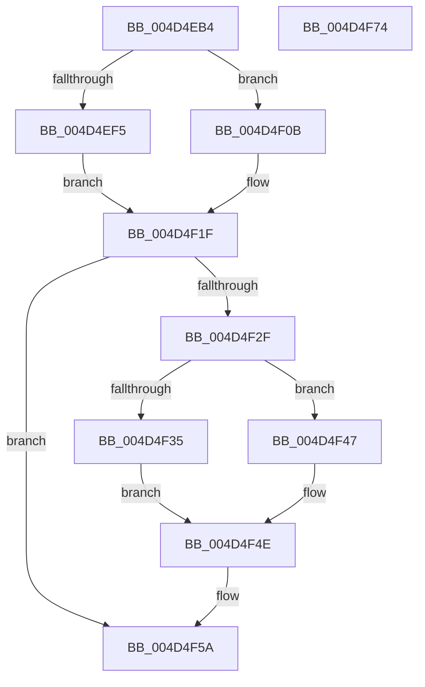

# PopUpdatePowerButtonHoldState

- RVA: `0x004D4EB4`–`0x004D4F75` (길이 `193` bytes)
- VA: `0x00000001404D4EB4`
- 실행 섹션: `.text`
- PDB 이름 있음: `예`; PDB Function 태그: `아니요`
- unwind 정보 RVA: `0x0005CAAC`
- 디코드: `49`개 명령, `193/193` bytes 표시
- 미해석 바이트: `0` (있으면 어셈블리에 `.byte`로 보존)

> 이 문서는 커널 이미지의 기계어와 PDB 기호를 분석해 생성했습니다. 4번과 5번은 함수 원형과 자료형을 바이너리 사용 방식에서 추정한 C 해석이며 원본 소스 복구 결과는 아닙니다.

## 1. Dependencies

- 직접 호출 지점: **3**; 고유 호출 대상: **3**
- 직접 호출자로 확인된 함수: **2**
- RIP 상대 이미지 참조: **11**

### Outgoing calls
- `0x004D4EC7` → [KeAcquireSpinLockRaiseToDpc](../20/KeAcquireSpinLockRaiseToDpc_function_00208470.md) (function, `0x00208470`)
- `0x004D4F55` → [PopQueueWorkItem](../4A/PopQueueWorkItem_function_004A20F8.md) (function, `0x004A20F8`)
- `0x004D4F64` → [KeReleaseSpinLock](../39/KeReleaseSpinLock_function_00392BA0.md) (function, `0x00392BA0`)

### Direct callers
- [PoSetPowerButtonHoldState](../5D/PoSetPowerButtonHoldState_function_005D1330.md) at `0x005D1334`
- [NtPowerInformation](../../page/95/NtPowerInformation_function_00955D80.md) at `0x00957C82`

### Static image references
- `0x004D4EC0` → RVA `0x00F08600` (`.data`; read)
- `0x004D4ECC` → RVA `0x00F08524` (`.data`; read)
- `0x004D4ED6` → RVA `0x00F08528` (`.data`; read)
- `0x004D4EF5` → RVA `0x00F08530` (`.data`; read/write)
- `0x004D4F02` → RVA `0x00F08528` (`.data`; write)
- `0x004D4F18` → RVA `0x00F08524` (`.data`; write)
- `0x004D4F1F` → RVA `0x00F086B8` (`.data`; read)
- `0x004D4F38` → RVA `0x00F086BC` (`.data`; read/write)
- `0x004D4F3F` → RVA `0x00F086B8` (`.data`; write)
- `0x004D4F47` → RVA `0x00F086B8` (`.data`; read/write)
- `0x004D4F4E` → RVA `0x00F08690` (`.data`; read)

## 2. Other-region calls and transfers

- 다른 실행 섹션으로 향하는 call: **0**
- 별도 외부 분기/꼬리 이동을 확인하지 못했습니다.

## 3. Assembly (complete function range)

```asm
004D4EB4  48 89 5C 24 08                  mov qword ptr [rsp + 8], rbx
004D4EB9  57                              push rdi
004D4EBA  48 83 EC 20                     sub rsp, 0x20
004D4EBE  8A D9                           mov bl, cl
004D4EC0  48 8D 0D 39 37 A3 00            lea rcx, [rip + 0xa33739]
004D4EC7  E8 A4 35 D3 FF                  call 0x140208470
004D4ECC  44 8B 0D 51 36 A3 00            mov r9d, dword ptr [rip + 0xa33651]
004D4ED3  45 33 D2                        xor r10d, r10d
004D4ED6  44 8B 05 4B 36 A3 00            mov r8d, dword ptr [rip + 0xa3364b]
004D4EDD  40 8A F8                        mov dil, al
004D4EE0  45 8D 5A 01                     lea r11d, [r10 + 1]
004D4EE4  43 8D 0C 01                     lea ecx, [r9 + r8]
004D4EE8  41 8B D3                        mov edx, r11d
004D4EEB  80 E1 3F                        and cl, 0x3f
004D4EEE  48 D3 E2                        shl rdx, cl
004D4EF1  84 DB                           test bl, bl
004D4EF3  74 16                           je 0x1404d4f0b
004D4EF5  48 09 15 34 36 A3 00            or qword ptr [rip + 0xa33634], rdx
004D4EFC  45 8B D3                        mov r10d, r11d
004D4EFF  45 03 C3                        add r8d, r11d
004D4F02  44 89 05 1F 36 A3 00            mov dword ptr [rip + 0xa3361f], r8d
004D4F09  EB 14                           jmp 0x1404d4f1f
004D4F0B  48 F7 D2                        not rdx
004D4F0E  48 21 15 1B 36 A3 00            and qword ptr [rip + 0xa3361b], rdx
004D4F15  45 03 CB                        add r9d, r11d
004D4F18  44 89 0D 05 36 A3 00            mov dword ptr [rip + 0xa33605], r9d
004D4F1F  8B 0D 93 37 A3 00               mov ecx, dword ptr [rip + 0xa33793]
004D4F25  8B C1                           mov eax, ecx
004D4F27  41 23 C3                        and eax, r11d
004D4F2A  44 3B D0                        cmp r10d, eax
004D4F2D  74 2B                           je 0x1404d4f5a
004D4F2F  33 D2                           xor edx, edx
004D4F31  84 DB                           test bl, bl
004D4F33  74 12                           je 0x1404d4f47
004D4F35  41 0B CB                        or ecx, r11d
004D4F38  44 01 1D 7D 37 A3 00            add dword ptr [rip + 0xa3377d], r11d
004D4F3F  89 0D 73 37 A3 00               mov dword ptr [rip + 0xa33773], ecx
004D4F45  EB 07                           jmp 0x1404d4f4e
004D4F47  83 25 6A 37 A3 00 00            and dword ptr [rip + 0xa3376a], 0
004D4F4E  48 8D 0D 3B 37 A3 00            lea rcx, [rip + 0xa3373b]
004D4F55  E8 9E D1 FC FF                  call 0x1404a20f8
004D4F5A  40 8A D7                        mov dl, dil
004D4F5D  48 8D 0D 9C 36 A3 00            lea rcx, [rip + 0xa3369c]
004D4F64  E8 37 DC EB FF                  call 0x140392ba0
004D4F69  48 8B 5C 24 30                  mov rbx, qword ptr [rsp + 0x30]
004D4F6E  48 83 C4 20                     add rsp, 0x20
004D4F72  5F                              pop rdi
004D4F73  C3                              ret
004D4F74  CC                              int3
```

## 4. C-style interpretation (structured pseudocode)

```c
__int64 __fastcall PopUpdatePowerButtonHoldState(unsigned __int8 a1)
{
    __int64 result;
    __int64 v_r10;
    __int64 v_rsp;
    unsigned __int64 v_stack_p8;

    v_stack_p8 = v_rbx;
    v_rsp = (v_rsp) - (32);
    result = KeAcquireSpinLockRaiseToDpc(v_rip + 10696505, a2, a3, a4);
    v_r10 = 0;
    a1 = (unsigned __int8)(((unsigned int)(*(unsigned int *)(v_rip + 10696273)) + (unsigned int)(*(unsigned int *)(v_rip + 10696267)) * 1) & (63));
    a2 = ((unsigned int)((unsigned int)(v_r10 + 1))) << (a1);
    if (a1 == 0) goto loc_004D4F0B;
    a3 = (unsigned int)(((unsigned int)(*(unsigned int *)(v_rip + 10696267))) + ((unsigned int)(v_r10 + 1)));
    *(unsigned int *)(v_rip + 10696223) = (unsigned int)(a3);
    goto loc_004D4F1F;
loc_004D4F0B:
    a2 = ~(a2);
    a4 = (unsigned int)(((unsigned int)(*(unsigned int *)(v_rip + 10696273))) + ((unsigned int)(v_r10 + 1)));
    *(unsigned int *)(v_rip + 10696197) = (unsigned int)(a4);
loc_004D4F1F:
    result = (unsigned int)(((unsigned int)((unsigned int)((unsigned int)(*(unsigned int *)(v_rip + 10696595))))) & ((unsigned int)(v_r10 + 1)));
    if (((unsigned int)((unsigned int)((unsigned int)(v_r10 + 1)))) == ((unsigned int)(result))) goto loc_004D4F5A;
    a2 = 0;
    if (a1 == 0) goto loc_004D4F47;
    a1 = (unsigned int)(((unsigned int)(*(unsigned int *)(v_rip + 10696595))) | ((unsigned int)(v_r10 + 1)));
    *(unsigned int *)(v_rip + 10696563) = a1;
    goto loc_004D4F4E;
loc_004D4F47:
loc_004D4F4E:
    result = PopQueueWorkItem(v_rip + 10696507, a2, a3, a4);
loc_004D4F5A:
    result = KeReleaseSpinLock(v_rip + 10696348, (unsigned __int8)((unsigned __int8)(result)), a3, a4);
    v_rsp = (v_rsp) + (32);
    return result;
}
```

## 5. (Beta) C Style

```c
int64_t PopUpdatePowerButtonHoldState(uint8_t Arg1)
{
    int64_t result;
    int64_t local_r10;
    int64_t local_rsp;
    uint64_t v_stack_p8;

    v_stack_p8 = local_rbx;
    local_rsp = (local_rsp) - (32);
    result = KeAcquireSpinLockRaiseToDpc(v_rip + 10696505, a2, a3, a4);
    local_r10 = 0;
    Arg1 = (uint8_t)(((uint32_t)(*(uint32_t *)(v_rip + 0xA33651)) + (uint32_t)(*(uint32_t *)(v_rip + 0xA3364B)) * 1) & (63));
    a2 = ((uint32_t)((uint32_t)(local_r10 + 1))) << (Arg1);
    if (Arg1 == 0) goto loc_004D4F0B;
    a3 = (uint32_t)(((uint32_t)(*(uint32_t *)(v_rip + 0xA3364B))) + ((uint32_t)(local_r10 + 1)));
    *(uint32_t *)(v_rip + 0xA3361F) = (uint32_t)(a3);
    goto loc_004D4F1F;
loc_004D4F0B:
    a2 = ~(a2);
    a4 = (uint32_t)(((uint32_t)(*(uint32_t *)(v_rip + 0xA33651))) + ((uint32_t)(local_r10 + 1)));
    *(uint32_t *)(v_rip + 0xA33605) = (uint32_t)(a4);
loc_004D4F1F:
    result = (uint32_t)(((uint32_t)((uint32_t)((uint32_t)(*(uint32_t *)(v_rip + 0xA33793))))) & ((uint32_t)(local_r10 + 1)));
    if (((uint32_t)((uint32_t)((uint32_t)(local_r10 + 1)))) == ((uint32_t)(result))) goto loc_004D4F5A;
    a2 = 0;
    if (Arg1 == 0) goto loc_004D4F47;
    Arg1 = (uint32_t)(((uint32_t)(*(uint32_t *)(v_rip + 0xA33793))) | ((uint32_t)(local_r10 + 1)));
    *(uint32_t *)(v_rip + 0xA33773) = Arg1;
    goto loc_004D4F4E;
loc_004D4F47:
loc_004D4F4E:
    result = PopQueueWorkItem(v_rip + 10696507, a2, a3, a4);
loc_004D4F5A:
    result = KeReleaseSpinLock(v_rip + 10696348, (uint8_t)((uint8_t)(result)), a3, a4);
    local_rsp = (local_rsp) + (32);
    return result;
}
```

## 6. Execution-region graph

[열기: 2D/3D 그래프와 함수 탐색 컨트롤 패널](../../../control-panel.html?section=text&rva=0x004D4EB4&view=graph)

- 2D 그래프는 위에서 아래로 흐르고, 3D 그래프는 빈 공간을 드래그해 회전합니다. Shift+드래그는 이동, 휠은 확대·축소, 함수 노드 선택은 대상 보고서 이동입니다.

### Static fallback


