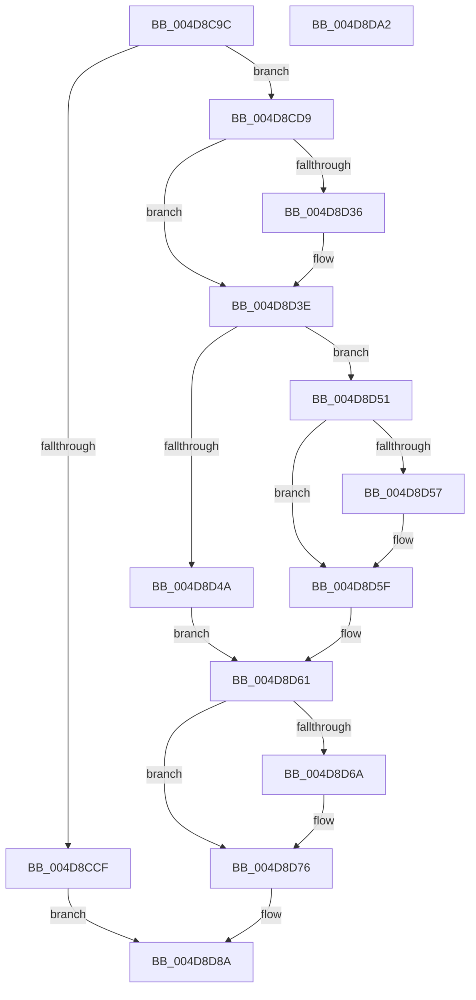

# PpmClearSimulatedIdle

- RVA: `0x004D8C9C`–`0x004D8DA3` (길이 `263` bytes)
- VA: `0x00000001404D8C9C`
- 실행 섹션: `.text`
- PDB 이름 있음: `예`; PDB Function 태그: `아니요`
- unwind 정보 RVA: `0x000BE828`
- 디코드: `67`개 명령, `263/263` bytes 표시
- 미해석 바이트: `0` (있으면 어셈블리에 `.byte`로 보존)

> 이 문서는 커널 이미지의 기계어와 PDB 기호를 분석해 생성했습니다. 4번과 5번은 함수 원형과 자료형을 바이너리 사용 방식에서 추정한 C 해석이며 원본 소스 복구 결과는 아닙니다.

## 1. Dependencies

- 직접 호출 지점: **6**; 고유 호출 대상: **6**
- 직접 호출자로 확인된 함수: **1**
- RIP 상대 이미지 참조: **3**

### Outgoing calls
- `0x004D8CC5` → [KeGetProcessorIndexFromNumber](../2D/KeGetProcessorIndexFromNumber_function_002DD2D0.md) (function, `0x002DD2D0`)
- `0x004D8D12` → [KeSetSystemGroupAffinityThread](../39/KeSetSystemGroupAffinityThread_function_00399140.md) (function, `0x00399140`)
- `0x004D8D39` → [KiRaiseIrqlProcessIrqlFlags](../4F/KiRaiseIrqlProcessIrqlFlags_function_004F56FC.md) (function, `0x004F56FC`)
- `0x004D8D71` → [KiLowerIrqlProcessIrqlFlags](../4F/KiLowerIrqlProcessIrqlFlags_function_004F5698.md) (function, `0x004F5698`)
- `0x004D8D83` → [KeRevertToUserGroupAffinityThread](../39/KeRevertToUserGroupAffinityThread_function_00398EC0.md) (function, `0x00398EC0`)
- `0x004D8D92` → [_security_check_cookie](../6A/_security_check_cookie_function_006AC640.md) (function, `0x006AC640`)

### Direct callers
- [NtPowerInformation](../../page/95/NtPowerInformation_function_00955D80.md) at `0x009572E6`

### Static image references
- `0x004D8CA6` → RVA `0x00E0A740` (`.data`; read)
- `0x004D8CDD` → RVA `0x00F231B0` (`.data`; read)
- `0x004D8D2D` → RVA `0x00FC6D20` (`ALMOSTRO`; read)

## 2. Other-region calls and transfers

- 다른 실행 섹션으로 향하는 call: **0**
- 별도 외부 분기/꼬리 이동을 확인하지 못했습니다.

## 3. Assembly (complete function range)

```asm
004D8C9C  48 89 5C 24 10                  mov qword ptr [rsp + 0x10], rbx
004D8CA1  57                              push rdi
004D8CA2  48 83 EC 50                     sub rsp, 0x50
004D8CA6  48 8B 05 93 1A 93 00            mov rax, qword ptr [rip + 0x931a93]
004D8CAD  48 33 C4                        xor rax, rsp
004D8CB0  48 89 44 24 40                  mov qword ptr [rsp + 0x40], rax
004D8CB5  0F 57 C0                        xorps xmm0, xmm0
004D8CB8  0F 57 C9                        xorps xmm1, xmm1
004D8CBB  0F 11 44 24 20                  movups xmmword ptr [rsp + 0x20], xmm0
004D8CC0  0F 11 4C 24 30                  movups xmmword ptr [rsp + 0x30], xmm1
004D8CC5  E8 06 46 E0 FF                  call 0x1402dd2d0
004D8CCA  83 F8 FF                        cmp eax, -1
004D8CCD  75 0A                           jne 0x1404d8cd9
004D8CCF  B8 0D 00 00 C0                  mov eax, 0xc000000d
004D8CD4  E9 B1 00 00 00                  jmp 0x1404d8d8a
004D8CD9  8B C8                           mov ecx, eax
004D8CDB  33 D2                           xor edx, edx
004D8CDD  48 8B 05 CC A4 A4 00            mov rax, qword ptr [rip + 0xa4a4cc]
004D8CE4  89 54 24 2A                     mov dword ptr [rsp + 0x2a], edx
004D8CE8  66 89 54 24 2E                  mov word ptr [rsp + 0x2e], dx
004D8CED  8B 0C 88                        mov ecx, dword ptr [rax + rcx*4]
004D8CF0  8B C1                           mov eax, ecx
004D8CF2  C1 E8 06                        shr eax, 6
004D8CF5  83 E1 3F                        and ecx, 0x3f
004D8CF8  66 89 44 24 28                  mov word ptr [rsp + 0x28], ax
004D8CFD  8D 42 01                        lea eax, [rdx + 1]
004D8D00  48 D3 E0                        shl rax, cl
004D8D03  48 8D 54 24 30                  lea rdx, [rsp + 0x30]
004D8D08  48 8D 4C 24 20                  lea rcx, [rsp + 0x20]
004D8D0D  48 89 44 24 20                  mov qword ptr [rsp + 0x20], rax
004D8D12  E8 29 04 EC FF                  call 0x140399140
004D8D17  65 48 8B 1C 25 20 00 00 00      mov rbx, qword ptr gs:[0x20]
004D8D20  44 0F 20 C7                     mov rdi, cr8
004D8D24  BA 02 00 00 00                  mov edx, 2
004D8D29  44 0F 22 C2                     mov cr8, rdx
004D8D2D  83 3D EC DF AE 00 00            cmp dword ptr [rip + 0xaedfec], 0
004D8D34  74 08                           je 0x1404d8d3e
004D8D36  40 8A CF                        mov cl, dil
004D8D39  E8 BE C9 01 00                  call 0x1404f56fc
004D8D3E  48 8B 83 40 88 00 00            mov rax, qword ptr [rbx + 0x8840]
004D8D45  48 85 C0                        test rax, rax
004D8D48  75 07                           jne 0x1404d8d51
004D8D4A  BB BB 00 00 C0                  mov ebx, 0xc00000bb
004D8D4F  EB 10                           jmp 0x1404d8d61
004D8D51  80 78 01 00                     cmp byte ptr [rax + 1], 0
004D8D55  74 08                           je 0x1404d8d5f
004D8D57  83 60 24 00                     and dword ptr [rax + 0x24], 0
004D8D5B  C6 40 01 00                     mov byte ptr [rax + 1], 0
004D8D5F  33 DB                           xor ebx, ebx
004D8D61  83 3D B8 DF AE 00 00            cmp dword ptr [rip + 0xaedfb8], 0
004D8D68  74 0C                           je 0x1404d8d76
004D8D6A  44 0F 20 C1                     mov rcx, cr8
004D8D6E  40 8A D7                        mov dl, dil
004D8D71  E8 22 C9 01 00                  call 0x1404f5698
004D8D76  40 0F B6 CF                     movzx ecx, dil
004D8D7A  44 0F 22 C1                     mov cr8, rcx
004D8D7E  48 8D 4C 24 30                  lea rcx, [rsp + 0x30]
004D8D83  E8 38 01 EC FF                  call 0x140398ec0
004D8D88  8B C3                           mov eax, ebx
004D8D8A  48 8B 4C 24 40                  mov rcx, qword ptr [rsp + 0x40]
004D8D8F  48 33 CC                        xor rcx, rsp
004D8D92  E8 A9 38 1D 00                  call 0x1406ac640
004D8D97  48 8B 5C 24 68                  mov rbx, qword ptr [rsp + 0x68]
004D8D9C  48 83 C4 50                     add rsp, 0x50
004D8DA0  5F                              pop rdi
004D8DA1  C3                              ret
004D8DA2  CC                              int3
```

## 4. C-style interpretation (structured pseudocode)

```c
__int64 __fastcall PpmClearSimulatedIdle(__int64 a1, int a2)
{
    __int64 result;
    __int64 v_rbx;
    __int64 v_rsp;
    unsigned __int64 v_stack_m18;
    unsigned __int64 v_stack_m28;
    unsigned __int16 v_stack_m2A;
    unsigned int v_stack_m2E;
    unsigned __int16 v_stack_m30;
    unsigned __int64 v_stack_m38;
    unsigned __int64 v_stack_p10;

    v_stack_p10 = v_rbx;
    v_rsp = (v_rsp) - (80);
    result = (*(unsigned __int64 *)(v_rip + 9640595)) ^ (v_rsp);
    v_stack_m18 = result;
    v_stack_m38 = v_xmm0;
    v_stack_m28 = v_xmm1;
    result = KeGetProcessorIndexFromNumber(a1, a2, a3, a4);
    if (((unsigned int)(result)) != -1) goto loc_004D8CD9;
    goto loc_004D8D8A;
loc_004D8CD9:
    a2 = 0;
    v_stack_m2E = 0;
    v_stack_m2A = 0;
    result = (unsigned int)(((unsigned int)((unsigned int)((unsigned int)(*(unsigned int *)(*(unsigned __int64 *)(v_rip + 10790092) + (unsigned int)((unsigned int)((unsigned int)(0xC000000DULL))) * 4))))) >> (6));
    a1 = (unsigned int)(((unsigned int)(*(unsigned int *)(*(unsigned __int64 *)(v_rip + 10790092) + (unsigned int)((unsigned int)((unsigned int)(0xC000000DULL))) * 4))) & (63));
    v_stack_m30 = (unsigned __int16)(result);
    result = (a2 + 1) << ((unsigned __int8)(a1));
    v_stack_m38 = result;
    result = KeSetSystemGroupAffinityThread(v_stack_m38, v_stack_m28, a3, a4);
    if ((*(unsigned int *)(v_rip + 11460588)) != 0) {
        a1 = (unsigned __int8)(v_cr8);
        result = KiRaiseIrqlProcessIrqlFlags(a1, 2, a3, a4);
    }
    if (*(unsigned __int64 *)(*(unsigned __int64 *)(gs_base + (0 + 32)) + 34880) != 0) goto loc_004D8D51;
    goto loc_004D8D61;
loc_004D8D51:
    if ((*(unsigned __int8 *)(*(unsigned __int64 *)(*(unsigned __int64 *)(gs_base + (0 + 32)) + 34880) + 1)) != 0) {
        *(unsigned __int8 *)(*(unsigned __int64 *)(*(unsigned __int64 *)(gs_base + (0 + 32)) + 34880) + 1) = 0;
    }
    v_rbx = 0;
loc_004D8D61:
    result = *(unsigned __int64 *)(*(unsigned __int64 *)(gs_base + (0 + 32)) + 34880);
    if ((*(unsigned int *)(v_rip + 11460536)) != 0) {
        a1 = 2;
        a2 = (unsigned __int8)(v_cr8);
        result = KiLowerIrqlProcessIrqlFlags(a1, a2, a3, a4);
    }
    result = KeRevertToUserGroupAffinityThread(v_stack_m28, a2, a3, a4);
loc_004D8D8A:
    a1 = (v_stack_m18) ^ (v_rsp);
    result = _security_check_cookie(a1, a2, a3, a4);
    v_rsp = (v_rsp) + (80);
    return result;
}
```

## 5. (Beta) C Style

```c
int64_t PpmClearSimulatedIdle(int64_t Arg1, int32_t Arg2)
{
    int64_t result;
    int64_t local_rbx;
    int64_t local_rsp;
    uint64_t v_stack_m18;
    uint64_t v_stack_m28;
    uint16_t v_stack_m2A;
    uint32_t v_stack_m2E;
    uint16_t v_stack_m30;
    uint64_t v_stack_m38;
    uint64_t v_stack_p10;

    v_stack_p10 = local_rbx;
    local_rsp = (local_rsp) - (80);
    result = (*(uint64_t *)(v_rip + 0x931A93)) ^ (local_rsp);
    v_stack_m18 = result;
    v_stack_m38 = v_xmm0;
    v_stack_m28 = v_xmm1;
    result = KeGetProcessorIndexFromNumber(Arg1, Arg2, a3, a4);
    if (((uint32_t)(result)) != -1) goto loc_004D8CD9;
    goto loc_004D8D8A;
loc_004D8CD9:
    Arg2 = 0;
    v_stack_m2E = 0;
    v_stack_m2A = 0;
    result = (uint32_t)(((uint32_t)((uint32_t)((uint32_t)(*(uint32_t *)(*(uint64_t *)(v_rip + 0xA4A4CC) + (uint32_t)((uint32_t)((uint32_t)(0xC000000DULL))) * 4))))) >> (6));
    Arg1 = (uint32_t)(((uint32_t)(*(uint32_t *)(*(uint64_t *)(v_rip + 0xA4A4CC) + (uint32_t)((uint32_t)((uint32_t)(0xC000000DULL))) * 4))) & (63));
    v_stack_m30 = (uint16_t)(result);
    result = (Arg2 + 1) << ((uint8_t)(Arg1));
    v_stack_m38 = result;
    result = KeSetSystemGroupAffinityThread(v_stack_m38, v_stack_m28, a3, a4);
    if ((*(uint32_t *)(v_rip + 0xAEDFEC)) != 0) {
        Arg1 = (uint8_t)(v_cr8);
        result = KiRaiseIrqlProcessIrqlFlags(Arg1, 2, a3, a4);
    }
    if (*(uint64_t *)(*(uint64_t *)(gs_base + (0 + 0x20)) + 0x8840) != 0) goto loc_004D8D51;
    goto loc_004D8D61;
loc_004D8D51:
    if ((*(uint8_t *)(*(uint64_t *)(*(uint64_t *)(gs_base + (0 + 0x20)) + 0x8840) + 0x1)) != 0) {
        *(uint8_t *)(*(uint64_t *)(*(uint64_t *)(gs_base + (0 + 0x20)) + 0x8840) + 0x1) = 0;
    }
    local_rbx = 0;
loc_004D8D61:
    result = *(uint64_t *)(*(uint64_t *)(gs_base + (0 + 0x20)) + 0x8840);
    if ((*(uint32_t *)(v_rip + 0xAEDFB8)) != 0) {
        Arg1 = 2;
        Arg2 = (uint8_t)(v_cr8);
        result = KiLowerIrqlProcessIrqlFlags(Arg1, Arg2, a3, a4);
    }
    result = KeRevertToUserGroupAffinityThread(v_stack_m28, Arg2, a3, a4);
loc_004D8D8A:
    Arg1 = (v_stack_m18) ^ (local_rsp);
    result = _security_check_cookie(Arg1, Arg2, a3, a4);
    local_rsp = (local_rsp) + (80);
    return result;
}
```

## 6. Execution-region graph

[열기: 2D/3D 그래프와 함수 탐색 컨트롤 패널](../../../control-panel.html?section=text&rva=0x004D8C9C&view=graph)

- 2D 그래프는 위에서 아래로 흐르고, 3D 그래프는 빈 공간을 드래그해 회전합니다. Shift+드래그는 이동, 휠은 확대·축소, 함수 노드 선택은 대상 보고서 이동입니다.

### Static fallback


