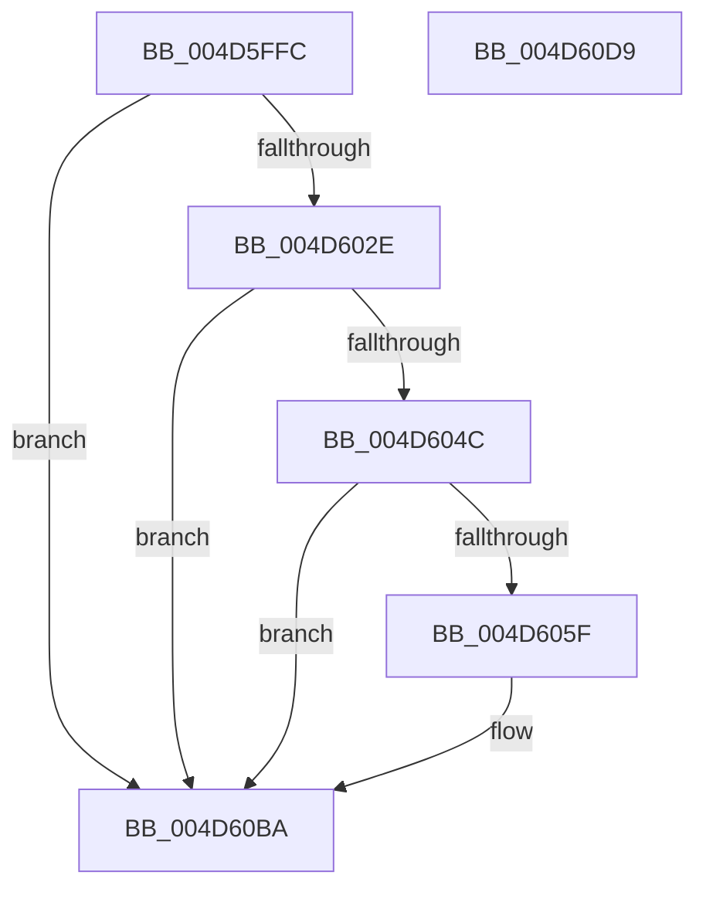

# PpmEventHgsContainmentHwUpdate

- RVA: `0x004D5FFC`–`0x004D60DA` (길이 `222` bytes)
- VA: `0x00000001404D5FFC`
- 실행 섹션: `.text`
- PDB 이름 있음: `예`; PDB Function 태그: `아니요`
- unwind 정보 RVA: `0x000BE338`
- 디코드: `50`개 명령, `222/222` bytes 표시
- 미해석 바이트: `0` (있으면 어셈블리에 `.byte`로 보존)

> 이 문서는 커널 이미지의 기계어와 PDB 기호를 분석해 생성했습니다. 4번과 5번은 함수 원형과 자료형을 바이너리 사용 방식에서 추정한 C 해석이며 원본 소스 복구 결과는 아닙니다.

## 1. Dependencies

- 직접 호출 지점: **3**; 고유 호출 대상: **3**
- 직접 호출자로 확인된 함수: **2**
- RIP 상대 이미지 참조: **6**

### Outgoing calls
- `0x004D6056` → [EtwEventEnabled](../39/EtwEventEnabled_function_00392450.md) (function, `0x00392450`)
- `0x004D60B5` → [EtwWriteEx](../25/EtwWriteEx_function_0025F0D0.md) (function, `0x0025F0D0`)
- `0x004D60C2` → [_security_check_cookie](../6A/_security_check_cookie_function_006AC640.md) (function, `0x006AC640`)

### Direct callers
- [PpmHeteroUpdateHgsConfiguration](../3B/PpmHeteroUpdateHgsConfiguration_function_003BF344.md) at `0x003BFC80`
- [PpmEventTraceControlCallback](../../page/A5/PpmEventTraceControlCallback_function_00A51F60.md) at `0x00A521F2`

### Static image references
- `0x004D600B` → RVA `0x00E0A740` (`.data`; read)
- `0x004D601A` → RVA `0x00FC501C` (`ALMOSTRO`; read)
- `0x004D6031` → RVA `0x0001EC50` (`.rdata`; read)
- `0x004D6038` → RVA `0x0001EC40` (`.rdata`; read)
- `0x004D6043` → RVA `0x00E67A39` (`.data`; read)
- `0x004D604C` → RVA `0x00F083E8` (`.data`; read)

## 2. Other-region calls and transfers

- 다른 실행 섹션으로 향하는 call: **0**
- 별도 외부 분기/꼬리 이동을 확인하지 못했습니다.

## 3. Assembly (complete function range)

```asm
004D5FFC  48 89 5C 24 08                  mov qword ptr [rsp + 8], rbx
004D6001  48 89 74 24 10                  mov qword ptr [rsp + 0x10], rsi
004D6006  57                              push rdi
004D6007  48 83 EC 70                     sub rsp, 0x70
004D600B  48 8B 05 2E 47 93 00            mov rax, qword ptr [rip + 0x93472e]
004D6012  48 33 C4                        xor rax, rsp
004D6015  48 89 44 24 60                  mov qword ptr [rsp + 0x60], rax
004D601A  8B 05 FC EF AE 00               mov eax, dword ptr [rip + 0xaeeffc]
004D6020  48 8B FA                        mov rdi, rdx
004D6023  48 8B F1                        mov rsi, rcx
004D6026  A8 04                           test al, 4
004D6028  0F 84 8C 00 00 00               je 0x1404d60ba
004D602E  45 84 C0                        test r8b, r8b
004D6031  48 8D 05 18 8C B4 FF            lea rax, [rip - 0x4b73e8]
004D6038  48 8D 1D 01 8C B4 FF            lea rbx, [rip - 0x4b73ff]
004D603F  48 0F 44 D8                     cmove rbx, rax
004D6043  80 3D EF 19 99 00 00            cmp byte ptr [rip + 0x9919ef], 0
004D604A  74 6E                           je 0x1404d60ba
004D604C  48 8B 0D 95 23 A3 00            mov rcx, qword ptr [rip + 0xa32395]
004D6053  48 8B D3                        mov rdx, rbx
004D6056  E8 F5 C3 EB FF                  call 0x140392450
004D605B  84 C0                           test al, al
004D605D  74 5B                           je 0x1404d60ba
004D605F  83 64 24 4C 00                  and dword ptr [rsp + 0x4c], 0
004D6064  48 8D 46 08                     lea rax, [rsi + 8]
004D6068  83 64 24 5C 00                  and dword ptr [rsp + 0x5c], 0
004D606D  45 33 C9                        xor r9d, r9d
004D6070  48 8B 0D 71 23 A3 00            mov rcx, qword ptr [rip + 0xa32371]
004D6077  45 33 C0                        xor r8d, r8d
004D607A  48 89 44 24 40                  mov qword ptr [rsp + 0x40], rax
004D607F  48 8B D3                        mov rdx, rbx
004D6082  48 8D 44 24 40                  lea rax, [rsp + 0x40]
004D6087  C7 44 24 48 08 00 00 00         mov dword ptr [rsp + 0x48], 8
004D608F  48 89 44 24 38                  mov qword ptr [rsp + 0x38], rax
004D6094  C7 44 24 30 02 00 00 00         mov dword ptr [rsp + 0x30], 2
004D609C  48 83 64 24 28 00               and qword ptr [rsp + 0x28], 0
004D60A2  48 83 64 24 20 00               and qword ptr [rsp + 0x20], 0
004D60A8  48 89 7C 24 50                  mov qword ptr [rsp + 0x50], rdi
004D60AD  C7 44 24 58 04 00 00 00         mov dword ptr [rsp + 0x58], 4
004D60B5  E8 16 90 D8 FF                  call 0x14025f0d0
004D60BA  48 8B 4C 24 60                  mov rcx, qword ptr [rsp + 0x60]
004D60BF  48 33 CC                        xor rcx, rsp
004D60C2  E8 79 65 1D 00                  call 0x1406ac640
004D60C7  4C 8D 5C 24 70                  lea r11, [rsp + 0x70]
004D60CC  49 8B 5B 10                     mov rbx, qword ptr [r11 + 0x10]
004D60D0  49 8B 73 18                     mov rsi, qword ptr [r11 + 0x18]
004D60D4  49 8B E3                        mov rsp, r11
004D60D7  5F                              pop rdi
004D60D8  C3                              ret
004D60D9  CC                              int3
```

## 4. C-style interpretation (structured pseudocode)

```c
__int64 __fastcall PpmEventHgsContainmentHwUpdate(__int64 a1, __int64 a2, int a3, int a4)
{
    __int64 result;
    __int64 v_rbx;
    __int64 v_rsp;
    unsigned __int64 v_stack_m18;
    unsigned int v_stack_m1C;
    unsigned int v_stack_m20;
    unsigned __int64 v_stack_m28;
    unsigned int v_stack_m2C;
    unsigned int v_stack_m30;
    unsigned __int64 v_stack_m38;
    unsigned __int64 v_stack_m40;
    unsigned int v_stack_m48;
    unsigned __int64 v_stack_m50;
    unsigned __int64 v_stack_m58;
    unsigned __int64 v_stack_m8;
    unsigned __int64 v_stack_p10;
    unsigned __int64 v_stack_p8;

    v_stack_p8 = v_rbx;
    v_stack_p10 = v_rsi;
    v_rsp = (v_rsp) - (112);
    result = (*(unsigned __int64 *)(v_rip + 9652014)) ^ (v_rsp);
    v_stack_m18 = result;
    if ((((unsigned __int8)((unsigned int)(*(unsigned int *)(v_rip + 11464700)))) & (4)) == 0) goto loc_004D60BA;
    v_rbx = v_rip - 4944895;
    if ((unsigned __int8)(a3) == 0) { v_rbx = v_rip - 4944872; }
    if ((*(unsigned __int8 *)(v_rip + 10033647)) == 0) goto loc_004D60BA;
    result = EtwEventEnabled(*(unsigned __int64 *)(v_rip + 10691477), v_rbx, a3, a4);
    if ((unsigned __int8)(result) != 0) {
        result = a1 + 8;
        a4 = 0;
        a1 = *(unsigned __int64 *)(v_rip + 10691441);
        a3 = 0;
        v_stack_m38 = result;
        a2 = v_rbx;
        result = v_stack_m38;
        v_stack_m30 = 8;
        v_stack_m40 = result;
        v_stack_m48 = 2;
        v_stack_m28 = a2;
        v_stack_m20 = 4;
        result = EtwWriteEx(a1, a2, a3, a4);
    }
    a1 = (v_stack_m18) ^ (v_rsp);
    result = _security_check_cookie(a1, a2, a3, a4);
    return result;
}
```

## 5. (Beta) C Style

```c
int64_t PpmEventHgsContainmentHwUpdate(void *Arg1, int64_t Arg2, int32_t Arg3, int32_t Arg4)
{
    uint8_t *arg1 = (uint8_t *)Arg1;

    int64_t result;
    int64_t local_rbx;
    int64_t local_rsp;
    uint64_t v_stack_m18;
    uint32_t v_stack_m1C;
    uint32_t v_stack_m20;
    uint64_t v_stack_m28;
    uint32_t v_stack_m2C;
    uint32_t v_stack_m30;
    uint64_t v_stack_m38;
    uint64_t v_stack_m40;
    uint32_t v_stack_m48;
    uint64_t v_stack_m50;
    uint64_t v_stack_m58;
    uint64_t v_stack_m8;
    uint64_t v_stack_p10;
    uint64_t v_stack_p8;

    v_stack_p8 = local_rbx;
    v_stack_p10 = local_rsi;
    local_rsp = (local_rsp) - (112);
    result = (*(uint64_t *)(v_rip + 0x93472E)) ^ (local_rsp);
    v_stack_m18 = result;
    if ((((uint8_t)((uint32_t)(*(uint32_t *)(v_rip + 0xAEEFFC)))) & (4)) == 0) goto loc_004D60BA;
    local_rbx = v_rip - 4944895;
    if ((uint8_t)(Arg3) == 0) { local_rbx = v_rip - 4944872; }
    if ((*(uint8_t *)(v_rip + 0x9919EF)) == 0) goto loc_004D60BA;
    result = EtwEventEnabled(*(uint64_t *)(v_rip + 0xA32395), local_rbx, Arg3, Arg4);
    if ((uint8_t)(result) != 0) {
        result = Arg1 + 8;
        Arg4 = 0;
        Arg1 = *(uint64_t *)(v_rip + 0xA32371);
        Arg3 = 0;
        v_stack_m38 = result;
        Arg2 = local_rbx;
        result = v_stack_m38;
        v_stack_m30 = 8;
        v_stack_m40 = result;
        v_stack_m48 = 2;
        v_stack_m28 = Arg2;
        v_stack_m20 = 4;
        result = EtwWriteEx(Arg1, Arg2, Arg3, Arg4);
    }
    Arg1 = (v_stack_m18) ^ (local_rsp);
    result = _security_check_cookie(Arg1, Arg2, Arg3, Arg4);
    return result;
}
```

### 관측된 메모리 오프셋

구조체 형식이 확인되지 않은 접근은 인자 기준의 오프셋으로만 기록했습니다.

| 기준 인자 | 오프셋 표현 | 폭 (bit) | 접근 |
|---|---:|---:|---|
| `Arg1` | `+ 0x8` | `64` | `R` |

## 6. Execution-region graph

[열기: 2D/3D 그래프와 함수 탐색 컨트롤 패널](../../../control-panel.html?section=text&rva=0x004D5FFC&view=graph)

- 2D 그래프는 위에서 아래로 흐르고, 3D 그래프는 빈 공간을 드래그해 회전합니다. Shift+드래그는 이동, 휠은 확대·축소, 함수 노드 선택은 대상 보고서 이동입니다.

### Static fallback


