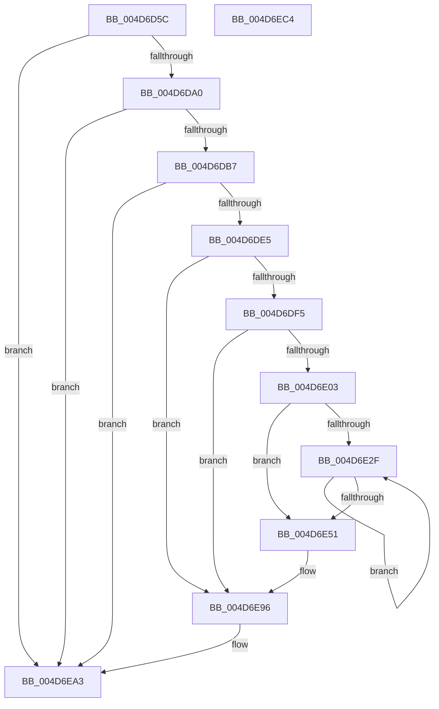

# PpmEventHgsHardwareTableResonChanged

- RVA: `0x004D6D5C`–`0x004D6EC5` (길이 `361` bytes)
- VA: `0x00000001404D6D5C`
- 실행 섹션: `.text`
- PDB 이름 있음: `예`; PDB Function 태그: `아니요`
- unwind 정보 RVA: `0x000BC800`
- 디코드: `85`개 명령, `361/361` bytes 표시
- 미해석 바이트: `0` (있으면 어셈블리에 `.byte`로 보존)

> 이 문서는 커널 이미지의 기계어와 PDB 기호를 분석해 생성했습니다. 4번과 5번은 함수 원형과 자료형을 바이너리 사용 방식에서 추정한 C 해석이며 원본 소스 복구 결과는 아닙니다.

## 1. Dependencies

- 직접 호출 지점: **5**; 고유 호출 대상: **5**
- 직접 호출자로 확인된 함수: **2**
- RIP 상대 이미지 참조: **8**

### Outgoing calls
- `0x004D6DAA` → [EtwEventEnabled](../39/EtwEventEnabled_function_00392450.md) (function, `0x00392450`)
- `0x004D6DD4` → [ExAllocatePool2](../../poolcode/B8/ExAllocatePool2_function_00B820F0.md) (function, `0x00B820F0`)
- `0x004D6E91` → [EtwWriteEx](../25/EtwWriteEx_function_0025F0D0.md) (function, `0x0025F0D0`)
- `0x004D6E9E` → [ExFreePoolWithTag](../../poolcode/B8/ExFreePoolWithTag_function_00B82870.md) (function, `0x00B82870`)
- `0x004D6EAA` → [_security_check_cookie](../6A/_security_check_cookie_function_006AC640.md) (function, `0x006AC640`)

### Direct callers
- [PpmHeteroUpdateHgsConfiguration](../3B/PpmHeteroUpdateHgsConfiguration_function_003BF344.md) at `0x003BFAAD`
- [PpmEventTraceControlCallback](../../page/A5/PpmEventTraceControlCallback_function_00A51F60.md) at `0x00A5212C`

### Static image references
- `0x004D6D71` → RVA `0x00E0A740` (`.data`; read)
- `0x004D6D81` → RVA `0x0001ECB8` (`.rdata`; read)
- `0x004D6D88` → RVA `0x0001ECA8` (`.rdata`; read)
- `0x004D6D93` → RVA `0x00E67A39` (`.data`; read)
- `0x004D6DA0` → RVA `0x00F083E8` (`.data`; read)
- `0x004D6DB7` → RVA `0x00E0B804` (`.data`; read)
- `0x004D6DE5` → RVA `0x00F0B228` (`.data`; read)
- `0x004D6DF5` → RVA `0x00F0B220` (`.data`; read)

## 2. Other-region calls and transfers

- 다른 실행 섹션으로 향하는 call: **2**
  - `0x004D6DD4` → [ExAllocatePool2](../../poolcode/B8/ExAllocatePool2_function_00B820F0.md) (`.text` → `POOLCODE`)
  - `0x004D6E9E` → [ExFreePoolWithTag](../../poolcode/B8/ExFreePoolWithTag_function_00B82870.md) (`.text` → `POOLCODE`)
- 별도 외부 분기/꼬리 이동을 확인하지 못했습니다.

## 3. Assembly (complete function range)

```asm
004D6D5C  48 89 5C 24 08                  mov qword ptr [rsp + 8], rbx
004D6D61  48 89 7C 24 10                  mov qword ptr [rsp + 0x10], rdi
004D6D66  55                              push rbp
004D6D67  48 8B EC                        mov rbp, rsp
004D6D6A  48 81 EC 80 00 00 00            sub rsp, 0x80
004D6D71  48 8B 05 C8 39 93 00            mov rax, qword ptr [rip + 0x9339c8]
004D6D78  48 33 C4                        xor rax, rsp
004D6D7B  48 89 45 F8                     mov qword ptr [rbp - 8], rax
004D6D7F  84 C9                           test cl, cl
004D6D81  48 8D 05 30 7F B4 FF            lea rax, [rip - 0x4b80d0]
004D6D88  48 8D 1D 19 7F B4 FF            lea rbx, [rip - 0x4b80e7]
004D6D8F  48 0F 44 D8                     cmove rbx, rax
004D6D93  80 3D 9F 0C 99 00 00            cmp byte ptr [rip + 0x990c9f], 0
004D6D9A  0F 84 03 01 00 00               je 0x1404d6ea3
004D6DA0  48 8B 0D 41 16 A3 00            mov rcx, qword ptr [rip + 0xa31641]
004D6DA7  48 8B D3                        mov rdx, rbx
004D6DAA  E8 A1 B6 EB FF                  call 0x140392450
004D6DAF  84 C0                           test al, al
004D6DB1  0F 84 EC 00 00 00               je 0x1404d6ea3
004D6DB7  8B 05 47 4A 93 00               mov eax, dword ptr [rip + 0x934a47]
004D6DBD  B9 00 01 00 00                  mov ecx, 0x100
004D6DC2  89 45 C0                        mov dword ptr [rbp - 0x40], eax
004D6DC5  41 B8 50 50 4D 65               mov r8d, 0x654d5050
004D6DCB  89 45 C4                        mov dword ptr [rbp - 0x3c], eax
004D6DCE  8D 04 40                        lea eax, [rax + rax*2]
004D6DD1  8D 14 00                        lea edx, [rax + rax]
004D6DD4  E8 17 B3 6A 00                  call 0x140b820f0
004D6DD9  48 8B F8                        mov rdi, rax
004D6DDC  48 85 C0                        test rax, rax
004D6DDF  0F 84 BE 00 00 00               je 0x1404d6ea3
004D6DE5  4C 8B 05 3C 44 A3 00            mov r8, qword ptr [rip + 0xa3443c]
004D6DEC  4D 85 C0                        test r8, r8
004D6DEF  0F 84 A1 00 00 00               je 0x1404d6e96
004D6DF5  48 83 3D 23 44 A3 00 00         cmp qword ptr [rip + 0xa34423], 0
004D6DFD  0F 84 93 00 00 00               je 0x1404d6e96
004D6E03  83 65 D4 00                     and dword ptr [rbp - 0x2c], 0
004D6E07  48 8D 45 C0                     lea rax, [rbp - 0x40]
004D6E0B  83 65 E4 00                     and dword ptr [rbp - 0x1c], 0
004D6E0F  B9 04 00 00 00                  mov ecx, 4
004D6E14  48 89 45 C8                     mov qword ptr [rbp - 0x38], rax
004D6E18  45 33 C9                        xor r9d, r9d
004D6E1B  48 8D 45 C4                     lea rax, [rbp - 0x3c]
004D6E1F  89 4D D0                        mov dword ptr [rbp - 0x30], ecx
004D6E22  48 89 45 D8                     mov qword ptr [rbp - 0x28], rax
004D6E26  89 4D E0                        mov dword ptr [rbp - 0x20], ecx
004D6E29  44 39 4D C0                     cmp dword ptr [rbp - 0x40], r9d
004D6E2D  76 22                           jbe 0x1404d6e51
004D6E2F  4B 8D 14 49                     lea rdx, [r9 + r9*2]
004D6E33  44 89 0C 57                     mov dword ptr [rdi + rdx*2], r9d
004D6E37  43 8A 04 48                     mov al, byte ptr [r8 + r9*2]
004D6E3B  88 44 57 04                     mov byte ptr [rdi + rdx*2 + 4], al
004D6E3F  43 8A 44 48 01                  mov al, byte ptr [r8 + r9*2 + 1]
004D6E44  41 FF C1                        inc r9d
004D6E47  88 44 57 05                     mov byte ptr [rdi + rdx*2 + 5], al
004D6E4B  44 3B 4D C0                     cmp r9d, dword ptr [rbp - 0x40]
004D6E4F  72 DE                           jb 0x1404d6e2f
004D6E51  8B 45 C4                        mov eax, dword ptr [rbp - 0x3c]
004D6E54  45 33 C9                        xor r9d, r9d
004D6E57  83 65 F4 00                     and dword ptr [rbp - 0xc], 0
004D6E5B  45 33 C0                        xor r8d, r8d
004D6E5E  48 8B D3                        mov rdx, rbx
004D6E61  48 89 7D E8                     mov qword ptr [rbp - 0x18], rdi
004D6E65  8D 0C 40                        lea ecx, [rax + rax*2]
004D6E68  03 C9                           add ecx, ecx
004D6E6A  48 8D 45 C8                     lea rax, [rbp - 0x38]
004D6E6E  48 89 44 24 38                  mov qword ptr [rsp + 0x38], rax
004D6E73  C7 44 24 30 03 00 00 00         mov dword ptr [rsp + 0x30], 3
004D6E7B  48 83 64 24 28 00               and qword ptr [rsp + 0x28], 0
004D6E81  48 83 64 24 20 00               and qword ptr [rsp + 0x20], 0
004D6E87  89 4D F0                        mov dword ptr [rbp - 0x10], ecx
004D6E8A  48 8B 0D 57 15 A3 00            mov rcx, qword ptr [rip + 0xa31557]
004D6E91  E8 3A 82 D8 FF                  call 0x14025f0d0
004D6E96  BA 50 50 4D 65                  mov edx, 0x654d5050
004D6E9B  48 8B CF                        mov rcx, rdi
004D6E9E  E8 CD B9 6A 00                  call 0x140b82870
004D6EA3  48 8B 4D F8                     mov rcx, qword ptr [rbp - 8]
004D6EA7  48 33 CC                        xor rcx, rsp
004D6EAA  E8 91 57 1D 00                  call 0x1406ac640
004D6EAF  4C 8D 9C 24 80 00 00 00         lea r11, [rsp + 0x80]
004D6EB7  49 8B 5B 10                     mov rbx, qword ptr [r11 + 0x10]
004D6EBB  49 8B 7B 18                     mov rdi, qword ptr [r11 + 0x18]
004D6EBF  49 8B E3                        mov rsp, r11
004D6EC2  5D                              pop rbp
004D6EC3  C3                              ret
004D6EC4  CC                              int3
```

## 4. C-style interpretation (structured pseudocode)

```c
__int64 __fastcall PpmEventHgsHardwareTableResonChanged(unsigned __int8 a1, __int64 a2, __int64 a3, int a4)
{
    __int64 result;
    __int64 v_rbx;
    __int64 v_rsp;
    unsigned __int64 v_stack_m10;
    unsigned int v_stack_m14;
    unsigned int v_stack_m18;
    unsigned __int64 v_stack_m20;
    unsigned int v_stack_m24;
    unsigned int v_stack_m28;
    unsigned __int64 v_stack_m30;
    unsigned int v_stack_m34;
    unsigned int v_stack_m38;
    unsigned __int64 v_stack_m40;
    unsigned int v_stack_m44;
    unsigned int v_stack_m48;
    unsigned __int64 v_stack_m50;
    unsigned int v_stack_m58;
    unsigned __int64 v_stack_m60;
    unsigned __int64 v_stack_m68;
    unsigned __int64 v_stack_m8;
    unsigned __int64 v_stack_p10;
    unsigned __int64 v_stack_p8;

    v_stack_p8 = v_rbx;
    v_stack_p10 = v_rdi;
    v_rsp = (v_rsp) - (128);
    result = (*(unsigned __int64 *)(v_rip + 9648584)) ^ (v_rsp);
    v_stack_m10 = result;
    v_rbx = v_rip - 4948199;
    if (a1 == 0) { v_rbx = v_rip - 4948176; }
    if ((*(unsigned __int8 *)(v_rip + 10030239)) == 0) goto loc_004D6EA3;
    result = EtwEventEnabled(*(unsigned __int64 *)(v_rip + 10688065), v_rbx, a3, a4);
    if ((unsigned __int8)(result) == 0) goto loc_004D6EA3;
    v_stack_m48 = (unsigned int)((unsigned int)(*(unsigned int *)(v_rip + 9652807)));
    v_stack_m44 = (unsigned int)((unsigned int)(*(unsigned int *)(v_rip + 9652807)));
    result = ExAllocatePool2(256, (unsigned int)(*(unsigned int *)(v_rip + 9652807)) + (unsigned int)(*(unsigned int *)(v_rip + 9652807)) * 2 + (unsigned int)(*(unsigned int *)(v_rip + 9652807)) + (unsigned int)(*(unsigned int *)(v_rip + 9652807)) * 2 * 1, (unsigned int)(0x654D5050ULL), a4);
    if (result == 0) goto loc_004D6EA3;
    if (*(unsigned __int64 *)(v_rip + 10699836) == 0) goto loc_004D6E96;
    if ((*(unsigned __int64 *)(v_rip + 10699811)) == 0) goto loc_004D6E96;
    v_stack_m40 = v_stack_m48;
    a4 = 0;
    v_stack_m38 = 4;
    v_stack_m30 = v_stack_m44;
    v_stack_m28 = 4;
    if (v_stack_m48 <= 0) goto loc_004D6E51;
loc_004D6E2F:
    *(unsigned int *)(result + a4 + a4 * 2 * 2) = 0;
    *(unsigned __int8 *)(result + a4 + a4 * 2 * 2 + 4) = (unsigned __int8)(*(unsigned __int8 *)(*(unsigned __int64 *)(v_rip + 10699836) + a4 * 2));
    a4 = (unsigned int)((a4) + 1);
    *(unsigned __int8 *)(result + a4 + a4 * 2 * 2 + 5) = (unsigned __int8)(*(unsigned __int8 *)(*(unsigned __int64 *)(v_rip + 10699836) + a4 * 2 + 1));
    if (a4 < v_stack_m48) goto loc_004D6E2F;
loc_004D6E51:
    a4 = 0;
    a3 = 0;
    v_stack_m20 = result;
    a1 = (unsigned int)(((unsigned int)(v_stack_m44) + (unsigned int)(v_stack_m44) * 2) + ((unsigned int)((unsigned int)(v_stack_m44) + (unsigned int)(v_stack_m44) * 2)));
    v_stack_m50 = v_stack_m40;
    v_stack_m58 = 3;
    v_stack_m18 = a1;
    result = EtwWriteEx(*(unsigned __int64 *)(v_rip + 10687831), v_rbx, a3, a4);
loc_004D6E96:
    result = ExFreePoolWithTag(result, (unsigned int)(0x654D5050ULL), a3, a4);
loc_004D6EA3:
    a1 = (v_stack_m10) ^ (v_rsp);
    result = _security_check_cookie(a1, (unsigned int)(0x654D5050ULL), a3, a4);
    return result;
}
```

## 5. (Beta) C Style

```c
int64_t PpmEventHgsHardwareTableResonChanged(uint8_t Arg1, int64_t Arg2, int64_t Arg3, int32_t Arg4)
{
    int64_t result;
    int64_t local_rbx;
    int64_t local_rsp;
    uint64_t v_stack_m10;
    uint32_t v_stack_m14;
    uint32_t v_stack_m18;
    uint64_t v_stack_m20;
    uint32_t v_stack_m24;
    uint32_t v_stack_m28;
    uint64_t v_stack_m30;
    uint32_t v_stack_m34;
    uint32_t v_stack_m38;
    uint64_t v_stack_m40;
    uint32_t v_stack_m44;
    uint32_t v_stack_m48;
    uint64_t v_stack_m50;
    uint32_t v_stack_m58;
    uint64_t v_stack_m60;
    uint64_t v_stack_m68;
    uint64_t v_stack_m8;
    uint64_t v_stack_p10;
    uint64_t v_stack_p8;

    v_stack_p8 = local_rbx;
    v_stack_p10 = local_rdi;
    local_rsp = (local_rsp) - (128);
    result = (*(uint64_t *)(v_rip + 0x9339C8)) ^ (local_rsp);
    v_stack_m10 = result;
    local_rbx = v_rip - 4948199;
    if (Arg1 == 0) { local_rbx = v_rip - 4948176; }
    if ((*(uint8_t *)(v_rip + 0x990C9F)) == 0) goto loc_004D6EA3;
    result = EtwEventEnabled(*(uint64_t *)(v_rip + 0xA31641), local_rbx, Arg3, Arg4);
    if ((uint8_t)(result) == 0) goto loc_004D6EA3;
    v_stack_m48 = (uint32_t)((uint32_t)(*(uint32_t *)(v_rip + 0x934A47)));
    v_stack_m44 = (uint32_t)((uint32_t)(*(uint32_t *)(v_rip + 0x934A47)));
    result = ExAllocatePool2(256, (uint32_t)(*(uint32_t *)(v_rip + 0x934A47)) + (uint32_t)(*(uint32_t *)(v_rip + 0x934A47)) * 2 + (uint32_t)(*(uint32_t *)(v_rip + 0x934A47)) + (uint32_t)(*(uint32_t *)(v_rip + 0x934A47)) * 2 * 1, (uint32_t)(0x654D5050ULL), Arg4);
    if (result == 0) goto loc_004D6EA3;
    if (*(uint64_t *)(v_rip + 0xA3443C) == 0) goto loc_004D6E96;
    if ((*(uint64_t *)(v_rip + 0xA34423)) == 0) goto loc_004D6E96;
    v_stack_m40 = v_stack_m48;
    Arg4 = 0;
    v_stack_m38 = 4;
    v_stack_m30 = v_stack_m44;
    v_stack_m28 = 4;
    if (v_stack_m48 <= 0) goto loc_004D6E51;
loc_004D6E2F:
    *(uint32_t *)(result + Arg4 + Arg4 * 2 * 2) = 0;
    *(uint8_t *)(result + Arg4 + Arg4 * 2 * 2 + 0x4) = (uint8_t)(*(uint8_t *)(*(uint64_t *)(v_rip + 0xA3443C) + Arg4 * 2));
    Arg4 = (uint32_t)((Arg4) + 1);
    *(uint8_t *)(result + Arg4 + Arg4 * 2 * 2 + 0x5) = (uint8_t)(*(uint8_t *)(*(uint64_t *)(v_rip + 0xA3443C) + Arg4 * 2 + 0x1));
    if (Arg4 < v_stack_m48) goto loc_004D6E2F;
loc_004D6E51:
    Arg4 = 0;
    Arg3 = 0;
    v_stack_m20 = result;
    Arg1 = (uint32_t)(((uint32_t)(v_stack_m44) + (uint32_t)(v_stack_m44) * 2) + ((uint32_t)((uint32_t)(v_stack_m44) + (uint32_t)(v_stack_m44) * 2)));
    v_stack_m50 = v_stack_m40;
    v_stack_m58 = 3;
    v_stack_m18 = Arg1;
    result = EtwWriteEx(*(uint64_t *)(v_rip + 0xA31557), local_rbx, Arg3, Arg4);
loc_004D6E96:
    result = ExFreePoolWithTag(result, (uint32_t)(0x654D5050ULL), Arg3, Arg4);
loc_004D6EA3:
    Arg1 = (v_stack_m10) ^ (local_rsp);
    result = _security_check_cookie(Arg1, (uint32_t)(0x654D5050ULL), Arg3, Arg4);
    return result;
}
```

## 6. Execution-region graph

[열기: 2D/3D 그래프와 함수 탐색 컨트롤 패널](../../../control-panel.html?section=text&rva=0x004D6D5C&view=graph)

- 2D 그래프는 위에서 아래로 흐르고, 3D 그래프는 빈 공간을 드래그해 회전합니다. Shift+드래그는 이동, 휠은 확대·축소, 함수 노드 선택은 대상 보고서 이동입니다.

### Static fallback


