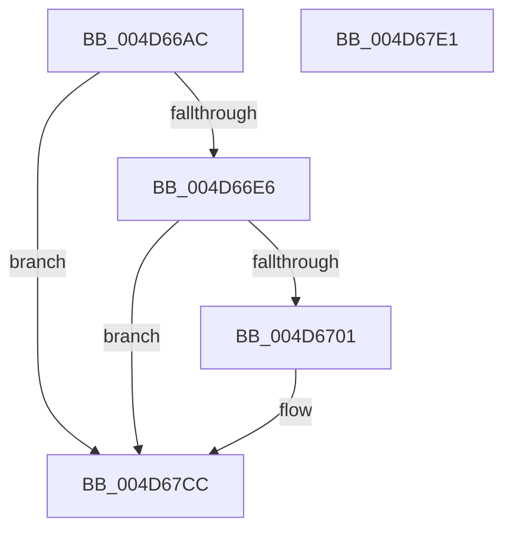

# PpmEventParkNodeClassRecordedStats

- RVA: `0x004D66AC`–`0x004D67E2` (길이 `310` bytes)
- VA: `0x00000001404D66AC`
- 실행 섹션: `.text`
- PDB 이름 있음: `예`; PDB Function 태그: `아니요`
- unwind 정보 RVA: `0x000BE42C`
- 디코드: `72`개 명령, `310/310` bytes 표시
- 미해석 바이트: `0` (있으면 어셈블리에 `.byte`로 보존)

> 이 문서는 커널 이미지의 기계어와 PDB 기호를 분석해 생성했습니다. 4번과 5번은 함수 원형과 자료형을 바이너리 사용 방식에서 추정한 C 해석이며 원본 소스 복구 결과는 아닙니다.

## 1. Dependencies

- 직접 호출 지점: **3**; 고유 호출 대상: **3**
- 직접 호출자로 확인된 함수: **1**
- RIP 상대 이미지 참조: **4**

### Outgoing calls
- `0x004D66F4` → [EtwEventEnabled](../39/EtwEventEnabled_function_00392450.md) (function, `0x00392450`)
- `0x004D67C7` → [EtwWriteEx](../25/EtwWriteEx_function_0025F0D0.md) (function, `0x0025F0D0`)
- `0x004D67D3` → [_security_check_cookie](../6A/_security_check_cookie_function_006AC640.md) (function, `0x006AC640`)

### Direct callers
- [sub_006EC724](../6E/Unknown_function_006EC724.md) at `0x006EC7CB`

### Static image references
- `0x004D66CB` → RVA `0x00E0A740` (`.data`; read)
- `0x004D66D9` → RVA `0x00E67A39` (`.data`; read)
- `0x004D66E6` → RVA `0x00F083E8` (`.data`; read)
- `0x004D66ED` → RVA `0x0001EC60` (`.rdata`; read)

## 2. Other-region calls and transfers

- 다른 실행 섹션으로 향하는 call: **0**
- 별도 외부 분기/꼬리 이동을 확인하지 못했습니다.

## 3. Assembly (complete function range)

```asm
004D66AC  48 8B C4                        mov rax, rsp
004D66AF  44 88 48 20                     mov byte ptr [rax + 0x20], r9b
004D66B3  44 88 40 18                     mov byte ptr [rax + 0x18], r8b
004D66B7  48 89 50 10                     mov qword ptr [rax + 0x10], rdx
004D66BB  66 89 48 08                     mov word ptr [rax + 8], cx
004D66BF  55                              push rbp
004D66C0  48 8D 68 B9                     lea rbp, [rax - 0x47]
004D66C4  48 81 EC D0 00 00 00            sub rsp, 0xd0
004D66CB  48 8B 05 6E 40 93 00            mov rax, qword ptr [rip + 0x93406e]
004D66D2  48 33 C4                        xor rax, rsp
004D66D5  48 89 45 2F                     mov qword ptr [rbp + 0x2f], rax
004D66D9  80 3D 59 13 99 00 00            cmp byte ptr [rip + 0x991359], 0
004D66E0  0F 84 E6 00 00 00               je 0x1404d67cc
004D66E6  48 8B 0D FB 1C A3 00            mov rcx, qword ptr [rip + 0xa31cfb]
004D66ED  48 8D 15 6C 85 B4 FF            lea rdx, [rip - 0x4b7a94]
004D66F4  E8 57 BD EB FF                  call 0x140392450
004D66F9  84 C0                           test al, al
004D66FB  0F 84 CB 00 00 00               je 0x1404d67cc
004D6701  83 65 BB 00                     and dword ptr [rbp - 0x45], 0
004D6705  48 8D 45 4F                     lea rax, [rbp + 0x4f]
004D6709  83 65 CB 00                     and dword ptr [rbp - 0x35], 0
004D670D  48 8D 15 4C 85 B4 FF            lea rdx, [rip - 0x4b7ab4]
004D6714  83 65 DB 00                     and dword ptr [rbp - 0x25], 0
004D6718  41 B9 08 00 00 00               mov r9d, 8
004D671E  83 65 EB 00                     and dword ptr [rbp - 0x15], 0
004D6722  83 65 FB 00                     and dword ptr [rbp - 5], 0
004D6726  83 65 0B 00                     and dword ptr [rbp + 0xb], 0
004D672A  83 65 1B 00                     and dword ptr [rbp + 0x1b], 0
004D672E  45 8D 41 F9                     lea r8d, [r9 - 7]
004D6732  83 65 2B 00                     and dword ptr [rbp + 0x2b], 0
004D6736  48 89 45 AF                     mov qword ptr [rbp - 0x51], rax
004D673A  48 8D 45 57                     lea rax, [rbp + 0x57]
004D673E  48 89 45 BF                     mov qword ptr [rbp - 0x41], rax
004D6742  48 8D 45 5F                     lea rax, [rbp + 0x5f]
004D6746  48 89 45 CF                     mov qword ptr [rbp - 0x31], rax
004D674A  48 8D 45 7F                     lea rax, [rbp + 0x7f]
004D674E  48 89 45 DF                     mov qword ptr [rbp - 0x21], rax
004D6752  48 8B 45 77                     mov rax, qword ptr [rbp + 0x77]
004D6756  44 89 4D C7                     mov dword ptr [rbp - 0x39], r9d
004D675A  44 89 45 D7                     mov dword ptr [rbp - 0x29], r8d
004D675E  44 89 45 E7                     mov dword ptr [rbp - 0x19], r8d
004D6762  48 8D 48 30                     lea rcx, [rax + 0x30]
004D6766  44 89 45 17                     mov dword ptr [rbp + 0x17], r8d
004D676A  48 8B 40 08                     mov rax, qword ptr [rax + 8]
004D676E  48 89 45 FF                     mov qword ptr [rbp - 1], rax
004D6772  8B 01                           mov eax, dword ptr [rcx]
004D6774  C1 E0 03                        shl eax, 3
004D6777  89 45 07                        mov dword ptr [rbp + 7], eax
004D677A  48 8D 45 67                     lea rax, [rbp + 0x67]
004D677E  48 89 45 0F                     mov qword ptr [rbp + 0xf], rax
004D6782  48 8D 45 6F                     lea rax, [rbp + 0x6f]
004D6786  48 89 45 1F                     mov qword ptr [rbp + 0x1f], rax
004D678A  48 8D 45 AF                     lea rax, [rbp - 0x51]
004D678E  48 89 44 24 38                  mov qword ptr [rsp + 0x38], rax
004D6793  44 89 4C 24 30                  mov dword ptr [rsp + 0x30], r9d
004D6798  45 33 C9                        xor r9d, r9d
004D679B  48 83 64 24 28 00               and qword ptr [rsp + 0x28], 0
004D67A1  48 83 64 24 20 00               and qword ptr [rsp + 0x20], 0
004D67A7  48 89 4D EF                     mov qword ptr [rbp - 0x11], rcx
004D67AB  48 8B 0D 36 1C A3 00            mov rcx, qword ptr [rip + 0xa31c36]
004D67B2  44 89 45 27                     mov dword ptr [rbp + 0x27], r8d
004D67B6  45 33 C0                        xor r8d, r8d
004D67B9  C7 45 B7 02 00 00 00            mov dword ptr [rbp - 0x49], 2
004D67C0  C7 45 F7 04 00 00 00            mov dword ptr [rbp - 9], 4
004D67C7  E8 04 89 D8 FF                  call 0x14025f0d0
004D67CC  48 8B 4D 2F                     mov rcx, qword ptr [rbp + 0x2f]
004D67D0  48 33 CC                        xor rcx, rsp
004D67D3  E8 68 5E 1D 00                  call 0x1406ac640
004D67D8  48 81 C4 D0 00 00 00            add rsp, 0xd0
004D67DF  5D                              pop rbp
004D67E0  C3                              ret
004D67E1  CC                              int3
```

## 4. C-style interpretation (structured pseudocode)

```c
__int64 __fastcall PpmEventParkNodeClassRecordedStats(unsigned __int16 a1, __int64 a2, unsigned __int8 a3, unsigned __int8 a4)
{
    __int64 result;
    __int64 v_rsp;
    unsigned __int64 v_stack_mA0;
    unsigned int v_stack_mA8;
    unsigned __int64 v_stack_mB0;
    unsigned __int64 v_stack_mB8;

    *(unsigned __int8 *)(v_rsp + 32) = a4;
    *(unsigned __int8 *)(v_rsp + 24) = a3;
    *(unsigned __int64 *)(v_rsp + 16) = a2;
    *(unsigned __int16 *)(v_rsp + 8) = a1;
    v_rsp = (v_rsp) - (208);
    result = (*(unsigned __int64 *)(v_rip + 9650286)) ^ (v_rsp);
    *(unsigned __int64 *)(v_rsp - 71 + 47) = result;
    if ((*(unsigned __int8 *)(v_rip + 10031961)) == 0) goto loc_004D67CC;
    result = EtwEventEnabled(*(unsigned __int64 *)(v_rip + 10689787), v_rip - 4946580, a3, a4);
    if ((unsigned __int8)(result) != 0) {
        result = v_rsp - 71 + 79;
        a2 = v_rip - 4946612;
        a4 = 8;
        a3 = a4 - 7;
        *(unsigned __int64 *)(v_rsp - 71 - 81) = result;
        result = v_rsp - 71 + 87;
        *(unsigned __int64 *)(v_rsp - 71 - 65) = result;
        result = v_rsp - 71 + 95;
        *(unsigned __int64 *)(v_rsp - 71 - 49) = result;
        result = v_rsp - 71 + 127;
        *(unsigned __int64 *)(v_rsp - 71 - 33) = result;
        result = *(unsigned __int64 *)(v_rsp - 71 + 119);
        *(unsigned int *)(v_rsp - 71 - 57) = a4;
        *(unsigned int *)(v_rsp - 71 - 41) = a3;
        *(unsigned int *)(v_rsp - 71 - 25) = a3;
        a1 = result + 48;
        *(unsigned int *)(v_rsp - 71 + 23) = a3;
        result = *(unsigned __int64 *)(result + 8);
        *(unsigned __int64 *)(v_rsp - 71 - 1) = result;
        result = *(unsigned int *)(a1);
        result = (unsigned int)((result) << (3));
        *(unsigned int *)(v_rsp - 71 + 7) = (unsigned int)(result);
        result = v_rsp - 71 + 103;
        *(unsigned __int64 *)(v_rsp - 71 + 15) = result;
        result = v_rsp - 71 + 111;
        *(unsigned __int64 *)(v_rsp - 71 + 31) = result;
        result = v_rsp - 71 - 81;
        v_stack_mA0 = result;
        v_stack_mA8 = a4;
        a4 = 0;
        *(unsigned __int64 *)(v_rsp - 71 - 17) = a1;
        a1 = *(unsigned __int64 *)(v_rip + 10689590);
        *(unsigned int *)(v_rsp - 71 + 39) = a3;
        a3 = 0;
        *(unsigned int *)(v_rsp - 71 - 73) = 2;
        *(unsigned int *)(v_rsp - 71 - 9) = 4;
        result = EtwWriteEx(a1, a2, a3, a4);
    }
    a1 = (*(unsigned __int64 *)(v_rsp - 71 + 47)) ^ (v_rsp);
    result = _security_check_cookie(a1, a2, a3, a4);
    v_rsp = (v_rsp) + (208);
    return result;
}
```

## 5. (Beta) C Style

```c
int64_t PpmEventParkNodeClassRecordedStats(uint16_t Arg1, int64_t Arg2, uint8_t Arg3, uint8_t Arg4)
{
    int64_t result;
    int64_t local_rsp;
    uint64_t v_stack_mA0;
    uint32_t v_stack_mA8;
    uint64_t v_stack_mB0;
    uint64_t v_stack_mB8;

    *(uint8_t *)(local_rsp + 0x20) = Arg4;
    *(uint8_t *)(local_rsp + 0x18) = Arg3;
    *(uint64_t *)(local_rsp + 0x10) = Arg2;
    *(uint16_t *)(local_rsp + 0x8) = Arg1;
    local_rsp = (local_rsp) - (208);
    result = (*(uint64_t *)(v_rip + 0x93406E)) ^ (local_rsp);
    *(uint64_t *)(local_rsp - 0x47 + 0x2F) = result;
    if ((*(uint8_t *)(v_rip + 0x991359)) == 0) goto loc_004D67CC;
    result = EtwEventEnabled(*(uint64_t *)(v_rip + 0xA31CFB), v_rip - 4946580, Arg3, Arg4);
    if ((uint8_t)(result) != 0) {
        result = local_rsp - 71 + 79;
        Arg2 = v_rip - 4946612;
        Arg4 = 8;
        Arg3 = Arg4 - 7;
        *(uint64_t *)(local_rsp - 0x47 - 0x51) = result;
        result = local_rsp - 71 + 87;
        *(uint64_t *)(local_rsp - 0x47 - 0x41) = result;
        result = local_rsp - 71 + 95;
        *(uint64_t *)(local_rsp - 0x47 - 0x31) = result;
        result = local_rsp - 71 + 127;
        *(uint64_t *)(local_rsp - 0x47 - 0x21) = result;
        result = *(uint64_t *)(local_rsp - 0x47 + 0x77);
        *(uint32_t *)(local_rsp - 0x47 - 0x39) = Arg4;
        *(uint32_t *)(local_rsp - 0x47 - 0x29) = Arg3;
        *(uint32_t *)(local_rsp - 0x47 - 0x19) = Arg3;
        Arg1 = result + 48;
        *(uint32_t *)(local_rsp - 0x47 + 0x17) = Arg3;
        result = *(uint64_t *)(result + 0x8);
        *(uint64_t *)(local_rsp - 0x47 - 0x1) = result;
        result = *(uint32_t *)(Arg1);
        result = (uint32_t)((result) << (3));
        *(uint32_t *)(local_rsp - 0x47 + 0x7) = (uint32_t)(result);
        result = local_rsp - 71 + 103;
        *(uint64_t *)(local_rsp - 0x47 + 0xF) = result;
        result = local_rsp - 71 + 111;
        *(uint64_t *)(local_rsp - 0x47 + 0x1F) = result;
        result = local_rsp - 71 - 81;
        v_stack_mA0 = result;
        v_stack_mA8 = Arg4;
        Arg4 = 0;
        *(uint64_t *)(local_rsp - 0x47 - 0x11) = Arg1;
        Arg1 = *(uint64_t *)(v_rip + 0xA31C36);
        *(uint32_t *)(local_rsp - 0x47 + 0x27) = Arg3;
        Arg3 = 0;
        *(uint32_t *)(local_rsp - 0x47 - 0x49) = 2;
        *(uint32_t *)(local_rsp - 0x47 - 0x9) = 4;
        result = EtwWriteEx(Arg1, Arg2, Arg3, Arg4);
    }
    Arg1 = (*(uint64_t *)(local_rsp - 0x47 + 0x2F)) ^ (local_rsp);
    result = _security_check_cookie(Arg1, Arg2, Arg3, Arg4);
    local_rsp = (local_rsp) + (208);
    return result;
}
```

## 6. Execution-region graph

[열기: 2D/3D 그래프와 함수 탐색 컨트롤 패널](../../../control-panel.html?section=text&rva=0x004D66AC&view=graph)

- 2D 그래프는 위에서 아래로 흐르고, 3D 그래프는 빈 공간을 드래그해 회전합니다. Shift+드래그는 이동, 휠은 확대·축소, 함수 노드 선택은 대상 보고서 이동입니다.

### Static fallback


