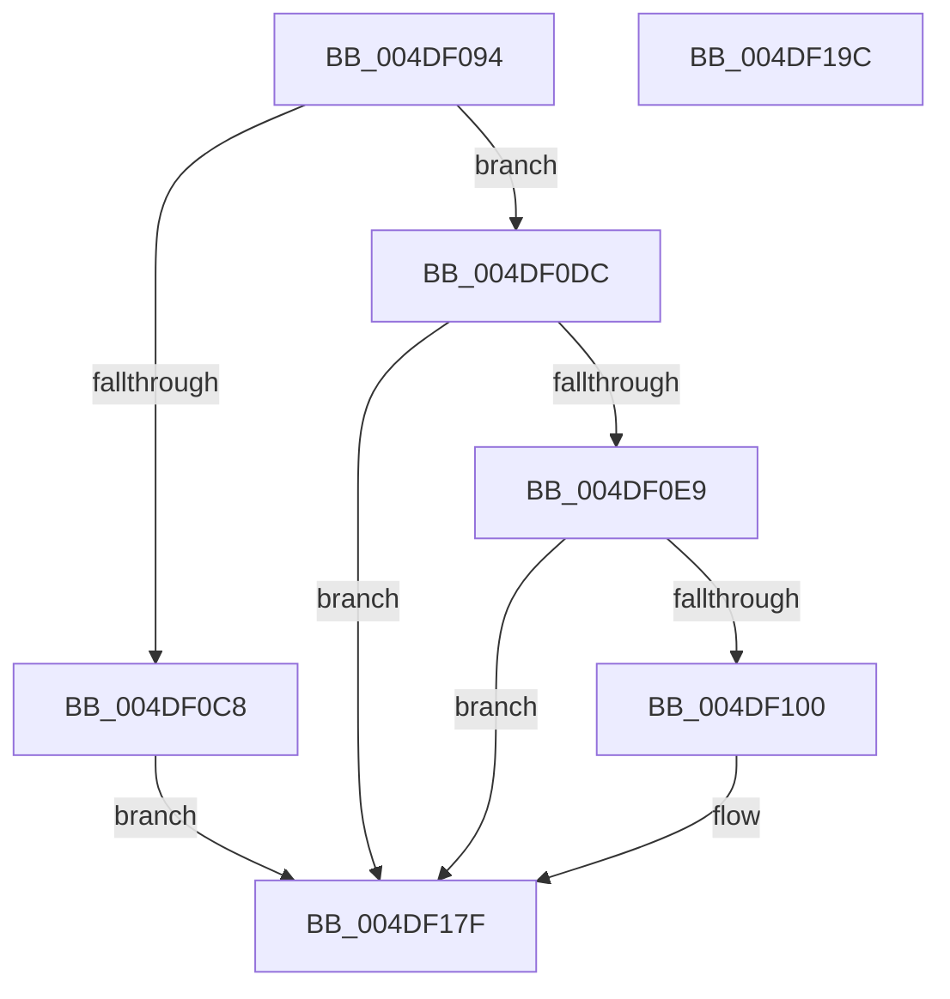

# PpmEventTraceHeteroDistributeUtility

- RVA: `0x004DF094`–`0x004DF19D` (길이 `265` bytes)
- VA: `0x00000001404DF094`
- 실행 섹션: `.text`
- PDB 이름 있음: `예`; PDB Function 태그: `아니요`
- unwind 정보 RVA: `0x000BED68`
- 디코드: `61`개 명령, `265/265` bytes 표시
- 미해석 바이트: `0` (있으면 어셈블리에 `.byte`로 보존)

> 이 문서는 커널 이미지의 기계어와 PDB 기호를 분석해 생성했습니다. 4번과 5번은 함수 원형과 자료형을 바이너리 사용 방식에서 추정한 C 해석이며 원본 소스 복구 결과는 아닙니다.

## 1. Dependencies

- 직접 호출 지점: **5**; 고유 호출 대상: **5**
- 직접 호출자로 확인된 함수: **2**
- RIP 상대 이미지 참조: **4**

### Outgoing calls
- `0x004DF0BF` → [Feature_PpmParkEx__private_IsEnabledDeviceUsageNoInline](../4F/Feature_PpmParkEx__private_IsEnabledDeviceUsageNoInline_function_004F135C.md) (function, `0x004F135C`)
- `0x004DF0D2` → [PpmEventTraceHeteroDistributeUtilityEx](../4F/PpmEventTraceHeteroDistributeUtilityEx_function_004F9C24.md) (function, `0x004F9C24`)
- `0x004DF0F7` → [EtwEventEnabled](../39/EtwEventEnabled_function_00392450.md) (function, `0x00392450`)
- `0x004DF17A` → [EtwWriteEx](../25/EtwWriteEx_function_0025F0D0.md) (function, `0x0025F0D0`)
- `0x004DF186` → [_security_check_cookie](../6A/_security_check_cookie_function_006AC640.md) (function, `0x006AC640`)

### Direct callers
- [PpmHeteroDistributeUtilityEx](../4E/PpmHeteroDistributeUtilityEx_function_004EFC00.md) at `0x004F01A5`
- [sub_006FAB60](../6F/Unknown_function_006FAB60.md) at `0x006FAF43`

### Static image references
- `0x004DF0AE` → RVA `0x00E0A740` (`.data`; read)
- `0x004DF0DC` → RVA `0x00E67A39` (`.data`; read)
- `0x004DF0E9` → RVA `0x00F083E8` (`.data`; read)
- `0x004DF0F0` → RVA `0x00021E00` (`.rdata`; read)

## 2. Other-region calls and transfers

- 다른 실행 섹션으로 향하는 call: **0**
- 별도 외부 분기/꼬리 이동을 확인하지 못했습니다.

## 3. Assembly (complete function range)

```asm
004DF094  48 8B C4                        mov rax, rsp
004DF097  48 89 58 20                     mov qword ptr [rax + 0x20], rbx
004DF09B  44 88 40 18                     mov byte ptr [rax + 0x18], r8b
004DF09F  88 50 10                        mov byte ptr [rax + 0x10], dl
004DF0A2  55                              push rbp
004DF0A3  48 8D 68 A1                     lea rbp, [rax - 0x5f]
004DF0A7  48 81 EC 90 00 00 00            sub rsp, 0x90
004DF0AE  48 8B 05 8B B6 92 00            mov rax, qword ptr [rip + 0x92b68b]
004DF0B5  48 33 C4                        xor rax, rsp
004DF0B8  48 89 45 47                     mov qword ptr [rbp + 0x47], rax
004DF0BC  48 8B D9                        mov rbx, rcx
004DF0BF  E8 98 22 01 00                  call 0x1404f135c
004DF0C4  85 C0                           test eax, eax
004DF0C6  74 14                           je 0x1404df0dc
004DF0C8  44 8A 45 77                     mov r8b, byte ptr [rbp + 0x77]
004DF0CC  48 8B CB                        mov rcx, rbx
004DF0CF  8A 55 6F                        mov dl, byte ptr [rbp + 0x6f]
004DF0D2  E8 4D AB 01 00                  call 0x1404f9c24
004DF0D7  E9 A3 00 00 00                  jmp 0x1404df17f
004DF0DC  80 3D 56 89 98 00 00            cmp byte ptr [rip + 0x988956], 0
004DF0E3  0F 84 96 00 00 00               je 0x1404df17f
004DF0E9  48 8B 0D F8 92 A2 00            mov rcx, qword ptr [rip + 0xa292f8]
004DF0F0  48 8D 15 09 2D B4 FF            lea rdx, [rip - 0x4bd2f7]
004DF0F7  E8 54 33 EB FF                  call 0x140392450
004DF0FC  84 C0                           test al, al
004DF0FE  74 7F                           je 0x1404df17f
004DF100  83 65 13 00                     and dword ptr [rbp + 0x13], 0
004DF104  48 8D 43 04                     lea rax, [rbx + 4]
004DF108  83 65 23 00                     and dword ptr [rbp + 0x23], 0
004DF10C  48 8D 15 ED 2C B4 FF            lea rdx, [rip - 0x4bd313]
004DF113  83 65 33 00                     and dword ptr [rbp + 0x33], 0
004DF117  B9 01 00 00 00                  mov ecx, 1
004DF11C  83 65 43 00                     and dword ptr [rbp + 0x43], 0
004DF120  45 33 C9                        xor r9d, r9d
004DF123  48 89 45 07                     mov qword ptr [rbp + 7], rax
004DF127  45 33 C0                        xor r8d, r8d
004DF12A  48 8D 43 10                     lea rax, [rbx + 0x10]
004DF12E  89 4D 2F                        mov dword ptr [rbp + 0x2f], ecx
004DF131  48 89 45 17                     mov qword ptr [rbp + 0x17], rax
004DF135  48 8D 45 6F                     lea rax, [rbp + 0x6f]
004DF139  48 89 45 27                     mov qword ptr [rbp + 0x27], rax
004DF13D  48 8D 45 77                     lea rax, [rbp + 0x77]
004DF141  48 89 45 37                     mov qword ptr [rbp + 0x37], rax
004DF145  48 8D 45 07                     lea rax, [rbp + 7]
004DF149  48 89 44 24 38                  mov qword ptr [rsp + 0x38], rax
004DF14E  C7 44 24 30 04 00 00 00         mov dword ptr [rsp + 0x30], 4
004DF156  48 83 64 24 28 00               and qword ptr [rsp + 0x28], 0
004DF15C  48 83 64 24 20 00               and qword ptr [rsp + 0x20], 0
004DF162  89 4D 3F                        mov dword ptr [rbp + 0x3f], ecx
004DF165  48 8B 0D 7C 92 A2 00            mov rcx, qword ptr [rip + 0xa2927c]
004DF16C  C7 45 0F 02 00 00 00            mov dword ptr [rbp + 0xf], 2
004DF173  C7 45 1F 08 00 00 00            mov dword ptr [rbp + 0x1f], 8
004DF17A  E8 51 FF D7 FF                  call 0x14025f0d0
004DF17F  48 8B 4D 47                     mov rcx, qword ptr [rbp + 0x47]
004DF183  48 33 CC                        xor rcx, rsp
004DF186  E8 B5 D4 1C 00                  call 0x1406ac640
004DF18B  48 8B 9C 24 B8 00 00 00         mov rbx, qword ptr [rsp + 0xb8]
004DF193  48 81 C4 90 00 00 00            add rsp, 0x90
004DF19A  5D                              pop rbp
004DF19B  C3                              ret
004DF19C  CC                              int3
```

## 4. C-style interpretation (structured pseudocode)

```c
__int64 __fastcall PpmEventTraceHeteroDistributeUtility(__int64 a1, unsigned __int8 a2, unsigned __int8 a3, int a4)
{
    __int64 result;
    __int64 v_rsp;
    unsigned __int64 v_stack_m60;
    unsigned int v_stack_m68;
    unsigned __int64 v_stack_m70;
    unsigned __int64 v_stack_m78;
    unsigned __int64 v_stack_p20;

    *(unsigned __int64 *)(v_rsp + 32) = v_rbx;
    *(unsigned __int8 *)(v_rsp + 24) = a3;
    *(unsigned __int8 *)(v_rsp + 16) = a2;
    v_rsp = (v_rsp) - (144);
    result = (*(unsigned __int64 *)(v_rip + 9614987)) ^ (v_rsp);
    *(unsigned __int64 *)(v_rsp - 95 + 71) = result;
    result = Feature_PpmParkEx__private_IsEnabledDeviceUsageNoInline(a1, a2, a3, a4);
    if ((unsigned int)(result) == 0) goto loc_004DF0DC;
    result = PpmEventTraceHeteroDistributeUtilityEx(a1, *(unsigned __int8 *)(v_rsp - 95 + 111), *(unsigned __int8 *)(v_rsp - 95 + 119), a4);
    goto loc_004DF17F;
loc_004DF0DC:
    if ((*(unsigned __int8 *)(v_rip + 9996630)) == 0) goto loc_004DF17F;
    result = EtwEventEnabled(*(unsigned __int64 *)(v_rip + 10654456), v_rip - 4969207, *(unsigned __int8 *)(v_rsp - 95 + 119), a4);
    if ((unsigned __int8)(result) != 0) {
        result = a1 + 4;
        a2 = v_rip - 4969235;
        a1 = 1;
        a4 = 0;
        *(unsigned __int64 *)(v_rsp - 95 + 7) = result;
        a3 = 0;
        result = a1 + 16;
        *(unsigned int *)(v_rsp - 95 + 47) = (unsigned int)(a1);
        *(unsigned __int64 *)(v_rsp - 95 + 23) = result;
        result = v_rsp - 95 + 111;
        *(unsigned __int64 *)(v_rsp - 95 + 39) = result;
        result = v_rsp - 95 + 119;
        *(unsigned __int64 *)(v_rsp - 95 + 55) = result;
        result = v_rsp - 95 + 7;
        v_stack_m60 = result;
        v_stack_m68 = 4;
        *(unsigned int *)(v_rsp - 95 + 63) = (unsigned int)(a1);
        a1 = *(unsigned __int64 *)(v_rip + 10654332);
        *(unsigned int *)(v_rsp - 95 + 15) = 2;
        *(unsigned int *)(v_rsp - 95 + 31) = 8;
        result = EtwWriteEx(a1, a2, a3, a4);
    }
    a1 = (*(unsigned __int64 *)(v_rsp - 95 + 71)) ^ (v_rsp);
    result = _security_check_cookie(a1, a2, a3, a4);
    v_rsp = (v_rsp) + (144);
    return result;
}
```

## 5. (Beta) C Style

```c
int64_t PpmEventTraceHeteroDistributeUtility(void *Arg1, uint8_t Arg2, uint8_t Arg3, int32_t Arg4)
{
    uint8_t *arg1 = (uint8_t *)Arg1;

    int64_t result;
    int64_t local_rsp;
    uint64_t v_stack_m60;
    uint32_t v_stack_m68;
    uint64_t v_stack_m70;
    uint64_t v_stack_m78;
    uint64_t v_stack_p20;

    *(uint64_t *)(local_rsp + 0x20) = local_rbx;
    *(uint8_t *)(local_rsp + 0x18) = Arg3;
    *(uint8_t *)(local_rsp + 0x10) = Arg2;
    local_rsp = (local_rsp) - (144);
    result = (*(uint64_t *)(v_rip + 0x92B68B)) ^ (local_rsp);
    *(uint64_t *)(local_rsp - 0x5F + 0x47) = result;
    result = Feature_PpmParkEx__private_IsEnabledDeviceUsageNoInline(Arg1, Arg2, Arg3, Arg4);
    if ((uint32_t)(result) == 0) goto loc_004DF0DC;
    result = PpmEventTraceHeteroDistributeUtilityEx(Arg1, *(uint8_t *)(local_rsp - 0x5F + 0x6F), *(uint8_t *)(local_rsp - 0x5F + 0x77), Arg4);
    goto loc_004DF17F;
loc_004DF0DC:
    if ((*(uint8_t *)(v_rip + 0x988956)) == 0) goto loc_004DF17F;
    result = EtwEventEnabled(*(uint64_t *)(v_rip + 0xA292F8), v_rip - 4969207, *(uint8_t *)(local_rsp - 0x5F + 0x77), Arg4);
    if ((uint8_t)(result) != 0) {
        result = Arg1 + 4;
        Arg2 = v_rip - 4969235;
        Arg1 = 1;
        Arg4 = 0;
        *(uint64_t *)(local_rsp - 0x5F + 0x7) = result;
        Arg3 = 0;
        result = Arg1 + 16;
        *(uint32_t *)(local_rsp - 0x5F + 0x2F) = (uint32_t)(Arg1);
        *(uint64_t *)(local_rsp - 0x5F + 0x17) = result;
        result = local_rsp - 95 + 111;
        *(uint64_t *)(local_rsp - 0x5F + 0x27) = result;
        result = local_rsp - 95 + 119;
        *(uint64_t *)(local_rsp - 0x5F + 0x37) = result;
        result = local_rsp - 95 + 7;
        v_stack_m60 = result;
        v_stack_m68 = 4;
        *(uint32_t *)(local_rsp - 0x5F + 0x3F) = (uint32_t)(Arg1);
        Arg1 = *(uint64_t *)(v_rip + 0xA2927C);
        *(uint32_t *)(local_rsp - 0x5F + 0xF) = 2;
        *(uint32_t *)(local_rsp - 0x5F + 0x1F) = 8;
        result = EtwWriteEx(Arg1, Arg2, Arg3, Arg4);
    }
    Arg1 = (*(uint64_t *)(local_rsp - 0x5F + 0x47)) ^ (local_rsp);
    result = _security_check_cookie(Arg1, Arg2, Arg3, Arg4);
    local_rsp = (local_rsp) + (144);
    return result;
}
```

### 관측된 메모리 오프셋

구조체 형식이 확인되지 않은 접근은 인자 기준의 오프셋으로만 기록했습니다.

| 기준 인자 | 오프셋 표현 | 폭 (bit) | 접근 |
|---|---:|---:|---|
| `Arg1` | `+ 0x4` | `64` | `R` |
| `Arg1` | `+ 0x10` | `64` | `R` |

## 6. Execution-region graph

[열기: 2D/3D 그래프와 함수 탐색 컨트롤 패널](../../../control-panel.html?section=text&rva=0x004DF094&view=graph)

- 2D 그래프는 위에서 아래로 흐르고, 3D 그래프는 빈 공간을 드래그해 회전합니다. Shift+드래그는 이동, 휠은 확대·축소, 함수 노드 선택은 대상 보고서 이동입니다.

### Static fallback


