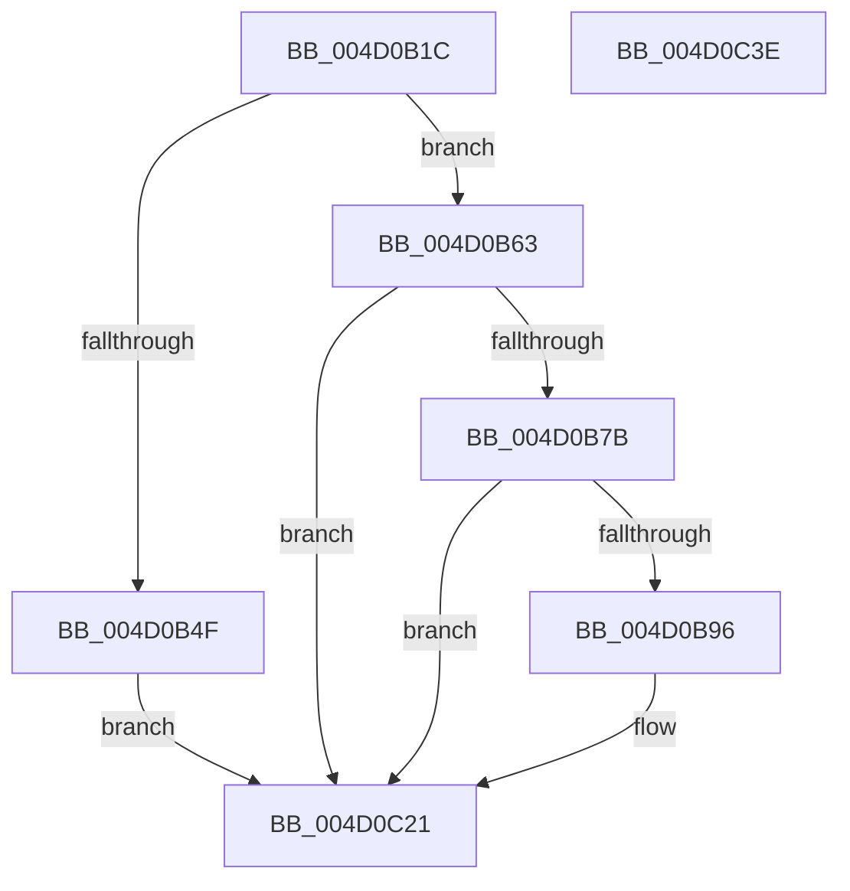

# PpmEventTraceMultiClassHeteroResponseUpdate

- RVA: `0x004D0B1C`–`0x004D0C3F` (길이 `291` bytes)
- VA: `0x00000001404D0B1C`
- 실행 섹션: `.text`
- PDB 이름 있음: `예`; PDB Function 태그: `아니요`
- unwind 정보 RVA: `0x000BDD1C`
- 디코드: `69`개 명령, `291/291` bytes 표시
- 미해석 바이트: `0` (있으면 어셈블리에 `.byte`로 보존)

> 이 문서는 커널 이미지의 기계어와 PDB 기호를 분석해 생성했습니다. 4번과 5번은 함수 원형과 자료형을 바이너리 사용 방식에서 추정한 C 해석이며 원본 소스 복구 결과는 아닙니다.

## 1. Dependencies

- 직접 호출 지점: **5**; 고유 호출 대상: **5**
- 직접 호출자로 확인된 함수: **4**
- RIP 상대 이미지 참조: **4**

### Outgoing calls
- `0x004D0B46` → [Feature_PpmParkEx__private_IsEnabledDeviceUsageNoInline](../4F/Feature_PpmParkEx__private_IsEnabledDeviceUsageNoInline_function_004F135C.md) (function, `0x004F135C`)
- `0x004D0B59` → [PpmEventTraceMultiClassHeteroResponseUpdateEx](../4F/PpmEventTraceMultiClassHeteroResponseUpdateEx_function_004F57C0.md) (function, `0x004F57C0`)
- `0x004D0B89` → [EtwEventEnabled](../39/EtwEventEnabled_function_00392450.md) (function, `0x00392450`)
- `0x004D0C1C` → [EtwWriteEx](../25/EtwWriteEx_function_0025F0D0.md) (function, `0x0025F0D0`)
- `0x004D0C28` → [_security_check_cookie](../6A/_security_check_cookie_function_006AC640.md) (function, `0x006AC640`)

### Direct callers
- [PpmHeteroComputeMultiClassUnparkCount](../41/PpmHeteroComputeMultiClassUnparkCount_function_00411F94.md) at `0x00412253`
- [PpmCheckComputeMultiClassHeteroResponse](../41/PpmCheckComputeMultiClassHeteroResponse_function_00412534.md) at `0x00412A97`
- [PpmCheckComputeMultiClassHeteroResponseEx](../4F/PpmCheckComputeMultiClassHeteroResponseEx_function_004F14A4.md) at `0x004F1923`
- [PpmHeteroComputeMultiClassUnparkCountEx](../5D/PpmHeteroComputeMultiClassUnparkCountEx_function_005DF584.md) at `0x005DF8B2`

### Static image references
- `0x004D0B2E` → RVA `0x00E0A740` (`.data`; read)
- `0x004D0B63` → RVA `0x00E67A39` (`.data`; read)
- `0x004D0B7B` → RVA `0x00F083E8` (`.data`; read)
- `0x004D0B82` → RVA `0x00022108` (`.rdata`; read)

## 2. Other-region calls and transfers

- 다른 실행 섹션으로 향하는 call: **0**
- 별도 외부 분기/꼬리 이동을 확인하지 못했습니다.

## 3. Assembly (complete function range)

```asm
004D0B1C  48 89 5C 24 20                  mov qword ptr [rsp + 0x20], rbx
004D0B21  55                              push rbp
004D0B22  48 8D 6C 24 A9                  lea rbp, [rsp - 0x57]
004D0B27  48 81 EC C0 00 00 00            sub rsp, 0xc0
004D0B2E  48 8B 05 0B 9C 93 00            mov rax, qword ptr [rip + 0x939c0b]
004D0B35  48 33 C4                        xor rax, rsp
004D0B38  48 89 45 47                     mov qword ptr [rbp + 0x47], rax
004D0B3C  48 8B DA                        mov rbx, rdx
004D0B3F  88 4D D7                        mov byte ptr [rbp - 0x29], cl
004D0B42  4C 89 45 E7                     mov qword ptr [rbp - 0x19], r8
004D0B46  E8 11 08 02 00                  call 0x1404f135c
004D0B4B  85 C0                           test eax, eax
004D0B4D  74 14                           je 0x1404d0b63
004D0B4F  4C 8B 45 E7                     mov r8, qword ptr [rbp - 0x19]
004D0B53  48 8B D3                        mov rdx, rbx
004D0B56  8A 4D D7                        mov cl, byte ptr [rbp - 0x29]
004D0B59  E8 62 4C 02 00                  call 0x1404f57c0
004D0B5E  E9 BE 00 00 00                  jmp 0x1404d0c21
004D0B63  80 3D CF 6E 99 00 00            cmp byte ptr [rip + 0x996ecf], 0
004D0B6A  8A 03                           mov al, byte ptr [rbx]
004D0B6C  88 45 DF                        mov byte ptr [rbp - 0x21], al
004D0B6F  8A 43 06                        mov al, byte ptr [rbx + 6]
004D0B72  88 45 E0                        mov byte ptr [rbp - 0x20], al
004D0B75  0F 84 A6 00 00 00               je 0x1404d0c21
004D0B7B  48 8B 0D 66 78 A3 00            mov rcx, qword ptr [rip + 0xa37866]
004D0B82  48 8D 15 7F 15 B5 FF            lea rdx, [rip - 0x4aea81]
004D0B89  E8 C2 18 EC FF                  call 0x140392450
004D0B8E  84 C0                           test al, al
004D0B90  0F 84 8B 00 00 00               je 0x1404d0c21
004D0B96  83 65 03 00                     and dword ptr [rbp + 3], 0
004D0B9A  48 8D 45 D7                     lea rax, [rbp - 0x29]
004D0B9E  83 65 13 00                     and dword ptr [rbp + 0x13], 0
004D0BA2  48 8D 15 5F 15 B5 FF            lea rdx, [rip - 0x4aeaa1]
004D0BA9  83 65 23 00                     and dword ptr [rbp + 0x23], 0
004D0BAD  B9 01 00 00 00                  mov ecx, 1
004D0BB2  83 65 33 00                     and dword ptr [rbp + 0x33], 0
004D0BB6  45 33 C9                        xor r9d, r9d
004D0BB9  83 65 43 00                     and dword ptr [rbp + 0x43], 0
004D0BBD  45 33 C0                        xor r8d, r8d
004D0BC0  48 89 45 F7                     mov qword ptr [rbp - 9], rax
004D0BC4  48 8D 45 DF                     lea rax, [rbp - 0x21]
004D0BC8  48 89 45 07                     mov qword ptr [rbp + 7], rax
004D0BCC  48 8D 45 E0                     lea rax, [rbp - 0x20]
004D0BD0  48 89 45 17                     mov qword ptr [rbp + 0x17], rax
004D0BD4  48 8D 43 10                     lea rax, [rbx + 0x10]
004D0BD8  48 89 45 27                     mov qword ptr [rbp + 0x27], rax
004D0BDC  48 8D 45 E7                     lea rax, [rbp - 0x19]
004D0BE0  89 4D FF                        mov dword ptr [rbp - 1], ecx
004D0BE3  89 4D 0F                        mov dword ptr [rbp + 0xf], ecx
004D0BE6  89 4D 1F                        mov dword ptr [rbp + 0x1f], ecx
004D0BE9  B9 08 00 00 00                  mov ecx, 8
004D0BEE  48 89 45 37                     mov qword ptr [rbp + 0x37], rax
004D0BF2  48 8D 45 F7                     lea rax, [rbp - 9]
004D0BF6  48 89 44 24 38                  mov qword ptr [rsp + 0x38], rax
004D0BFB  C7 44 24 30 05 00 00 00         mov dword ptr [rsp + 0x30], 5
004D0C03  48 83 64 24 28 00               and qword ptr [rsp + 0x28], 0
004D0C09  48 83 64 24 20 00               and qword ptr [rsp + 0x20], 0
004D0C0F  89 4D 2F                        mov dword ptr [rbp + 0x2f], ecx
004D0C12  89 4D 3F                        mov dword ptr [rbp + 0x3f], ecx
004D0C15  48 8B 0D CC 77 A3 00            mov rcx, qword ptr [rip + 0xa377cc]
004D0C1C  E8 AF E4 D8 FF                  call 0x14025f0d0
004D0C21  48 8B 4D 47                     mov rcx, qword ptr [rbp + 0x47]
004D0C25  48 33 CC                        xor rcx, rsp
004D0C28  E8 13 BA 1D 00                  call 0x1406ac640
004D0C2D  48 8B 9C 24 E8 00 00 00         mov rbx, qword ptr [rsp + 0xe8]
004D0C35  48 81 C4 C0 00 00 00            add rsp, 0xc0
004D0C3C  5D                              pop rbp
004D0C3D  C3                              ret
004D0C3E  CC                              int3
```

## 4. C-style interpretation (structured pseudocode)

```c
__int64 __fastcall PpmEventTraceMultiClassHeteroResponseUpdate(unsigned __int8 a1, __int64 a2, __int64 a3, int a4)
{
    __int64 result;
    __int64 v_rsp;
    unsigned __int64 v_stack_m18;
    unsigned int v_stack_m1C;
    unsigned int v_stack_m20;
    unsigned __int64 v_stack_m28;
    unsigned int v_stack_m2C;
    unsigned int v_stack_m30;
    unsigned __int64 v_stack_m38;
    unsigned int v_stack_m3C;
    unsigned int v_stack_m40;
    unsigned __int64 v_stack_m48;
    unsigned int v_stack_m4C;
    unsigned int v_stack_m50;
    unsigned __int64 v_stack_m58;
    unsigned int v_stack_m5C;
    unsigned __int64 v_stack_m5F;
    unsigned int v_stack_m60;
    unsigned __int64 v_stack_m68;
    unsigned __int64 v_stack_m78;
    unsigned __int8 v_stack_m7F;
    unsigned __int8 v_stack_m80;
    unsigned __int8 v_stack_m88;
    unsigned __int64 v_stack_m90;
    unsigned int v_stack_m98;
    unsigned __int64 v_stack_mA0;
    unsigned __int64 v_stack_mA8;
    unsigned __int64 v_stack_p20;

    v_stack_p20 = v_rbx;
    v_rsp = (v_rsp) - (192);
    result = (*(unsigned __int64 *)(v_rip + 9673739)) ^ (v_rsp);
    v_stack_m18 = result;
    v_stack_m88 = a1;
    v_stack_m78 = a3;
    result = Feature_PpmParkEx__private_IsEnabledDeviceUsageNoInline(a1, a2, a3, a4);
    if ((unsigned int)(result) == 0) goto loc_004D0B63;
    result = PpmEventTraceMultiClassHeteroResponseUpdateEx(v_stack_m88, a2, v_stack_m78, a4);
    goto loc_004D0C21;
loc_004D0B63:
    v_stack_m80 = (unsigned __int8)(*(unsigned __int8 *)(a2));
    v_stack_m7F = (unsigned __int8)(*(unsigned __int8 *)(a2 + 6));
    if ((*(unsigned __int8 *)(v_rip + 10055375)) == 0) goto loc_004D0C21;
    result = EtwEventEnabled(*(unsigned __int64 *)(v_rip + 10713190), v_rip - 4909697, v_stack_m78, a4);
    if ((unsigned __int8)(result) != 0) {
        result = v_stack_m88;
        a2 = v_rip - 4909729;
        a1 = 1;
        a4 = 0;
        a3 = 0;
        v_stack_m68 = result;
        result = v_stack_m80;
        v_stack_m58 = result;
        result = v_stack_m7F;
        v_stack_m48 = result;
        result = a2 + 16;
        v_stack_m38 = result;
        result = v_stack_m78;
        v_stack_m60 = a1;
        v_stack_m50 = a1;
        v_stack_m40 = a1;
        a1 = 8;
        v_stack_m28 = result;
        result = v_stack_m68;
        v_stack_m90 = result;
        v_stack_m98 = 5;
        v_stack_m30 = a1;
        v_stack_m20 = a1;
        a1 = *(unsigned __int64 *)(v_rip + 10713036);
        result = EtwWriteEx(a1, a2, a3, a4);
    }
    a1 = (v_stack_m18) ^ (v_rsp);
    result = _security_check_cookie(a1, a2, a3, a4);
    v_rsp = (v_rsp) + (192);
    return result;
}
```

## 5. (Beta) C Style

```c
int64_t PpmEventTraceMultiClassHeteroResponseUpdate(uint8_t Arg1, void *Arg2, int64_t Arg3, int32_t Arg4)
{
    uint8_t *arg2 = (uint8_t *)Arg2;

    int64_t result;
    int64_t local_rsp;
    uint64_t v_stack_m18;
    uint32_t v_stack_m1C;
    uint32_t v_stack_m20;
    uint64_t v_stack_m28;
    uint32_t v_stack_m2C;
    uint32_t v_stack_m30;
    uint64_t v_stack_m38;
    uint32_t v_stack_m3C;
    uint32_t v_stack_m40;
    uint64_t v_stack_m48;
    uint32_t v_stack_m4C;
    uint32_t v_stack_m50;
    uint64_t v_stack_m58;
    uint32_t v_stack_m5C;
    uint64_t v_stack_m5F;
    uint32_t v_stack_m60;
    uint64_t v_stack_m68;
    uint64_t v_stack_m78;
    uint8_t v_stack_m7F;
    uint8_t v_stack_m80;
    uint8_t v_stack_m88;
    uint64_t v_stack_m90;
    uint32_t v_stack_m98;
    uint64_t v_stack_mA0;
    uint64_t v_stack_mA8;
    uint64_t v_stack_p20;

    v_stack_p20 = local_rbx;
    local_rsp = (local_rsp) - (192);
    result = (*(uint64_t *)(v_rip + 0x939C0B)) ^ (local_rsp);
    v_stack_m18 = result;
    v_stack_m88 = Arg1;
    v_stack_m78 = Arg3;
    result = Feature_PpmParkEx__private_IsEnabledDeviceUsageNoInline(Arg1, Arg2, Arg3, Arg4);
    if ((uint32_t)(result) == 0) goto loc_004D0B63;
    result = PpmEventTraceMultiClassHeteroResponseUpdateEx(v_stack_m88, Arg2, v_stack_m78, Arg4);
    goto loc_004D0C21;
loc_004D0B63:
    v_stack_m80 = (uint8_t)(*(uint8_t *)(arg2));
    v_stack_m7F = (uint8_t)(*(uint8_t *)(arg2 + 0x6));
    if ((*(uint8_t *)(v_rip + 0x996ECF)) == 0) goto loc_004D0C21;
    result = EtwEventEnabled(*(uint64_t *)(v_rip + 0xA37866), v_rip - 4909697, v_stack_m78, Arg4);
    if ((uint8_t)(result) != 0) {
        result = v_stack_m88;
        Arg2 = v_rip - 4909729;
        Arg1 = 1;
        Arg4 = 0;
        Arg3 = 0;
        v_stack_m68 = result;
        result = v_stack_m80;
        v_stack_m58 = result;
        result = v_stack_m7F;
        v_stack_m48 = result;
        result = Arg2 + 16;
        v_stack_m38 = result;
        result = v_stack_m78;
        v_stack_m60 = Arg1;
        v_stack_m50 = Arg1;
        v_stack_m40 = Arg1;
        Arg1 = 8;
        v_stack_m28 = result;
        result = v_stack_m68;
        v_stack_m90 = result;
        v_stack_m98 = 5;
        v_stack_m30 = Arg1;
        v_stack_m20 = Arg1;
        Arg1 = *(uint64_t *)(v_rip + 0xA377CC);
        result = EtwWriteEx(Arg1, Arg2, Arg3, Arg4);
    }
    Arg1 = (v_stack_m18) ^ (local_rsp);
    result = _security_check_cookie(Arg1, Arg2, Arg3, Arg4);
    local_rsp = (local_rsp) + (192);
    return result;
}
```

### 관측된 메모리 오프셋

구조체 형식이 확인되지 않은 접근은 인자 기준의 오프셋으로만 기록했습니다.

| 기준 인자 | 오프셋 표현 | 폭 (bit) | 접근 |
|---|---:|---:|---|
| `Arg2` | `+ 0x0` | `8` | `R` |
| `Arg2` | `+ 0x6` | `8` | `R` |
| `Arg2` | `+ 0x10` | `64` | `R` |

## 6. Execution-region graph

[열기: 2D/3D 그래프와 함수 탐색 컨트롤 패널](../../../control-panel.html?section=text&rva=0x004D0B1C&view=graph)

- 2D 그래프는 위에서 아래로 흐르고, 3D 그래프는 빈 공간을 드래그해 회전합니다. Shift+드래그는 이동, 휠은 확대·축소, 함수 노드 선택은 대상 보고서 이동입니다.

### Static fallback


