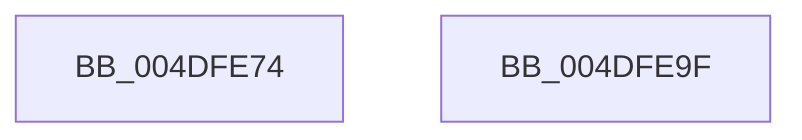

# PpmHeteroReevaluateMultiCoreFeatures

- RVA: `0x004DFE74`–`0x004DFEA0` (길이 `44` bytes)
- VA: `0x00000001404DFE74`
- 실행 섹션: `.text`
- PDB 이름 있음: `예`; PDB Function 태그: `아니요`
- unwind 정보 RVA: `0x000DB714`
- 디코드: `12`개 명령, `44/44` bytes 표시
- 미해석 바이트: `0` (있으면 어셈블리에 `.byte`로 보존)

> 이 문서는 커널 이미지의 기계어와 PDB 기호를 분석해 생성했습니다. 4번과 5번은 함수 원형과 자료형을 바이너리 사용 방식에서 추정한 C 해석이며 원본 소스 복구 결과는 아닙니다.

## 1. Dependencies

- 직접 호출 지점: **0**; 고유 호출 대상: **0**
- 직접 호출자로 확인된 함수: **1**
- RIP 상대 이미지 참조: **4**

### Outgoing calls
- 직접 디코드된 call 명령이 없습니다.

### Direct callers
- [PopInitializeHeteroProcessors](../../page/A5/PopInitializeHeteroProcessors_function_00A53570.md) at `0x00A53796`

### Static image references
- `0x004DFE74` → RVA `0x00FC50B4` (`ALMOSTRO`; read)
- `0x004DFE87` → RVA `0x00FC6C34` (`ALMOSTRO`; write)
- `0x004DFE8D` → RVA `0x00FC50F8` (`ALMOSTRO`; read)
- `0x004DFE98` → RVA `0x00FC6C88` (`ALMOSTRO`; write)

## 2. Other-region calls and transfers

- 다른 실행 섹션으로 향하는 call: **0**
- 별도 외부 분기/꼬리 이동을 확인하지 못했습니다.

## 3. Assembly (complete function range)

```asm
004DFE74  8B 05 3A 52 AE 00               mov eax, dword ptr [rip + 0xae523a]
004DFE7A  83 C9 FF                        or ecx, 0xffffffff
004DFE7D  3B C1                           cmp eax, ecx
004DFE7F  BA 01 00 00 00                  mov edx, 1
004DFE84  0F 44 C2                        cmove eax, edx
004DFE87  89 05 A7 6D AE 00               mov dword ptr [rip + 0xae6da7], eax
004DFE8D  8B 05 65 52 AE 00               mov eax, dword ptr [rip + 0xae5265]
004DFE93  3B C1                           cmp eax, ecx
004DFE95  0F 44 C2                        cmove eax, edx
004DFE98  89 05 EA 6D AE 00               mov dword ptr [rip + 0xae6dea], eax
004DFE9E  C3                              ret
004DFE9F  CC                              int3
```

## 4. C-style interpretation (structured pseudocode)

```c
__int64 __fastcall PpmHeteroReevaluateMultiCoreFeatures(int a1)
{
    __int64 result;

    a1 = (unsigned int)((a1) | (0xFFFFFFFFULL));
    result = (unsigned int)(*(unsigned int *)(v_rip + 11424314));
    if (((unsigned int)((unsigned int)(*(unsigned int *)(v_rip + 11424314)))) == a1) { result = 1; }
    *(unsigned int *)(v_rip + 11431335) = (unsigned int)(result);
    result = (unsigned int)(*(unsigned int *)(v_rip + 11424357));
    if (((unsigned int)((unsigned int)(*(unsigned int *)(v_rip + 11424357)))) == a1) { result = 1; }
    *(unsigned int *)(v_rip + 11431402) = (unsigned int)(result);
    return result;
}
```

## 5. (Beta) C Style

```c
int64_t PpmHeteroReevaluateMultiCoreFeatures(int32_t Arg1)
{
    int64_t result;

    Arg1 = (uint32_t)((Arg1) | (0xFFFFFFFFULL));
    result = (uint32_t)(*(uint32_t *)(v_rip + 0xAE523A));
    if (((uint32_t)((uint32_t)(*(uint32_t *)(v_rip + 0xAE523A)))) == Arg1) { result = 1; }
    *(uint32_t *)(v_rip + 0xAE6DA7) = (uint32_t)(result);
    result = (uint32_t)(*(uint32_t *)(v_rip + 0xAE5265));
    if (((uint32_t)((uint32_t)(*(uint32_t *)(v_rip + 0xAE5265)))) == Arg1) { result = 1; }
    *(uint32_t *)(v_rip + 0xAE6DEA) = (uint32_t)(result);
    return result;
}
```

## 6. Execution-region graph

[열기: 2D/3D 그래프와 함수 탐색 컨트롤 패널](../../../control-panel.html?section=text&rva=0x004DFE74&view=graph)

- 2D 그래프는 위에서 아래로 흐르고, 3D 그래프는 빈 공간을 드래그해 회전합니다. Shift+드래그는 이동, 휠은 확대·축소, 함수 노드 선택은 대상 보고서 이동입니다.

### Static fallback


