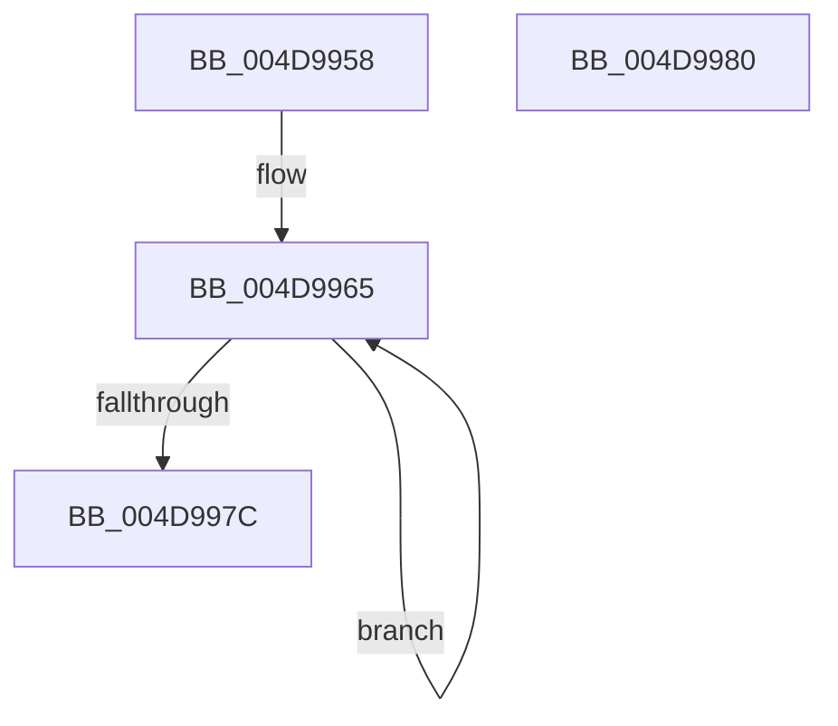

# PpmIdleSetSynchronizationState

- RVA: `0x004D9958`–`0x004D9981` (길이 `41` bytes)
- VA: `0x00000001404D9958`
- 실행 섹션: `.text`
- PDB 이름 있음: `예`; PDB Function 태그: `아니요`
- unwind 정보 RVA: `0x000DB714`
- 디코드: `14`개 명령, `41/41` bytes 표시
- 미해석 바이트: `0` (있으면 어셈블리에 `.byte`로 보존)

> 이 문서는 커널 이미지의 기계어와 PDB 기호를 분석해 생성했습니다. 4번과 5번은 함수 원형과 자료형을 바이너리 사용 방식에서 추정한 C 해석이며 원본 소스 복구 결과는 아닙니다.

## 1. Dependencies

- 직접 호출 지점: **0**; 고유 호출 대상: **0**
- 직접 호출자로 확인된 함수: **3**
- RIP 상대 이미지 참조: **0**

### Outgoing calls
- 직접 디코드된 call 명령이 없습니다.

### Direct callers
- [PpmIdleSelectStates](../2C/PpmIdleSelectStates_function_002CFFE8.md) at `0x002D07EE`
- [PpmIdleExecuteTransition](../2D/PpmIdleExecuteTransition_function_002D0A1C.md) at `0x002D1040`
- [PpmIdleExecuteTransition](../2D/PpmIdleExecuteTransition_function_002D0A1C.md) at `0x002D110F`
- [PpmIdleExecuteTransition](../2D/PpmIdleExecuteTransition_function_002D0A1C.md) at `0x002D114B`
- [sub_006DCEEE](../6D/Unknown_function_006DCEEE.md) at `0x006DCFC8`

### Static image references
- 디코드된 RIP-relative 메모리 참조가 없습니다.

## 2. Other-region calls and transfers

- 다른 실행 섹션으로 향하는 call: **0**
- 별도 외부 분기/꼬리 이동을 확인하지 못했습니다.

## 3. Assembly (complete function range)

```asm
004D9958  0F 0D 09                        prefetchw byte ptr [rcx]
004D995B  8B 01                           mov eax, dword ptr [rcx]
004D995D  44 0F B6 CA                     movzx r9d, dl
004D9961  41 C1 E1 18                     shl r9d, 0x18
004D9965  8B D0                           mov edx, eax
004D9967  44 8B C0                        mov r8d, eax
004D996A  81 E2 FF FF FF 00               and edx, 0xffffff
004D9970  41 0B D1                        or edx, r9d
004D9973  F0 0F B1 11                     lock cmpxchg dword ptr [rcx], edx
004D9977  41 3B C0                        cmp eax, r8d
004D997A  75 E9                           jne 0x1404d9965
004D997C  C1 E8 18                        shr eax, 0x18
004D997F  C3                              ret
004D9980  CC                              int3
```

## 4. C-style interpretation (structured pseudocode)

```c
__int64 __fastcall PpmIdleSetSynchronizationState(__int64 a1, unsigned __int8 a2)
{
    __int64 result;

    a4 = (unsigned int)((a2) << (24));
loc_004D9965:
    a2 = (unsigned int)(((unsigned int)((unsigned int)((unsigned int)(*(unsigned int *)(a1))))) & (0xFFFFFFULL));
    a2 = (unsigned int)((a2) | ((unsigned int)(a4)));
    if (((unsigned int)((unsigned int)(*(unsigned int *)(a1)))) != ((unsigned int)((unsigned int)((unsigned int)((unsigned int)(*(unsigned int *)(a1))))))) goto loc_004D9965;
    result = (unsigned int)(((unsigned int)(*(unsigned int *)(a1))) >> (24));
    return result;
}
```

## 5. (Beta) C Style

```c
int64_t PpmIdleSetSynchronizationState(void *Arg1, uint8_t Arg2)
{
    uint8_t *arg1 = (uint8_t *)Arg1;

    int64_t result;

    a4 = (uint32_t)((Arg2) << (24));
loc_004D9965:
    Arg2 = (uint32_t)(((uint32_t)((uint32_t)((uint32_t)(*(uint32_t *)(arg1))))) & (0xFFFFFFULL));
    Arg2 = (uint32_t)((Arg2) | ((uint32_t)(a4)));
    if (((uint32_t)((uint32_t)(*(uint32_t *)(arg1)))) != ((uint32_t)((uint32_t)((uint32_t)((uint32_t)(*(uint32_t *)(arg1))))))) goto loc_004D9965;
    result = (uint32_t)(((uint32_t)(*(uint32_t *)(arg1))) >> (24));
    return result;
}
```

### 관측된 메모리 오프셋

구조체 형식이 확인되지 않은 접근은 인자 기준의 오프셋으로만 기록했습니다.

| 기준 인자 | 오프셋 표현 | 폭 (bit) | 접근 |
|---|---:|---:|---|
| `Arg1` | `+ 0x0` | `8` | `R` |
| `Arg1` | `+ 0x0` | `32` | `R` |

## 6. Execution-region graph

[열기: 2D/3D 그래프와 함수 탐색 컨트롤 패널](../../../control-panel.html?section=text&rva=0x004D9958&view=graph)

- 2D 그래프는 위에서 아래로 흐르고, 3D 그래프는 빈 공간을 드래그해 회전합니다. Shift+드래그는 이동, 휠은 확대·축소, 함수 노드 선택은 대상 보고서 이동입니다.

### Static fallback


