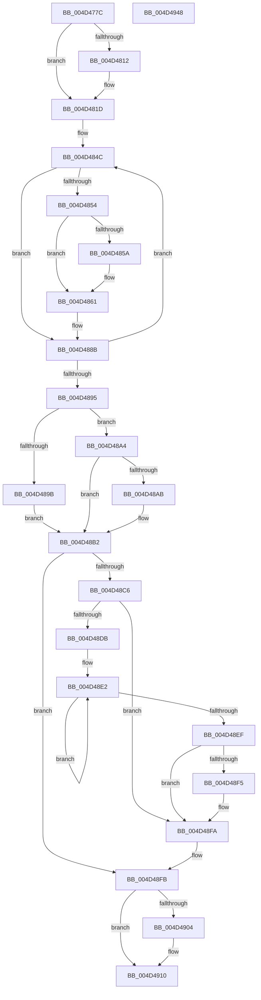

# PpmInstallFeedbackCounters

- RVA: `0x004D477C`–`0x004D4949` (길이 `461` bytes)
- VA: `0x00000001404D477C`
- 실행 섹션: `.text`
- PDB 이름 있음: `예`; PDB Function 태그: `아니요`
- unwind 정보 RVA: `0x000BE128`
- 디코드: `124`개 명령, `461/461` bytes 표시
- 미해석 바이트: `0` (있으면 어셈블리에 `.byte`로 보존)

> 이 문서는 커널 이미지의 기계어와 PDB 기호를 분석해 생성했습니다. 4번과 5번은 함수 원형과 자료형을 바이너리 사용 방식에서 추정한 C 해석이며 원본 소스 복구 결과는 아닙니다.

## 1. Dependencies

- 직접 호출 지점: **12**; 고유 호출 대상: **12**
- 직접 호출자로 확인된 함수: **1**
- RIP 상대 이미지 참조: **3**

### Outgoing calls
- `0x004D47F7` → [KeSetSystemGroupAffinityThread](../39/KeSetSystemGroupAffinityThread_function_00399140.md) (function, `0x00399140`)
- `0x004D4818` → [KiRaiseIrqlProcessIrqlFlags](../4F/KiRaiseIrqlProcessIrqlFlags_function_004F56FC.md) (function, `0x004F56FC`)
- `0x004D4826` → [KeQueryPerformanceCounter](../37/KeQueryPerformanceCounter_function_0037E7E0.md) (function, `0x0037E7E0`)
- `0x004D4831` → [PpmContinueActiveTimeAccumulation](../2D/PpmContinueActiveTimeAccumulation_function_002DDB54.md) (function, `0x002DDB54`)
- `0x004D4836` → [KeDisableInterrupts](../21/KeDisableInterrupts_function_00217BE0.md) (function, `0x00217BE0`)
- `0x004D4841` → [KeAcquireSpinLockAtDpcLevel](../20/KeAcquireSpinLockAtDpcLevel_function_00208430.md) (function, `0x00208430`)
- `0x004D4886` → [PpmPerfFeedbackCounterRead](../44/PpmPerfFeedbackCounterRead_function_004437B0.md) (function, `0x004437B0`)
- `0x004D48BC` → [KxReleaseSpinLock](../20/KxReleaseSpinLock_function_00206670.md) (function, `0x00206670`)
- `0x004D48F5` → [KiRemoveSystemWorkPriorityKick](../26/KiRemoveSystemWorkPriorityKick_function_002631D0.md) (function, `0x002631D0`)
- `0x004D490B` → [KiLowerIrqlProcessIrqlFlags](../4F/KiLowerIrqlProcessIrqlFlags_function_004F5698.md) (function, `0x004F5698`)
- `0x004D491D` → [KeRevertToUserGroupAffinityThread](../39/KeRevertToUserGroupAffinityThread_function_00398EC0.md) (function, `0x00398EC0`)
- `0x004D492A` → [_security_check_cookie](../6A/_security_check_cookie_function_006AC640.md) (function, `0x006AC640`)

### Direct callers
- [PpmRegisterPerfStates](../../page/75/PpmRegisterPerfStates_function_0075B084.md) at `0x0075B9A5`

### Static image references
- `0x004D4793` → RVA `0x00E0A740` (`.data`; read)
- `0x004D47A2` → RVA `0x00F231B0` (`.data`; read)
- `0x004D4809` → RVA `0x00FC6D20` (`ALMOSTRO`; read)

## 2. Other-region calls and transfers

- 다른 실행 섹션으로 향하는 call: **0**
- 별도 외부 분기/꼬리 이동을 확인하지 못했습니다.

## 3. Assembly (complete function range)

```asm
004D477C  4C 8B DC                        mov r11, rsp
004D477F  49 89 5B 18                     mov qword ptr [r11 + 0x18], rbx
004D4783  49 89 6B 20                     mov qword ptr [r11 + 0x20], rbp
004D4787  56                              push rsi
004D4788  57                              push rdi
004D4789  41 54                           push r12
004D478B  41 56                           push r14
004D478D  41 57                           push r15
004D478F  48 83 EC 60                     sub rsp, 0x60
004D4793  48 8B 05 A6 5F 93 00            mov rax, qword ptr [rip + 0x935fa6]
004D479A  48 33 C4                        xor rax, rsp
004D479D  48 89 44 24 58                  mov qword ptr [rsp + 0x58], rax
004D47A2  48 8B 05 07 EA A4 00            mov rax, qword ptr [rip + 0xa4ea07]
004D47A9  4C 8B F1                        mov r14, rcx
004D47AC  8B 49 24                        mov ecx, dword ptr [rcx + 0x24]
004D47AF  48 8B FA                        mov rdi, rdx
004D47B2  83 64 24 30 00                  and dword ptr [rsp + 0x30], 0
004D47B7  33 D2                           xor edx, edx
004D47B9  0F 57 C0                        xorps xmm0, xmm0
004D47BC  0F 57 C9                        xorps xmm1, xmm1
004D47BF  0F 11 44 24 38                  movups xmmword ptr [rsp + 0x38], xmm0
004D47C4  8B 0C 88                        mov ecx, dword ptr [rax + rcx*4]
004D47C7  45 8A E0                        mov r12b, r8b
004D47CA  8B C1                           mov eax, ecx
004D47CC  89 54 24 42                     mov dword ptr [rsp + 0x42], edx
004D47D0  C1 E8 06                        shr eax, 6
004D47D3  83 E1 3F                        and ecx, 0x3f
004D47D6  66 89 44 24 40                  mov word ptr [rsp + 0x40], ax
004D47DB  8D 42 01                        lea eax, [rdx + 1]
004D47DE  48 D3 E0                        shl rax, cl
004D47E1  49 8D 4B B0                     lea rcx, [r11 - 0x50]
004D47E5  66 89 54 24 46                  mov word ptr [rsp + 0x46], dx
004D47EA  49 8D 53 C0                     lea rdx, [r11 - 0x40]
004D47EE  49 89 43 B0                     mov qword ptr [r11 - 0x50], rax
004D47F2  0F 11 4C 24 48                  movups xmmword ptr [rsp + 0x48], xmm1
004D47F7  E8 44 49 EC FF                  call 0x140399140
004D47FC  44 0F 20 C5                     mov rbp, cr8
004D4800  BE 02 00 00 00                  mov esi, 2
004D4805  44 0F 22 C6                     mov cr8, rsi
004D4809  83 3D 10 25 AF 00 00            cmp dword ptr [rip + 0xaf2510], 0
004D4810  74 0B                           je 0x1404d481d
004D4812  40 8A D6                        mov dl, sil
004D4815  40 8A CD                        mov cl, bpl
004D4818  E8 DF 0E 02 00                  call 0x1404f56fc
004D481D  33 C9                           xor ecx, ecx
004D481F  49 8D 9E 90 88 00 00            lea rbx, [r14 + 0x8890]
004D4826  E8 B5 9F EA FF                  call 0x14037e7e0
004D482B  48 8B D0                        mov rdx, rax
004D482E  49 8B CE                        mov rcx, r14
004D4831  E8 1E 93 E0 FF                  call 0x1402ddb54
004D4836  E8 A5 33 D4 FF                  call 0x140217be0
004D483B  48 8B CB                        mov rcx, rbx
004D483E  44 8A F8                        mov r15b, al
004D4841  E8 EA 3B D3 FF                  call 0x140208430
004D4846  4C 8B F3                        mov r14, rbx
004D4849  4C 2B F7                        sub r14, rdi
004D484C  48 8B 0F                        mov rcx, qword ptr [rdi]
004D484F  48 85 C9                        test rcx, rcx
004D4852  74 37                           je 0x1404d488b
004D4854  80 79 22 00                     cmp byte ptr [rcx + 0x22], 0
004D4858  74 07                           je 0x1404d4861
004D485A  C6 83 89 00 00 00 01            mov byte ptr [rbx + 0x89], 1
004D4861  48 8B 07                        mov rax, qword ptr [rdi]
004D4864  4C 8D 44 24 30                  lea r8, [rsp + 0x30]
004D4869  48 83 64 24 20 00               and qword ptr [rsp + 0x20], 0
004D486F  45 33 C9                        xor r9d, r9d
004D4872  49 89 44 3E 18                  mov qword ptr [r14 + rdi + 0x18], rax
004D4877  B2 01                           mov dl, 1
004D4879  48 6B 43 30 64                  imul rax, qword ptr [rbx + 0x30], 0x64
004D487E  49 89 44 3E 40                  mov qword ptr [r14 + rdi + 0x40], rax
004D4883  48 8B 0F                        mov rcx, qword ptr [rdi]
004D4886  E8 25 EF F6 FF                  call 0x1404437b0
004D488B  48 83 C7 08                     add rdi, 8
004D488F  48 83 EE 01                     sub rsi, 1
004D4893  75 B7                           jne 0x1404d484c
004D4895  48 39 73 20                     cmp qword ptr [rbx + 0x20], rsi
004D4899  74 09                           je 0x1404d48a4
004D489B  C6 83 88 00 00 00 01            mov byte ptr [rbx + 0x88], 1
004D48A2  EB 0E                           jmp 0x1404d48b2
004D48A4  48 83 7B 18 00                  cmp qword ptr [rbx + 0x18], 0
004D48A9  74 07                           je 0x1404d48b2
004D48AB  C6 83 88 00 00 00 00            mov byte ptr [rbx + 0x88], 0
004D48B2  48 8B CB                        mov rcx, rbx
004D48B5  44 88 A3 8A 00 00 00            mov byte ptr [rbx + 0x8a], r12b
004D48BC  E8 AF 1D D3 FF                  call 0x140206670
004D48C1  45 84 FF                        test r15b, r15b
004D48C4  74 35                           je 0x1404d48fb
004D48C6  65 48 8B 0C 25 20 00 00 00      mov rcx, qword ptr gs:[0x20]
004D48CF  4C 8B 81 B8 8E 00 00            mov r8, qword ptr [rcx + 0x8eb8]
004D48D6  4D 85 C0                        test r8, r8
004D48D9  74 1F                           je 0x1404d48fa
004D48DB  41 0F 0D 08                     prefetchw byte ptr [r8]
004D48DF  41 8B 00                        mov eax, dword ptr [r8]
004D48E2  8B D0                           mov edx, eax
004D48E4  0F BA F2 15                     btr edx, 0x15
004D48E8  F0 41 0F B1 10                  lock cmpxchg dword ptr [r8], edx
004D48ED  75 F3                           jne 0x1404d48e2
004D48EF  0F BA E0 15                     bt eax, 0x15
004D48F3  73 05                           jae 0x1404d48fa
004D48F5  E8 D6 E8 D8 FF                  call 0x1402631d0
004D48FA  FB                              sti
004D48FB  83 3D 1E 24 AF 00 00            cmp dword ptr [rip + 0xaf241e], 0
004D4902  74 0C                           je 0x1404d4910
004D4904  44 0F 20 C1                     mov rcx, cr8
004D4908  40 8A D5                        mov dl, bpl
004D490B  E8 88 0D 02 00                  call 0x1404f5698
004D4910  40 0F B6 C5                     movzx eax, bpl
004D4914  44 0F 22 C0                     mov cr8, rax
004D4918  48 8D 4C 24 48                  lea rcx, [rsp + 0x48]
004D491D  E8 9E 45 EC FF                  call 0x140398ec0
004D4922  48 8B 4C 24 58                  mov rcx, qword ptr [rsp + 0x58]
004D4927  48 33 CC                        xor rcx, rsp
004D492A  E8 11 7D 1D 00                  call 0x1406ac640
004D492F  4C 8D 5C 24 60                  lea r11, [rsp + 0x60]
004D4934  49 8B 5B 40                     mov rbx, qword ptr [r11 + 0x40]
004D4938  49 8B 6B 48                     mov rbp, qword ptr [r11 + 0x48]
004D493C  49 8B E3                        mov rsp, r11
004D493F  41 5F                           pop r15
004D4941  41 5E                           pop r14
004D4943  41 5C                           pop r12
004D4945  5F                              pop rdi
004D4946  5E                              pop rsi
004D4947  C3                              ret
004D4948  CC                              int3
```

## 4. C-style interpretation (structured pseudocode)

```c
__int64 __fastcall PpmInstallFeedbackCounters(__int64 a1, __int64 a2, unsigned __int8 a3, int a4)
{
    __int64 result;
    __int64 v_r14;
    __int64 v_rdi;
    __int64 v_rsi;
    __int64 v_rsp;
    unsigned __int64 v_stack_m28;
    unsigned __int64 v_stack_m30;
    unsigned __int64 v_stack_m40;
    unsigned __int16 v_stack_m42;
    unsigned int v_stack_m46;
    unsigned __int16 v_stack_m48;
    unsigned __int64 v_stack_m50;
    unsigned int v_stack_m58;
    unsigned __int64 v_stack_m68;

    *(unsigned __int64 *)(v_rsp + 24) = v_rbx;
    *(unsigned __int64 *)(v_rsp + 32) = v_rbp;
    v_rsp = (v_rsp) - (96);
    result = (*(unsigned __int64 *)(v_rip + 9658278)) ^ (v_rsp);
    v_stack_m30 = result;
    a2 = 0;
    v_stack_m50 = v_xmm0;
    v_stack_m46 = 0;
    result = (unsigned int)(((unsigned int)((unsigned int)((unsigned int)(*(unsigned int *)(*(unsigned __int64 *)(v_rip + 10807815) + (unsigned int)(*(unsigned int *)(a1 + 36)) * 4))))) >> (6));
    a1 = (unsigned int)(((unsigned int)(*(unsigned int *)(*(unsigned __int64 *)(v_rip + 10807815) + (unsigned int)(*(unsigned int *)(a1 + 36)) * 4))) & (63));
    v_stack_m48 = (unsigned __int16)(result);
    result = (a2 + 1) << ((unsigned __int8)(a1));
    v_stack_m42 = 0;
    *(unsigned __int64 *)(v_rsp - 80) = result;
    v_stack_m40 = v_xmm1;
    result = KeSetSystemGroupAffinityThread(v_rsp - 80, v_rsp - 64, a3, a4);
    if ((*(unsigned int *)(v_rip + 11478288)) != 0) {
        a2 = 2;
        a1 = (unsigned __int8)(v_cr8);
        result = KiRaiseIrqlProcessIrqlFlags(a1, a2, a3, a4);
    }
    a1 = 0;
    result = KeQueryPerformanceCounter(a1, a2, a3, a4);
    result = PpmContinueActiveTimeAccumulation(0, result, a3, a4);
    result = KeDisableInterrupts(0, result, a3, a4);
    result = KeAcquireSpinLockAtDpcLevel(a1 + 34960, result, a3, a4);
    v_r14 = (a1 + 34960) - (a2);
loc_004D484C:
    if (*(unsigned __int64 *)(a2) == 0) goto loc_004D488B;
    if ((*(unsigned __int8 *)(*(unsigned __int64 *)(a2) + 34)) != 0) {
        *(unsigned __int8 *)(a1 + 34960 + 137) = 1;
    }
    a4 = 0;
    *(unsigned __int64 *)(v_r14 + a2 * 1 + 24) = *(unsigned __int64 *)(a2);
    result = (*(unsigned __int64 *)(a2)) * (*(unsigned __int64 *)(a1 + 34960 + 48));
    *(unsigned __int64 *)(v_r14 + a2 * 1 + 64) = result;
    result = PpmPerfFeedbackCounterRead(*(unsigned __int64 *)(a2), 1, v_stack_m58, a4);
loc_004D488B:
    v_rdi = (a2) + (8);
    v_rsi = (2) - (1);
    if (condition_is_not_equal) goto loc_004D484C;
    if ((*(unsigned __int64 *)(a1 + 34960 + 32)) == v_rsi) goto loc_004D48A4;
    *(unsigned __int8 *)(a1 + 34960 + 136) = 1;
    goto loc_004D48B2;
loc_004D48A4:
    if ((*(unsigned __int64 *)(a1 + 34960 + 24)) != 0) {
        *(unsigned __int8 *)(a1 + 34960 + 136) = 0;
    }
    *(unsigned __int8 *)(a1 + 34960 + 138) = a3;
    result = KxReleaseSpinLock(a1 + 34960, 1, v_stack_m58, a4);
    if ((unsigned __int8)((unsigned __int8)(result)) == 0) goto loc_004D48FB;
    if (*(unsigned __int64 *)(*(unsigned __int64 *)(gs_base + (0 + 32)) + 36536) == 0) goto loc_004D48FA;
loc_004D48E2:
    if (*(unsigned __int64 *)(*(unsigned __int64 *)(gs_base + (0 + 32)) + 36536) != 0) goto loc_004D48E2;
    result = (unsigned int)(*(unsigned int *)(*(unsigned __int64 *)(*(unsigned __int64 *)(gs_base + (0 + 32)) + 36536)));
    if (!(condition_is_above_or_equal)) {
        result = KiRemoveSystemWorkPriorityKick(*(unsigned __int64 *)(gs_base + (0 + 32)), (unsigned int)((unsigned int)((unsigned int)(*(unsigned int *)(*(unsigned __int64 *)(*(unsigned __int64 *)(gs_base + (0 + 32)) + 36536))))), *(unsigned __int64 *)(*(unsigned __int64 *)(gs_base + (0 + 32)) + 36536), a4);
    }
loc_004D48FB:
    if ((*(unsigned int *)(v_rip + 11478046)) != 0) {
        a1 = 2;
        a2 = (unsigned __int8)(v_cr8);
        result = KiLowerIrqlProcessIrqlFlags(a1, a2, *(unsigned __int64 *)(*(unsigned __int64 *)(gs_base + (0 + 32)) + 36536), a4);
    }
    result = KeRevertToUserGroupAffinityThread(v_stack_m40, a2, *(unsigned __int64 *)(*(unsigned __int64 *)(gs_base + (0 + 32)) + 36536), a4);
    a1 = (v_stack_m30) ^ (v_rsp);
    result = _security_check_cookie(a1, a2, *(unsigned __int64 *)(*(unsigned __int64 *)(gs_base + (0 + 32)) + 36536), a4);
    return result;
}
```

## 5. (Beta) C Style

```c
int64_t PpmInstallFeedbackCounters(void *Arg1, void *Arg2, uint8_t Arg3, int32_t Arg4)
{
    uint8_t *arg1 = (uint8_t *)Arg1;
    uint8_t *arg2 = (uint8_t *)Arg2;

    int64_t result;
    int64_t local_r14;
    int64_t local_rdi;
    int64_t local_rsi;
    int64_t local_rsp;
    uint64_t v_stack_m28;
    uint64_t v_stack_m30;
    uint64_t v_stack_m40;
    uint16_t v_stack_m42;
    uint32_t v_stack_m46;
    uint16_t v_stack_m48;
    uint64_t v_stack_m50;
    uint32_t v_stack_m58;
    uint64_t v_stack_m68;

    *(uint64_t *)(local_rsp + 0x18) = local_rbx;
    *(uint64_t *)(local_rsp + 0x20) = local_rbp;
    local_rsp = (local_rsp) - (96);
    result = (*(uint64_t *)(v_rip + 0x935FA6)) ^ (local_rsp);
    v_stack_m30 = result;
    Arg2 = 0;
    v_stack_m50 = v_xmm0;
    v_stack_m46 = 0;
    result = (uint32_t)(((uint32_t)((uint32_t)((uint32_t)(*(uint32_t *)(*(uint64_t *)(v_rip + 0xA4EA07) + (uint32_t)(*(uint32_t *)(arg1 + 0x24)) * 4))))) >> (6));
    Arg1 = (uint32_t)(((uint32_t)(*(uint32_t *)(*(uint64_t *)(v_rip + 0xA4EA07) + (uint32_t)(*(uint32_t *)(arg1 + 0x24)) * 4))) & (63));
    v_stack_m48 = (uint16_t)(result);
    result = (Arg2 + 1) << ((uint8_t)(Arg1));
    v_stack_m42 = 0;
    *(uint64_t *)(local_rsp - 0x50) = result;
    v_stack_m40 = v_xmm1;
    result = KeSetSystemGroupAffinityThread(local_rsp - 80, local_rsp - 64, Arg3, Arg4);
    if ((*(uint32_t *)(v_rip + 0xAF2510)) != 0) {
        Arg2 = 2;
        Arg1 = (uint8_t)(v_cr8);
        result = KiRaiseIrqlProcessIrqlFlags(Arg1, Arg2, Arg3, Arg4);
    }
    Arg1 = 0;
    result = KeQueryPerformanceCounter(Arg1, Arg2, Arg3, Arg4);
    result = PpmContinueActiveTimeAccumulation(0, result, Arg3, Arg4);
    result = KeDisableInterrupts(0, result, Arg3, Arg4);
    result = KeAcquireSpinLockAtDpcLevel(Arg1 + 34960, result, Arg3, Arg4);
    local_r14 = (Arg1 + 34960) - (Arg2);
loc_004D484C:
    if (*(uint64_t *)(arg2) == 0) goto loc_004D488B;
    if ((*(uint8_t *)(*(uint64_t *)(arg2) + 0x22)) != 0) {
        *(uint8_t *)(arg1 + 0x8890 + 0x89) = 1;
    }
    Arg4 = 0;
    *(uint64_t *)(local_r14 + arg2 * 1 + 0x18) = *(uint64_t *)(arg2);
    result = (*(uint64_t *)(arg2)) * (*(uint64_t *)(arg1 + 0x8890 + 0x30));
    *(uint64_t *)(local_r14 + arg2 * 1 + 0x40) = result;
    result = PpmPerfFeedbackCounterRead(*(uint64_t *)(arg2), 1, v_stack_m58, Arg4);
loc_004D488B:
    local_rdi = (Arg2) + (8);
    local_rsi = (2) - (1);
    if (condition_is_not_equal) goto loc_004D484C;
    if ((*(uint64_t *)(arg1 + 0x8890 + 0x20)) == local_rsi) goto loc_004D48A4;
    *(uint8_t *)(arg1 + 0x8890 + 0x88) = 1;
    goto loc_004D48B2;
loc_004D48A4:
    if ((*(uint64_t *)(arg1 + 0x8890 + 0x18)) != 0) {
        *(uint8_t *)(arg1 + 0x8890 + 0x88) = 0;
    }
    *(uint8_t *)(arg1 + 0x8890 + 0x8A) = Arg3;
    result = KxReleaseSpinLock(Arg1 + 34960, 1, v_stack_m58, Arg4);
    if ((uint8_t)((uint8_t)(result)) == 0) goto loc_004D48FB;
    if (*(uint64_t *)(*(uint64_t *)(gs_base + (0 + 0x20)) + 0x8EB8) == 0) goto loc_004D48FA;
loc_004D48E2:
    if (*(uint64_t *)(*(uint64_t *)(gs_base + (0 + 0x20)) + 0x8EB8) != 0) goto loc_004D48E2;
    result = (uint32_t)(*(uint32_t *)(*(uint64_t *)(*(uint64_t *)(gs_base + (0 + 0x20)) + 0x8EB8)));
    if (!(condition_is_above_or_equal)) {
        result = KiRemoveSystemWorkPriorityKick(*(uint64_t *)(gs_base + (0 + 0x20)), (uint32_t)((uint32_t)((uint32_t)(*(uint32_t *)(*(uint64_t *)(*(uint64_t *)(gs_base + (0 + 0x20)) + 0x8EB8))))), *(uint64_t *)(*(uint64_t *)(gs_base + (0 + 0x20)) + 0x8EB8), Arg4);
    }
loc_004D48FB:
    if ((*(uint32_t *)(v_rip + 0xAF241E)) != 0) {
        Arg1 = 2;
        Arg2 = (uint8_t)(v_cr8);
        result = KiLowerIrqlProcessIrqlFlags(Arg1, Arg2, *(uint64_t *)(*(uint64_t *)(gs_base + (0 + 0x20)) + 0x8EB8), Arg4);
    }
    result = KeRevertToUserGroupAffinityThread(v_stack_m40, Arg2, *(uint64_t *)(*(uint64_t *)(gs_base + (0 + 0x20)) + 0x8EB8), Arg4);
    Arg1 = (v_stack_m30) ^ (local_rsp);
    result = _security_check_cookie(Arg1, Arg2, *(uint64_t *)(*(uint64_t *)(gs_base + (0 + 0x20)) + 0x8EB8), Arg4);
    return result;
}
```

### 관측된 메모리 오프셋

구조체 형식이 확인되지 않은 접근은 인자 기준의 오프셋으로만 기록했습니다.

| 기준 인자 | 오프셋 표현 | 폭 (bit) | 접근 |
|---|---:|---:|---|
| `Arg1` | `+ 0x18` | `64` | `R` |
| `Arg1` | `+ 0x18 + rdi*1` | `64` | `W` |
| `Arg1` | `+ 0x20` | `64` | `R` |
| `Arg1` | `+ 0x24` | `32` | `R` |
| `Arg1` | `+ 0x30` | `64` | `R` |
| `Arg1` | `+ 0x40 + rdi*1` | `64` | `W` |
| `Arg1` | `+ 0x88` | `8` | `W` |
| `Arg1` | `+ 0x89` | `8` | `W` |
| `Arg1` | `+ 0x8A` | `8` | `W` |
| `Arg1` | `+ 0x8890` | `64` | `R` |
| `Arg2` | `+ 0x0` | `64` | `R` |

## 6. Execution-region graph

[열기: 2D/3D 그래프와 함수 탐색 컨트롤 패널](../../../control-panel.html?section=text&rva=0x004D477C&view=graph)

- 2D 그래프는 위에서 아래로 흐르고, 3D 그래프는 빈 공간을 드래그해 회전합니다. Shift+드래그는 이동, 휠은 확대·축소, 함수 노드 선택은 대상 보고서 이동입니다.

### Static fallback


