# PpmParkSetLpiCap

- RVA: `0x004D9358`–`0x004D94BB` (길이 `355` bytes)
- VA: `0x00000001404D9358`
- 실행 섹션: `.text`
- PDB 이름 있음: `예`; PDB Function 태그: `아니요`
- unwind 정보 RVA: `0x0006F978`
- 디코드: `99`개 명령, `355/355` bytes 표시
- 미해석 바이트: `0` (있으면 어셈블리에 `.byte`로 보존)

> 이 문서는 커널 이미지의 기계어와 PDB 기호를 분석해 생성했습니다. 4번과 5번은 함수 원형과 자료형을 바이너리 사용 방식에서 추정한 C 해석이며 원본 소스 복구 결과는 아닙니다.

## 1. Dependencies

- 직접 호출 지점: **5**; 고유 호출 대상: **5**
- 직접 호출자로 확인된 함수: **1**
- RIP 상대 이미지 참조: **10**

### Outgoing calls
- `0x004D93A3` → [PpmAcquireLock](../2D/PpmAcquireLock_function_002D9AA4.md) (function, `0x002D9AA4`)
- `0x004D947D` → [PpmParkApplyPolicy](../4B/PpmParkApplyPolicy_function_004B613C.md) (function, `0x004B613C`)
- `0x004D9482` → [PpmCheckReInit](../../page/A8/PpmCheckReInit_function_00A84DD8.md) (function, `0x00A84DD8`)
- `0x004D948C` → [PpmCheckCustomRun](../3B/PpmCheckCustomRun_function_003BEC2C.md) (function, `0x003BEC2C`)
- `0x004D949A` → [PpmReleaseLock](../2D/PpmReleaseLock_function_002DA428.md) (function, `0x002DA428`)

### Direct callers
- [NtPowerInformation](../../page/95/NtPowerInformation_function_00955D80.md) at `0x00957281`

### Static image references
- `0x004D9386` → RVA `0x00FC6AB8` (`ALMOSTRO`; read)
- `0x004D939C` → RVA `0x00F0CC00` (`.data`; read)
- `0x004D93A8` → RVA `0x00F083A2` (`.data`; read)
- `0x004D93C0` → RVA `0x00F083E0` (`.data`; read)
- `0x004D93CC` → RVA `0x00F083D8` (`.data`; read)
- `0x004D944F` → RVA `0x00E67A40` (`.data`; read)
- `0x004D9457` → RVA `0x00E67A40` (`.data`; write)
- `0x004D945F` → RVA `0x00E67A48` (`.data`; write)
- `0x004D9469` → RVA `0x00E67A44` (`.data`; read)
- `0x004D9471` → RVA `0x00E67A44` (`.data`; write)

## 2. Other-region calls and transfers

- 다른 실행 섹션으로 향하는 call: **1**
  - `0x004D9482` → [PpmCheckReInit](../../page/A8/PpmCheckReInit_function_00A84DD8.md) (`.text` → `PAGE`)
- 별도 외부 분기/꼬리 이동을 확인하지 못했습니다.

## 3. Assembly (complete function range)

```asm
004D9358  48 89 5C 24 08                  mov qword ptr [rsp + 8], rbx
004D935D  48 89 74 24 10                  mov qword ptr [rsp + 0x10], rsi
004D9362  48 89 7C 24 18                  mov qword ptr [rsp + 0x18], rdi
004D9367  41 56                           push r14
004D9369  48 83 EC 20                     sub rsp, 0x20
004D936D  65 48 8B 04 25 20 00 00 00      mov rax, qword ptr gs:[0x20]
004D9376  4D 8B F0                        mov r14, r8
004D9379  8B FA                           mov edi, edx
004D937B  8B D9                           mov ebx, ecx
004D937D  83 B8 20 89 00 00 02            cmp dword ptr [rax + 0x8920], 2
004D9384  7C 16                           jl 0x1404d939c
004D9386  F7 05 28 D7 AE 00 00 00 04 00   test dword ptr [rip + 0xaed728], 0x40000
004D9390  75 0A                           jne 0x1404d939c
004D9392  B8 01 00 00 C0                  mov eax, 0xc0000001
004D9397  E9 08 01 00 00                  jmp 0x1404d94a4
004D939C  48 8D 0D 5D 38 A3 00            lea rcx, [rip + 0xa3385d]
004D93A3  E8 FC 06 E0 FF                  call 0x1402d9aa4
004D93A8  0F B7 35 F3 EF A2 00            movzx esi, word ptr [rip + 0xa2eff3]
004D93AF  FF CB                           dec ebx
004D93B1  03 DE                           add ebx, esi
004D93B3  33 D2                           xor edx, edx
004D93B5  8B C3                           mov eax, ebx
004D93B7  44 8B D6                        mov r10d, esi
004D93BA  F7 F6                           div esi
004D93BC  2B DA                           sub ebx, edx
004D93BE  74 3D                           je 0x1404d93fd
004D93C0  8B 15 1A F0 A2 00               mov edx, dword ptr [rip + 0xa2f01a]
004D93C6  33 C9                           xor ecx, ecx
004D93C8  85 D2                           test edx, edx
004D93CA  74 2F                           je 0x1404d93fb
004D93CC  4C 8B 05 05 F0 A2 00            mov r8, qword ptr [rip + 0xa2f005]
004D93D3  44 8B CA                        mov r9d, edx
004D93D6  49 83 C0 0A                     add r8, 0xa
004D93DA  41 0F B7 00                     movzx eax, word ptr [r8]
004D93DE  66 3B C6                        cmp ax, si
004D93E1  76 05                           jbe 0x1404d93e8
004D93E3  41 2B C2                        sub eax, r10d
004D93E6  03 C8                           add ecx, eax
004D93E8  49 81 C0 10 05 00 00            add r8, 0x510
004D93EF  8B C1                           mov eax, ecx
004D93F1  49 83 E9 01                     sub r9, 1
004D93F5  75 E3                           jne 0x1404d93da
004D93F7  3B D8                           cmp ebx, eax
004D93F9  76 02                           jbe 0x1404d93fd
004D93FB  8B D9                           mov ebx, ecx
004D93FD  33 D2                           xor edx, edx
004D93FF  8D 4F FF                        lea ecx, [rdi - 1]
004D9402  41 03 CA                        add ecx, r10d
004D9405  8B C1                           mov eax, ecx
004D9407  41 F7 F2                        div r10d
004D940A  2B CA                           sub ecx, edx
004D940C  74 3F                           je 0x1404d944d
004D940E  44 8B 05 CB EF A2 00            mov r8d, dword ptr [rip + 0xa2efcb]
004D9415  33 D2                           xor edx, edx
004D9417  45 85 C0                        test r8d, r8d
004D941A  74 2F                           je 0x1404d944b
004D941C  4C 8B 0D B5 EF A2 00            mov r9, qword ptr [rip + 0xa2efb5]
004D9423  45 8B D8                        mov r11d, r8d
004D9426  49 83 C1 0A                     add r9, 0xa
004D942A  41 0F B7 01                     movzx eax, word ptr [r9]
004D942E  66 3B C6                        cmp ax, si
004D9431  76 05                           jbe 0x1404d9438
004D9433  41 2B C2                        sub eax, r10d
004D9436  03 D0                           add edx, eax
004D9438  49 81 C1 10 05 00 00            add r9, 0x510
004D943F  8B C2                           mov eax, edx
004D9441  49 83 EB 01                     sub r11, 1
004D9445  75 E3                           jne 0x1404d942a
004D9447  3B C8                           cmp ecx, eax
004D9449  76 02                           jbe 0x1404d944d
004D944B  8B CA                           mov ecx, edx
004D944D  32 C0                           xor al, al
004D944F  3B 1D EB E5 98 00               cmp ebx, dword ptr [rip + 0x98e5eb]
004D9455  74 12                           je 0x1404d9469
004D9457  89 1D E3 E5 98 00               mov dword ptr [rip + 0x98e5e3], ebx
004D945D  B0 01                           mov al, 1
004D945F  C7 05 DF E5 98 00 01 00 00 00   mov dword ptr [rip + 0x98e5df], 1
004D9469  3B 0D D5 E5 98 00               cmp ecx, dword ptr [rip + 0x98e5d5]
004D946F  74 08                           je 0x1404d9479
004D9471  89 0D CD E5 98 00               mov dword ptr [rip + 0x98e5cd], ecx
004D9477  EB 04                           jmp 0x1404d947d
004D9479  84 C0                           test al, al
004D947B  74 16                           je 0x1404d9493
004D947D  E8 BA CC FD FF                  call 0x1404b613c
004D9482  E8 51 B9 5A 00                  call 0x140a84dd8
004D9487  B9 04 00 00 00                  mov ecx, 4
004D948C  E8 9B 57 EE FF                  call 0x1403bec2c
004D9491  EB 0C                           jmp 0x1404d949f
004D9493  48 8D 0D 66 37 A3 00            lea rcx, [rip + 0xa33766]
004D949A  E8 89 0F E0 FF                  call 0x1402da428
004D949F  41 89 1E                        mov dword ptr [r14], ebx
004D94A2  33 C0                           xor eax, eax
004D94A4  48 8B 5C 24 30                  mov rbx, qword ptr [rsp + 0x30]
004D94A9  48 8B 74 24 38                  mov rsi, qword ptr [rsp + 0x38]
004D94AE  48 8B 7C 24 40                  mov rdi, qword ptr [rsp + 0x40]
004D94B3  48 83 C4 20                     add rsp, 0x20
004D94B7  41 5E                           pop r14
004D94B9  C3                              ret
004D94BA  CC                              int3
```

## 4. C-style interpretation (structured pseudocode)

```c
__int64 __fastcall PpmParkSetLpiCap(int a1, int a2, __int64 a3)
{
    __int64 result;
    __int64 v_r11;
    __int64 v_rbx;
    __int64 v_rsp;
    unsigned __int64 v_stack_p10;
    unsigned __int64 v_stack_p18;
    unsigned __int64 v_stack_p8;

    v_stack_p8 = v_rbx;
    v_stack_p10 = v_rsi;
    v_stack_p18 = v_rdi;
    v_rsp = (v_rsp) - (32);
    if ((*(unsigned int *)(*(unsigned __int64 *)(gs_base + (0 + 32)) + 35104)) < 2) goto loc_004D939C;
    if (((*(unsigned int *)(v_rip + 11458344)) & (0x40000ULL)) != 0) goto loc_004D939C;
    goto loc_004D94A4;
loc_004D939C:
    result = PpmAcquireLock(v_rip + 10696797, a2, a3, a4);
    v_rbx = (unsigned int)(((unsigned int)(a1)) - 1);
    v_rbx = (unsigned int)((v_rbx) + ((unsigned int)(*(unsigned __int16 *)(v_rip + 10678259))));
    a2 = 0;
    v_rbx = (unsigned int)((v_rbx) - (0));
    if (condition_is_equal) goto loc_004D93FD;
    a1 = 0;
    if ((unsigned int)((unsigned int)(*(unsigned int *)(v_rip + 10678298))) == 0) goto loc_004D93FB;
    a3 = (*(unsigned __int64 *)(v_rip + 10678277)) + (10);
loc_004D93DA:
    result = *(unsigned __int16 *)(a3);
    if (((unsigned __int16)(*(unsigned __int16 *)(a3))) >= = ((unsigned __int16)(*(unsigned __int16 *)(v_rip + 10678259)))) {
        result = (unsigned int)((*(unsigned __int16 *)(a3)) - ((unsigned int)((unsigned int)((unsigned int)(*(unsigned __int16 *)(v_rip + 10678259))))));
        a1 = (unsigned int)((a1) + ((unsigned int)(result)));
    }
    a3 = (a3) + (0x510ULL);
    a4 = ((unsigned int)((unsigned int)((unsigned int)(*(unsigned int *)(v_rip + 10678298))))) - (1);
    if (condition_is_not_equal) goto loc_004D93DA;
    if (((unsigned int)(v_rbx)) >= = ((unsigned int)((unsigned int)(a1)))) {
        v_rbx = a1;
    }
    a2 = 0;
    a1 = (unsigned int)(((unsigned int)(a2) - 1) + ((unsigned int)((unsigned int)((unsigned int)(*(unsigned __int16 *)(v_rip + 10678259))))));
    a1 = (unsigned int)((a1) - (0));
    if (condition_is_equal) goto loc_004D944D;
    a2 = 0;
    if ((unsigned int)((unsigned int)(*(unsigned int *)(v_rip + 10678219))) == 0) goto loc_004D944B;
    a4 = (*(unsigned __int64 *)(v_rip + 10678197)) + (10);
loc_004D942A:
    result = *(unsigned __int16 *)(a4);
    if (((unsigned __int16)(*(unsigned __int16 *)(a4))) >= = ((unsigned __int16)(*(unsigned __int16 *)(v_rip + 10678259)))) {
        result = (unsigned int)((*(unsigned __int16 *)(a4)) - ((unsigned int)((unsigned int)((unsigned int)(*(unsigned __int16 *)(v_rip + 10678259))))));
        a2 = (unsigned int)((a2) + ((unsigned int)(result)));
    }
    a4 = (a4) + (0x510ULL);
    v_r11 = ((unsigned int)((unsigned int)((unsigned int)(*(unsigned int *)(v_rip + 10678219))))) - (1);
    if (condition_is_not_equal) goto loc_004D942A;
    if (a1 >= = ((unsigned int)((unsigned int)(a2)))) {
        a1 = a2;
    }
    result = 0;
    if (((unsigned int)(v_rbx)) != (*(unsigned int *)(v_rip + 10020331))) {
        *(unsigned int *)(v_rip + 10020323) = (unsigned int)(v_rbx);
        result = 1;
        *(unsigned int *)(v_rip + 10020319) = 1;
    }
    if (a1 == (*(unsigned int *)(v_rip + 10020309))) goto loc_004D9479;
    *(unsigned int *)(v_rip + 10020301) = a1;
    goto loc_004D947D;
loc_004D9479:
    if ((unsigned __int8)(result) == 0) goto loc_004D9493;
loc_004D947D:
    result = PpmParkApplyPolicy(a1, a2, (unsigned int)(*(unsigned int *)(v_rip + 10678219)), a4);
    result = PpmCheckReInit(a1, a2, (unsigned int)(*(unsigned int *)(v_rip + 10678219)), a4);
    result = PpmCheckCustomRun(4, a2, (unsigned int)(*(unsigned int *)(v_rip + 10678219)), a4);
    goto loc_004D949F;
loc_004D9493:
    result = PpmReleaseLock(v_rip + 10696550, a2, (unsigned int)(*(unsigned int *)(v_rip + 10678219)), a4);
loc_004D949F:
    *(unsigned int *)(a3) = (unsigned int)(v_rbx);
    result = 0;
loc_004D94A4:
    v_rsp = (v_rsp) + (32);
    return result;
}
```

## 5. (Beta) C Style

```c
int64_t PpmParkSetLpiCap(int32_t Arg1, void *Arg2, void *Arg3)
{
    uint8_t *arg2 = (uint8_t *)Arg2;
    uint8_t *arg3 = (uint8_t *)Arg3;

    int64_t result;
    int64_t local_r11;
    int64_t local_rbx;
    int64_t local_rsp;
    uint64_t v_stack_p10;
    uint64_t v_stack_p18;
    uint64_t v_stack_p8;

    v_stack_p8 = local_rbx;
    v_stack_p10 = local_rsi;
    v_stack_p18 = local_rdi;
    local_rsp = (local_rsp) - (32);
    if ((*(uint32_t *)(*(uint64_t *)(gs_base + (0 + 0x20)) + 0x8920)) < 2) goto loc_004D939C;
    if (((*(uint32_t *)(v_rip + 0xAED728)) & (0x40000ULL)) != 0) goto loc_004D939C;
    goto loc_004D94A4;
loc_004D939C:
    result = PpmAcquireLock(v_rip + 10696797, Arg2, Arg3, a4);
    local_rbx = (uint32_t)(((uint32_t)(Arg1)) - 1);
    local_rbx = (uint32_t)((local_rbx) + ((uint32_t)(*(uint16_t *)(v_rip + 0xA2EFF3))));
    Arg2 = 0;
    local_rbx = (uint32_t)((local_rbx) - (0));
    if (condition_is_equal) goto loc_004D93FD;
    Arg1 = 0;
    if ((uint32_t)((uint32_t)(*(uint32_t *)(v_rip + 0xA2F01A))) == 0) goto loc_004D93FB;
    Arg3 = (*(uint64_t *)(v_rip + 0xA2F005)) + (10);
loc_004D93DA:
    result = *(uint16_t *)(arg3);
    if (((uint16_t)(*(uint16_t *)(arg3))) >= = ((uint16_t)(*(uint16_t *)(v_rip + 0xA2EFF3)))) {
        result = (uint32_t)((*(uint16_t *)(arg3)) - ((uint32_t)((uint32_t)((uint32_t)(*(uint16_t *)(v_rip + 0xA2EFF3))))));
        Arg1 = (uint32_t)((Arg1) + ((uint32_t)(result)));
    }
    Arg3 = (Arg3) + (0x510ULL);
    a4 = ((uint32_t)((uint32_t)((uint32_t)(*(uint32_t *)(v_rip + 0xA2F01A))))) - (1);
    if (condition_is_not_equal) goto loc_004D93DA;
    if (((uint32_t)(local_rbx)) >= = ((uint32_t)((uint32_t)(Arg1)))) {
        local_rbx = Arg1;
    }
    Arg2 = 0;
    Arg1 = (uint32_t)(((uint32_t)(Arg2) - 1) + ((uint32_t)((uint32_t)((uint32_t)(*(uint16_t *)(v_rip + 0xA2EFF3))))));
    Arg1 = (uint32_t)((Arg1) - (0));
    if (condition_is_equal) goto loc_004D944D;
    Arg2 = 0;
    if ((uint32_t)((uint32_t)(*(uint32_t *)(v_rip + 0xA2EFCB))) == 0) goto loc_004D944B;
    a4 = (*(uint64_t *)(v_rip + 0xA2EFB5)) + (10);
loc_004D942A:
    result = *(uint16_t *)(a4);
    if (((uint16_t)(*(uint16_t *)(a4))) >= = ((uint16_t)(*(uint16_t *)(v_rip + 0xA2EFF3)))) {
        result = (uint32_t)((*(uint16_t *)(a4)) - ((uint32_t)((uint32_t)((uint32_t)(*(uint16_t *)(v_rip + 0xA2EFF3))))));
        Arg2 = (uint32_t)((Arg2) + ((uint32_t)(result)));
    }
    a4 = (a4) + (0x510ULL);
    local_r11 = ((uint32_t)((uint32_t)((uint32_t)(*(uint32_t *)(v_rip + 0xA2EFCB))))) - (1);
    if (condition_is_not_equal) goto loc_004D942A;
    if (Arg1 >= = ((uint32_t)((uint32_t)(Arg2)))) {
        Arg1 = Arg2;
    }
    result = 0;
    if (((uint32_t)(local_rbx)) != (*(uint32_t *)(v_rip + 0x98E5EB))) {
        *(uint32_t *)(v_rip + 0x98E5E3) = (uint32_t)(local_rbx);
        result = 1;
        *(uint32_t *)(v_rip + 0x98E5DF) = 1;
    }
    if (Arg1 == (*(uint32_t *)(v_rip + 0x98E5D5))) goto loc_004D9479;
    *(uint32_t *)(v_rip + 0x98E5CD) = Arg1;
    goto loc_004D947D;
loc_004D9479:
    if ((uint8_t)(result) == 0) goto loc_004D9493;
loc_004D947D:
    result = PpmParkApplyPolicy(Arg1, Arg2, (uint32_t)(*(uint32_t *)(v_rip + 0xA2EFCB)), a4);
    result = PpmCheckReInit(Arg1, Arg2, (uint32_t)(*(uint32_t *)(v_rip + 0xA2EFCB)), a4);
    result = PpmCheckCustomRun(4, Arg2, (uint32_t)(*(uint32_t *)(v_rip + 0xA2EFCB)), a4);
    goto loc_004D949F;
loc_004D9493:
    result = PpmReleaseLock(v_rip + 10696550, Arg2, (uint32_t)(*(uint32_t *)(v_rip + 0xA2EFCB)), a4);
loc_004D949F:
    *(uint32_t *)(arg3) = (uint32_t)(local_rbx);
    result = 0;
loc_004D94A4:
    local_rsp = (local_rsp) + (32);
    return result;
}
```

### 관측된 메모리 오프셋

구조체 형식이 확인되지 않은 접근은 인자 기준의 오프셋으로만 기록했습니다.

| 기준 인자 | 오프셋 표현 | 폭 (bit) | 접근 |
|---|---:|---:|---|
| `Arg2` | `- 0x1` | `32` | `R` |
| `Arg3` | `+ 0x0` | `32` | `W` |

## 6. Execution-region graph

[열기: 2D/3D 그래프와 함수 탐색 컨트롤 패널](../../../control-panel.html?section=text&rva=0x004D9358&view=graph)

- 2D 그래프는 위에서 아래로 흐르고, 3D 그래프는 빈 공간을 드래그해 회전합니다. Shift+드래그는 이동, 휠은 확대·축소, 함수 노드 선택은 대상 보고서 이동입니다.

### Static fallback

```mermaid
flowchart TD
  bb_004D9358[BB_004D9358]
  bb_004D9386[BB_004D9386]
  bb_004D9392[BB_004D9392]
  bb_004D939C[BB_004D939C]
  bb_004D93C0[BB_004D93C0]
  bb_004D93CC[BB_004D93CC]
  bb_004D93DA[BB_004D93DA]
  bb_004D93E3[BB_004D93E3]
  bb_004D93E8[BB_004D93E8]
  bb_004D93F7[BB_004D93F7]
  bb_004D93FB[BB_004D93FB]
  bb_004D93FD[BB_004D93FD]
  bb_004D940E[BB_004D940E]
  bb_004D941C[BB_004D941C]
  bb_004D942A[BB_004D942A]
  bb_004D9433[BB_004D9433]
  bb_004D9438[BB_004D9438]
  bb_004D9447[BB_004D9447]
  bb_004D944B[BB_004D944B]
  bb_004D944D[BB_004D944D]
  bb_004D9457[BB_004D9457]
  bb_004D9469[BB_004D9469]
  bb_004D9471[BB_004D9471]
  bb_004D9479[BB_004D9479]
  bb_004D947D[BB_004D947D]
  bb_004D9493[BB_004D9493]
  bb_004D949F[BB_004D949F]
  bb_004D94A4[BB_004D94A4]
  bb_004D94BA[BB_004D94BA]
  bb_004D9358 -->|branch| bb_004D939C
  bb_004D9358 -->|fallthrough| bb_004D9386
  bb_004D9386 -->|branch| bb_004D939C
  bb_004D9386 -->|fallthrough| bb_004D9392
  bb_004D9392 -->|branch| bb_004D94A4
  bb_004D939C -->|branch| bb_004D93FD
  bb_004D939C -->|fallthrough| bb_004D93C0
  bb_004D93C0 -->|branch| bb_004D93FB
  bb_004D93C0 -->|fallthrough| bb_004D93CC
  bb_004D93CC -->|flow| bb_004D93DA
  bb_004D93DA -->|branch| bb_004D93E8
  bb_004D93DA -->|fallthrough| bb_004D93E3
  bb_004D93E3 -->|flow| bb_004D93E8
  bb_004D93E8 -->|branch| bb_004D93DA
  bb_004D93E8 -->|fallthrough| bb_004D93F7
  bb_004D93F7 -->|branch| bb_004D93FD
  bb_004D93F7 -->|fallthrough| bb_004D93FB
  bb_004D93FB -->|flow| bb_004D93FD
  bb_004D93FD -->|branch| bb_004D944D
  bb_004D93FD -->|fallthrough| bb_004D940E
  bb_004D940E -->|branch| bb_004D944B
  bb_004D940E -->|fallthrough| bb_004D941C
  bb_004D941C -->|flow| bb_004D942A
  bb_004D942A -->|branch| bb_004D9438
  bb_004D942A -->|fallthrough| bb_004D9433
  bb_004D9433 -->|flow| bb_004D9438
  bb_004D9438 -->|branch| bb_004D942A
  bb_004D9438 -->|fallthrough| bb_004D9447
  bb_004D9447 -->|branch| bb_004D944D
  bb_004D9447 -->|fallthrough| bb_004D944B
  bb_004D944B -->|flow| bb_004D944D
  bb_004D944D -->|branch| bb_004D9469
  bb_004D944D -->|fallthrough| bb_004D9457
  bb_004D9457 -->|flow| bb_004D9469
  bb_004D9469 -->|branch| bb_004D9479
  bb_004D9469 -->|fallthrough| bb_004D9471
  bb_004D9471 -->|branch| bb_004D947D
  bb_004D9479 -->|branch| bb_004D9493
  bb_004D9479 -->|fallthrough| bb_004D947D
  bb_004D947D -->|branch| bb_004D949F
  bb_004D9493 -->|flow| bb_004D949F
  bb_004D949F -->|flow| bb_004D94A4
```


