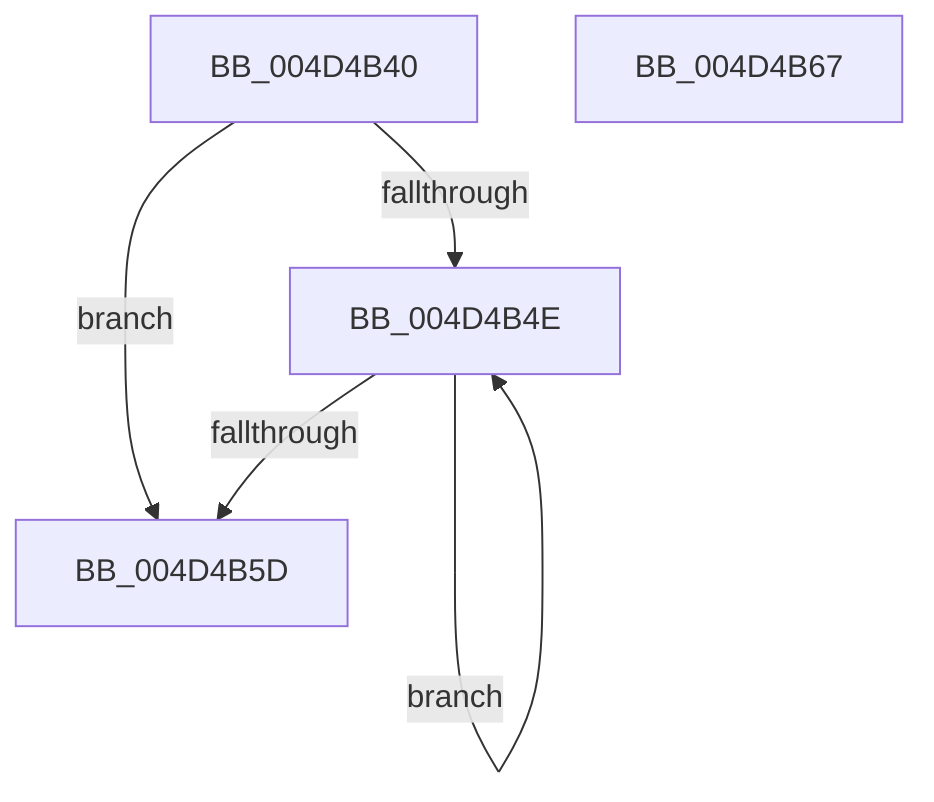

# PpmPerfComputePerfReductionTolerance

- RVA: `0x004D4B40`–`0x004D4B68` (길이 `40` bytes)
- VA: `0x00000001404D4B40`
- 실행 섹션: `.text`
- PDB 이름 있음: `예`; PDB Function 태그: `아니요`
- unwind 정보 RVA: `0x000DB714`
- 디코드: `11`개 명령, `40/40` bytes 표시
- 미해석 바이트: `0` (있으면 어셈블리에 `.byte`로 보존)

> 이 문서는 커널 이미지의 기계어와 PDB 기호를 분석해 생성했습니다. 4번과 5번은 함수 원형과 자료형을 바이너리 사용 방식에서 추정한 C 해석이며 원본 소스 복구 결과는 아닙니다.

## 1. Dependencies

- 직접 호출 지점: **0**; 고유 호출 대상: **0**
- 직접 호출자로 확인된 함수: **1**
- RIP 상대 이미지 참조: **1**

### Outgoing calls
- 직접 디코드된 call 명령이 없습니다.

### Direct callers
- [PpmInfoAdjustSetting](../../page/A4/PpmInfoAdjustSetting_function_00A432A8.md) at `0x00A4334B`

### Static image references
- `0x004D4B42` → RVA `0x00000000` (`image boundary/outside`; read)

## 2. Other-region calls and transfers

- 다른 실행 섹션으로 향하는 call: **0**
- 별도 외부 분기/꼬리 이동을 확인하지 못했습니다.

## 3. Assembly (complete function range)

```asm
004D4B40  33 D2                           xor edx, edx
004D4B42  4C 8D 05 B7 B4 B2 FF            lea r8, [rip - 0x4d4b49]
004D4B49  83 F9 5F                        cmp ecx, 0x5f
004D4B4C  73 0F                           jae 0x1404d4b5d
004D4B4E  FF C2                           inc edx
004D4B50  42 0F B6 84 02 00 92 02 00      movzx eax, byte ptr [rdx + r8 + 0x29200]
004D4B59  3B C8                           cmp ecx, eax
004D4B5B  72 F1                           jb 0x1404d4b4e
004D4B5D  42 0F B6 84 02 F8 91 02 00      movzx eax, byte ptr [rdx + r8 + 0x291f8]
004D4B66  C3                              ret
004D4B67  CC                              int3
```

## 4. C-style interpretation (structured pseudocode)

```c
__int64 __fastcall PpmPerfComputePerfReductionTolerance(int a1, int a2)
{
    a2 = 0;
    if (a1 >= 95) goto loc_004D4B5D;
loc_004D4B4E:
    a2 = (unsigned int)((a2) + 1);
    if (a1 < ((unsigned int)(*(unsigned __int8 *)(a2 + v_rip - 5065545 * 1 + 168448)))) goto loc_004D4B4E;
loc_004D4B5D:
    return *(unsigned __int8 *)(a2 + v_rip - 5065545 * 1 + 168440);
}
```

## 5. (Beta) C Style

```c
int64_t PpmPerfComputePerfReductionTolerance(int32_t Arg1, int32_t Arg2)
{
    Arg2 = 0;
    if (Arg1 >= 95) goto loc_004D4B5D;
loc_004D4B4E:
    Arg2 = (uint32_t)((Arg2) + 1);
    if (Arg1 < ((uint32_t)(*(uint8_t *)(Arg2 + v_rip - 0x4D4B49 * 1 + 0x29200)))) goto loc_004D4B4E;
loc_004D4B5D:
    return *(uint8_t *)(Arg2 + v_rip - 0x4D4B49 * 1 + 0x291F8);
}
```

## 6. Execution-region graph

[열기: 2D/3D 그래프와 함수 탐색 컨트롤 패널](../../../control-panel.html?section=text&rva=0x004D4B40&view=graph)

- 2D 그래프는 위에서 아래로 흐르고, 3D 그래프는 빈 공간을 드래그해 회전합니다. Shift+드래그는 이동, 휠은 확대·축소, 함수 노드 선택은 대상 보고서 이동입니다.

### Static fallback


