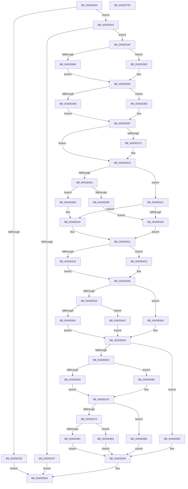

# PpmPerfGetVmPerfConfig

- RVA: `0x004DE504`–`0x004DE70D` (길이 `521` bytes)
- VA: `0x00000001404DE504`
- 실행 섹션: `.text`
- PDB 이름 있음: `예`; PDB Function 태그: `아니요`
- unwind 정보 RVA: `0x0008CA40`
- 디코드: `154`개 명령, `521/521` bytes 표시
- 미해석 바이트: `0` (있으면 어셈블리에 `.byte`로 보존)

> 이 문서는 커널 이미지의 기계어와 PDB 기호를 분석해 생성했습니다. 4번과 5번은 함수 원형과 자료형을 바이너리 사용 방식에서 추정한 C 해석이며 원본 소스 복구 결과는 아닙니다.

## 1. Dependencies

- 직접 호출 지점: **3**; 고유 호출 대상: **3**
- 직접 호출자로 확인된 함수: **1**
- RIP 상대 이미지 참조: **2**

### Outgoing calls
- `0x004DE529` → [PpmAcquireLock](../2D/PpmAcquireLock_function_002D9AA4.md) (function, `0x002D9AA4`)
- `0x004DE6DF` → [guard_dispatch_icall](../6B/guard_dispatch_icall_function_006BAAD0.md) (function, `0x006BAAD0`)
- `0x004DE6EB` → [PpmReleaseLock](../2D/PpmReleaseLock_function_002DA428.md) (function, `0x002DA428`)

### Direct callers
- [PopPowerInformationInternal](../../page/A8/PopPowerInformationInternal_function_00A8B7C0.md) at `0x00A8CB95`

### Static image references
- `0x004DE522` → RVA `0x00F0CC00` (`.data`; read)
- `0x004DE530` → RVA `0x00FC6AEC` (`ALMOSTRO`; read)

## 2. Other-region calls and transfers

- 다른 실행 섹션으로 향하는 call: **0**
- 별도 외부 분기/꼬리 이동을 확인하지 못했습니다.

## 3. Assembly (complete function range)

```asm
004DE504  48 89 5C 24 08                  mov qword ptr [rsp + 8], rbx
004DE509  48 89 6C 24 10                  mov qword ptr [rsp + 0x10], rbp
004DE50E  48 89 74 24 18                  mov qword ptr [rsp + 0x18], rsi
004DE513  57                              push rdi
004DE514  41 56                           push r14
004DE516  41 57                           push r15
004DE518  48 83 EC 60                     sub rsp, 0x60
004DE51C  44 8B F1                        mov r14d, ecx
004DE51F  4C 8B FA                        mov r15, rdx
004DE522  48 8D 0D D7 E6 A2 00            lea rcx, [rip + 0xa2e6d7]
004DE529  E8 76 B5 DF FF                  call 0x1402d9aa4
004DE52E  33 DB                           xor ebx, ebx
004DE530  38 1D B6 85 AE 00               cmp byte ptr [rip + 0xae85b6], bl
004DE536  75 0A                           jne 0x1404de542
004DE538  BB BB 00 00 C0                  mov ebx, 0xc00000bb
004DE53D  E9 A2 01 00 00                  jmp 0x1404de6e4
004DE542  45 85 F6                        test r14d, r14d
004DE545  75 08                           jne 0x1404de54f
004DE547  49 89 1F                        mov qword ptr [r15], rbx
004DE54A  E9 95 01 00 00                  jmp 0x1404de6e4
004DE54F  65 48 8B 04 25 20 00 00 00      mov rax, qword ptr gs:[0x20]
004DE558  4C 8B 98 B0 89 00 00            mov r11, qword ptr [rax + 0x89b0]
004DE55F  41 8A 83 2C 02 00 00            mov al, byte ptr [r11 + 0x22c]
004DE566  41 8B B3 C4 01 00 00            mov esi, dword ptr [r11 + 0x1c4]
004DE56D  F6 D8                           neg al
004DE56F  41 8B AB CC 01 00 00            mov ebp, dword ptr [r11 + 0x1cc]
004DE576  1B FF                           sbb edi, edi
004DE578  F7 D7                           not edi
004DE57A  83 E7 04                        and edi, 4
004DE57D  41 38 9B 2D 02 00 00            cmp byte ptr [r11 + 0x22d], bl
004DE584  74 07                           je 0x1404de58d
004DE586  83 CF 01                        or edi, 1
004DE589  8B C5                           mov eax, ebp
004DE58B  EB 07                           jmp 0x1404de594
004DE58D  41 8B 83 C8 01 00 00            mov eax, dword ptr [r11 + 0x1c8]
004DE594  45 8B 93 20 02 00 00            mov r10d, dword ptr [r11 + 0x220]
004DE59B  41 3B C2                        cmp eax, r10d
004DE59E  44 0F 47 D0                     cmova r10d, eax
004DE5A2  41 38 9B 2E 02 00 00            cmp byte ptr [r11 + 0x22e], bl
004DE5A9  75 0A                           jne 0x1404de5b5
004DE5AB  83 CF 08                        or edi, 8
004DE5AE  B8 64 00 00 00                  mov eax, 0x64
004DE5B3  EB 02                           jmp 0x1404de5b7
004DE5B5  8B C6                           mov eax, esi
004DE5B7  41 8B 8B 18 02 00 00            mov ecx, dword ptr [r11 + 0x218]
004DE5BE  83 F9 64                        cmp ecx, 0x64
004DE5C1  73 05                           jae 0x1404de5c8
004DE5C3  3B C1                           cmp eax, ecx
004DE5C5  0F 43 C1                        cmovae eax, ecx
004DE5C8  45 8B 8B 1C 02 00 00            mov r9d, dword ptr [r11 + 0x21c]
004DE5CF  41 3B C1                        cmp eax, r9d
004DE5D2  45 8B 83 C0 01 00 00            mov r8d, dword ptr [r11 + 0x1c0]
004DE5D9  41 8B C8                        mov ecx, r8d
004DE5DC  44 0F 42 C8                     cmovb r9d, eax
004DE5E0  D1 E9                           shr ecx, 1
004DE5E2  33 D2                           xor edx, edx
004DE5E4  41 6B C6 64                     imul eax, r14d, 0x64
004DE5E8  03 C1                           add eax, ecx
004DE5EA  41 F7 F0                        div r8d
004DE5ED  44 3B C8                        cmp r9d, eax
004DE5F0  8B C8                           mov ecx, eax
004DE5F2  8B D0                           mov edx, eax
004DE5F4  41 0F 42 C9                     cmovb ecx, r9d
004DE5F8  44 3B D0                        cmp r10d, eax
004DE5FB  41 0F 42 C2                     cmovb eax, r10d
004DE5FF  3B C5                           cmp eax, ebp
004DE601  76 1E                           jbe 0x1404de621
004DE603  44 3B D2                        cmp r10d, edx
004DE606  73 05                           jae 0x1404de60d
004DE608  45 8B C2                        mov r8d, r10d
004DE60B  EB 1C                           jmp 0x1404de629
004DE60D  44 8B C2                        mov r8d, edx
004DE610  8B C2                           mov eax, edx
004DE612  3B C1                           cmp eax, ecx
004DE614  76 18                           jbe 0x1404de62e
004DE616  44 3B D2                        cmp r10d, edx
004DE619  8B C2                           mov eax, edx
004DE61B  41 0F 42 C2                     cmovb eax, r10d
004DE61F  EB 0F                           jmp 0x1404de630
004DE621  44 8B C5                        mov r8d, ebp
004DE624  44 3B D2                        cmp r10d, edx
004DE627  73 E7                           jae 0x1404de610
004DE629  41 8B C2                        mov eax, r10d
004DE62C  EB E4                           jmp 0x1404de612
004DE62E  8B C1                           mov eax, ecx
004DE630  3B C6                           cmp eax, esi
004DE632  73 1C                           jae 0x1404de650
004DE634  44 3B D2                        cmp r10d, edx
004DE637  8B C2                           mov eax, edx
004DE639  41 0F 42 C2                     cmovb eax, r10d
004DE63D  3B C1                           cmp eax, ecx
004DE63F  76 0B                           jbe 0x1404de64c
004DE641  44 3B D2                        cmp r10d, edx
004DE644  8B C2                           mov eax, edx
004DE646  41 0F 42 C2                     cmovb eax, r10d
004DE64A  EB 06                           jmp 0x1404de652
004DE64C  8B C1                           mov eax, ecx
004DE64E  EB 02                           jmp 0x1404de652
004DE650  8B C6                           mov eax, esi
004DE652  3B C5                           cmp eax, ebp
004DE654  76 3C                           jbe 0x1404de692
004DE656  44 3B D2                        cmp r10d, edx
004DE659  8B C2                           mov eax, edx
004DE65B  41 0F 42 C2                     cmovb eax, r10d
004DE65F  3B C1                           cmp eax, ecx
004DE661  76 0B                           jbe 0x1404de66e
004DE663  44 3B D2                        cmp r10d, edx
004DE666  8B C2                           mov eax, edx
004DE668  41 0F 42 C2                     cmovb eax, r10d
004DE66C  EB 02                           jmp 0x1404de670
004DE66E  8B C1                           mov eax, ecx
004DE670  3B C6                           cmp eax, esi
004DE672  73 1A                           jae 0x1404de68e
004DE674  44 3B D2                        cmp r10d, edx
004DE677  8B C2                           mov eax, edx
004DE679  41 0F 42 C2                     cmovb eax, r10d
004DE67D  3B C1                           cmp eax, ecx
004DE67F  76 09                           jbe 0x1404de68a
004DE681  44 3B D2                        cmp r10d, edx
004DE684  41 0F 42 D2                     cmovb edx, r10d
004DE688  EB 0A                           jmp 0x1404de694
004DE68A  8B D1                           mov edx, ecx
004DE68C  EB 06                           jmp 0x1404de694
004DE68E  8B D6                           mov edx, esi
004DE690  EB 02                           jmp 0x1404de694
004DE692  8B D5                           mov edx, ebp
004DE694  41 8B 83 34 02 00 00            mov eax, dword ptr [r11 + 0x234]
004DE69B  45 8B 8B 24 02 00 00            mov r9d, dword ptr [r11 + 0x224]
004DE6A2  49 8B 8B 38 01 00 00            mov rcx, qword ptr [r11 + 0x138]
004DE6A9  48 89 5C 24 50                  mov qword ptr [rsp + 0x50], rbx
004DE6AE  4C 89 7C 24 48                  mov qword ptr [rsp + 0x48], r15
004DE6B3  48 89 5C 24 40                  mov qword ptr [rsp + 0x40], rbx
004DE6B8  48 8B 49 08                     mov rcx, qword ptr [rcx + 8]
004DE6BC  89 7C 24 38                     mov dword ptr [rsp + 0x38], edi
004DE6C0  89 44 24 30                     mov dword ptr [rsp + 0x30], eax
004DE6C4  49 8B 83 78 01 00 00            mov rax, qword ptr [r11 + 0x178]
004DE6CB  44 89 4C 24 28                  mov dword ptr [rsp + 0x28], r9d
004DE6D0  45 8B 8B 28 02 00 00            mov r9d, dword ptr [r11 + 0x228]
004DE6D7  44 89 4C 24 20                  mov dword ptr [rsp + 0x20], r9d
004DE6DC  44 8B CA                        mov r9d, edx
004DE6DF  E8 EC C3 1D 00                  call 0x1406baad0
004DE6E4  48 8D 0D 15 E5 A2 00            lea rcx, [rip + 0xa2e515]
004DE6EB  E8 38 BD DF FF                  call 0x1402da428
004DE6F0  4C 8D 5C 24 60                  lea r11, [rsp + 0x60]
004DE6F5  8B C3                           mov eax, ebx
004DE6F7  49 8B 5B 20                     mov rbx, qword ptr [r11 + 0x20]
004DE6FB  49 8B 6B 28                     mov rbp, qword ptr [r11 + 0x28]
004DE6FF  49 8B 73 30                     mov rsi, qword ptr [r11 + 0x30]
004DE703  49 8B E3                        mov rsp, r11
004DE706  41 5F                           pop r15
004DE708  41 5E                           pop r14
004DE70A  5F                              pop rdi
004DE70B  C3                              ret
004DE70C  CC                              int3
```

## 4. C-style interpretation (structured pseudocode)

```c
__int64 __fastcall PpmPerfGetVmPerfConfig(int a1, __int64 a2)
{
    __int64 result;
    __int64 v_r10;
    __int64 v_rbx;
    __int64 v_rdi;
    __int64 v_rsp;
    unsigned __int64 v_stack_m18;
    unsigned __int64 v_stack_m28;
    unsigned __int64 v_stack_m30;
    unsigned __int64 v_stack_m38;
    unsigned int v_stack_m40;
    unsigned int v_stack_m48;
    unsigned int v_stack_m50;
    unsigned int v_stack_m58;
    unsigned __int64 v_stack_p10;
    unsigned __int64 v_stack_p18;
    unsigned __int64 v_stack_p8;

    v_stack_p8 = v_rbx;
    v_stack_p10 = v_rbp;
    v_stack_p18 = v_rsi;
    v_rsp = (v_rsp) - (96);
    result = PpmAcquireLock(v_rip + 10675927, a2, a3, a4);
    v_rbx = 0;
    if ((*(unsigned __int8 *)(v_rip + 11437494)) != 0) goto loc_004DE542;
    goto loc_004DE6E4;
loc_004DE542:
    if ((unsigned int)((unsigned int)(a1)) != 0) goto loc_004DE54F;
    *(unsigned __int64 *)(a2) = (unsigned int)(0xC00000BBULL);
    goto loc_004DE6E4;
loc_004DE54F:
    result = (unsigned __int8)(-(*(unsigned __int8 *)(*(unsigned __int64 *)(*(unsigned __int64 *)(gs_base + (0 + 32)) + 35248) + 556)));
    v_rdi = (unsigned int)(~(v_rdi));
    v_rdi = (unsigned int)((v_rdi) & (4));
    if ((*(unsigned __int8 *)(*(unsigned __int64 *)(*(unsigned __int64 *)(gs_base + (0 + 32)) + 35248) + 557)) == ((unsigned __int8)((unsigned int)(0xC00000BBULL)))) goto loc_004DE58D;
    v_rdi = (unsigned int)((v_rdi) | (1));
    goto loc_004DE594;
loc_004DE58D:
loc_004DE594:
    v_r10 = (unsigned int)(*(unsigned int *)(*(unsigned __int64 *)(*(unsigned __int64 *)(gs_base + (0 + 32)) + 35248) + 544));
    if (((unsigned int)((unsigned int)(*(unsigned int *)(*(unsigned __int64 *)(*(unsigned __int64 *)(gs_base + (0 + 32)) + 35248) + 456)))) > ((unsigned int)((unsigned int)(*(unsigned int *)(*(unsigned __int64 *)(*(unsigned __int64 *)(gs_base + (0 + 32)) + 35248) + 544))))) { v_r10 = (unsigned int)((unsigned int)(*(unsigned int *)(*(unsigned __int64 *)(*(unsigned __int64 *)(gs_base + (0 + 32)) + 35248) + 456))); }
    if ((*(unsigned __int8 *)(*(unsigned __int64 *)(*(unsigned __int64 *)(gs_base + (0 + 32)) + 35248) + 558)) != ((unsigned __int8)((unsigned int)(0xC00000BBULL)))) goto loc_004DE5B5;
    v_rdi = (unsigned int)((v_rdi) | (8));
    goto loc_004DE5B7;
loc_004DE5B5:
loc_004DE5B7:
    result = (unsigned int)((unsigned int)((unsigned int)(*(unsigned int *)(*(unsigned __int64 *)(*(unsigned __int64 *)(gs_base + (0 + 32)) + 35248) + 452))));
    if (((unsigned int)((unsigned int)(*(unsigned int *)(*(unsigned __int64 *)(*(unsigned __int64 *)(gs_base + (0 + 32)) + 35248) + 536)))) < 100) {
        result = (unsigned int)((unsigned int)((unsigned int)(*(unsigned int *)(*(unsigned __int64 *)(*(unsigned __int64 *)(gs_base + (0 + 32)) + 35248) + 452))));
        if (((unsigned int)((unsigned int)((unsigned int)((unsigned int)(*(unsigned int *)(*(unsigned __int64 *)(*(unsigned __int64 *)(gs_base + (0 + 32)) + 35248) + 452)))))) >= ((unsigned int)((unsigned int)(*(unsigned int *)(*(unsigned __int64 *)(*(unsigned __int64 *)(gs_base + (0 + 32)) + 35248) + 536))))) { result = (unsigned int)((unsigned int)(*(unsigned int *)(*(unsigned __int64 *)(*(unsigned __int64 *)(gs_base + (0 + 32)) + 35248) + 536))); }
    }
    a4 = (unsigned int)(*(unsigned int *)(*(unsigned __int64 *)(*(unsigned __int64 *)(gs_base + (0 + 32)) + 35248) + 540));
    if (((unsigned int)(result)) < ((unsigned int)((unsigned int)(*(unsigned int *)(*(unsigned __int64 *)(*(unsigned __int64 *)(gs_base + (0 + 32)) + 35248) + 540))))) { a4 = (unsigned int)(result); }
    a1 = (unsigned int)(((unsigned int)((unsigned int)((unsigned int)(*(unsigned int *)(*(unsigned __int64 *)(*(unsigned __int64 *)(gs_base + (0 + 32)) + 35248) + 448))))) >> (1));
    a2 = 0;
    result = (unsigned int)((result) * ((unsigned int)((unsigned int)(a1))));
    result = (unsigned int)((result) + (a1));
    a1 = (unsigned int)((unsigned int)(result));
    if (((unsigned int)(a4)) < ((unsigned int)(result))) { a1 = (unsigned int)(a4); }
    if (((unsigned int)(v_r10)) < ((unsigned int)(result))) { result = (unsigned int)(v_r10); }
    if (((unsigned int)(result)) <= ((unsigned int)((unsigned int)(*(unsigned int *)(*(unsigned __int64 *)(*(unsigned __int64 *)(gs_base + (0 + 32)) + 35248) + 460))))) goto loc_004DE621;
    if (((unsigned int)(v_r10)) >= ((unsigned int)((unsigned int)((unsigned int)(result))))) goto loc_004DE60D;
    goto loc_004DE629;
loc_004DE60D:
loc_004DE610:
loc_004DE612:
    if (((unsigned int)((unsigned int)((unsigned int)((unsigned int)((unsigned int)(result)))))) <= a1) goto loc_004DE62E;
    result = (unsigned int)((unsigned int)((unsigned int)((unsigned int)(result))));
    if (((unsigned int)(v_r10)) < ((unsigned int)((unsigned int)((unsigned int)(result))))) { result = (unsigned int)(v_r10); }
    goto loc_004DE630;
loc_004DE621:
    if (((unsigned int)(v_r10)) >= ((unsigned int)((unsigned int)((unsigned int)(result))))) goto loc_004DE610;
loc_004DE629:
    goto loc_004DE612;
loc_004DE62E:
loc_004DE630:
    if (((unsigned int)((unsigned int)(a1))) >= ((unsigned int)((unsigned int)(*(unsigned int *)(*(unsigned __int64 *)(*(unsigned __int64 *)(gs_base + (0 + 32)) + 35248) + 452))))) goto loc_004DE650;
    result = (unsigned int)((unsigned int)((unsigned int)((unsigned int)(result))));
    if (((unsigned int)(v_r10)) < ((unsigned int)((unsigned int)((unsigned int)(result))))) { result = (unsigned int)(v_r10); }
    if (((unsigned int)(result)) <= a1) goto loc_004DE64C;
    result = (unsigned int)((unsigned int)((unsigned int)((unsigned int)(result))));
    if (((unsigned int)(v_r10)) < ((unsigned int)((unsigned int)((unsigned int)(result))))) { result = (unsigned int)(v_r10); }
    goto loc_004DE652;
loc_004DE64C:
    goto loc_004DE652;
loc_004DE650:
loc_004DE652:
    if (((unsigned int)((unsigned int)((unsigned int)((unsigned int)(*(unsigned int *)(*(unsigned __int64 *)(*(unsigned __int64 *)(gs_base + (0 + 32)) + 35248) + 452)))))) <= ((unsigned int)((unsigned int)(*(unsigned int *)(*(unsigned __int64 *)(*(unsigned __int64 *)(gs_base + (0 + 32)) + 35248) + 460))))) goto loc_004DE692;
    result = (unsigned int)((unsigned int)((unsigned int)((unsigned int)(result))));
    if (((unsigned int)(v_r10)) < ((unsigned int)((unsigned int)((unsigned int)(result))))) { result = (unsigned int)(v_r10); }
    if (((unsigned int)(result)) <= a1) goto loc_004DE66E;
    result = (unsigned int)((unsigned int)((unsigned int)((unsigned int)(result))));
    if (((unsigned int)(v_r10)) < ((unsigned int)((unsigned int)((unsigned int)(result))))) { result = (unsigned int)(v_r10); }
    goto loc_004DE670;
loc_004DE66E:
loc_004DE670:
    if (((unsigned int)((unsigned int)(a1))) >= ((unsigned int)((unsigned int)(*(unsigned int *)(*(unsigned __int64 *)(*(unsigned __int64 *)(gs_base + (0 + 32)) + 35248) + 452))))) goto loc_004DE68E;
    result = (unsigned int)((unsigned int)((unsigned int)((unsigned int)(result))));
    if (((unsigned int)(v_r10)) < ((unsigned int)((unsigned int)((unsigned int)(result))))) { result = (unsigned int)(v_r10); }
    if (((unsigned int)(result)) <= a1) goto loc_004DE68A;
    a2 = (unsigned int)((unsigned int)(result));
    if (((unsigned int)(v_r10)) < ((unsigned int)((unsigned int)((unsigned int)(result))))) { a2 = (unsigned int)(v_r10); }
    goto loc_004DE694;
loc_004DE68A:
    goto loc_004DE694;
loc_004DE68E:
    goto loc_004DE694;
loc_004DE692:
loc_004DE694:
    v_stack_m28 = (unsigned int)(0xC00000BBULL);
    v_stack_m30 = a2;
    v_stack_m38 = (unsigned int)(0xC00000BBULL);
    v_stack_m40 = (unsigned int)(v_rdi);
    v_stack_m48 = (unsigned int)((unsigned int)(*(unsigned int *)(*(unsigned __int64 *)(*(unsigned __int64 *)(gs_base + (0 + 32)) + 35248) + 564)));
    v_stack_m50 = (unsigned int)((unsigned int)(*(unsigned int *)(*(unsigned __int64 *)(*(unsigned __int64 *)(gs_base + (0 + 32)) + 35248) + 548)));
    v_stack_m58 = (unsigned int)((unsigned int)(*(unsigned int *)(*(unsigned __int64 *)(*(unsigned __int64 *)(gs_base + (0 + 32)) + 35248) + 552)));
    result = guard_dispatch_icall(*(unsigned __int64 *)(*(unsigned __int64 *)(*(unsigned __int64 *)(*(unsigned __int64 *)(gs_base + (0 + 32)) + 35248) + 312) + 8), (unsigned int)((unsigned int)((unsigned int)(*(unsigned int *)(*(unsigned __int64 *)(*(unsigned __int64 *)(gs_base + (0 + 32)) + 35248) + 460)))), (unsigned int)((unsigned int)((unsigned int)(*(unsigned int *)(*(unsigned __int64 *)(*(unsigned __int64 *)(gs_base + (0 + 32)) + 35248) + 460)))), (unsigned int)((unsigned int)((unsigned int)((unsigned int)((unsigned int)(*(unsigned int *)(*(unsigned __int64 *)(*(unsigned __int64 *)(gs_base + (0 + 32)) + 35248) + 460)))))));
loc_004DE6E4:
    result = PpmReleaseLock(v_rip + 10675477, (unsigned int)((unsigned int)((unsigned int)(*(unsigned int *)(*(unsigned __int64 *)(*(unsigned __int64 *)(gs_base + (0 + 32)) + 35248) + 460)))), (unsigned int)((unsigned int)((unsigned int)(*(unsigned int *)(*(unsigned __int64 *)(*(unsigned __int64 *)(gs_base + (0 + 32)) + 35248) + 460)))), (unsigned int)((unsigned int)((unsigned int)((unsigned int)((unsigned int)(*(unsigned int *)(*(unsigned __int64 *)(*(unsigned __int64 *)(gs_base + (0 + 32)) + 35248) + 460)))))));
    return (unsigned int)((unsigned int)((unsigned int)(0xC00000BBULL)));
}
```

## 5. (Beta) C Style

```c
int64_t PpmPerfGetVmPerfConfig(int32_t Arg1, void *Arg2)
{
    uint8_t *arg2 = (uint8_t *)Arg2;

    int64_t result;
    int64_t local_r10;
    int64_t local_rbx;
    int64_t local_rdi;
    int64_t local_rsp;
    uint64_t v_stack_m18;
    uint64_t v_stack_m28;
    uint64_t v_stack_m30;
    uint64_t v_stack_m38;
    uint32_t v_stack_m40;
    uint32_t v_stack_m48;
    uint32_t v_stack_m50;
    uint32_t v_stack_m58;
    uint64_t v_stack_p10;
    uint64_t v_stack_p18;
    uint64_t v_stack_p8;

    v_stack_p8 = local_rbx;
    v_stack_p10 = local_rbp;
    v_stack_p18 = local_rsi;
    local_rsp = (local_rsp) - (96);
    result = PpmAcquireLock(v_rip + 10675927, Arg2, a3, a4);
    local_rbx = 0;
    if ((*(uint8_t *)(v_rip + 0xAE85B6)) != 0) goto loc_004DE542;
    goto loc_004DE6E4;
loc_004DE542:
    if ((uint32_t)((uint32_t)(Arg1)) != 0) goto loc_004DE54F;
    *(uint64_t *)(arg2) = (uint32_t)(0xC00000BBULL);
    goto loc_004DE6E4;
loc_004DE54F:
    result = (uint8_t)(-(*(uint8_t *)(*(uint64_t *)(*(uint64_t *)(gs_base + (0 + 0x20)) + 0x89B0) + 0x22C)));
    local_rdi = (uint32_t)(~(local_rdi));
    local_rdi = (uint32_t)((local_rdi) & (4));
    if ((*(uint8_t *)(*(uint64_t *)(*(uint64_t *)(gs_base + (0 + 0x20)) + 0x89B0) + 0x22D)) == ((uint8_t)((uint32_t)(0xC00000BBULL)))) goto loc_004DE58D;
    local_rdi = (uint32_t)((local_rdi) | (1));
    goto loc_004DE594;
loc_004DE58D:
loc_004DE594:
    local_r10 = (uint32_t)(*(uint32_t *)(*(uint64_t *)(*(uint64_t *)(gs_base + (0 + 0x20)) + 0x89B0) + 0x220));
    if (((uint32_t)((uint32_t)(*(uint32_t *)(*(uint64_t *)(*(uint64_t *)(gs_base + (0 + 0x20)) + 0x89B0) + 0x1C8)))) > ((uint32_t)((uint32_t)(*(uint32_t *)(*(uint64_t *)(*(uint64_t *)(gs_base + (0 + 0x20)) + 0x89B0) + 0x220))))) { local_r10 = (uint32_t)((uint32_t)(*(uint32_t *)(*(uint64_t *)(*(uint64_t *)(gs_base + (0 + 0x20)) + 0x89B0) + 0x1C8))); }
    if ((*(uint8_t *)(*(uint64_t *)(*(uint64_t *)(gs_base + (0 + 0x20)) + 0x89B0) + 0x22E)) != ((uint8_t)((uint32_t)(0xC00000BBULL)))) goto loc_004DE5B5;
    local_rdi = (uint32_t)((local_rdi) | (8));
    goto loc_004DE5B7;
loc_004DE5B5:
loc_004DE5B7:
    result = (uint32_t)((uint32_t)((uint32_t)(*(uint32_t *)(*(uint64_t *)(*(uint64_t *)(gs_base + (0 + 0x20)) + 0x89B0) + 0x1C4))));
    if (((uint32_t)((uint32_t)(*(uint32_t *)(*(uint64_t *)(*(uint64_t *)(gs_base + (0 + 0x20)) + 0x89B0) + 0x218)))) < 100) {
        result = (uint32_t)((uint32_t)((uint32_t)(*(uint32_t *)(*(uint64_t *)(*(uint64_t *)(gs_base + (0 + 0x20)) + 0x89B0) + 0x1C4))));
        if (((uint32_t)((uint32_t)((uint32_t)((uint32_t)(*(uint32_t *)(*(uint64_t *)(*(uint64_t *)(gs_base + (0 + 0x20)) + 0x89B0) + 0x1C4)))))) >= ((uint32_t)((uint32_t)(*(uint32_t *)(*(uint64_t *)(*(uint64_t *)(gs_base + (0 + 0x20)) + 0x89B0) + 0x218))))) { result = (uint32_t)((uint32_t)(*(uint32_t *)(*(uint64_t *)(*(uint64_t *)(gs_base + (0 + 0x20)) + 0x89B0) + 0x218))); }
    }
    a4 = (uint32_t)(*(uint32_t *)(*(uint64_t *)(*(uint64_t *)(gs_base + (0 + 0x20)) + 0x89B0) + 0x21C));
    if (((uint32_t)(result)) < ((uint32_t)((uint32_t)(*(uint32_t *)(*(uint64_t *)(*(uint64_t *)(gs_base + (0 + 0x20)) + 0x89B0) + 0x21C))))) { a4 = (uint32_t)(result); }
    Arg1 = (uint32_t)(((uint32_t)((uint32_t)((uint32_t)(*(uint32_t *)(*(uint64_t *)(*(uint64_t *)(gs_base + (0 + 0x20)) + 0x89B0) + 0x1C0))))) >> (1));
    Arg2 = 0;
    result = (uint32_t)((result) * ((uint32_t)((uint32_t)(Arg1))));
    result = (uint32_t)((result) + (Arg1));
    Arg1 = (uint32_t)((uint32_t)(result));
    if (((uint32_t)(a4)) < ((uint32_t)(result))) { Arg1 = (uint32_t)(a4); }
    if (((uint32_t)(local_r10)) < ((uint32_t)(result))) { result = (uint32_t)(local_r10); }
    if (((uint32_t)(result)) <= ((uint32_t)((uint32_t)(*(uint32_t *)(*(uint64_t *)(*(uint64_t *)(gs_base + (0 + 0x20)) + 0x89B0) + 0x1CC))))) goto loc_004DE621;
    if (((uint32_t)(local_r10)) >= ((uint32_t)((uint32_t)((uint32_t)(result))))) goto loc_004DE60D;
    goto loc_004DE629;
loc_004DE60D:
loc_004DE610:
loc_004DE612:
    if (((uint32_t)((uint32_t)((uint32_t)((uint32_t)((uint32_t)(result)))))) <= Arg1) goto loc_004DE62E;
    result = (uint32_t)((uint32_t)((uint32_t)((uint32_t)(result))));
    if (((uint32_t)(local_r10)) < ((uint32_t)((uint32_t)((uint32_t)(result))))) { result = (uint32_t)(local_r10); }
    goto loc_004DE630;
loc_004DE621:
    if (((uint32_t)(local_r10)) >= ((uint32_t)((uint32_t)((uint32_t)(result))))) goto loc_004DE610;
loc_004DE629:
    goto loc_004DE612;
loc_004DE62E:
loc_004DE630:
    if (((uint32_t)((uint32_t)(Arg1))) >= ((uint32_t)((uint32_t)(*(uint32_t *)(*(uint64_t *)(*(uint64_t *)(gs_base + (0 + 0x20)) + 0x89B0) + 0x1C4))))) goto loc_004DE650;
    result = (uint32_t)((uint32_t)((uint32_t)((uint32_t)(result))));
    if (((uint32_t)(local_r10)) < ((uint32_t)((uint32_t)((uint32_t)(result))))) { result = (uint32_t)(local_r10); }
    if (((uint32_t)(result)) <= Arg1) goto loc_004DE64C;
    result = (uint32_t)((uint32_t)((uint32_t)((uint32_t)(result))));
    if (((uint32_t)(local_r10)) < ((uint32_t)((uint32_t)((uint32_t)(result))))) { result = (uint32_t)(local_r10); }
    goto loc_004DE652;
loc_004DE64C:
    goto loc_004DE652;
loc_004DE650:
loc_004DE652:
    if (((uint32_t)((uint32_t)((uint32_t)((uint32_t)(*(uint32_t *)(*(uint64_t *)(*(uint64_t *)(gs_base + (0 + 0x20)) + 0x89B0) + 0x1C4)))))) <= ((uint32_t)((uint32_t)(*(uint32_t *)(*(uint64_t *)(*(uint64_t *)(gs_base + (0 + 0x20)) + 0x89B0) + 0x1CC))))) goto loc_004DE692;
    result = (uint32_t)((uint32_t)((uint32_t)((uint32_t)(result))));
    if (((uint32_t)(local_r10)) < ((uint32_t)((uint32_t)((uint32_t)(result))))) { result = (uint32_t)(local_r10); }
    if (((uint32_t)(result)) <= Arg1) goto loc_004DE66E;
    result = (uint32_t)((uint32_t)((uint32_t)((uint32_t)(result))));
    if (((uint32_t)(local_r10)) < ((uint32_t)((uint32_t)((uint32_t)(result))))) { result = (uint32_t)(local_r10); }
    goto loc_004DE670;
loc_004DE66E:
loc_004DE670:
    if (((uint32_t)((uint32_t)(Arg1))) >= ((uint32_t)((uint32_t)(*(uint32_t *)(*(uint64_t *)(*(uint64_t *)(gs_base + (0 + 0x20)) + 0x89B0) + 0x1C4))))) goto loc_004DE68E;
    result = (uint32_t)((uint32_t)((uint32_t)((uint32_t)(result))));
    if (((uint32_t)(local_r10)) < ((uint32_t)((uint32_t)((uint32_t)(result))))) { result = (uint32_t)(local_r10); }
    if (((uint32_t)(result)) <= Arg1) goto loc_004DE68A;
    Arg2 = (uint32_t)((uint32_t)(result));
    if (((uint32_t)(local_r10)) < ((uint32_t)((uint32_t)((uint32_t)(result))))) { Arg2 = (uint32_t)(local_r10); }
    goto loc_004DE694;
loc_004DE68A:
    goto loc_004DE694;
loc_004DE68E:
    goto loc_004DE694;
loc_004DE692:
loc_004DE694:
    v_stack_m28 = (uint32_t)(0xC00000BBULL);
    v_stack_m30 = Arg2;
    v_stack_m38 = (uint32_t)(0xC00000BBULL);
    v_stack_m40 = (uint32_t)(local_rdi);
    v_stack_m48 = (uint32_t)((uint32_t)(*(uint32_t *)(*(uint64_t *)(*(uint64_t *)(gs_base + (0 + 0x20)) + 0x89B0) + 0x234)));
    v_stack_m50 = (uint32_t)((uint32_t)(*(uint32_t *)(*(uint64_t *)(*(uint64_t *)(gs_base + (0 + 0x20)) + 0x89B0) + 0x224)));
    v_stack_m58 = (uint32_t)((uint32_t)(*(uint32_t *)(*(uint64_t *)(*(uint64_t *)(gs_base + (0 + 0x20)) + 0x89B0) + 0x228)));
    result = guard_dispatch_icall(*(uint64_t *)(*(uint64_t *)(*(uint64_t *)(*(uint64_t *)(gs_base + (0 + 0x20)) + 0x89B0) + 0x138) + 0x8), (uint32_t)((uint32_t)((uint32_t)(*(uint32_t *)(*(uint64_t *)(*(uint64_t *)(gs_base + (0 + 0x20)) + 0x89B0) + 0x1CC)))), (uint32_t)((uint32_t)((uint32_t)(*(uint32_t *)(*(uint64_t *)(*(uint64_t *)(gs_base + (0 + 0x20)) + 0x89B0) + 0x1CC)))), (uint32_t)((uint32_t)((uint32_t)((uint32_t)((uint32_t)(*(uint32_t *)(*(uint64_t *)(*(uint64_t *)(gs_base + (0 + 0x20)) + 0x89B0) + 0x1CC)))))));
loc_004DE6E4:
    result = PpmReleaseLock(v_rip + 10675477, (uint32_t)((uint32_t)((uint32_t)(*(uint32_t *)(*(uint64_t *)(*(uint64_t *)(gs_base + (0 + 0x20)) + 0x89B0) + 0x1CC)))), (uint32_t)((uint32_t)((uint32_t)(*(uint32_t *)(*(uint64_t *)(*(uint64_t *)(gs_base + (0 + 0x20)) + 0x89B0) + 0x1CC)))), (uint32_t)((uint32_t)((uint32_t)((uint32_t)((uint32_t)(*(uint32_t *)(*(uint64_t *)(*(uint64_t *)(gs_base + (0 + 0x20)) + 0x89B0) + 0x1CC)))))));
    return (uint32_t)((uint32_t)((uint32_t)(0xC00000BBULL)));
}
```

### 관측된 메모리 오프셋

구조체 형식이 확인되지 않은 접근은 인자 기준의 오프셋으로만 기록했습니다.

| 기준 인자 | 오프셋 표현 | 폭 (bit) | 접근 |
|---|---:|---:|---|
| `Arg2` | `+ 0x0` | `64` | `W` |

## 6. Execution-region graph

[열기: 2D/3D 그래프와 함수 탐색 컨트롤 패널](../../../control-panel.html?section=text&rva=0x004DE504&view=graph)

- 2D 그래프는 위에서 아래로 흐르고, 3D 그래프는 빈 공간을 드래그해 회전합니다. Shift+드래그는 이동, 휠은 확대·축소, 함수 노드 선택은 대상 보고서 이동입니다.

### Static fallback


