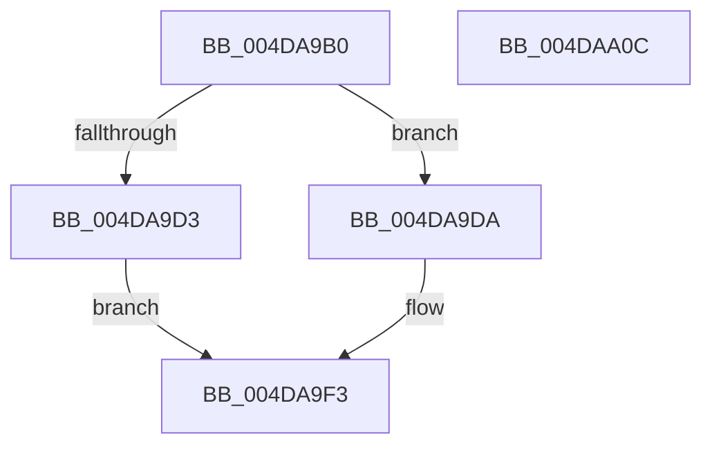

# PpmSetExitLatencySamplingPercentage

- RVA: `0x004DA9B0`–`0x004DAA0D` (길이 `93` bytes)
- VA: `0x00000001404DA9B0`
- 실행 섹션: `.text`
- PDB 이름 있음: `예`; PDB Function 태그: `아니요`
- unwind 정보 RVA: `0x0005CAAC`
- 디코드: `25`개 명령, `93/93` bytes 표시
- 미해석 바이트: `0` (있으면 어셈블리에 `.byte`로 보존)

> 이 문서는 커널 이미지의 기계어와 PDB 기호를 분석해 생성했습니다. 4번과 5번은 함수 원형과 자료형을 바이너리 사용 방식에서 추정한 C 해석이며 원본 소스 복구 결과는 아닙니다.

## 1. Dependencies

- 직접 호출 지점: **2**; 고유 호출 대상: **2**
- 직접 호출자로 확인된 함수: **1**
- RIP 상대 이미지 참조: **4**

### Outgoing calls
- `0x004DA9C4` → [PpmAcquireLock](../2D/PpmAcquireLock_function_002D9AA4.md) (function, `0x002D9AA4`)
- `0x004DA9FA` → [PpmReleaseLock](../2D/PpmReleaseLock_function_002DA428.md) (function, `0x002DA428`)

### Direct callers
- [NtPowerInformation](../../page/95/NtPowerInformation_function_00955D80.md) at `0x0095788B`

### Static image references
- `0x004DA9BD` → RVA `0x00F0E760` (`.data`; read)
- `0x004DA9CB` → RVA `0x00E67680` (`.data`; read)
- `0x004DA9E3` → RVA `0x00E67680` (`.data`; write)
- `0x004DA9ED` → RVA `0x00E67668` (`.data`; write)

## 2. Other-region calls and transfers

- 다른 실행 섹션으로 향하는 call: **0**
- 별도 외부 분기/꼬리 이동을 확인하지 못했습니다.

## 3. Assembly (complete function range)

```asm
004DA9B0  48 89 5C 24 08                  mov qword ptr [rsp + 8], rbx
004DA9B5  57                              push rdi
004DA9B6  48 83 EC 20                     sub rsp, 0x20
004DA9BA  48 8B F9                        mov rdi, rcx
004DA9BD  48 8D 0D 9C 3D A3 00            lea rcx, [rip + 0xa33d9c]
004DA9C4  E8 DB F0 DF FF                  call 0x1402d9aa4
004DA9C9  33 DB                           xor ebx, ebx
004DA9CB  38 1D AF CC 98 00               cmp byte ptr [rip + 0x98ccaf], bl
004DA9D1  74 07                           je 0x1404da9da
004DA9D3  BB 01 00 00 C0                  mov ebx, 0xc0000001
004DA9D8  EB 19                           jmp 0x1404da9f3
004DA9DA  8B 17                           mov edx, dword ptr [rdi]
004DA9DC  B8 64 00 00 00                  mov eax, 0x64
004DA9E1  3B D0                           cmp edx, eax
004DA9E3  C6 05 96 CC 98 00 01            mov byte ptr [rip + 0x98cc96], 1
004DA9EA  0F 47 D0                        cmova edx, eax
004DA9ED  89 15 75 CC 98 00               mov dword ptr [rip + 0x98cc75], edx
004DA9F3  48 8D 0D 66 3D A3 00            lea rcx, [rip + 0xa33d66]
004DA9FA  E8 29 FA DF FF                  call 0x1402da428
004DA9FF  8B C3                           mov eax, ebx
004DAA01  48 8B 5C 24 30                  mov rbx, qword ptr [rsp + 0x30]
004DAA06  48 83 C4 20                     add rsp, 0x20
004DAA0A  5F                              pop rdi
004DAA0B  C3                              ret
004DAA0C  CC                              int3
```

## 4. C-style interpretation (structured pseudocode)

```c
__int64 __fastcall PpmSetExitLatencySamplingPercentage(__int64 a1)
{
    __int64 result;
    __int64 v_rbx;
    __int64 v_rsp;
    unsigned __int64 v_stack_p8;

    v_stack_p8 = v_rbx;
    v_rsp = (v_rsp) - (32);
    result = PpmAcquireLock(v_rip + 10698140, a2, a3, a4);
    v_rbx = 0;
    if ((*(unsigned __int8 *)(v_rip + 10013871)) == 0) goto loc_004DA9DA;
    goto loc_004DA9F3;
loc_004DA9DA:
    *(unsigned __int8 *)(v_rip + 10013846) = 1;
    a2 = (unsigned int)(*(unsigned int *)(a1));
    if (((unsigned int)((unsigned int)(*(unsigned int *)(a1)))) > 100) { a2 = 100; }
    *(unsigned int *)(v_rip + 10013813) = (unsigned int)(a2);
loc_004DA9F3:
    result = PpmReleaseLock(v_rip + 10698086, a2, a3, a4);
    v_rsp = (v_rsp) + (32);
    return (unsigned int)((unsigned int)((unsigned int)(0xC0000001ULL)));
}
```

## 5. (Beta) C Style

```c
int64_t PpmSetExitLatencySamplingPercentage(void *Arg1)
{
    uint8_t *arg1 = (uint8_t *)Arg1;

    int64_t result;
    int64_t local_rbx;
    int64_t local_rsp;
    uint64_t v_stack_p8;

    v_stack_p8 = local_rbx;
    local_rsp = (local_rsp) - (32);
    result = PpmAcquireLock(v_rip + 10698140, a2, a3, a4);
    local_rbx = 0;
    if ((*(uint8_t *)(v_rip + 0x98CCAF)) == 0) goto loc_004DA9DA;
    goto loc_004DA9F3;
loc_004DA9DA:
    *(uint8_t *)(v_rip + 0x98CC96) = 1;
    a2 = (uint32_t)(*(uint32_t *)(arg1));
    if (((uint32_t)((uint32_t)(*(uint32_t *)(arg1)))) > 100) { a2 = 100; }
    *(uint32_t *)(v_rip + 0x98CC75) = (uint32_t)(a2);
loc_004DA9F3:
    result = PpmReleaseLock(v_rip + 10698086, a2, a3, a4);
    local_rsp = (local_rsp) + (32);
    return (uint32_t)((uint32_t)((uint32_t)(0xC0000001ULL)));
}
```

### 관측된 메모리 오프셋

구조체 형식이 확인되지 않은 접근은 인자 기준의 오프셋으로만 기록했습니다.

| 기준 인자 | 오프셋 표현 | 폭 (bit) | 접근 |
|---|---:|---:|---|
| `Arg1` | `+ 0x0` | `32` | `R` |

## 6. Execution-region graph

[열기: 2D/3D 그래프와 함수 탐색 컨트롤 패널](../../../control-panel.html?section=text&rva=0x004DA9B0&view=graph)

- 2D 그래프는 위에서 아래로 흐르고, 3D 그래프는 빈 공간을 드래그해 회전합니다. Shift+드래그는 이동, 휠은 확대·축소, 함수 노드 선택은 대상 보고서 이동입니다.

### Static fallback


