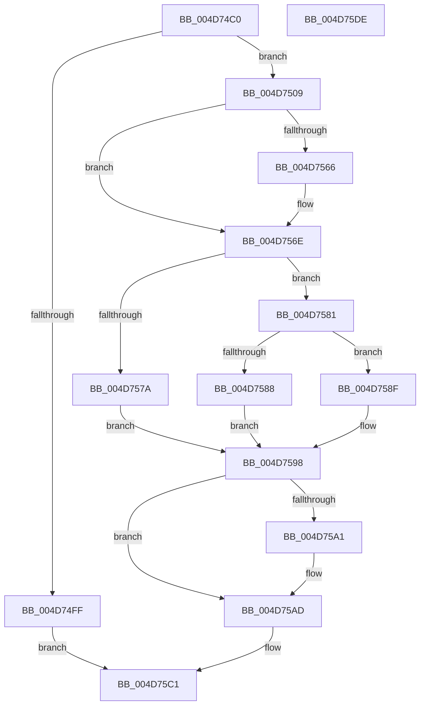

# PpmSetSimulatedIdle

- RVA: `0x004D74C0`–`0x004D75DF` (길이 `287` bytes)
- VA: `0x00000001404D74C0`
- 실행 섹션: `.text`
- PDB 이름 있음: `예`; PDB Function 태그: `아니요`
- unwind 정보 RVA: `0x000BE5DC`
- 디코드: `74`개 명령, `287/287` bytes 표시
- 미해석 바이트: `0` (있으면 어셈블리에 `.byte`로 보존)

> 이 문서는 커널 이미지의 기계어와 PDB 기호를 분석해 생성했습니다. 4번과 5번은 함수 원형과 자료형을 바이너리 사용 방식에서 추정한 C 해석이며 원본 소스 복구 결과는 아닙니다.

## 1. Dependencies

- 직접 호출 지점: **6**; 고유 호출 대상: **6**
- 직접 호출자로 확인된 함수: **1**
- RIP 상대 이미지 참조: **3**

### Outgoing calls
- `0x004D74F5` → [KeGetProcessorIndexFromNumber](../2D/KeGetProcessorIndexFromNumber_function_002DD2D0.md) (function, `0x002DD2D0`)
- `0x004D7542` → [KeSetSystemGroupAffinityThread](../39/KeSetSystemGroupAffinityThread_function_00399140.md) (function, `0x00399140`)
- `0x004D7569` → [KiRaiseIrqlProcessIrqlFlags](../4F/KiRaiseIrqlProcessIrqlFlags_function_004F56FC.md) (function, `0x004F56FC`)
- `0x004D75A8` → [KiLowerIrqlProcessIrqlFlags](../4F/KiLowerIrqlProcessIrqlFlags_function_004F5698.md) (function, `0x004F5698`)
- `0x004D75BA` → [KeRevertToUserGroupAffinityThread](../39/KeRevertToUserGroupAffinityThread_function_00398EC0.md) (function, `0x00398EC0`)
- `0x004D75C9` → [_security_check_cookie](../6A/_security_check_cookie_function_006AC640.md) (function, `0x006AC640`)

### Direct callers
- [NtPowerInformation](../../page/95/NtPowerInformation_function_00955D80.md) at `0x009572CF`

### Static image references
- `0x004D74CF` → RVA `0x00E0A740` (`.data`; read)
- `0x004D750D` → RVA `0x00F231B0` (`.data`; read)
- `0x004D755D` → RVA `0x00FC6D20` (`ALMOSTRO`; read)

## 2. Other-region calls and transfers

- 다른 실행 섹션으로 향하는 call: **0**
- 별도 외부 분기/꼬리 이동을 확인하지 못했습니다.

## 3. Assembly (complete function range)

```asm
004D74C0  48 89 5C 24 10                  mov qword ptr [rsp + 0x10], rbx
004D74C5  48 89 74 24 18                  mov qword ptr [rsp + 0x18], rsi
004D74CA  57                              push rdi
004D74CB  48 83 EC 50                     sub rsp, 0x50
004D74CF  48 8B 05 6A 32 93 00            mov rax, qword ptr [rip + 0x93326a]
004D74D6  48 33 C4                        xor rax, rsp
004D74D9  48 89 44 24 40                  mov qword ptr [rsp + 0x40], rax
004D74DE  48 8B D9                        mov rbx, rcx
004D74E1  0F 57 C0                        xorps xmm0, xmm0
004D74E4  0F 57 C9                        xorps xmm1, xmm1
004D74E7  48 83 C1 04                     add rcx, 4
004D74EB  0F 11 44 24 20                  movups xmmword ptr [rsp + 0x20], xmm0
004D74F0  0F 11 4C 24 30                  movups xmmword ptr [rsp + 0x30], xmm1
004D74F5  E8 D6 5D E0 FF                  call 0x1402dd2d0
004D74FA  83 F8 FF                        cmp eax, -1
004D74FD  75 0A                           jne 0x1404d7509
004D74FF  B8 0D 00 00 C0                  mov eax, 0xc000000d
004D7504  E9 B8 00 00 00                  jmp 0x1404d75c1
004D7509  8B C8                           mov ecx, eax
004D750B  33 D2                           xor edx, edx
004D750D  48 8B 05 9C BC A4 00            mov rax, qword ptr [rip + 0xa4bc9c]
004D7514  89 54 24 2A                     mov dword ptr [rsp + 0x2a], edx
004D7518  66 89 54 24 2E                  mov word ptr [rsp + 0x2e], dx
004D751D  8B 0C 88                        mov ecx, dword ptr [rax + rcx*4]
004D7520  8B C1                           mov eax, ecx
004D7522  C1 E8 06                        shr eax, 6
004D7525  83 E1 3F                        and ecx, 0x3f
004D7528  66 89 44 24 28                  mov word ptr [rsp + 0x28], ax
004D752D  8D 42 01                        lea eax, [rdx + 1]
004D7530  48 D3 E0                        shl rax, cl
004D7533  48 8D 54 24 30                  lea rdx, [rsp + 0x30]
004D7538  48 8D 4C 24 20                  lea rcx, [rsp + 0x20]
004D753D  48 89 44 24 20                  mov qword ptr [rsp + 0x20], rax
004D7542  E8 F9 1B EC FF                  call 0x140399140
004D7547  65 48 8B 34 25 20 00 00 00      mov rsi, qword ptr gs:[0x20]
004D7550  44 0F 20 C7                     mov rdi, cr8
004D7554  BA 02 00 00 00                  mov edx, 2
004D7559  44 0F 22 C2                     mov cr8, rdx
004D755D  83 3D BC F7 AE 00 00            cmp dword ptr [rip + 0xaef7bc], 0
004D7564  74 08                           je 0x1404d756e
004D7566  40 8A CF                        mov cl, dil
004D7569  E8 8E E1 01 00                  call 0x1404f56fc
004D756E  48 8B 86 40 88 00 00            mov rax, qword ptr [rsi + 0x8840]
004D7575  48 85 C0                        test rax, rax
004D7578  75 07                           jne 0x1404d7581
004D757A  BB BB 00 00 C0                  mov ebx, 0xc00000bb
004D757F  EB 17                           jmp 0x1404d7598
004D7581  8B 0B                           mov ecx, dword ptr [rbx]
004D7583  3B 48 28                        cmp ecx, dword ptr [rax + 0x28]
004D7586  72 07                           jb 0x1404d758f
004D7588  BB 0D 00 00 C0                  mov ebx, 0xc000000d
004D758D  EB 09                           jmp 0x1404d7598
004D758F  C6 40 01 01                     mov byte ptr [rax + 1], 1
004D7593  33 DB                           xor ebx, ebx
004D7595  89 48 24                        mov dword ptr [rax + 0x24], ecx
004D7598  83 3D 81 F7 AE 00 00            cmp dword ptr [rip + 0xaef781], 0
004D759F  74 0C                           je 0x1404d75ad
004D75A1  44 0F 20 C1                     mov rcx, cr8
004D75A5  40 8A D7                        mov dl, dil
004D75A8  E8 EB E0 01 00                  call 0x1404f5698
004D75AD  40 0F B6 CF                     movzx ecx, dil
004D75B1  44 0F 22 C1                     mov cr8, rcx
004D75B5  48 8D 4C 24 30                  lea rcx, [rsp + 0x30]
004D75BA  E8 01 19 EC FF                  call 0x140398ec0
004D75BF  8B C3                           mov eax, ebx
004D75C1  48 8B 4C 24 40                  mov rcx, qword ptr [rsp + 0x40]
004D75C6  48 33 CC                        xor rcx, rsp
004D75C9  E8 72 50 1D 00                  call 0x1406ac640
004D75CE  48 8B 5C 24 68                  mov rbx, qword ptr [rsp + 0x68]
004D75D3  48 8B 74 24 70                  mov rsi, qword ptr [rsp + 0x70]
004D75D8  48 83 C4 50                     add rsp, 0x50
004D75DC  5F                              pop rdi
004D75DD  C3                              ret
004D75DE  CC                              int3
```

## 4. C-style interpretation (structured pseudocode)

```c
__int64 __fastcall PpmSetSimulatedIdle(__int64 a1, int a2)
{
    __int64 result;
    __int64 v_rbx;
    __int64 v_rsp;
    unsigned __int64 v_stack_m18;
    unsigned __int64 v_stack_m28;
    unsigned __int16 v_stack_m2A;
    unsigned int v_stack_m2E;
    unsigned __int16 v_stack_m30;
    unsigned __int64 v_stack_m38;
    unsigned __int64 v_stack_p10;
    unsigned __int64 v_stack_p18;

    v_stack_p10 = v_rbx;
    v_stack_p18 = v_rsi;
    v_rsp = (v_rsp) - (80);
    result = (*(unsigned __int64 *)(v_rip + 9646698)) ^ (v_rsp);
    v_stack_m18 = result;
    a1 = (a1) + (4);
    v_stack_m38 = v_xmm0;
    v_stack_m28 = v_xmm1;
    result = KeGetProcessorIndexFromNumber(a1, a2, a3, a4);
    if (((unsigned int)(result)) != -1) goto loc_004D7509;
    goto loc_004D75C1;
loc_004D7509:
    a2 = 0;
    v_stack_m2E = 0;
    v_stack_m2A = 0;
    result = (unsigned int)(((unsigned int)((unsigned int)((unsigned int)(*(unsigned int *)(*(unsigned __int64 *)(v_rip + 10796188) + (unsigned int)((unsigned int)((unsigned int)(0xC000000DULL))) * 4))))) >> (6));
    a1 = (unsigned int)(((unsigned int)(*(unsigned int *)(*(unsigned __int64 *)(v_rip + 10796188) + (unsigned int)((unsigned int)((unsigned int)(0xC000000DULL))) * 4))) & (63));
    v_stack_m30 = (unsigned __int16)(result);
    result = (a2 + 1) << ((unsigned __int8)(a1));
    v_stack_m38 = result;
    result = KeSetSystemGroupAffinityThread(v_stack_m38, v_stack_m28, a3, a4);
    if ((*(unsigned int *)(v_rip + 11466684)) != 0) {
        a1 = (unsigned __int8)(v_cr8);
        result = KiRaiseIrqlProcessIrqlFlags(a1, 2, a3, a4);
    }
    if (*(unsigned __int64 *)(*(unsigned __int64 *)(gs_base + (0 + 32)) + 34880) != 0) goto loc_004D7581;
    goto loc_004D7598;
loc_004D7581:
    if (((unsigned int)((unsigned int)(*(unsigned int *)((unsigned int)(0xC00000BBULL))))) < (*(unsigned int *)(*(unsigned __int64 *)(*(unsigned __int64 *)(gs_base + (0 + 32)) + 34880) + 40))) goto loc_004D758F;
    goto loc_004D7598;
loc_004D758F:
    *(unsigned __int8 *)(*(unsigned __int64 *)(*(unsigned __int64 *)(gs_base + (0 + 32)) + 34880) + 1) = 1;
    v_rbx = 0;
    *(unsigned int *)(*(unsigned __int64 *)(*(unsigned __int64 *)(gs_base + (0 + 32)) + 34880) + 36) = (unsigned int)((unsigned int)(*(unsigned int *)((unsigned int)(0xC00000BBULL))));
loc_004D7598:
    result = *(unsigned __int64 *)(*(unsigned __int64 *)(gs_base + (0 + 32)) + 34880);
    if ((*(unsigned int *)(v_rip + 11466625)) != 0) {
        a1 = 2;
        a2 = (unsigned __int8)(v_cr8);
        result = KiLowerIrqlProcessIrqlFlags(a1, a2, a3, a4);
    }
    result = KeRevertToUserGroupAffinityThread(v_stack_m28, a2, a3, a4);
loc_004D75C1:
    a1 = (v_stack_m18) ^ (v_rsp);
    result = _security_check_cookie(a1, a2, a3, a4);
    v_rsp = (v_rsp) + (80);
    return result;
}
```

## 5. (Beta) C Style

```c
int64_t PpmSetSimulatedIdle(void *Arg1, int32_t Arg2)
{
    uint8_t *arg1 = (uint8_t *)Arg1;

    int64_t result;
    int64_t local_rbx;
    int64_t local_rsp;
    uint64_t v_stack_m18;
    uint64_t v_stack_m28;
    uint16_t v_stack_m2A;
    uint32_t v_stack_m2E;
    uint16_t v_stack_m30;
    uint64_t v_stack_m38;
    uint64_t v_stack_p10;
    uint64_t v_stack_p18;

    v_stack_p10 = local_rbx;
    v_stack_p18 = local_rsi;
    local_rsp = (local_rsp) - (80);
    result = (*(uint64_t *)(v_rip + 0x93326A)) ^ (local_rsp);
    v_stack_m18 = result;
    Arg1 = (Arg1) + (4);
    v_stack_m38 = v_xmm0;
    v_stack_m28 = v_xmm1;
    result = KeGetProcessorIndexFromNumber(Arg1, Arg2, a3, a4);
    if (((uint32_t)(result)) != -1) goto loc_004D7509;
    goto loc_004D75C1;
loc_004D7509:
    Arg2 = 0;
    v_stack_m2E = 0;
    v_stack_m2A = 0;
    result = (uint32_t)(((uint32_t)((uint32_t)((uint32_t)(*(uint32_t *)(*(uint64_t *)(v_rip + 0xA4BC9C) + (uint32_t)((uint32_t)((uint32_t)(0xC000000DULL))) * 4))))) >> (6));
    Arg1 = (uint32_t)(((uint32_t)(*(uint32_t *)(*(uint64_t *)(v_rip + 0xA4BC9C) + (uint32_t)((uint32_t)((uint32_t)(0xC000000DULL))) * 4))) & (63));
    v_stack_m30 = (uint16_t)(result);
    result = (Arg2 + 1) << ((uint8_t)(Arg1));
    v_stack_m38 = result;
    result = KeSetSystemGroupAffinityThread(v_stack_m38, v_stack_m28, a3, a4);
    if ((*(uint32_t *)(v_rip + 0xAEF7BC)) != 0) {
        Arg1 = (uint8_t)(v_cr8);
        result = KiRaiseIrqlProcessIrqlFlags(Arg1, 2, a3, a4);
    }
    if (*(uint64_t *)(*(uint64_t *)(gs_base + (0 + 0x20)) + 0x8840) != 0) goto loc_004D7581;
    goto loc_004D7598;
loc_004D7581:
    if (((uint32_t)((uint32_t)(*(uint32_t *)((uint32_t)(0xC00000BBULL))))) < (*(uint32_t *)(*(uint64_t *)(*(uint64_t *)(gs_base + (0 + 0x20)) + 0x8840) + 0x28))) goto loc_004D758F;
    goto loc_004D7598;
loc_004D758F:
    *(uint8_t *)(*(uint64_t *)(*(uint64_t *)(gs_base + (0 + 0x20)) + 0x8840) + 0x1) = 1;
    local_rbx = 0;
    *(uint32_t *)(*(uint64_t *)(*(uint64_t *)(gs_base + (0 + 0x20)) + 0x8840) + 0x24) = (uint32_t)((uint32_t)(*(uint32_t *)((uint32_t)(0xC00000BBULL))));
loc_004D7598:
    result = *(uint64_t *)(*(uint64_t *)(gs_base + (0 + 0x20)) + 0x8840);
    if ((*(uint32_t *)(v_rip + 0xAEF781)) != 0) {
        Arg1 = 2;
        Arg2 = (uint8_t)(v_cr8);
        result = KiLowerIrqlProcessIrqlFlags(Arg1, Arg2, a3, a4);
    }
    result = KeRevertToUserGroupAffinityThread(v_stack_m28, Arg2, a3, a4);
loc_004D75C1:
    Arg1 = (v_stack_m18) ^ (local_rsp);
    result = _security_check_cookie(Arg1, Arg2, a3, a4);
    local_rsp = (local_rsp) + (80);
    return result;
}
```

### 관측된 메모리 오프셋

구조체 형식이 확인되지 않은 접근은 인자 기준의 오프셋으로만 기록했습니다.

| 기준 인자 | 오프셋 표현 | 폭 (bit) | 접근 |
|---|---:|---:|---|
| `Arg1` | `+ 0x0` | `32` | `R` |

## 6. Execution-region graph

[열기: 2D/3D 그래프와 함수 탐색 컨트롤 패널](../../../control-panel.html?section=text&rva=0x004D74C0&view=graph)

- 2D 그래프는 위에서 아래로 흐르고, 3D 그래프는 빈 공간을 드래그해 회전합니다. Shift+드래그는 이동, 휠은 확대·축소, 함수 노드 선택은 대상 보고서 이동입니다.

### Static fallback


