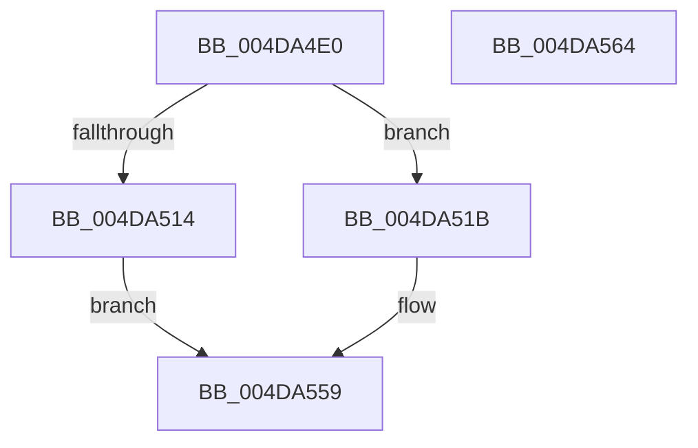

# PsAllocateAffinityToken

- RVA: `0x004DA4E0`–`0x004DA565` (길이 `133` bytes)
- VA: `0x00000001404DA4E0`
- 실행 섹션: `.text`
- PDB 이름 있음: `예`; PDB Function 태그: `아니요`
- unwind 정보 RVA: `0x0005CAAC`
- 디코드: `35`개 명령, `133/133` bytes 표시
- 미해석 바이트: `0` (있으면 어셈블리에 `.byte`로 보존)

> 이 문서는 커널 이미지의 기계어와 PDB 기호를 분석해 생성했습니다. 4번과 5번은 함수 원형과 자료형을 바이너리 사용 방식에서 추정한 C 해석이며 원본 소스 복구 결과는 아닙니다.

## 1. Dependencies

- 직접 호출 지점: **2**; 고유 호출 대상: **2**
- 직접 호출자로 확인된 함수: **1**
- RIP 상대 이미지 참조: **1**

### Outgoing calls
- `0x004DA507` → [ExAllocatePool2](../../poolcode/B8/ExAllocatePool2_function_00B820F0.md) (function, `0x00B820F0`)
- `0x004DA544` → [memset](../6C/memset_function_006C6C40.md) (function, `0x006C6C40`)

### Direct callers
- [MiCombineAllPhysicalMemory](../../page/9F/MiCombineAllPhysicalMemory_function_009F6B6C.md) at `0x009F6CD8`

### Static image references
- `0x004DA4EA` → RVA `0x00FC5014` (`ALMOSTRO`; read)

## 2. Other-region calls and transfers

- 다른 실행 섹션으로 향하는 call: **1**
  - `0x004DA507` → [ExAllocatePool2](../../poolcode/B8/ExAllocatePool2_function_00B820F0.md) (`.text` → `POOLCODE`)
- 별도 외부 분기/꼬리 이동을 확인하지 못했습니다.

## 3. Assembly (complete function range)

```asm
004DA4E0  48 89 5C 24 08                  mov qword ptr [rsp + 8], rbx
004DA4E5  57                              push rdi
004DA4E6  48 83 EC 20                     sub rsp, 0x20
004DA4EA  0F B7 05 23 AB AE 00            movzx eax, word ptr [rip + 0xaeab23]
004DA4F1  48 8B F9                        mov rdi, rcx
004DA4F4  B9 40 00 00 00                  mov ecx, 0x40
004DA4F9  41 B8 50 73 61 74               mov r8d, 0x74617350
004DA4FF  48 8D 14 C5 28 00 00 00         lea rdx, [rax*8 + 0x28]
004DA507  E8 E4 7B 6A 00                  call 0x140b820f0
004DA50C  48 8B D8                        mov rbx, rax
004DA50F  48 85 C0                        test rax, rax
004DA512  75 07                           jne 0x1404da51b
004DA514  B8 9A 00 00 C0                  mov eax, 0xc000009a
004DA519  EB 3E                           jmp 0x1404da559
004DA51B  48 8D 48 20                     lea rcx, [rax + 0x20]
004DA51F  33 D2                           xor edx, edx
004DA521  48 89 48 18                     mov qword ptr [rax + 0x18], rcx
004DA525  0F B7 05 E8 AA AE 00            movzx eax, word ptr [rip + 0xaeaae8]
004DA52C  83 61 04 00                     and dword ptr [rcx + 4], 0
004DA530  44 8B C0                        mov r8d, eax
004DA533  66 C7 01 01 00                  mov word ptr [rcx], 1
004DA538  66 89 41 02                     mov word ptr [rcx + 2], ax
004DA53C  48 83 C1 08                     add rcx, 8
004DA540  49 C1 E0 03                     shl r8, 3
004DA544  E8 F7 C6 1E 00                  call 0x1406c6c40
004DA549  48 83 23 00                     and qword ptr [rbx], 0
004DA54D  0F 57 C0                        xorps xmm0, xmm0
004DA550  0F 11 43 08                     movups xmmword ptr [rbx + 8], xmm0
004DA554  48 89 1F                        mov qword ptr [rdi], rbx
004DA557  33 C0                           xor eax, eax
004DA559  48 8B 5C 24 30                  mov rbx, qword ptr [rsp + 0x30]
004DA55E  48 83 C4 20                     add rsp, 0x20
004DA562  5F                              pop rdi
004DA563  C3                              ret
004DA564  CC                              int3
```

## 4. C-style interpretation (structured pseudocode)

```c
__int64 __fastcall PsAllocateAffinityToken(__int64 a1)
{
    __int64 result;
    __int64 v_rsp;
    unsigned __int64 v_stack_p8;

    v_stack_p8 = v_rbx;
    v_rsp = (v_rsp) - (32);
    result = ExAllocatePool2(64, *(unsigned __int16 *)(v_rip + 11447075) * 8 + 40, (unsigned int)(0x74617350ULL), a4);
    if (result != 0) goto loc_004DA51B;
    goto loc_004DA559;
loc_004DA51B:
    a2 = 0;
    *(unsigned __int64 *)((unsigned int)(0xC000009AULL) + 24) = (unsigned int)(0xC000009AULL) + 32;
    *(unsigned __int16 *)((unsigned int)(0xC000009AULL) + 32) = 1;
    *(unsigned __int16 *)((unsigned int)(0xC000009AULL) + 32 + 2) = (unsigned __int16)(*(unsigned __int16 *)(v_rip + 11447016));
    a1 = ((unsigned int)(0xC000009AULL) + 32) + (8);
    a3 = ((unsigned int)((unsigned int)(*(unsigned __int16 *)(v_rip + 11447016)))) << (3);
    result = memset(a1, a2, a3, a4);
    *(unsigned __int64 *)(result + 8) = v_xmm0;
    *(unsigned __int64 *)(a1) = result;
    result = 0;
loc_004DA559:
    v_rsp = (v_rsp) + (32);
    return result;
}
```

## 5. (Beta) C Style

```c
int64_t PsAllocateAffinityToken(void *Arg1)
{
    uint8_t *arg1 = (uint8_t *)Arg1;

    int64_t result;
    int64_t local_rsp;
    uint64_t v_stack_p8;

    v_stack_p8 = local_rbx;
    local_rsp = (local_rsp) - (32);
    result = ExAllocatePool2(64, *(uint16_t *)(v_rip + 0xAEAB23) * 8 + 40, (uint32_t)(0x74617350ULL), a4);
    if (result != 0) goto loc_004DA51B;
    goto loc_004DA559;
loc_004DA51B:
    a2 = 0;
    *(uint64_t *)((uint32_t)(0xC000009AULL) + 0x18) = (uint32_t)(0xC000009AULL) + 32;
    *(uint16_t *)((uint32_t)(0xC000009AULL) + 0x20) = 1;
    *(uint16_t *)((uint32_t)(0xC000009AULL) + 0x20 + 0x2) = (uint16_t)(*(uint16_t *)(v_rip + 0xAEAAE8));
    Arg1 = ((uint32_t)(0xC000009AULL) + 32) + (8);
    a3 = ((uint32_t)((uint32_t)(*(uint16_t *)(v_rip + 0xAEAAE8)))) << (3);
    result = memset(Arg1, a2, a3, a4);
    *(uint64_t *)(result + 0x8) = v_xmm0;
    *(uint64_t *)(arg1) = result;
    result = 0;
loc_004DA559:
    local_rsp = (local_rsp) + (32);
    return result;
}
```

### 관측된 메모리 오프셋

구조체 형식이 확인되지 않은 접근은 인자 기준의 오프셋으로만 기록했습니다.

| 기준 인자 | 오프셋 표현 | 폭 (bit) | 접근 |
|---|---:|---:|---|
| `Arg1` | `+ 0x0` | `64` | `W` |

## 6. Execution-region graph

[열기: 2D/3D 그래프와 함수 탐색 컨트롤 패널](../../../control-panel.html?section=text&rva=0x004DA4E0&view=graph)

- 2D 그래프는 위에서 아래로 흐르고, 3D 그래프는 빈 공간을 드래그해 회전합니다. Shift+드래그는 이동, 휠은 확대·축소, 함수 노드 선택은 대상 보고서 이동입니다.

### Static fallback


