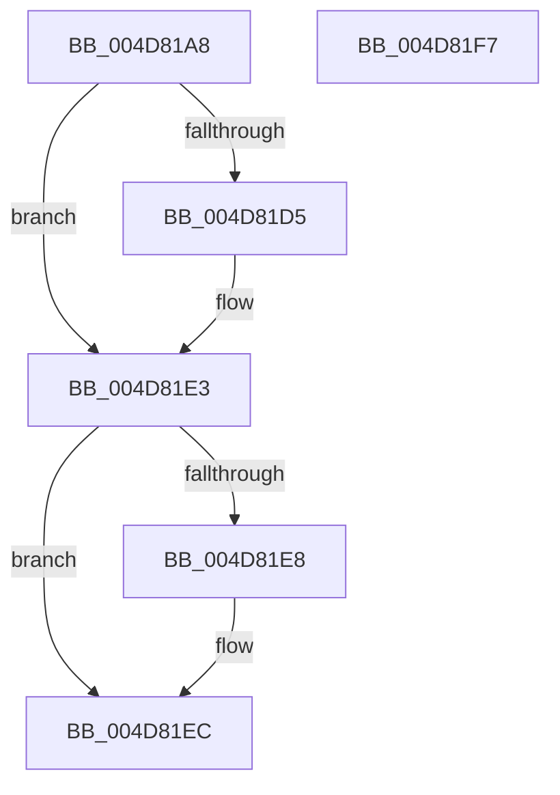

# PspLockQuotaListExclusive

- RVA: `0x004D81A8`–`0x004D81F8` (길이 `80` bytes)
- VA: `0x00000001404D81A8`
- 실행 섹션: `.text`
- PDB 이름 있음: `예`; PDB Function 태그: `아니요`
- unwind 정보 RVA: `0x0005CAAC`
- 디코드: `25`개 명령, `80/80` bytes 표시
- 미해석 바이트: `0` (있으면 어셈블리에 `.byte`로 보존)

> 이 문서는 커널 이미지의 기계어와 PDB 기호를 분석해 생성했습니다. 4번과 5번은 함수 원형과 자료형을 바이너리 사용 방식에서 추정한 C 해석이며 원본 소스 복구 결과는 아닙니다.

## 1. Dependencies

- 직접 호출 지점: **2**; 고유 호출 대상: **2**
- 직접 호출자로 확인된 함수: **2**
- RIP 상대 이미지 참조: **0**

### Outgoing calls
- `0x004D81C5` → [KeAbPreAcquire](../21/KeAbPreAcquire_function_00210230.md) (function, `0x00210230`)
- `0x004D81DE` → [ExfAcquirePushLockExclusiveEx](../20/ExfAcquirePushLockExclusiveEx_function_0020FC90.md) (function, `0x0020FC90`)

### Direct callers
- [PspRemoveQuotaBlock](../../page/9D/PspRemoveQuotaBlock_function_009DAA00.md) at `0x009DAA85`
- [PspLookupProcessQuotaBlock](../../page/AE/PspLookupProcessQuotaBlock_function_00AE336C.md) at `0x00AE33C2`

### Static image references
- 디코드된 RIP-relative 메모리 참조가 없습니다.

## 2. Other-region calls and transfers

- 다른 실행 섹션으로 향하는 call: **0**
- 별도 외부 분기/꼬리 이동을 확인하지 못했습니다.

## 3. Assembly (complete function range)

```asm
004D81A8  48 89 5C 24 08                  mov qword ptr [rsp + 8], rbx
004D81AD  57                              push rdi
004D81AE  48 83 EC 20                     sub rsp, 0x20
004D81B2  66 FF 89 E4 01 00 00            dec word ptr [rcx + 0x1e4]
004D81B9  48 8B FA                        mov rdi, rdx
004D81BC  48 8B CF                        mov rcx, rdi
004D81BF  45 33 C0                        xor r8d, r8d
004D81C2  33 D2                           xor edx, edx
004D81C4  90                              nop
004D81C5  E8 66 80 D3 FF                  call 0x140210230
004D81CA  F0 48 0F BA 2F 00               lock bts qword ptr [rdi], 0
004D81D0  48 8B D8                        mov rbx, rax
004D81D3  73 0E                           jae 0x1404d81e3
004D81D5  4C 8B C7                        mov r8, rdi
004D81D8  48 8B D0                        mov rdx, rax
004D81DB  48 8B CF                        mov rcx, rdi
004D81DE  E8 AD 7A D3 FF                  call 0x14020fc90
004D81E3  48 85 DB                        test rbx, rbx
004D81E6  74 04                           je 0x1404d81ec
004D81E8  C6 43 0A 01                     mov byte ptr [rbx + 0xa], 1
004D81EC  48 8B 5C 24 30                  mov rbx, qword ptr [rsp + 0x30]
004D81F1  48 83 C4 20                     add rsp, 0x20
004D81F5  5F                              pop rdi
004D81F6  C3                              ret
004D81F7  CC                              int3
```

## 4. C-style interpretation (structured pseudocode)

```c
__int64 __fastcall PspLockQuotaListExclusive(__int64 a1, __int64 a2, int a3)
{
    __int64 result;
    __int64 v_rsp;
    unsigned __int64 v_stack_p8;

    v_stack_p8 = v_rbx;
    v_rsp = (v_rsp) - (32);
    a3 = 0;
    a2 = 0;
    result = KeAbPreAcquire(a2, a2, a3, a4);
    if (!(condition_is_above_or_equal)) {
        a3 = 0;
        a2 = result;
        a1 = a2;
        result = ExfAcquirePushLockExclusiveEx(a1, a2, a3, a4);
    }
    if (result != 0) {
        *(unsigned __int8 *)(result + 10) = 1;
    }
    v_rsp = (v_rsp) + (32);
    return result;
}
```

## 5. (Beta) C Style

```c
int64_t PspLockQuotaListExclusive(void *Arg1, void *Arg2, int32_t Arg3)
{
    uint8_t *arg1 = (uint8_t *)Arg1;
    uint8_t *arg2 = (uint8_t *)Arg2;

    int64_t result;
    int64_t local_rsp;
    uint64_t v_stack_p8;

    v_stack_p8 = local_rbx;
    local_rsp = (local_rsp) - (32);
    Arg3 = 0;
    Arg2 = 0;
    result = KeAbPreAcquire(Arg2, Arg2, Arg3, a4);
    if (!(condition_is_above_or_equal)) {
        Arg3 = 0;
        Arg2 = result;
        Arg1 = Arg2;
        result = ExfAcquirePushLockExclusiveEx(Arg1, Arg2, Arg3, a4);
    }
    if (result != 0) {
        *(uint8_t *)(result + 0xA) = 1;
    }
    local_rsp = (local_rsp) + (32);
    return result;
}
```

### 관측된 메모리 오프셋

구조체 형식이 확인되지 않은 접근은 인자 기준의 오프셋으로만 기록했습니다.

| 기준 인자 | 오프셋 표현 | 폭 (bit) | 접근 |
|---|---:|---:|---|
| `Arg1` | `+ 0x1E4` | `16` | `R/W` |
| `Arg2` | `+ 0x0` | `64` | `R/W` |

## 6. Execution-region graph

[열기: 2D/3D 그래프와 함수 탐색 컨트롤 패널](../../../control-panel.html?section=text&rva=0x004D81A8&view=graph)

- 2D 그래프는 위에서 아래로 흐르고, 3D 그래프는 빈 공간을 드래그해 회전합니다. Shift+드래그는 이동, 휠은 확대·축소, 함수 노드 선택은 대상 보고서 이동입니다.

### Static fallback


