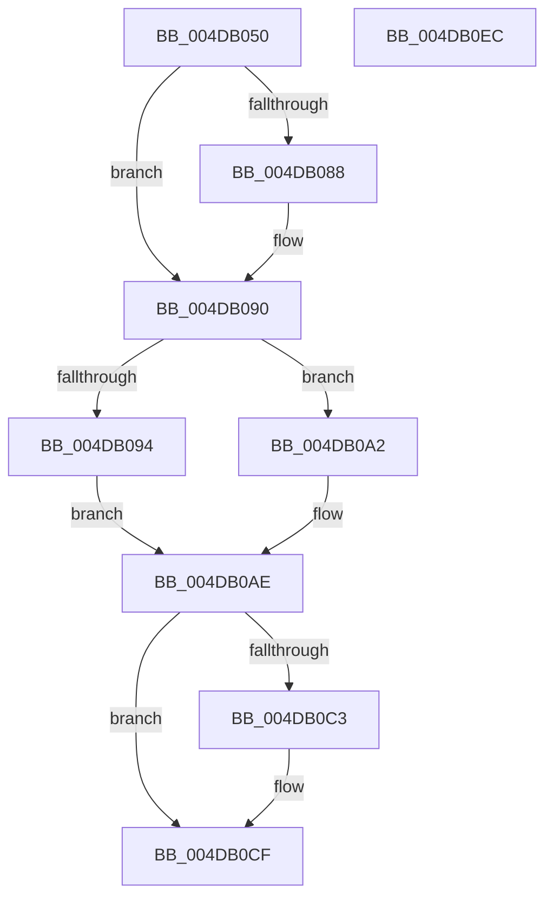

# PspSetPicoThreadDescriptorBase

- RVA: `0x004DB050`–`0x004DB0ED` (길이 `157` bytes)
- VA: `0x00000001404DB050`
- 실행 섹션: `.text`
- PDB 이름 있음: `예`; PDB Function 태그: `아니요`
- unwind 정보 RVA: `0x0005C954`
- 디코드: `40`개 명령, `157/157` bytes 표시
- 미해석 바이트: `0` (있으면 어셈블리에 `.byte`로 보존)

> 이 문서는 커널 이미지의 기계어와 PDB 기호를 분석해 생성했습니다. 4번과 5번은 함수 원형과 자료형을 바이너리 사용 방식에서 추정한 C 해석이며 원본 소스 복구 결과는 아닙니다.

## 1. Dependencies

- 직접 호출 지점: **2**; 고유 호출 대상: **2**
- 직접 호출자로 확인된 함수: **0**
- RIP 상대 이미지 참조: **1**

### Outgoing calls
- `0x004DB08B` → [KiRaiseIrqlProcessIrqlFlags](../4F/KiRaiseIrqlProcessIrqlFlags_function_004F56FC.md) (function, `0x004F56FC`)
- `0x004DB0CA` → [KiLowerIrqlProcessIrqlFlags](../4F/KiLowerIrqlProcessIrqlFlags_function_004F5698.md) (function, `0x004F5698`)

### Direct callers
- 이 함수 시작 RVA로 연결되는 직접 call은 확인되지 않았습니다. 간접 호출은 완전히 역산할 수 없습니다.

### Static image references
- `0x004DB07F` → RVA `0x00FC6D20` (`ALMOSTRO`; read)

## 2. Other-region calls and transfers

- 다른 실행 섹션으로 향하는 call: **0**
- 별도 외부 분기/꼬리 이동을 확인하지 못했습니다.

## 3. Assembly (complete function range)

```asm
004DB050  48 89 5C 24 08                  mov qword ptr [rsp + 8], rbx
004DB055  48 89 6C 24 10                  mov qword ptr [rsp + 0x10], rbp
004DB05A  48 89 74 24 18                  mov qword ptr [rsp + 0x18], rsi
004DB05F  57                              push rdi
004DB060  48 83 EC 20                     sub rsp, 0x20
004DB064  65 48 8B 2C 25 88 01 00 00      mov rbp, qword ptr gs:[0x188]
004DB06D  48 8B F2                        mov rsi, rdx
004DB070  8B D9                           mov ebx, ecx
004DB072  44 0F 20 C7                     mov rdi, cr8
004DB076  BA 02 00 00 00                  mov edx, 2
004DB07B  44 0F 22 C2                     mov cr8, rdx
004DB07F  83 3D 9A BC AE 00 00            cmp dword ptr [rip + 0xaebc9a], 0
004DB086  74 08                           je 0x1404db090
004DB088  40 8A CF                        mov cl, dil
004DB08B  E8 6C A6 01 00                  call 0x1404f56fc
004DB090  85 DB                           test ebx, ebx
004DB092  74 0E                           je 0x1404db0a2
004DB094  48 89 B5 80 06 00 00            mov qword ptr [rbp + 0x680], rsi
004DB09B  B9 02 01 00 C0                  mov ecx, 0xc0000102
004DB0A0  EB 0C                           jmp 0x1404db0ae
004DB0A2  48 89 B5 78 06 00 00            mov qword ptr [rbp + 0x678], rsi
004DB0A9  B9 00 01 00 C0                  mov ecx, 0xc0000100
004DB0AE  48 8B D6                        mov rdx, rsi
004DB0B1  48 8B C6                        mov rax, rsi
004DB0B4  48 C1 EA 20                     shr rdx, 0x20
004DB0B8  0F 30                           wrmsr
004DB0BA  83 3D 5F BC AE 00 00            cmp dword ptr [rip + 0xaebc5f], 0
004DB0C1  74 0C                           je 0x1404db0cf
004DB0C3  44 0F 20 C1                     mov rcx, cr8
004DB0C7  40 8A D7                        mov dl, dil
004DB0CA  E8 C9 A5 01 00                  call 0x1404f5698
004DB0CF  40 0F B6 C7                     movzx eax, dil
004DB0D3  44 0F 22 C0                     mov cr8, rax
004DB0D7  48 8B 5C 24 30                  mov rbx, qword ptr [rsp + 0x30]
004DB0DC  48 8B 6C 24 38                  mov rbp, qword ptr [rsp + 0x38]
004DB0E1  48 8B 74 24 40                  mov rsi, qword ptr [rsp + 0x40]
004DB0E6  48 83 C4 20                     add rsp, 0x20
004DB0EA  5F                              pop rdi
004DB0EB  C3                              ret
004DB0EC  CC                              int3
```

## 4. C-style interpretation (structured pseudocode)

```c
__int64 __fastcall PspSetPicoThreadDescriptorBase(int a1, __int64 a2)
{
    __int64 result;
    __int64 v_rsp;
    unsigned __int64 v_stack_p10;
    unsigned __int64 v_stack_p18;
    unsigned __int64 v_stack_p8;

    v_stack_p8 = v_rbx;
    v_stack_p10 = v_rbp;
    v_stack_p18 = v_rsi;
    v_rsp = (v_rsp) - (32);
    if ((*(unsigned int *)(v_rip + 11451546)) != 0) {
        a1 = (unsigned __int8)(v_cr8);
        result = KiRaiseIrqlProcessIrqlFlags(a1, 2, a3, a4);
    }
    if ((unsigned int)((unsigned int)(a1)) == 0) goto loc_004DB0A2;
    *(unsigned __int64 *)(*(unsigned __int64 *)(gs_base + (0 + 392)) + 1664) = a2;
    goto loc_004DB0AE;
loc_004DB0A2:
    *(unsigned __int64 *)(*(unsigned __int64 *)(gs_base + (0 + 392)) + 1656) = a2;
loc_004DB0AE:
    a2 = (a2) >> (32);
    result = a2;
    if ((*(unsigned int *)(v_rip + 11451487)) != 0) {
        a1 = 2;
        a2 = (unsigned __int8)(v_cr8);
        result = KiLowerIrqlProcessIrqlFlags(a1, a2, a3, a4);
    }
    v_rsp = (v_rsp) + (32);
    return (unsigned __int8)(v_cr8);
}
```

## 5. (Beta) C Style

```c
int64_t PspSetPicoThreadDescriptorBase(int32_t Arg1, int64_t Arg2)
{
    int64_t result;
    int64_t local_rsp;
    uint64_t v_stack_p10;
    uint64_t v_stack_p18;
    uint64_t v_stack_p8;

    v_stack_p8 = local_rbx;
    v_stack_p10 = local_rbp;
    v_stack_p18 = local_rsi;
    local_rsp = (local_rsp) - (32);
    if ((*(uint32_t *)(v_rip + 0xAEBC9A)) != 0) {
        Arg1 = (uint8_t)(v_cr8);
        result = KiRaiseIrqlProcessIrqlFlags(Arg1, 2, a3, a4);
    }
    if ((uint32_t)((uint32_t)(Arg1)) == 0) goto loc_004DB0A2;
    *(uint64_t *)(*(uint64_t *)(gs_base + (0 + 0x188)) + 0x680) = Arg2;
    goto loc_004DB0AE;
loc_004DB0A2:
    *(uint64_t *)(*(uint64_t *)(gs_base + (0 + 0x188)) + 0x678) = Arg2;
loc_004DB0AE:
    Arg2 = (Arg2) >> (32);
    result = Arg2;
    if ((*(uint32_t *)(v_rip + 0xAEBC5F)) != 0) {
        Arg1 = 2;
        Arg2 = (uint8_t)(v_cr8);
        result = KiLowerIrqlProcessIrqlFlags(Arg1, Arg2, a3, a4);
    }
    local_rsp = (local_rsp) + (32);
    return (uint8_t)(v_cr8);
}
```

## 6. Execution-region graph

[열기: 2D/3D 그래프와 함수 탐색 컨트롤 패널](../../../control-panel.html?section=text&rva=0x004DB050&view=graph)

- 2D 그래프는 위에서 아래로 흐르고, 3D 그래프는 빈 공간을 드래그해 회전합니다. Shift+드래그는 이동, 휠은 확대·축소, 함수 노드 선택은 대상 보고서 이동입니다.

### Static fallback


