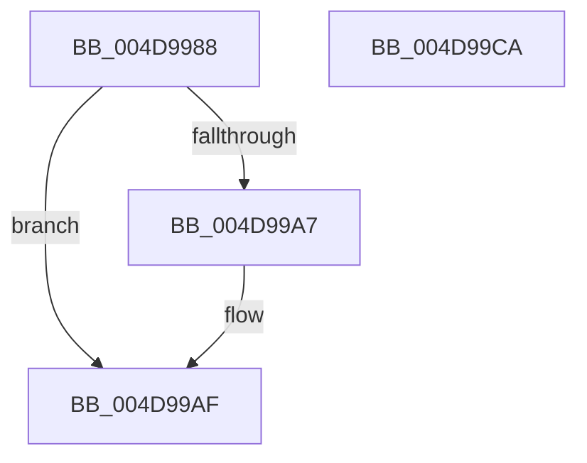

# PspUnlockQuotaListExclusive

- RVA: `0x004D9988`–`0x004D99CB` (길이 `67` bytes)
- VA: `0x00000001404D9988`
- 실행 섹션: `.text`
- PDB 이름 있음: `예`; PDB Function 태그: `아니요`
- unwind 정보 RVA: `0x0005CAAC`
- 디코드: `21`개 명령, `67/67` bytes 표시
- 미해석 바이트: `0` (있으면 어셈블리에 `.byte`로 보존)

> 이 문서는 커널 이미지의 기계어와 PDB 기호를 분석해 생성했습니다. 4번과 5번은 함수 원형과 자료형을 바이너리 사용 방식에서 추정한 C 해석이며 원본 소스 복구 결과는 아닙니다.

## 1. Dependencies

- 직접 호출 지점: **3**; 고유 호출 대상: **3**
- 직접 호출자로 확인된 함수: **2**
- RIP 상대 이미지 참조: **0**

### Outgoing calls
- `0x004D99AA` → [ExfTryToWakePushLock](../26/ExfTryToWakePushLock_function_00265DD0.md) (function, `0x00265DD0`)
- `0x004D99B2` → [KeAbPostRelease](../2E/KeAbPostRelease_function_002E1600.md) (function, `0x002E1600`)
- `0x004D99BA` → [KeLeaveCriticalRegionThread](../25/KeLeaveCriticalRegionThread_function_0025EFF0.md) (function, `0x0025EFF0`)

### Direct callers
- [PspRemoveQuotaBlock](../../page/9D/PspRemoveQuotaBlock_function_009DAA00.md) at `0x009DAAD2`
- [PspLookupProcessQuotaBlock](../../page/AE/PspLookupProcessQuotaBlock_function_00AE336C.md) at `0x00AE34B4`

### Static image references
- 디코드된 RIP-relative 메모리 참조가 없습니다.

## 2. Other-region calls and transfers

- 다른 실행 섹션으로 향하는 call: **0**
- 별도 외부 분기/꼬리 이동을 확인하지 못했습니다.

## 3. Assembly (complete function range)

```asm
004D9988  48 89 5C 24 08                  mov qword ptr [rsp + 8], rbx
004D998D  57                              push rdi
004D998E  48 83 EC 20                     sub rsp, 0x20
004D9992  48 8B DA                        mov rbx, rdx
004D9995  48 8B F9                        mov rdi, rcx
004D9998  48 83 C8 FF                     or rax, 0xffffffffffffffff
004D999C  F0 48 0F C1 02                  lock xadd qword ptr [rdx], rax
004D99A1  24 06                           and al, 6
004D99A3  3C 02                           cmp al, 2
004D99A5  75 08                           jne 0x1404d99af
004D99A7  48 8B CA                        mov rcx, rdx
004D99AA  E8 21 C4 D8 FF                  call 0x140265dd0
004D99AF  48 8B CB                        mov rcx, rbx
004D99B2  E8 49 7C E0 FF                  call 0x1402e1600
004D99B7  48 8B CF                        mov rcx, rdi
004D99BA  E8 31 56 D8 FF                  call 0x14025eff0
004D99BF  48 8B 5C 24 30                  mov rbx, qword ptr [rsp + 0x30]
004D99C4  48 83 C4 20                     add rsp, 0x20
004D99C8  5F                              pop rdi
004D99C9  C3                              ret
004D99CA  CC                              int3
```

## 4. C-style interpretation (structured pseudocode)

```c
__int64 __fastcall PspUnlockQuotaListExclusive(__int64 a1, __int64 a2)
{
    __int64 result;
    __int64 v_rsp;
    unsigned __int64 v_stack_p8;

    v_stack_p8 = v_rbx;
    v_rsp = (v_rsp) - (32);
    result = (result) | (-1);
    result = (unsigned __int8)((result) & (6));
    if (((unsigned __int8)(result)) == 2) {
        a1 = a2;
        result = ExfTryToWakePushLock(a1, a2, a3, a4);
    }
    result = KeAbPostRelease(a2, a2, a3, a4);
    result = KeLeaveCriticalRegionThread(a1, a2, a3, a4);
    v_rsp = (v_rsp) + (32);
    return result;
}
```

## 5. (Beta) C Style

```c
int64_t PspUnlockQuotaListExclusive(int64_t Arg1, void *Arg2)
{
    uint8_t *arg2 = (uint8_t *)Arg2;

    int64_t result;
    int64_t local_rsp;
    uint64_t v_stack_p8;

    v_stack_p8 = local_rbx;
    local_rsp = (local_rsp) - (32);
    result = (result) | (-1);
    result = (uint8_t)((result) & (6));
    if (((uint8_t)(result)) == 2) {
        Arg1 = Arg2;
        result = ExfTryToWakePushLock(Arg1, Arg2, a3, a4);
    }
    result = KeAbPostRelease(Arg2, Arg2, a3, a4);
    result = KeLeaveCriticalRegionThread(Arg1, Arg2, a3, a4);
    local_rsp = (local_rsp) + (32);
    return result;
}
```

### 관측된 메모리 오프셋

구조체 형식이 확인되지 않은 접근은 인자 기준의 오프셋으로만 기록했습니다.

| 기준 인자 | 오프셋 표현 | 폭 (bit) | 접근 |
|---|---:|---:|---|
| `Arg2` | `+ 0x0` | `64` | `R/W` |

## 6. Execution-region graph

[열기: 2D/3D 그래프와 함수 탐색 컨트롤 패널](../../../control-panel.html?section=text&rva=0x004D9988&view=graph)

- 2D 그래프는 위에서 아래로 흐르고, 3D 그래프는 빈 공간을 드래그해 회전합니다. Shift+드래그는 이동, 휠은 확대·축소, 함수 노드 선택은 대상 보고서 이동입니다.

### Static fallback


