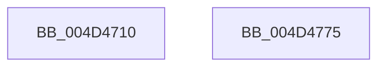

# RtlEthernetAddressToStringW

- RVA: `0x004D4710`–`0x004D4776` (길이 `102` bytes)
- VA: `0x00000001404D4710`
- 실행 섹션: `.text`
- PDB 이름 있음: `예`; PDB Function 태그: `아니요`
- unwind 정보 RVA: `0x0008A2AC`
- 디코드: `26`개 명령, `102/102` bytes 표시
- 미해석 바이트: `0` (있으면 어셈블리에 `.byte`로 보존)

> 이 문서는 커널 이미지의 기계어와 PDB 기호를 분석해 생성했습니다. 4번과 5번은 함수 원형과 자료형을 바이너리 사용 방식에서 추정한 C 해석이며 원본 소스 복구 결과는 아닙니다.

## 1. Dependencies

- 직접 호출 지점: **1**; 고유 호출 대상: **1**
- 직접 호출자로 확인된 함수: **1**
- RIP 상대 이미지 참조: **1**

### Outgoing calls
- `0x004D475E` → [swprintf_s](../50/swprintf_s_function_00504B20.md) (function, `0x00504B20`)

### Direct callers
- [AdtpBuildMacStrings](../../page/82/AdtpBuildMacStrings_function_008220DC.md) at `0x00822164`

### Static image references
- `0x004D4749` → RVA `0x006CCCC0` (` ?? ::FNODOBFM::`string'`; read)

## 2. Other-region calls and transfers

- 다른 실행 섹션으로 향하는 call: **0**
- 별도 외부 분기/꼬리 이동을 확인하지 못했습니다.

## 3. Assembly (complete function range)

```asm
004D4710  48 89 5C 24 08                  mov qword ptr [rsp + 8], rbx
004D4715  57                              push rdi
004D4716  48 83 EC 50                     sub rsp, 0x50
004D471A  44 0F B6 41 04                  movzx r8d, byte ptr [rcx + 4]
004D471F  48 8B FA                        mov rdi, rdx
004D4722  0F B6 41 05                     movzx eax, byte ptr [rcx + 5]
004D4726  BA 12 00 00 00                  mov edx, 0x12
004D472B  44 0F B6 51 03                  movzx r10d, byte ptr [rcx + 3]
004D4730  44 0F B6 59 02                  movzx r11d, byte ptr [rcx + 2]
004D4735  0F B6 59 01                     movzx ebx, byte ptr [rcx + 1]
004D4739  44 0F B6 09                     movzx r9d, byte ptr [rcx]
004D473D  48 8B CF                        mov rcx, rdi
004D4740  89 44 24 40                     mov dword ptr [rsp + 0x40], eax
004D4744  44 89 44 24 38                  mov dword ptr [rsp + 0x38], r8d
004D4749  4C 8D 05 70 85 1F 00            lea r8, [rip + 0x1f8570]
004D4750  44 89 54 24 30                  mov dword ptr [rsp + 0x30], r10d
004D4755  44 89 5C 24 28                  mov dword ptr [rsp + 0x28], r11d
004D475A  89 5C 24 20                     mov dword ptr [rsp + 0x20], ebx
004D475E  E8 BD 03 03 00                  call 0x140504b20
004D4763  48 8B 5C 24 60                  mov rbx, qword ptr [rsp + 0x60]
004D4768  48 63 C8                        movsxd rcx, eax
004D476B  48 8D 04 4F                     lea rax, [rdi + rcx*2]
004D476F  48 83 C4 50                     add rsp, 0x50
004D4773  5F                              pop rdi
004D4774  C3                              ret
004D4775  CC                              int3
```

## 4. C-style interpretation (structured pseudocode)

```c
__int64 __fastcall RtlEthernetAddressToStringW(__int64 a1, __int64 a2)
{
    __int64 result;
    __int64 v_rsp;
    unsigned int v_stack_m18;
    unsigned int v_stack_m20;
    unsigned int v_stack_m28;
    unsigned int v_stack_m30;
    unsigned int v_stack_m38;
    unsigned __int64 v_stack_p8;

    v_stack_p8 = v_rbx;
    v_rsp = (v_rsp) - (80);
    v_stack_m18 = (unsigned int)(*(unsigned __int8 *)(a1 + 5));
    v_stack_m20 = (unsigned int)(*(unsigned __int8 *)(a1 + 4));
    v_stack_m28 = (unsigned int)(*(unsigned __int8 *)(a1 + 3));
    v_stack_m30 = (unsigned int)(*(unsigned __int8 *)(a1 + 2));
    v_stack_m38 = (unsigned int)(*(unsigned __int8 *)(a1 + 1));
    result = swprintf_s(a2, 18, v_rip + 2065776, *(unsigned __int8 *)(a1));
    v_rsp = (v_rsp) + (80);
    return a2 + (int)((unsigned int)(result)) * 2;
}
```

## 5. (Beta) C Style

```c
int64_t RtlEthernetAddressToStringW(void *Arg1, void *Arg2)
{
    uint8_t *arg1 = (uint8_t *)Arg1;
    uint8_t *arg2 = (uint8_t *)Arg2;

    int64_t result;
    int64_t local_rsp;
    uint32_t v_stack_m18;
    uint32_t v_stack_m20;
    uint32_t v_stack_m28;
    uint32_t v_stack_m30;
    uint32_t v_stack_m38;
    uint64_t v_stack_p8;

    v_stack_p8 = local_rbx;
    local_rsp = (local_rsp) - (80);
    v_stack_m18 = (uint32_t)(*(uint8_t *)(arg1 + 0x5));
    v_stack_m20 = (uint32_t)(*(uint8_t *)(arg1 + 0x4));
    v_stack_m28 = (uint32_t)(*(uint8_t *)(arg1 + 0x3));
    v_stack_m30 = (uint32_t)(*(uint8_t *)(arg1 + 0x2));
    v_stack_m38 = (uint32_t)(*(uint8_t *)(arg1 + 0x1));
    result = swprintf_s(Arg2, 18, v_rip + 2065776, *(uint8_t *)(arg1));
    local_rsp = (local_rsp) + (80);
    return Arg2 + (int32_t)((uint32_t)(result)) * 2;
}
```

### 관측된 메모리 오프셋

구조체 형식이 확인되지 않은 접근은 인자 기준의 오프셋으로만 기록했습니다.

| 기준 인자 | 오프셋 표현 | 폭 (bit) | 접근 |
|---|---:|---:|---|
| `Arg1` | `+ 0x0` | `8` | `R` |
| `Arg1` | `+ 0x1` | `8` | `R` |
| `Arg1` | `+ 0x2` | `8` | `R` |
| `Arg1` | `+ 0x3` | `8` | `R` |
| `Arg1` | `+ 0x4` | `8` | `R` |
| `Arg1` | `+ 0x5` | `8` | `R` |
| `Arg2` | `+ 0x0 + rcx*2` | `64` | `R` |

## 6. Execution-region graph

[열기: 2D/3D 그래프와 함수 탐색 컨트롤 패널](../../../control-panel.html?section=text&rva=0x004D4710&view=graph)

- 2D 그래프는 위에서 아래로 흐르고, 3D 그래프는 빈 공간을 드래그해 회전합니다. Shift+드래그는 이동, 휠은 확대·축소, 함수 노드 선택은 대상 보고서 이동입니다.

### Static fallback


