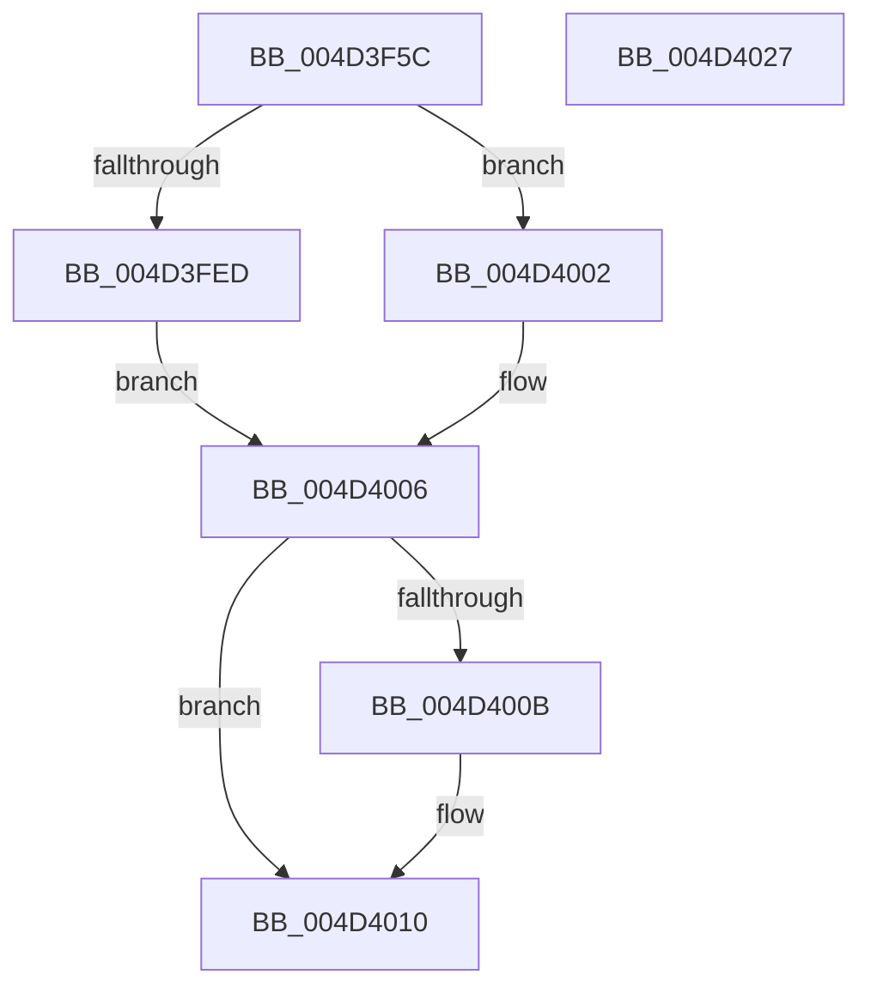

# RtlFileMapInitializeByNtPath

- RVA: `0x004D3F5C`–`0x004D4028` (길이 `204` bytes)
- VA: `0x00000001404D3F5C`
- 실행 섹션: `.text`
- PDB 이름 있음: `예`; PDB Function 태그: `아니요`
- unwind 정보 RVA: `0x000BE0A4`
- 디코드: `51`개 명령, `204/204` bytes 표시
- 미해석 바이트: `0` (있으면 어셈블리에 `.byte`로 보존)

> 이 문서는 커널 이미지의 기계어와 PDB 기호를 분석해 생성했습니다. 4번과 5번은 함수 원형과 자료형을 바이너리 사용 방식에서 추정한 C 해석이며 원본 소스 복구 결과는 아닙니다.

## 1. Dependencies

- 직접 호출 지점: **2**; 고유 호출 대상: **2**
- 직접 호출자로 확인된 함수: **1**
- RIP 상대 이미지 참조: **0**

### Outgoing calls
- `0x004D3FE2` → [ZwCreateFile](../6A/ZwCreateFile_function_006ADB70.md) (function, `0x006ADB70`)
- `0x004D400B` → [ZwClose](../6A/ZwClose_function_006AD2B0.md) (function, `0x006AD2B0`)

### Direct callers
- [AslFileMappingCreate](../../page/95/AslFileMappingCreate_function_00958448.md) at `0x00958518`

### Static image references
- 디코드된 RIP-relative 메모리 참조가 없습니다.

## 2. Other-region calls and transfers

- 다른 실행 섹션으로 향하는 call: **0**
- 별도 외부 분기/꼬리 이동을 확인하지 못했습니다.

## 3. Assembly (complete function range)

```asm
004D3F5C  48 8B C4                        mov rax, rsp
004D3F5F  48 89 58 08                     mov qword ptr [rax + 8], rbx
004D3F63  48 89 78 18                     mov qword ptr [rax + 0x18], rdi
004D3F67  55                              push rbp
004D3F68  48 8D 68 A1                     lea rbp, [rax - 0x5f]
004D3F6C  48 81 EC A0 00 00 00            sub rsp, 0xa0
004D3F73  83 60 A8 00                     and dword ptr [rax - 0x58], 0
004D3F77  4C 8D 4D 17                     lea r9, [rbp + 0x17]
004D3F7B  48 83 60 A0 00                  and qword ptr [rax - 0x60], 0
004D3F80  4C 8D 45 27                     lea r8, [rbp + 0x27]
004D3F84  83 65 2B 00                     and dword ptr [rbp + 0x2b], 0
004D3F88  0F 57 C0                        xorps xmm0, xmm0
004D3F8B  83 65 43 00                     and dword ptr [rbp + 0x43], 0
004D3F8F  48 8B F9                        mov rdi, rcx
004D3F92  48 83 65 6F 00                  and qword ptr [rbp + 0x6f], 0
004D3F97  48 8D 4D 6F                     lea rcx, [rbp + 0x6f]
004D3F9B  48 83 65 2F 00                  and qword ptr [rbp + 0x2f], 0
004D3FA0  C7 40 98 60 00 00 00            mov dword ptr [rax - 0x68], 0x60
004D3FA7  C7 40 90 01 00 00 00            mov dword ptr [rax - 0x70], 1
004D3FAE  C7 40 88 05 00 00 00            mov dword ptr [rax - 0x78], 5
004D3FB5  48 89 55 37                     mov qword ptr [rbp + 0x37], rdx
004D3FB9  BA 80 00 10 80                  mov edx, 0x80100080
004D3FBE  C7 40 80 80 00 00 00            mov dword ptr [rax - 0x80], 0x80
004D3FC5  48 83 64 24 20 00               and qword ptr [rsp + 0x20], 0
004D3FCB  0F 11 45 17                     movups xmmword ptr [rbp + 0x17], xmm0
004D3FCF  C7 45 27 30 00 00 00            mov dword ptr [rbp + 0x27], 0x30
004D3FD6  C7 45 3F 40 02 00 00            mov dword ptr [rbp + 0x3f], 0x240
004D3FDD  F3 0F 7F 45 47                  movdqu xmmword ptr [rbp + 0x47], xmm0
004D3FE2  E8 89 9B 1D 00                  call 0x1406adb70
004D3FE7  8B D8                           mov ebx, eax
004D3FE9  85 C0                           test eax, eax
004D3FEB  78 15                           js 0x1404d4002
004D3FED  48 8B 45 6F                     mov rax, qword ptr [rbp + 0x6f]
004D3FF1  33 C9                           xor ecx, ecx
004D3FF3  48 89 07                        mov qword ptr [rdi], rax
004D3FF6  33 DB                           xor ebx, ebx
004D3FF8  48 89 4D 6F                     mov qword ptr [rbp + 0x6f], rcx
004D3FFC  C6 47 30 01                     mov byte ptr [rdi + 0x30], 1
004D4000  EB 04                           jmp 0x1404d4006
004D4002  48 8B 4D 6F                     mov rcx, qword ptr [rbp + 0x6f]
004D4006  48 85 C9                        test rcx, rcx
004D4009  74 05                           je 0x1404d4010
004D400B  E8 A0 92 1D 00                  call 0x1406ad2b0
004D4010  4C 8D 9C 24 A0 00 00 00         lea r11, [rsp + 0xa0]
004D4018  8B C3                           mov eax, ebx
004D401A  49 8B 5B 10                     mov rbx, qword ptr [r11 + 0x10]
004D401E  49 8B 7B 20                     mov rdi, qword ptr [r11 + 0x20]
004D4022  49 8B E3                        mov rsp, r11
004D4025  5D                              pop rbp
004D4026  C3                              ret
004D4027  CC                              int3
```

## 4. C-style interpretation (structured pseudocode)

```c
__int64 __fastcall RtlFileMapInitializeByNtPath(__int64 a1, __int64 a2)
{
    __int64 result;
    __int64 v_rbx;
    __int64 v_rsp;
    unsigned __int64 v_stack_m8;
    unsigned __int64 v_stack_m88;

    *(unsigned __int64 *)(v_rsp + 8) = v_rbx;
    *(unsigned __int64 *)(v_rsp + 24) = v_rdi;
    v_rsp = (v_rsp) - (160);
    *(unsigned int *)(v_rsp - 104) = 96;
    *(unsigned int *)(v_rsp - 112) = 1;
    *(unsigned int *)(v_rsp - 120) = 5;
    *(unsigned __int64 *)(v_rsp - 95 + 55) = a2;
    *(unsigned int *)(v_rsp - 128) = 128;
    *(unsigned __int64 *)(v_rsp - 95 + 23) = v_xmm0;
    *(unsigned int *)(v_rsp - 95 + 39) = 48;
    *(unsigned int *)(v_rsp - 95 + 63) = 576;
    *(unsigned __int64 *)(v_rsp - 95 + 71) = v_xmm0;
    result = ZwCreateFile(v_rsp - 95 + 111, (unsigned int)(0x80100080ULL), v_rsp - 95 + 39, v_rsp - 95 + 23);
    if (sign_flag) goto loc_004D4002;
    a1 = 0;
    *(unsigned __int64 *)(a1) = *(unsigned __int64 *)(v_rsp - 95 + 111);
    v_rbx = 0;
    *(unsigned __int64 *)(v_rsp - 95 + 111) = 0;
    *(unsigned __int8 *)(a1 + 48) = 1;
    goto loc_004D4006;
loc_004D4002:
loc_004D4006:
    result = *(unsigned __int64 *)(v_rsp - 95 + 111);
    if (*(unsigned __int64 *)(v_rsp - 95 + 111) != 0) {
        result = ZwClose(*(unsigned __int64 *)(v_rsp - 95 + 111), (unsigned int)(0x80100080ULL), v_rsp - 95 + 39, v_rsp - 95 + 23);
    }
    return 0;
}
```

## 5. (Beta) C Style

```c
int64_t RtlFileMapInitializeByNtPath(void *Arg1, int64_t Arg2)
{
    uint8_t *arg1 = (uint8_t *)Arg1;

    int64_t result;
    int64_t local_rbx;
    int64_t local_rsp;
    uint64_t v_stack_m8;
    uint64_t v_stack_m88;

    *(uint64_t *)(local_rsp + 0x8) = local_rbx;
    *(uint64_t *)(local_rsp + 0x18) = local_rdi;
    local_rsp = (local_rsp) - (160);
    *(uint32_t *)(local_rsp - 0x68) = 96;
    *(uint32_t *)(local_rsp - 0x70) = 1;
    *(uint32_t *)(local_rsp - 0x78) = 5;
    *(uint64_t *)(local_rsp - 0x5F + 0x37) = Arg2;
    *(uint32_t *)(local_rsp - 0x80) = 128;
    *(uint64_t *)(local_rsp - 0x5F + 0x17) = v_xmm0;
    *(uint32_t *)(local_rsp - 0x5F + 0x27) = 48;
    *(uint32_t *)(local_rsp - 0x5F + 0x3F) = 576;
    *(uint64_t *)(local_rsp - 0x5F + 0x47) = v_xmm0;
    result = ZwCreateFile(local_rsp - 95 + 111, (uint32_t)(0x80100080ULL), local_rsp - 95 + 39, local_rsp - 95 + 23);
    if (sign_flag) goto loc_004D4002;
    Arg1 = 0;
    *(uint64_t *)(arg1) = *(uint64_t *)(local_rsp - 0x5F + 0x6F);
    local_rbx = 0;
    *(uint64_t *)(local_rsp - 0x5F + 0x6F) = 0;
    *(uint8_t *)(arg1 + 0x30) = 1;
    goto loc_004D4006;
loc_004D4002:
loc_004D4006:
    result = *(uint64_t *)(local_rsp - 0x5F + 0x6F);
    if (*(uint64_t *)(local_rsp - 0x5F + 0x6F) != 0) {
        result = ZwClose(*(uint64_t *)(local_rsp - 0x5F + 0x6F), (uint32_t)(0x80100080ULL), local_rsp - 95 + 39, local_rsp - 95 + 23);
    }
    return 0;
}
```

### 관측된 메모리 오프셋

구조체 형식이 확인되지 않은 접근은 인자 기준의 오프셋으로만 기록했습니다.

| 기준 인자 | 오프셋 표현 | 폭 (bit) | 접근 |
|---|---:|---:|---|
| `Arg1` | `+ 0x0` | `64` | `W` |
| `Arg1` | `+ 0x30` | `8` | `W` |

## 6. Execution-region graph

[열기: 2D/3D 그래프와 함수 탐색 컨트롤 패널](../../../control-panel.html?section=text&rva=0x004D3F5C&view=graph)

- 2D 그래프는 위에서 아래로 흐르고, 3D 그래프는 빈 공간을 드래그해 회전합니다. Shift+드래그는 이동, 휠은 확대·축소, 함수 노드 선택은 대상 보고서 이동입니다.

### Static fallback


