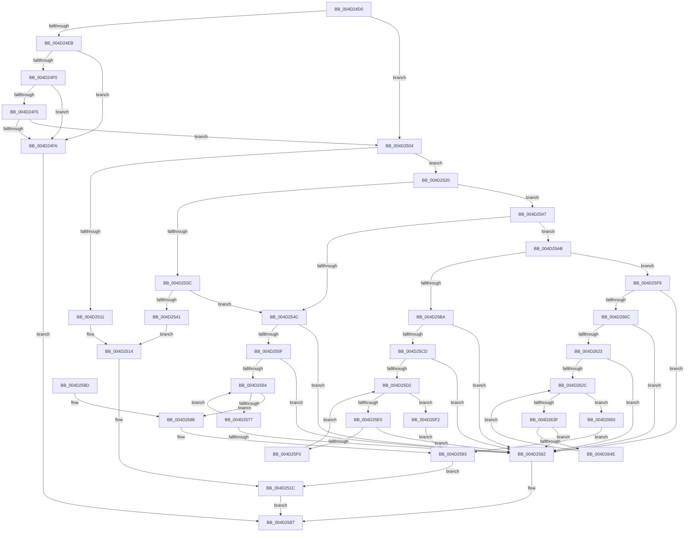

# RtlIoEncodeMemIoResource

- RVA: `0x004D24D0`–`0x004D265A` (길이 `394` bytes)
- VA: `0x00000001404D24D0`
- 실행 섹션: `.text`
- PDB 이름 있음: `예`; PDB Function 태그: `아니요`
- unwind 정보 RVA: `0x000BDE84`
- 디코드: `113`개 명령, `394/394` bytes 표시
- 미해석 바이트: `0` (있으면 어셈블리에 `.byte`로 보존)

> 이 문서는 커널 이미지의 기계어와 PDB 기호를 분석해 생성했습니다. 4번과 5번은 함수 원형과 자료형을 바이너리 사용 방식에서 추정한 C 해석이며 원본 소스 복구 결과는 아닙니다.

## 1. Dependencies

- 직접 호출 지점: **0**; 고유 호출 대상: **0**
- 직접 호출자로 확인된 함수: **0**
- RIP 상대 이미지 참조: **0**

### Outgoing calls
- 직접 디코드된 call 명령이 없습니다.

### Direct callers
- 이 함수 시작 RVA로 연결되는 직접 call은 확인되지 않았습니다. 간접 호출은 완전히 역산할 수 없습니다.

### Static image references
- 디코드된 RIP-relative 메모리 참조가 없습니다.

## 2. Other-region calls and transfers

- 다른 실행 섹션으로 향하는 call: **0**
- 별도 외부 분기/꼬리 이동을 확인하지 못했습니다.

## 3. Assembly (complete function range)

```asm
004D24D0  48 89 5C 24 08                  mov qword ptr [rsp + 8], rbx
004D24D5  4C 8B 54 24 30                  mov r10, qword ptr [rsp + 0x30]
004D24DA  8D 42 FD                        lea eax, [rdx - 3]
004D24DD  4C 8B 5C 24 28                  mov r11, qword ptr [rsp + 0x28]
004D24E2  BB FF FF FF FF                  mov ebx, 0xffffffff
004D24E7  A8 FB                           test al, 0xfb
004D24E9  74 19                           je 0x1404d2504
004D24EB  80 FA 01                        cmp dl, 1
004D24EE  75 0A                           jne 0x1404d24fa
004D24F0  4C 3B C3                        cmp r8, rbx
004D24F3  77 05                           ja 0x1404d24fa
004D24F5  4C 3B CB                        cmp r9, rbx
004D24F8  76 0A                           jbe 0x1404d2504
004D24FA  B8 0D 00 00 C0                  mov eax, 0xc000000d
004D24FF  E9 83 00 00 00                  jmp 0x1404d2587
004D2504  4C 89 59 10                     mov qword ptr [rcx + 0x10], r11
004D2508  4C 89 51 18                     mov qword ptr [rcx + 0x18], r10
004D250C  80 FA 01                        cmp dl, 1
004D250F  75 0F                           jne 0x1404d2520
004D2511  88 51 01                        mov byte ptr [rcx + 1], dl
004D2514  44 89 41 08                     mov dword ptr [rcx + 8], r8d
004D2518  44 89 49 0C                     mov dword ptr [rcx + 0xc], r9d
004D251C  33 C0                           xor eax, eax
004D251E  EB 67                           jmp 0x1404d2587
004D2520  BA FF F1 00 00                  mov edx, 0xf1ff
004D2525  49 BB 00 FF FF FF FF 00 00 00   movabs r11, 0xffffffff00
004D252F  66 23 51 04                     and dx, word ptr [rcx + 4]
004D2533  66 89 51 04                     mov word ptr [rcx + 4], dx
004D2537  4C 3B C3                        cmp r8, rbx
004D253A  77 0B                           ja 0x1404d2547
004D253C  4C 3B CB                        cmp r9, rbx
004D253F  77 0B                           ja 0x1404d254c
004D2541  C6 41 01 03                     mov byte ptr [rcx + 1], 3
004D2545  EB CD                           jmp 0x1404d2514
004D2547  4D 3B C3                        cmp r8, r11
004D254A  77 5F                           ja 0x1404d25ab
004D254C  4D 8B D0                        mov r10, r8
004D254F  49 C1 EA 08                     shr r10, 8
004D2553  41 8B C2                        mov eax, r10d
004D2556  48 C1 E0 08                     shl rax, 8
004D255A  4C 3B C0                        cmp r8, rax
004D255D  75 23                           jne 0x1404d2582
004D255F  4D 3B CB                        cmp r9, r11
004D2562  77 1E                           ja 0x1404d2582
004D2564  4D 8B C1                        mov r8, r9
004D2567  49 C1 E8 08                     shr r8, 8
004D256B  41 8B C0                        mov eax, r8d
004D256E  48 C1 E0 08                     shl rax, 8
004D2572  4C 3B C8                        cmp r9, rax
004D2575  74 17                           je 0x1404d258e
004D2577  49 8B C1                        mov rax, r9
004D257A  4D 03 C9                        add r9, r9
004D257D  4C 3B C8                        cmp r9, rax
004D2580  73 E2                           jae 0x1404d2564
004D2582  B8 01 00 00 C0                  mov eax, 0xc0000001
004D2587  48 8B 5C 24 08                  mov rbx, qword ptr [rsp + 8]
004D258C  C3                              ret
004D258D  CC                              int3
004D258E  B8 00 02 00 00                  mov eax, 0x200
004D2593  66 0B D0                        or dx, ax
004D2596  C6 41 01 07                     mov byte ptr [rcx + 1], 7
004D259A  66 89 51 04                     mov word ptr [rcx + 4], dx
004D259E  44 89 51 08                     mov dword ptr [rcx + 8], r10d
004D25A2  44 89 41 0C                     mov dword ptr [rcx + 0xc], r8d
004D25A6  E9 71 FF FF FF                  jmp 0x1404d251c
004D25AB  49 BB 00 00 FF FF FF FF 00 00   movabs r11, 0xffffffff0000
004D25B5  4D 3B C3                        cmp r8, r11
004D25B8  77 3F                           ja 0x1404d25f9
004D25BA  4D 8B D0                        mov r10, r8
004D25BD  49 C1 EA 10                     shr r10, 0x10
004D25C1  41 8B C2                        mov eax, r10d
004D25C4  48 C1 E0 10                     shl rax, 0x10
004D25C8  4C 3B C0                        cmp r8, rax
004D25CB  75 B5                           jne 0x1404d2582
004D25CD  4D 3B CB                        cmp r9, r11
004D25D0  77 B0                           ja 0x1404d2582
004D25D2  4D 8B C1                        mov r8, r9
004D25D5  49 C1 E8 10                     shr r8, 0x10
004D25D9  41 8B C0                        mov eax, r8d
004D25DC  48 C1 E0 10                     shl rax, 0x10
004D25E0  4C 3B C8                        cmp r9, rax
004D25E3  74 0D                           je 0x1404d25f2
004D25E5  49 8B C1                        mov rax, r9
004D25E8  4D 03 C9                        add r9, r9
004D25EB  4C 3B C8                        cmp r9, rax
004D25EE  72 92                           jb 0x1404d2582
004D25F0  EB E0                           jmp 0x1404d25d2
004D25F2  B8 00 04 00 00                  mov eax, 0x400
004D25F7  EB 9A                           jmp 0x1404d2593
004D25F9  49 BB 00 00 00 00 FF FF FF FF   movabs r11, 0xffffffff00000000
004D2603  4D 3B C3                        cmp r8, r11
004D2606  0F 87 76 FF FF FF               ja 0x1404d2582
004D260C  4D 8B D0                        mov r10, r8
004D260F  49 C1 EA 20                     shr r10, 0x20
004D2613  49 8B C2                        mov rax, r10
004D2616  48 C1 E0 20                     shl rax, 0x20
004D261A  4C 3B C0                        cmp r8, rax
004D261D  0F 85 5F FF FF FF               jne 0x1404d2582
004D2623  4D 3B CB                        cmp r9, r11
004D2626  0F 87 56 FF FF FF               ja 0x1404d2582
004D262C  4D 8B C1                        mov r8, r9
004D262F  49 C1 E8 20                     shr r8, 0x20
004D2633  41 8B C0                        mov eax, r8d
004D2636  48 C1 E0 20                     shl rax, 0x20
004D263A  4C 3B C8                        cmp r9, rax
004D263D  74 11                           je 0x1404d2650
004D263F  49 8B C1                        mov rax, r9
004D2642  4D 03 C9                        add r9, r9
004D2645  4C 3B C8                        cmp r9, rax
004D2648  0F 82 34 FF FF FF               jb 0x1404d2582
004D264E  EB DC                           jmp 0x1404d262c
004D2650  B8 00 08 00 00                  mov eax, 0x800
004D2655  E9 39 FF FF FF                  jmp 0x1404d2593
```

## 4. C-style interpretation (structured pseudocode)

```c
__int64 __fastcall RtlIoEncodeMemIoResource(__int64 a1, __int64 a2, __int64 a3, __int64 a4, __int64 a5, __int64 a6)
{
    __int64 result;
    __int64 v_r10;
    unsigned __int64 v_stack_p8;

    v_stack_p8 = v_rbx;
    if ((((unsigned __int8)(a2 - 3)) & (251)) == 0) goto loc_004D2504;
    if (((unsigned __int8)(a2)) != 1) goto loc_004D24FA;
    if (a3 > ((unsigned int)(0xFFFFFFFFULL))) goto loc_004D24FA;
    if (a4 <= ((unsigned int)(0xFFFFFFFFULL))) goto loc_004D2504;
loc_004D24FA:
    goto loc_004D2587;
loc_004D2504:
    *(unsigned __int64 *)(a1 + 16) = a5;
    *(unsigned __int64 *)(a1 + 24) = a6;
    if (((unsigned __int8)(a2)) != 1) goto loc_004D2520;
    *(unsigned __int8 *)(a1 + 1) = (unsigned __int8)(a2);
loc_004D2514:
    *(unsigned int *)(a1 + 8) = (unsigned int)(a3);
    *(unsigned int *)(a1 + 12) = (unsigned int)(a4);
loc_004D251C:
    result = 0;
    goto loc_004D2587;
loc_004D2520:
    a2 = (unsigned __int16)(((unsigned int)(0xF1FFULL)) & (*(unsigned __int16 *)(a1 + 4)));
    *(unsigned __int16 *)(a1 + 4) = (unsigned __int16)(a2);
    if (a3 > ((unsigned int)(0xFFFFFFFFULL))) goto loc_004D2547;
    if (a4 > ((unsigned int)(0xFFFFFFFFULL))) goto loc_004D254C;
    *(unsigned __int8 *)(a1 + 1) = 3;
    goto loc_004D2514;
loc_004D2547:
    if (a3 > a5) goto loc_004D25AB;
loc_004D254C:
    v_r10 = (a3) >> (8);
    result = ((unsigned int)((unsigned int)(v_r10))) << (8);
    if (a3 != result) goto loc_004D2582;
    if (a4 > a5) goto loc_004D2582;
loc_004D2564:
    a3 = (a4) >> (8);
    result = ((unsigned int)((unsigned int)(a3))) << (8);
    if (a4 == result) goto loc_004D258E;
    a4 = (a4) + (a4);
    if (a4 >= a4) goto loc_004D2564;
loc_004D2582:
loc_004D2587:
    return (unsigned int)(0xC0000001ULL);
loc_004D258E:
loc_004D2593:
    a2 = (unsigned __int16)((a2) | (512));
    *(unsigned __int8 *)(a1 + 1) = 7;
    *(unsigned __int16 *)(a1 + 4) = (unsigned __int16)(a2);
    *(unsigned int *)(a1 + 8) = (unsigned int)(v_r10);
    *(unsigned int *)(a1 + 12) = (unsigned int)(a3);
    goto loc_004D251C;
loc_004D25AB:
    if (a3 > a5) goto loc_004D25F9;
    v_r10 = (a3) >> (16);
    result = ((unsigned int)((unsigned int)(v_r10))) << (16);
    if (a3 != result) goto loc_004D2582;
    if (a4 > a5) goto loc_004D2582;
loc_004D25D2:
    a3 = (a4) >> (16);
    result = ((unsigned int)((unsigned int)(a3))) << (16);
    if (a4 == result) goto loc_004D25F2;
    a4 = (a4) + (a4);
    if (a4 < a4) goto loc_004D2582;
    goto loc_004D25D2;
loc_004D25F2:
    goto loc_004D2593;
loc_004D25F9:
    if (a3 > a5) goto loc_004D2582;
    v_r10 = (a3) >> (32);
    result = (v_r10) << (32);
    if (a3 != result) goto loc_004D2582;
    if (a4 > a5) goto loc_004D2582;
loc_004D262C:
    a3 = (a4) >> (32);
    result = ((unsigned int)((unsigned int)(a3))) << (32);
    if (a4 == result) goto loc_004D2650;
    a4 = (a4) + (a4);
    if (a4 < a4) goto loc_004D2582;
    goto loc_004D262C;
loc_004D2650:
    goto loc_004D2593;
}
```

## 5. (Beta) C Style

```c
int64_t RtlIoEncodeMemIoResource(void *Arg1, void *Arg2, int64_t Arg3, int64_t Arg4, int64_t Arg5, int64_t Arg6)
{
    uint8_t *arg1 = (uint8_t *)Arg1;
    uint8_t *arg2 = (uint8_t *)Arg2;

    int64_t result;
    int64_t local_r10;
    uint64_t v_stack_p8;

    v_stack_p8 = local_rbx;
    if ((((uint8_t)(Arg2 - 3)) & (251)) == 0) goto loc_004D2504;
    if (((uint8_t)(Arg2)) != 1) goto loc_004D24FA;
    if (Arg3 > ((uint32_t)(0xFFFFFFFFULL))) goto loc_004D24FA;
    if (Arg4 <= ((uint32_t)(0xFFFFFFFFULL))) goto loc_004D2504;
loc_004D24FA:
    goto loc_004D2587;
loc_004D2504:
    *(uint64_t *)(arg1 + 0x10) = Arg5;
    *(uint64_t *)(arg1 + 0x18) = Arg6;
    if (((uint8_t)(Arg2)) != 1) goto loc_004D2520;
    *(uint8_t *)(arg1 + 0x1) = (uint8_t)(Arg2);
loc_004D2514:
    *(uint32_t *)(arg1 + 0x8) = (uint32_t)(Arg3);
    *(uint32_t *)(arg1 + 0xC) = (uint32_t)(Arg4);
loc_004D251C:
    result = 0;
    goto loc_004D2587;
loc_004D2520:
    Arg2 = (uint16_t)(((uint32_t)(0xF1FFULL)) & (*(uint16_t *)(arg1 + 0x4)));
    *(uint16_t *)(arg1 + 0x4) = (uint16_t)(Arg2);
    if (Arg3 > ((uint32_t)(0xFFFFFFFFULL))) goto loc_004D2547;
    if (Arg4 > ((uint32_t)(0xFFFFFFFFULL))) goto loc_004D254C;
    *(uint8_t *)(arg1 + 0x1) = 3;
    goto loc_004D2514;
loc_004D2547:
    if (Arg3 > Arg5) goto loc_004D25AB;
loc_004D254C:
    local_r10 = (Arg3) >> (8);
    result = ((uint32_t)((uint32_t)(local_r10))) << (8);
    if (Arg3 != result) goto loc_004D2582;
    if (Arg4 > Arg5) goto loc_004D2582;
loc_004D2564:
    Arg3 = (Arg4) >> (8);
    result = ((uint32_t)((uint32_t)(Arg3))) << (8);
    if (Arg4 == result) goto loc_004D258E;
    Arg4 = (Arg4) + (Arg4);
    if (Arg4 >= Arg4) goto loc_004D2564;
loc_004D2582:
loc_004D2587:
    return (uint32_t)(0xC0000001ULL);
loc_004D258E:
loc_004D2593:
    Arg2 = (uint16_t)((Arg2) | (512));
    *(uint8_t *)(arg1 + 0x1) = 7;
    *(uint16_t *)(arg1 + 0x4) = (uint16_t)(Arg2);
    *(uint32_t *)(arg1 + 0x8) = (uint32_t)(local_r10);
    *(uint32_t *)(arg1 + 0xC) = (uint32_t)(Arg3);
    goto loc_004D251C;
loc_004D25AB:
    if (Arg3 > Arg5) goto loc_004D25F9;
    local_r10 = (Arg3) >> (16);
    result = ((uint32_t)((uint32_t)(local_r10))) << (16);
    if (Arg3 != result) goto loc_004D2582;
    if (Arg4 > Arg5) goto loc_004D2582;
loc_004D25D2:
    Arg3 = (Arg4) >> (16);
    result = ((uint32_t)((uint32_t)(Arg3))) << (16);
    if (Arg4 == result) goto loc_004D25F2;
    Arg4 = (Arg4) + (Arg4);
    if (Arg4 < Arg4) goto loc_004D2582;
    goto loc_004D25D2;
loc_004D25F2:
    goto loc_004D2593;
loc_004D25F9:
    if (Arg3 > Arg5) goto loc_004D2582;
    local_r10 = (Arg3) >> (32);
    result = (local_r10) << (32);
    if (Arg3 != result) goto loc_004D2582;
    if (Arg4 > Arg5) goto loc_004D2582;
loc_004D262C:
    Arg3 = (Arg4) >> (32);
    result = ((uint32_t)((uint32_t)(Arg3))) << (32);
    if (Arg4 == result) goto loc_004D2650;
    Arg4 = (Arg4) + (Arg4);
    if (Arg4 < Arg4) goto loc_004D2582;
    goto loc_004D262C;
loc_004D2650:
    goto loc_004D2593;
}
```

### 관측된 메모리 오프셋

구조체 형식이 확인되지 않은 접근은 인자 기준의 오프셋으로만 기록했습니다.

| 기준 인자 | 오프셋 표현 | 폭 (bit) | 접근 |
|---|---:|---:|---|
| `Arg1` | `+ 0x1` | `8` | `W` |
| `Arg1` | `+ 0x4` | `16` | `R` |
| `Arg1` | `+ 0x4` | `16` | `W` |
| `Arg1` | `+ 0x8` | `32` | `W` |
| `Arg1` | `+ 0xC` | `32` | `W` |
| `Arg1` | `+ 0x10` | `64` | `W` |
| `Arg1` | `+ 0x18` | `64` | `W` |
| `Arg2` | `- 0x3` | `32` | `R` |

## 6. Execution-region graph

[열기: 2D/3D 그래프와 함수 탐색 컨트롤 패널](../../../control-panel.html?section=text&rva=0x004D24D0&view=graph)

- 2D 그래프는 위에서 아래로 흐르고, 3D 그래프는 빈 공간을 드래그해 회전합니다. Shift+드래그는 이동, 휠은 확대·축소, 함수 노드 선택은 대상 보고서 이동입니다.

### Static fallback


