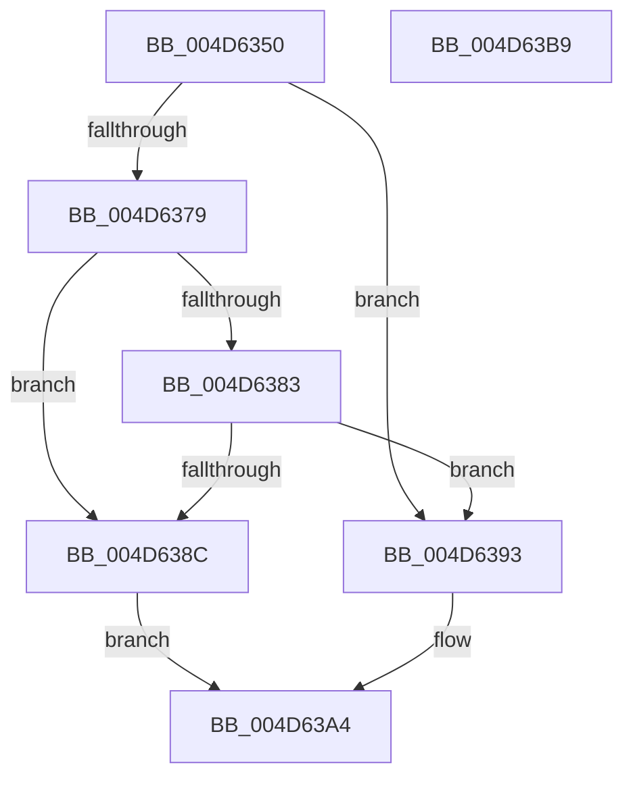

# RtlRegisterFeatureConfigurationChangeNotification

- RVA: `0x004D6350`–`0x004D63BA` (길이 `106` bytes)
- VA: `0x00000001404D6350`
- 실행 섹션: `.text`
- PDB 이름 있음: `예`; PDB Function 태그: `아니요`
- unwind 정보 RVA: `0x0005C954`
- 디코드: `31`개 명령, `106/106` bytes 표시
- 미해석 바이트: `0` (있으면 어셈블리에 `.byte`로 보존)

> 이 문서는 커널 이미지의 기계어와 PDB 기호를 분석해 생성했습니다. 4번과 5번은 함수 원형과 자료형을 바이너리 사용 방식에서 추정한 C 해석이며 원본 소스 복구 결과는 아닙니다.

## 1. Dependencies

- 직접 호출 지점: **2**; 고유 호출 대상: **2**
- 직접 호출자로 확인된 함수: **1**
- RIP 상대 이미지 참조: **2**

### Outgoing calls
- `0x004D6370` → [KeGetEffectiveIrql](../2F/KeGetEffectiveIrql_function_002F8030.md) (function, `0x002F8030`)
- `0x004D639F` → [CmFcRegisterFeatureConfigurationChangeNotification](../../page/70/CmFcRegisterFeatureConfigurationChangeNotification_function_007045C4.md) (function, `0x007045C4`)

### Direct callers
- [wil_details_RegisterFeatureStagingChangeNotification](../../page/7E/wil_details_RegisterFeatureStagingChangeNotification_function_007E604C.md) at `0x007E6063`

### Static image references
- `0x004D6379` → RVA `0x00F4754C` (`.data`; read)
- `0x004D6383` → RVA `0x00F0BD20` (`.data`; read)

## 2. Other-region calls and transfers

- 다른 실행 섹션으로 향하는 call: **1**
  - `0x004D639F` → [CmFcRegisterFeatureConfigurationChangeNotification](../../page/70/CmFcRegisterFeatureConfigurationChangeNotification_function_007045C4.md) (`.text` → `PAGE`)
- 별도 외부 분기/꼬리 이동을 확인하지 못했습니다.

## 3. Assembly (complete function range)

```asm
004D6350  48 89 5C 24 08                  mov qword ptr [rsp + 8], rbx
004D6355  48 89 6C 24 10                  mov qword ptr [rsp + 0x10], rbp
004D635A  48 89 74 24 18                  mov qword ptr [rsp + 0x18], rsi
004D635F  57                              push rdi
004D6360  48 83 EC 20                     sub rsp, 0x20
004D6364  49 8B D9                        mov rbx, r9
004D6367  49 8B F8                        mov rdi, r8
004D636A  48 8B F2                        mov rsi, rdx
004D636D  48 8B E9                        mov rbp, rcx
004D6370  E8 BB 1C E2 FF                  call 0x1402f8030
004D6375  84 C0                           test al, al
004D6377  74 1A                           je 0x1404d6393
004D6379  8B 05 CD 11 A7 00               mov eax, dword ptr [rip + 0xa711cd]
004D637F  A8 03                           test al, 3
004D6381  75 09                           jne 0x1404d638c
004D6383  80 3D 96 59 A3 00 00            cmp byte ptr [rip + 0xa35996], 0
004D638A  74 07                           je 0x1404d6393
004D638C  B8 BB 00 00 C0                  mov eax, 0xc00000bb
004D6391  EB 11                           jmp 0x1404d63a4
004D6393  4C 8B CB                        mov r9, rbx
004D6396  4C 8B C7                        mov r8, rdi
004D6399  48 8B D6                        mov rdx, rsi
004D639C  48 8B CD                        mov rcx, rbp
004D639F  E8 20 E2 22 00                  call 0x1407045c4
004D63A4  48 8B 5C 24 30                  mov rbx, qword ptr [rsp + 0x30]
004D63A9  48 8B 6C 24 38                  mov rbp, qword ptr [rsp + 0x38]
004D63AE  48 8B 74 24 40                  mov rsi, qword ptr [rsp + 0x40]
004D63B3  48 83 C4 20                     add rsp, 0x20
004D63B7  5F                              pop rdi
004D63B8  C3                              ret
004D63B9  CC                              int3
```

## 4. C-style interpretation (structured pseudocode)

```c
__int64 __fastcall RtlRegisterFeatureConfigurationChangeNotification(__int64 a1, __int64 a2, __int64 a3, __int64 a4)
{
    __int64 result;
    __int64 v_rsp;
    unsigned __int64 v_stack_p10;
    unsigned __int64 v_stack_p18;
    unsigned __int64 v_stack_p8;

    v_stack_p8 = v_rbx;
    v_stack_p10 = v_rbp;
    v_stack_p18 = v_rsi;
    v_rsp = (v_rsp) - (32);
    result = KeGetEffectiveIrql(a1, a2, a3, a4);
    if ((unsigned __int8)(result) == 0) goto loc_004D6393;
    if ((((unsigned __int8)((unsigned int)(*(unsigned int *)(v_rip + 10949069)))) & (3)) != 0) goto loc_004D638C;
    if ((*(unsigned __int8 *)(v_rip + 10705302)) == 0) goto loc_004D6393;
loc_004D638C:
    goto loc_004D63A4;
loc_004D6393:
    result = CmFcRegisterFeatureConfigurationChangeNotification(a1, a2, a3, a4);
loc_004D63A4:
    v_rsp = (v_rsp) + (32);
    return result;
}
```

## 5. (Beta) C Style

```c
int64_t RtlRegisterFeatureConfigurationChangeNotification(int64_t Arg1, int64_t Arg2, int64_t Arg3, int64_t Arg4)
{
    int64_t result;
    int64_t local_rsp;
    uint64_t v_stack_p10;
    uint64_t v_stack_p18;
    uint64_t v_stack_p8;

    v_stack_p8 = local_rbx;
    v_stack_p10 = local_rbp;
    v_stack_p18 = local_rsi;
    local_rsp = (local_rsp) - (32);
    result = KeGetEffectiveIrql(Arg1, Arg2, Arg3, Arg4);
    if ((uint8_t)(result) == 0) goto loc_004D6393;
    if ((((uint8_t)((uint32_t)(*(uint32_t *)(v_rip + 0xA711CD)))) & (3)) != 0) goto loc_004D638C;
    if ((*(uint8_t *)(v_rip + 0xA35996)) == 0) goto loc_004D6393;
loc_004D638C:
    goto loc_004D63A4;
loc_004D6393:
    result = CmFcRegisterFeatureConfigurationChangeNotification(Arg1, Arg2, Arg3, Arg4);
loc_004D63A4:
    local_rsp = (local_rsp) + (32);
    return result;
}
```

## 6. Execution-region graph

[열기: 2D/3D 그래프와 함수 탐색 컨트롤 패널](../../../control-panel.html?section=text&rva=0x004D6350&view=graph)

- 2D 그래프는 위에서 아래로 흐르고, 3D 그래프는 빈 공간을 드래그해 회전합니다. Shift+드래그는 이동, 휠은 확대·축소, 함수 노드 선택은 대상 보고서 이동입니다.

### Static fallback


