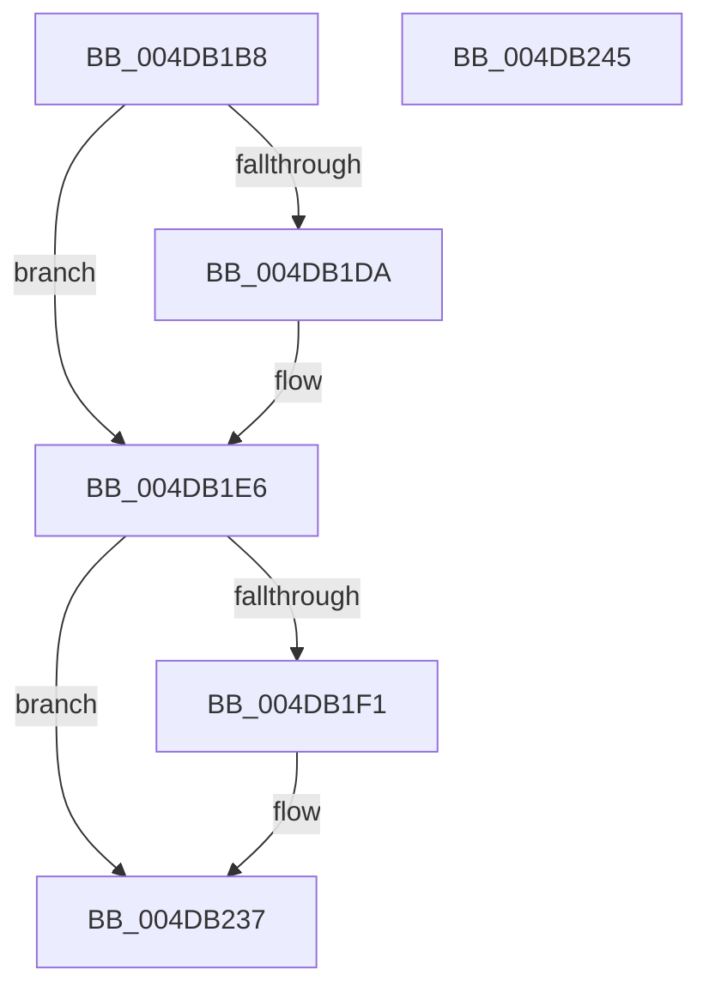

# RtlpHpExtrasAppend

- RVA: `0x004DB1B8`–`0x004DB246` (길이 `142` bytes)
- VA: `0x00000001404DB1B8`
- 실행 섹션: `.text`
- PDB 이름 있음: `예`; PDB Function 태그: `아니요`
- unwind 정보 RVA: `0x0005CAAC`
- 디코드: `39`개 명령, `142/142` bytes 표시
- 미해석 바이트: `0` (있으면 어셈블리에 `.byte`로 보존)

> 이 문서는 커널 이미지의 기계어와 PDB 기호를 분석해 생성했습니다. 4번과 5번은 함수 원형과 자료형을 바이너리 사용 방식에서 추정한 C 해석이며 원본 소스 복구 결과는 아닙니다.

## 1. Dependencies

- 직접 호출 지점: **1**; 고유 호출 대상: **1**
- 직접 호출자로 확인된 함수: **1**
- RIP 상대 이미지 참조: **1**

### Outgoing calls
- `0x004DB232` → [RtlpHpExtrasSetPresent](../60/RtlpHpExtrasSetPresent_function_00602CF4.md) (function, `0x00602CF4`)

### Direct callers
- [RtlpHpAllocateHeapSlow](../2E/RtlpHpAllocateHeapSlow_function_002E9DEC.md) at `0x002EA48F`

### Static image references
- `0x004DB1DA` → RVA `0x00042F00` (`.rdata`; read)

## 2. Other-region calls and transfers

- 다른 실행 섹션으로 향하는 call: **0**
- 별도 외부 분기/꼬리 이동을 확인하지 못했습니다.

## 3. Assembly (complete function range)

```asm
004DB1B8  48 89 5C 24 08                  mov qword ptr [rsp + 8], rbx
004DB1BD  57                              push rdi
004DB1BE  48 83 EC 20                     sub rsp, 0x20
004DB1C2  44 8B 4C 24 58                  mov r9d, dword ptr [rsp + 0x58]
004DB1C7  4E 8D 1C 02                     lea r11, [rdx + r8]
004DB1CB  45 8B D1                        mov r10d, r9d
004DB1CE  48 8B F9                        mov rdi, rcx
004DB1D1  41 81 E2 00 20 00 00            and r10d, 0x2000
004DB1D8  74 0C                           je 0x1404db1e6
004DB1DA  66 0F 6F 05 1E 7D B6 FF         movdqa xmm0, xmmword ptr [rip - 0x4982e2]
004DB1E2  41 0F 11 03                     movups xmmword ptr [r11], xmm0
004DB1E6  33 DB                           xor ebx, ebx
004DB1E8  41 F7 C1 08 0F 00 20            test r9d, 0x20000f08
004DB1EF  74 46                           je 0x1404db237
004DB1F1  45 85 D2                        test r10d, r10d
004DB1F4  49 8D 5B 10                     lea rbx, [r11 + 0x10]
004DB1F8  0F 57 C0                        xorps xmm0, xmm0
004DB1FB  49 0F 44 DB                     cmove rbx, r11
004DB1FF  41 C1 E9 08                     shr r9d, 8
004DB203  41 80 E1 FE                     and r9b, 0xfe
004DB207  48 83 C3 0F                     add rbx, 0xf
004DB20B  48 83 E3 F0                     and rbx, 0xfffffffffffffff0
004DB20F  41 C0 E1 04                     shl r9b, 4
004DB213  0F 11 03                        movups xmmword ptr [rbx], xmm0
004DB216  8A 4B 02                        mov cl, byte ptr [rbx + 2]
004DB219  80 E1 0F                        and cl, 0xf
004DB21C  44 0A C9                        or r9b, cl
004DB21F  48 8B 4C 24 50                  mov rcx, qword ptr [rsp + 0x50]
004DB224  48 C1 E9 04                     shr rcx, 4
004DB228  88 4B 03                        mov byte ptr [rbx + 3], cl
004DB22B  48 8B CF                        mov rcx, rdi
004DB22E  44 88 4B 02                     mov byte ptr [rbx + 2], r9b
004DB232  E8 BD 7A 12 00                  call 0x140602cf4
004DB237  48 8B C3                        mov rax, rbx
004DB23A  48 8B 5C 24 30                  mov rbx, qword ptr [rsp + 0x30]
004DB23F  48 83 C4 20                     add rsp, 0x20
004DB243  5F                              pop rdi
004DB244  C3                              ret
004DB245  CC                              int3
```

## 4. C-style interpretation (structured pseudocode)

```c
__int64 __fastcall RtlpHpExtrasAppend(__int64 a1, __int64 a2, __int64 a3, __int64 a4, __int64 a5, unsigned int a6)
{
    __int64 result;
    __int64 v_r10;
    __int64 v_rbx;
    __int64 v_rsp;
    unsigned __int64 v_stack_p8;

    v_stack_p8 = v_rbx;
    v_rsp = (v_rsp) - (32);
    v_r10 = (unsigned int)(((unsigned int)((unsigned int)((unsigned int)(a6)))) & (0x2000ULL));
    if (!(condition_is_equal)) {
        *(unsigned __int64 *)(a2 + a3 * 1) = v_xmm0;
    }
    v_rbx = 0;
    if ((((unsigned int)((unsigned int)(a6))) & (0x20000F08ULL)) != 0) {
        v_rbx = a2 + a3 * 1 + 16;
        if ((unsigned int)(v_r10) == 0) { v_rbx = a2 + a3 * 1; }
        a4 = (unsigned int)(((unsigned int)(a6)) >> (8));
        a4 = (unsigned __int8)((a4) & (254));
        v_rbx = (v_rbx) + (15);
        v_rbx = (v_rbx) & (-16);
        a4 = (unsigned __int8)((a4) << (4));
        *(unsigned __int64 *)(v_rbx) = v_xmm0;
        a1 = *(unsigned __int8 *)(v_rbx + 2);
        a1 = (unsigned __int8)((a1) & (15));
        a4 = (unsigned __int8)((a4) | ((unsigned __int8)(a1)));
        a1 = a5;
        a1 = (a1) >> (4);
        *(unsigned __int8 *)(v_rbx + 3) = (unsigned __int8)(a1);
        a1 = a1;
        *(unsigned __int8 *)(v_rbx + 2) = (unsigned __int8)(a4);
        result = RtlpHpExtrasSetPresent(a1, a2, a3, a4);
    }
    v_rsp = (v_rsp) + (32);
    return v_rbx;
}
```

## 5. (Beta) C Style

```c
int64_t RtlpHpExtrasAppend(int64_t Arg1, void *Arg2, int64_t Arg3, int64_t Arg4, int64_t Arg5, uint32_t Arg6)
{
    uint8_t *arg2 = (uint8_t *)Arg2;

    int64_t result;
    int64_t local_r10;
    int64_t local_rbx;
    int64_t local_rsp;
    uint64_t v_stack_p8;

    v_stack_p8 = local_rbx;
    local_rsp = (local_rsp) - (32);
    local_r10 = (uint32_t)(((uint32_t)((uint32_t)((uint32_t)(Arg6)))) & (0x2000ULL));
    if (!(condition_is_equal)) {
        *(uint64_t *)(arg2 + Arg3 * 1) = v_xmm0;
    }
    local_rbx = 0;
    if ((((uint32_t)((uint32_t)(Arg6))) & (0x20000F08ULL)) != 0) {
        local_rbx = Arg2 + Arg3 * 1 + 16;
        if ((uint32_t)(local_r10) == 0) { local_rbx = Arg2 + Arg3 * 1; }
        Arg4 = (uint32_t)(((uint32_t)(Arg6)) >> (8));
        Arg4 = (uint8_t)((Arg4) & (254));
        local_rbx = (local_rbx) + (15);
        local_rbx = (local_rbx) & (-16);
        Arg4 = (uint8_t)((Arg4) << (4));
        *(uint64_t *)(local_rbx) = v_xmm0;
        Arg1 = *(uint8_t *)(local_rbx + 0x2);
        Arg1 = (uint8_t)((Arg1) & (15));
        Arg4 = (uint8_t)((Arg4) | ((uint8_t)(Arg1)));
        Arg1 = Arg5;
        Arg1 = (Arg1) >> (4);
        *(uint8_t *)(local_rbx + 0x3) = (uint8_t)(Arg1);
        Arg1 = Arg1;
        *(uint8_t *)(local_rbx + 0x2) = (uint8_t)(Arg4);
        result = RtlpHpExtrasSetPresent(Arg1, Arg2, Arg3, Arg4);
    }
    local_rsp = (local_rsp) + (32);
    return local_rbx;
}
```

### 관측된 메모리 오프셋

구조체 형식이 확인되지 않은 접근은 인자 기준의 오프셋으로만 기록했습니다.

| 기준 인자 | 오프셋 표현 | 폭 (bit) | 접근 |
|---|---:|---:|---|
| `Arg2` | `+ 0x0` | `128` | `R` |
| `Arg2` | `+ 0x0 + r8*1` | `64` | `R` |
| `Arg2` | `+ 0x10` | `64` | `R` |

## 6. Execution-region graph

[열기: 2D/3D 그래프와 함수 탐색 컨트롤 패널](../../../control-panel.html?section=text&rva=0x004DB1B8&view=graph)

- 2D 그래프는 위에서 아래로 흐르고, 3D 그래프는 빈 공간을 드래그해 회전합니다. Shift+드래그는 이동, 휠은 확대·축소, 함수 노드 선택은 대상 보고서 이동입니다.

### Static fallback


