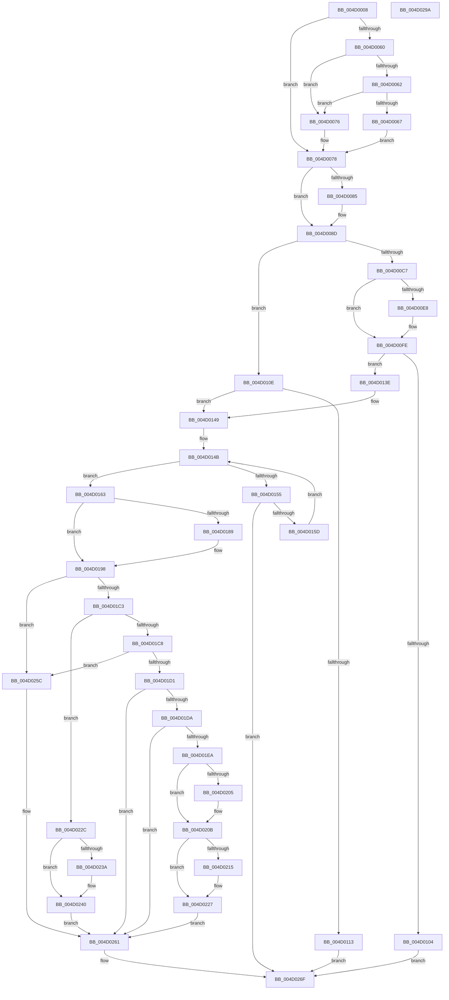

# RtlpHpLfhBucketUpdateAffinityMapping

- RVA: `0x004D0008`–`0x004D029B` (길이 `659` bytes)
- VA: `0x00000001404D0008`
- 실행 섹션: `.text`
- PDB 이름 있음: `예`; PDB Function 태그: `아니요`
- unwind 정보 RVA: `0x000BDB70`
- 디코드: `179`개 명령, `659/659` bytes 표시
- 미해석 바이트: `0` (있으면 어셈블리에 `.byte`로 보존)

> 이 문서는 커널 이미지의 기계어와 PDB 기호를 분석해 생성했습니다. 4번과 5번은 함수 원형과 자료형을 바이너리 사용 방식에서 추정한 C 해석이며 원본 소스 복구 결과는 아닙니다.

## 1. Dependencies

- 직접 호출 지점: **11**; 고유 호출 대상: **8**
- 직접 호출자로 확인된 함수: **5**
- RIP 상대 이미지 참조: **2**

### Outgoing calls
- `0x004D007B` → [RtlpHpEnvTlsGetValue](../2E/RtlpHpEnvTlsGetValue_function_002E9850.md) (function, `0x002E9850`)
- `0x004D0088` → [RtlpHpLfhThreadDataInitializeSet](../4F/RtlpHpLfhThreadDataInitializeSet_function_004F6334.md) (function, `0x004F6334`)
- `0x004D00F4` → [RtlpHpEnvTlsSetValue](../4F/RtlpHpEnvTlsSetValue_function_004F63AC.md) (function, `0x004F63AC`)
- `0x004D0134` → [RtlpHpEnvTlsSetValue](../4F/RtlpHpEnvTlsSetValue_function_004F63AC.md) (function, `0x004F63AC`)
- `0x004D016E` → [RtlpHpLfhBucketGetSlotInfo](../2E/RtlpHpLfhBucketGetSlotInfo_function_002E7B34.md) (function, `0x002E7B34`)
- `0x004D01AC` → [RtlpHpAffinityMgrUpdateProcess](../2E/RtlpHpAffinityMgrUpdateProcess_function_002EBB94.md) (function, `0x002EBB94`)
- `0x004D01E0` → [RtlpHpLfhContextSlotAllocate](../4C/RtlpHpLfhContextSlotAllocate_function_004C45BC.md) (function, `0x004C45BC`)
- `0x004D0222` → [RtlpHpEnvTlsSetValue](../4F/RtlpHpEnvTlsSetValue_function_004F63AC.md) (function, `0x004F63AC`)
- `0x004D0255` → [RtlpHpEnvTlsSetValue](../4F/RtlpHpEnvTlsSetValue_function_004F63AC.md) (function, `0x004F63AC`)
- `0x004D026A` → [RtlpHpAffinityMgrUpdateComplete](../2E/RtlpHpAffinityMgrUpdateComplete_function_002EBD2C.md) (function, `0x002EBD2C`)
- `0x004D027A` → [_security_check_cookie](../6A/_security_check_cookie_function_006AC640.md) (function, `0x006AC640`)

### Direct callers
- [RtlpHpLfhSlotAllocateSlow](../2E/RtlpHpLfhSlotAllocateSlow_function_002E8FBC.md) at `0x002E9836`
- [sub_002E9C01](../2E/Unknown_function_002E9C01.md) at `0x002E9DDB`
- [RtlpHpAllocateHeapSlow](../2E/RtlpHpAllocateHeapSlow_function_002E9DEC.md) at `0x002EA3D8`
- [RtlpHpMetadataAlloc](../2E/RtlpHpMetadataAlloc_function_002EC180.md) at `0x002EC566`
- [ExAllocateHeapPool](../35/ExAllocateHeapPool_function_0035BA30.md) at `0x0035C4A2`
- [ExAllocateHeapPool](../35/ExAllocateHeapPool_function_0035BA30.md) at `0x0035F459`

### Static image references
- `0x004D001F` → RVA `0x00E0A740` (`.data`; read)
- `0x004D020B` → RVA `0x00F059A0` (`.data`; read)

## 2. Other-region calls and transfers

- 다른 실행 섹션으로 향하는 call: **0**
- 별도 외부 분기/꼬리 이동을 확인하지 못했습니다.

## 3. Assembly (complete function range)

```asm
004D0008  48 89 5C 24 18                  mov qword ptr [rsp + 0x18], rbx
004D000D  55                              push rbp
004D000E  56                              push rsi
004D000F  57                              push rdi
004D0010  41 54                           push r12
004D0012  41 55                           push r13
004D0014  41 56                           push r14
004D0016  41 57                           push r15
004D0018  48 81 EC 60 01 00 00            sub rsp, 0x160
004D001F  48 8B 05 1A A7 93 00            mov rax, qword ptr [rip + 0x93a71a]
004D0026  48 33 C4                        xor rax, rsp
004D0029  48 89 84 24 50 01 00 00         mov qword ptr [rsp + 0x150], rax
004D0031  65 48 8B 04 25 20 00 00 00      mov rax, qword ptr gs:[0x20]
004D003A  33 FF                           xor edi, edi
004D003C  44 0F B6 3A                     movzx r15d, byte ptr [rdx]
004D0040  48 8B EA                        mov rbp, rdx
004D0043  41 D1 EF                        shr r15d, 1
004D0046  48 8B F1                        mov rsi, rcx
004D0049  44 89 7C 24 40                  mov dword ptr [rsp + 0x40], r15d
004D004E  8B 58 24                        mov ebx, dword ptr [rax + 0x24]
004D0051  44 8D 67 01                     lea r12d, [rdi + 1]
004D0055  0F B6 41 40                     movzx eax, byte ptr [rcx + 0x40]
004D0059  83 E3 3F                        and ebx, 0x3f
004D005C  3B D8                           cmp ebx, eax
004D005E  72 18                           jb 0x1404d0078
004D0060  74 14                           je 0x1404d0076
004D0062  41 3A C4                        cmp al, r12b
004D0065  74 0F                           je 0x1404d0076
004D0067  2B D8                           sub ebx, eax
004D0069  48 8B 41 38                     mov rax, qword ptr [rcx + 0x38]
004D006D  41 2B DC                        sub ebx, r12d
004D0070  0F B6 1C 03                     movzx ebx, byte ptr [rbx + rax]
004D0074  EB 02                           jmp 0x1404d0078
004D0076  8B DF                           mov ebx, edi
004D0078  8B 49 4C                        mov ecx, dword ptr [rcx + 0x4c]
004D007B  E8 D0 97 E1 FF                  call 0x1402e9850
004D0080  48 85 C0                        test rax, rax
004D0083  75 08                           jne 0x1404d008d
004D0085  48 8B CE                        mov rcx, rsi
004D0088  E8 A7 62 02 00                  call 0x1404f6334
004D008D  0F B6 4E 40                     movzx ecx, byte ptr [rsi + 0x40]
004D0091  4C 8D 86 C0 05 00 00            lea r8, [rsi + 0x5c0]
004D0098  48 C1 E1 08                     shl rcx, 8
004D009C  4C 8B EF                        mov r13, rdi
004D009F  44 0F B7 F0                     movzx r14d, ax
004D00A3  48 81 C1 C0 05 00 00            add rcx, 0x5c0
004D00AA  41 C1 E6 06                     shl r14d, 6
004D00AE  48 03 CE                        add rcx, rsi
004D00B1  8B D3                           mov edx, ebx
004D00B3  4C 03 F6                        add r14, rsi
004D00B6  48 C1 E2 08                     shl rdx, 8
004D00BA  4C 03 C2                        add r8, rdx
004D00BD  48 89 44 24 30                  mov qword ptr [rsp + 0x30], rax
004D00C2  4C 3B F1                        cmp r14, rcx
004D00C5  72 47                           jb 0x1404d010e
004D00C7  4F 8D 24 7E                     lea r12, [r14 + r15*2]
004D00CB  48 C1 E8 20                     shr rax, 0x20
004D00CF  41 0F B7 14 24                  movzx edx, word ptr [r12]
004D00D4  4D 8B EE                        mov r13, r14
004D00D7  47 0F B7 3C 78                  movzx r15d, word ptr [r8 + r15*2]
004D00DC  4D 8B F0                        mov r14, r8
004D00DF  66 89 54 24 38                  mov word ptr [rsp + 0x38], dx
004D00E4  3A C3                           cmp al, bl
004D00E6  74 16                           je 0x1404d00fe
004D00E8  8B 4E 4C                        mov ecx, dword ptr [rsi + 0x4c]
004D00EB  88 5C 24 34                     mov byte ptr [rsp + 0x34], bl
004D00EF  48 8B 54 24 30                  mov rdx, qword ptr [rsp + 0x30]
004D00F4  E8 B3 62 02 00                  call 0x1404f63ac
004D00F9  0F B7 54 24 38                  movzx edx, word ptr [rsp + 0x38]
004D00FE  66 41 3B D7                     cmp dx, r15w
004D0102  74 3A                           je 0x1404d013e
004D0104  66 45 89 3C 24                  mov word ptr [r12], r15w
004D0109  E9 61 01 00 00                  jmp 0x1404d026f
004D010E  4D 3B F0                        cmp r14, r8
004D0111  74 36                           je 0x1404d0149
004D0113  8B 4E 4C                        mov ecx, dword ptr [rsi + 0x4c]
004D0116  48 89 44 24 30                  mov qword ptr [rsp + 0x30], rax
004D011B  48 8D 82 C0 05 00 00            lea rax, [rdx + 0x5c0]
004D0122  48 C1 E8 06                     shr rax, 6
004D0126  66 89 44 24 30                  mov word ptr [rsp + 0x30], ax
004D012B  88 5C 24 34                     mov byte ptr [rsp + 0x34], bl
004D012F  48 8B 54 24 30                  mov rdx, qword ptr [rsp + 0x30]
004D0134  E8 73 62 02 00                  call 0x1404f63ac
004D0139  E9 31 01 00 00                  jmp 0x1404d026f
004D013E  44 8B 7C 24 40                  mov r15d, dword ptr [rsp + 0x40]
004D0143  41 BC 01 00 00 00               mov r12d, 1
004D0149  8B CF                           mov ecx, edi
004D014B  33 C0                           xor eax, eax
004D014D  F0 44 0F B0 65 68               lock cmpxchg byte ptr [rbp + 0x68], r12b
004D0153  74 0E                           je 0x1404d0163
004D0155  85 C9                           test ecx, ecx
004D0157  0F 84 12 01 00 00               je 0x1404d026f
004D015D  F3 90                           pause
004D015F  FF C9                           dec ecx
004D0161  EB E8                           jmp 0x1404d014b
004D0163  4C 8D 44 24 50                  lea r8, [rsp + 0x50]
004D0168  48 8B D5                        mov rdx, rbp
004D016B  48 8B CE                        mov rcx, rsi
004D016E  E8 C1 79 E1 FF                  call 0x1402e7b34
004D0173  44 0F B6 64 24 35               movzx r12d, byte ptr [rsp + 0x35]
004D0179  44 8B C7                        mov r8d, edi
004D017C  47 0F B7 0C 7E                  movzx r9d, word ptr [r14 + r15*2]
004D0181  8D 50 FF                        lea edx, [rax - 1]
004D0184  44 3B E2                        cmp r12d, edx
004D0187  72 0F                           jb 0x1404d0198
004D0189  0F B6 4E 40                     movzx ecx, byte ptr [rsi + 0x40]
004D018D  3B C1                           cmp eax, ecx
004D018F  B9 01 00 00 00                  mov ecx, 1
004D0194  44 0F 42 C1                     cmovb r8d, ecx
004D0198  41 8B D1                        mov edx, r9d
004D019B  44 89 44 24 20                  mov dword ptr [rsp + 0x20], r8d
004D01A0  44 8B C8                        mov r9d, eax
004D01A3  4C 8D 44 24 50                  lea r8, [rsp + 0x50]
004D01A8  48 8D 4D 68                     lea rcx, [rbp + 0x68]
004D01AC  E8 E3 B9 E1 FF                  call 0x1402ebb94
004D01B1  48 89 44 24 40                  mov qword ptr [rsp + 0x40], rax
004D01B6  48 8B D8                        mov rbx, rax
004D01B9  8B C8                           mov ecx, eax
004D01BB  85 C0                           test eax, eax
004D01BD  0F 84 99 00 00 00               je 0x1404d025c
004D01C3  83 E9 01                        sub ecx, 1
004D01C6  74 64                           je 0x1404d022c
004D01C8  83 E9 01                        sub ecx, 1
004D01CB  0F 84 8B 00 00 00               je 0x1404d025c
004D01D1  83 F9 01                        cmp ecx, 1
004D01D4  0F 85 87 00 00 00               jne 0x1404d0261
004D01DA  48 8B D5                        mov rdx, rbp
004D01DD  48 8B CE                        mov rcx, rsi
004D01E0  E8 D7 43 FF FF                  call 0x1404c45bc
004D01E5  48 85 C0                        test rax, rax
004D01E8  74 77                           je 0x1404d0261
004D01EA  48 2B C6                        sub rax, rsi
004D01ED  41 BC 01 00 00 00               mov r12d, 1
004D01F3  44 00 65 01                     add byte ptr [rbp + 1], r12b
004D01F7  48 C1 E8 06                     shr rax, 6
004D01FB  66 43 89 04 7E                  mov word ptr [r14 + r15*2], ax
004D0200  4D 85 ED                        test r13, r13
004D0203  74 06                           je 0x1404d020b
004D0205  66 43 89 44 7D 00               mov word ptr [r13 + r15*2], ax
004D020B  8B 05 8F 57 A3 00               mov eax, dword ptr [rip + 0xa3578f]
004D0211  A8 40                           test al, 0x40
004D0213  74 12                           je 0x1404d0227
004D0215  8B 4E 4C                        mov ecx, dword ptr [rsi + 0x4c]
004D0218  40 88 7C 24 35                  mov byte ptr [rsp + 0x35], dil
004D021D  48 8B 54 24 30                  mov rdx, qword ptr [rsp + 0x30]
004D0222  E8 85 61 02 00                  call 0x1404f63ac
004D0227  41 8B FC                        mov edi, r12d
004D022A  EB 35                           jmp 0x1404d0261
004D022C  8B 44 24 44                     mov eax, dword ptr [rsp + 0x44]
004D0230  66 43 89 04 7E                  mov word ptr [r14 + r15*2], ax
004D0235  4D 85 ED                        test r13, r13
004D0238  74 06                           je 0x1404d0240
004D023A  66 43 89 44 7D 00               mov word ptr [r13 + r15*2], ax
004D0240  8B 4E 4C                        mov ecx, dword ptr [rsi + 0x4c]
004D0243  BF 01 00 00 00                  mov edi, 1
004D0248  44 02 E7                        add r12b, dil
004D024B  44 88 64 24 35                  mov byte ptr [rsp + 0x35], r12b
004D0250  48 8B 54 24 30                  mov rdx, qword ptr [rsp + 0x30]
004D0255  E8 52 61 02 00                  call 0x1404f63ac
004D025A  EB 05                           jmp 0x1404d0261
004D025C  BF 01 00 00 00                  mov edi, 1
004D0261  48 8D 4D 68                     lea rcx, [rbp + 0x68]
004D0265  44 8B C7                        mov r8d, edi
004D0268  8B D3                           mov edx, ebx
004D026A  E8 BD BA E1 FF                  call 0x1402ebd2c
004D026F  48 8B 8C 24 50 01 00 00         mov rcx, qword ptr [rsp + 0x150]
004D0277  48 33 CC                        xor rcx, rsp
004D027A  E8 C1 C3 1D 00                  call 0x1406ac640
004D027F  48 8B 9C 24 B0 01 00 00         mov rbx, qword ptr [rsp + 0x1b0]
004D0287  48 81 C4 60 01 00 00            add rsp, 0x160
004D028E  41 5F                           pop r15
004D0290  41 5E                           pop r14
004D0292  41 5D                           pop r13
004D0294  41 5C                           pop r12
004D0296  5F                              pop rdi
004D0297  5E                              pop rsi
004D0298  5D                              pop rbp
004D0299  C3                              ret
004D029A  CC                              int3
```

## 4. C-style interpretation (structured pseudocode)

```c
__int64 __fastcall RtlpHpLfhBucketUpdateAffinityMapping(__int64 a1, __int64 a2)
{
    __int64 result;
    __int64 v_r12;
    __int64 v_r14;
    __int64 v_r15;
    __int64 v_rbx;
    __int64 v_rdi;
    __int64 v_rsp;
    unsigned __int64 v_stack_m148;
    unsigned int v_stack_m154;
    unsigned int v_stack_m158;
    unsigned __int16 v_stack_m160;
    unsigned __int8 v_stack_m163;
    unsigned __int8 v_stack_m164;
    unsigned __int64 v_stack_m168;
    unsigned int v_stack_m178;
    unsigned __int64 v_stack_m48;
    unsigned __int64 v_stack_p18;

    v_stack_p18 = v_rbx;
    v_rsp = (v_rsp) - (352);
    result = (*(unsigned __int64 *)(v_rip + 9676570)) ^ (v_rsp);
    v_stack_m48 = result;
    v_rdi = 0;
    v_r15 = (unsigned int)((*(unsigned __int8 *)(a2)) >> (1));
    v_stack_m158 = (unsigned int)(v_r15);
    v_rbx = (unsigned int)(((unsigned int)(*(unsigned int *)(*(unsigned __int64 *)(gs_base + (0 + 32)) + 36))) & (63));
    if (((unsigned int)(v_rbx)) < ((unsigned int)(*(unsigned __int8 *)(a1 + 64)))) goto loc_004D0078;
    if (((unsigned int)(v_rbx)) == ((unsigned int)(*(unsigned __int8 *)(a1 + 64)))) goto loc_004D0076;
    if (((unsigned __int8)(*(unsigned __int8 *)(a1 + 64))) == ((unsigned __int8)(v_rdi + 1))) goto loc_004D0076;
    v_rbx = (unsigned int)((v_rbx) - ((unsigned int)(*(unsigned __int8 *)(a1 + 64))));
    v_rbx = (unsigned int)((v_rbx) - ((unsigned int)(v_rdi + 1)));
    goto loc_004D0078;
loc_004D0076:
loc_004D0078:
    result = RtlpHpEnvTlsGetValue((unsigned int)(*(unsigned int *)(a1 + 76)), a2, a3, a4);
    if (result == 0) {
        a1 = a1;
        result = RtlpHpLfhThreadDataInitializeSet(a1, a2, a3, a4);
    }
    a1 = (*(unsigned __int8 *)(a1 + 64)) << (8);
    a1 = (a1) + (0x5C0ULL);
    v_r14 = (unsigned int)(((unsigned __int16)(result)) << (6));
    a1 = (a1) + (a1);
    v_r14 = (v_r14) + (a1);
    a2 = (0) << (8);
    a3 = (a1 + 1472) + (a2);
    v_stack_m168 = result;
    if (v_r14 < a1) goto loc_004D010E;
    result = (result) >> (32);
    v_stack_m160 = (unsigned __int16)(*(unsigned __int16 *)(v_r14 + v_r15 * 2));
    if (((unsigned __int8)(result)) != 0) {
        a1 = *(unsigned int *)(a1 + 76);
        v_stack_m164 = 0;
        a2 = v_stack_m168;
        result = RtlpHpEnvTlsSetValue(a1, a2, a3, a4);
        a2 = v_stack_m160;
    }
    if (((unsigned __int16)(a2)) == ((unsigned __int16)(*(unsigned __int16 *)(a3 + v_r15 * 2)))) goto loc_004D013E;
    *(unsigned __int16 *)(v_r14 + v_r15 * 2) = (unsigned __int16)(*(unsigned __int16 *)(a3 + v_r15 * 2));
    goto loc_004D026F;
loc_004D010E:
    if (a3 == a3) goto loc_004D0149;
    v_stack_m168 = result;
    result = (a2 + 1472) >> (6);
    v_stack_m168 = (unsigned __int16)(result);
    v_stack_m164 = 0;
    result = RtlpHpEnvTlsSetValue((unsigned int)(*(unsigned int *)(a1 + 76)), v_stack_m168, a3, a4);
    goto loc_004D026F;
loc_004D013E:
loc_004D0149:
loc_004D014B:
    result = 0;
    if (condition_is_equal) goto loc_004D0163;
    if (0 == 0) goto loc_004D026F;
    a1 = (unsigned int)((0) - 1);
    goto loc_004D014B;
loc_004D0163:
    result = RtlpHpLfhBucketGetSlotInfo(a1, a2, v_stack_m148, a4);
    if (((unsigned int)(v_stack_m163)) >= ((unsigned int)(result - 1))) {
        a1 = *(unsigned __int8 *)(a1 + 64);
        a1 = 1;
        a3 = 0;
        if (((unsigned int)(result)) < ((unsigned int)(a1))) { a3 = (unsigned int)(a1); }
    }
    v_stack_m178 = (unsigned int)(a3);
    result = RtlpHpAffinityMgrUpdateProcess(a2 + 104, (unsigned int)((unsigned int)(*(unsigned __int16 *)(a3 + (unsigned int)(v_stack_m158) * 2))), v_stack_m148, (unsigned int)((unsigned int)(result)));
    v_stack_m158 = result;
    if ((unsigned int)(result) == 0) goto loc_004D025C;
    a1 = (unsigned int)(((unsigned int)((unsigned int)(result))) - (1));
    if (condition_is_equal) goto loc_004D022C;
    a1 = (unsigned int)((a1) - (1));
    if (condition_is_equal) goto loc_004D025C;
    if (((unsigned int)(a1)) != 1) goto loc_004D0261;
    result = RtlpHpLfhContextSlotAllocate(a1, a2, v_stack_m148, (unsigned int)((unsigned int)(result)));
    if (result == 0) goto loc_004D0261;
    result = (result) - (a1);
    result = (result) >> (6);
    *(unsigned __int16 *)(a3 + (unsigned int)(v_stack_m158) * 2) = (unsigned __int16)(result);
    if (v_r14 != 0) {
        *(unsigned __int16 *)(v_r14 + (unsigned int)(v_stack_m158) * 2) = (unsigned __int16)(result);
    }
    result = (unsigned int)(*(unsigned int *)(v_rip + 10704783));
    if ((((unsigned __int8)((unsigned int)(*(unsigned int *)(v_rip + 10704783)))) & (64)) != 0) {
        a1 = *(unsigned int *)(a1 + 76);
        v_stack_m163 = 0;
        a2 = v_stack_m168;
        result = RtlpHpEnvTlsSetValue(a1, a2, v_stack_m148, (unsigned int)((unsigned int)(result)));
    }
    goto loc_004D0261;
loc_004D022C:
    *(unsigned __int16 *)(a3 + (unsigned int)(v_stack_m158) * 2) = (unsigned __int16)((unsigned int)(v_stack_m154));
    if (v_r14 != 0) {
        *(unsigned __int16 *)(v_r14 + (unsigned int)(v_stack_m158) * 2) = (unsigned __int16)((unsigned int)(v_stack_m154));
    }
    v_r12 = (unsigned __int8)((1) + (1));
    v_stack_m163 = (unsigned __int8)(v_r12);
    result = RtlpHpEnvTlsSetValue((unsigned int)(*(unsigned int *)(a1 + 76)), v_stack_m168, v_stack_m148, (unsigned int)((unsigned int)(result)));
    goto loc_004D0261;
loc_004D025C:
loc_004D0261:
    result = RtlpHpAffinityMgrUpdateComplete(a2 + 104, (unsigned int)((unsigned int)(result)), 1, (unsigned int)((unsigned int)(result)));
loc_004D026F:
    a1 = (v_stack_m48) ^ (v_rsp);
    result = _security_check_cookie(a1, (unsigned int)((unsigned int)(result)), 1, (unsigned int)((unsigned int)(result)));
    v_rsp = (v_rsp) + (352);
    return result;
}
```

## 5. (Beta) C Style

```c
int64_t RtlpHpLfhBucketUpdateAffinityMapping(void *Arg1, void *Arg2)
{
    uint8_t *arg1 = (uint8_t *)Arg1;
    uint8_t *arg2 = (uint8_t *)Arg2;

    int64_t result;
    int64_t local_r12;
    int64_t local_r14;
    int64_t local_r15;
    int64_t local_rbx;
    int64_t local_rdi;
    int64_t local_rsp;
    uint64_t v_stack_m148;
    uint32_t v_stack_m154;
    uint32_t v_stack_m158;
    uint16_t v_stack_m160;
    uint8_t v_stack_m163;
    uint8_t v_stack_m164;
    uint64_t v_stack_m168;
    uint32_t v_stack_m178;
    uint64_t v_stack_m48;
    uint64_t v_stack_p18;

    v_stack_p18 = local_rbx;
    local_rsp = (local_rsp) - (352);
    result = (*(uint64_t *)(v_rip + 0x93A71A)) ^ (local_rsp);
    v_stack_m48 = result;
    local_rdi = 0;
    local_r15 = (uint32_t)((*(uint8_t *)(arg2)) >> (1));
    v_stack_m158 = (uint32_t)(local_r15);
    local_rbx = (uint32_t)(((uint32_t)(*(uint32_t *)(*(uint64_t *)(gs_base + (0 + 0x20)) + 0x24))) & (63));
    if (((uint32_t)(local_rbx)) < ((uint32_t)(*(uint8_t *)(arg1 + 0x40)))) goto loc_004D0078;
    if (((uint32_t)(local_rbx)) == ((uint32_t)(*(uint8_t *)(arg1 + 0x40)))) goto loc_004D0076;
    if (((uint8_t)(*(uint8_t *)(arg1 + 0x40))) == ((uint8_t)(local_rdi + 1))) goto loc_004D0076;
    local_rbx = (uint32_t)((local_rbx) - ((uint32_t)(*(uint8_t *)(arg1 + 0x40))));
    local_rbx = (uint32_t)((local_rbx) - ((uint32_t)(local_rdi + 1)));
    goto loc_004D0078;
loc_004D0076:
loc_004D0078:
    result = RtlpHpEnvTlsGetValue((uint32_t)(*(uint32_t *)(arg1 + 0x4C)), Arg2, a3, a4);
    if (result == 0) {
        Arg1 = Arg1;
        result = RtlpHpLfhThreadDataInitializeSet(Arg1, Arg2, a3, a4);
    }
    Arg1 = (*(uint8_t *)(arg1 + 0x40)) << (8);
    Arg1 = (Arg1) + (0x5C0ULL);
    local_r14 = (uint32_t)(((uint16_t)(result)) << (6));
    Arg1 = (Arg1) + (Arg1);
    local_r14 = (local_r14) + (Arg1);
    Arg2 = (0) << (8);
    a3 = (Arg1 + 1472) + (Arg2);
    v_stack_m168 = result;
    if (local_r14 < Arg1) goto loc_004D010E;
    result = (result) >> (32);
    v_stack_m160 = (uint16_t)(*(uint16_t *)(local_r14 + local_r15 * 2));
    if (((uint8_t)(result)) != 0) {
        Arg1 = *(uint32_t *)(arg1 + 0x4C);
        v_stack_m164 = 0;
        Arg2 = v_stack_m168;
        result = RtlpHpEnvTlsSetValue(Arg1, Arg2, a3, a4);
        Arg2 = v_stack_m160;
    }
    if (((uint16_t)(Arg2)) == ((uint16_t)(*(uint16_t *)(a3 + local_r15 * 2)))) goto loc_004D013E;
    *(uint16_t *)(local_r14 + local_r15 * 2) = (uint16_t)(*(uint16_t *)(a3 + local_r15 * 2));
    goto loc_004D026F;
loc_004D010E:
    if (a3 == a3) goto loc_004D0149;
    v_stack_m168 = result;
    result = (Arg2 + 1472) >> (6);
    v_stack_m168 = (uint16_t)(result);
    v_stack_m164 = 0;
    result = RtlpHpEnvTlsSetValue((uint32_t)(*(uint32_t *)(arg1 + 0x4C)), v_stack_m168, a3, a4);
    goto loc_004D026F;
loc_004D013E:
loc_004D0149:
loc_004D014B:
    result = 0;
    if (condition_is_equal) goto loc_004D0163;
    if (0 == 0) goto loc_004D026F;
    Arg1 = (uint32_t)((0) - 1);
    goto loc_004D014B;
loc_004D0163:
    result = RtlpHpLfhBucketGetSlotInfo(Arg1, Arg2, v_stack_m148, a4);
    if (((uint32_t)(v_stack_m163)) >= ((uint32_t)(result - 1))) {
        Arg1 = *(uint8_t *)(arg1 + 0x40);
        Arg1 = 1;
        a3 = 0;
        if (((uint32_t)(result)) < ((uint32_t)(Arg1))) { a3 = (uint32_t)(Arg1); }
    }
    v_stack_m178 = (uint32_t)(a3);
    result = RtlpHpAffinityMgrUpdateProcess(Arg2 + 104, (uint32_t)((uint32_t)(*(uint16_t *)(a3 + (uint32_t)(v_stack_m158) * 2))), v_stack_m148, (uint32_t)((uint32_t)(result)));
    v_stack_m158 = result;
    if ((uint32_t)(result) == 0) goto loc_004D025C;
    Arg1 = (uint32_t)(((uint32_t)((uint32_t)(result))) - (1));
    if (condition_is_equal) goto loc_004D022C;
    Arg1 = (uint32_t)((Arg1) - (1));
    if (condition_is_equal) goto loc_004D025C;
    if (((uint32_t)(Arg1)) != 1) goto loc_004D0261;
    result = RtlpHpLfhContextSlotAllocate(Arg1, Arg2, v_stack_m148, (uint32_t)((uint32_t)(result)));
    if (result == 0) goto loc_004D0261;
    result = (result) - (Arg1);
    result = (result) >> (6);
    *(uint16_t *)(a3 + (uint32_t)(v_stack_m158) * 2) = (uint16_t)(result);
    if (local_r14 != 0) {
        *(uint16_t *)(local_r14 + (uint32_t)(v_stack_m158) * 2) = (uint16_t)(result);
    }
    result = (uint32_t)(*(uint32_t *)(v_rip + 0xA3578F));
    if ((((uint8_t)((uint32_t)(*(uint32_t *)(v_rip + 0xA3578F)))) & (64)) != 0) {
        Arg1 = *(uint32_t *)(arg1 + 0x4C);
        v_stack_m163 = 0;
        Arg2 = v_stack_m168;
        result = RtlpHpEnvTlsSetValue(Arg1, Arg2, v_stack_m148, (uint32_t)((uint32_t)(result)));
    }
    goto loc_004D0261;
loc_004D022C:
    *(uint16_t *)(a3 + (uint32_t)(v_stack_m158) * 2) = (uint16_t)((uint32_t)(v_stack_m154));
    if (local_r14 != 0) {
        *(uint16_t *)(local_r14 + (uint32_t)(v_stack_m158) * 2) = (uint16_t)((uint32_t)(v_stack_m154));
    }
    local_r12 = (uint8_t)((1) + (1));
    v_stack_m163 = (uint8_t)(local_r12);
    result = RtlpHpEnvTlsSetValue((uint32_t)(*(uint32_t *)(arg1 + 0x4C)), v_stack_m168, v_stack_m148, (uint32_t)((uint32_t)(result)));
    goto loc_004D0261;
loc_004D025C:
loc_004D0261:
    result = RtlpHpAffinityMgrUpdateComplete(Arg2 + 104, (uint32_t)((uint32_t)(result)), 1, (uint32_t)((uint32_t)(result)));
loc_004D026F:
    Arg1 = (v_stack_m48) ^ (local_rsp);
    result = _security_check_cookie(Arg1, (uint32_t)((uint32_t)(result)), 1, (uint32_t)((uint32_t)(result)));
    local_rsp = (local_rsp) + (352);
    return result;
}
```

### 관측된 메모리 오프셋

구조체 형식이 확인되지 않은 접근은 인자 기준의 오프셋으로만 기록했습니다.

| 기준 인자 | 오프셋 표현 | 폭 (bit) | 접근 |
|---|---:|---:|---|
| `Arg1` | `+ 0x0 + r15*2` | `16` | `R` |
| `Arg1` | `+ 0x38` | `64` | `R` |
| `Arg1` | `+ 0x40` | `8` | `R` |
| `Arg1` | `+ 0x4C` | `32` | `R` |
| `Arg1` | `+ 0x5C0` | `64` | `R` |
| `Arg2` | `+ 0x0` | `8` | `R` |
| `Arg2` | `+ 0x1` | `8` | `R/W` |
| `Arg2` | `+ 0x68` | `8` | `R` |
| `Arg2` | `+ 0x68` | `64` | `R` |

## 6. Execution-region graph

[열기: 2D/3D 그래프와 함수 탐색 컨트롤 패널](../../../control-panel.html?section=text&rva=0x004D0008&view=graph)

- 2D 그래프는 위에서 아래로 흐르고, 3D 그래프는 빈 공간을 드래그해 회전합니다. Shift+드래그는 이동, 휠은 확대·축소, 함수 노드 선택은 대상 보고서 이동입니다.

### Static fallback


