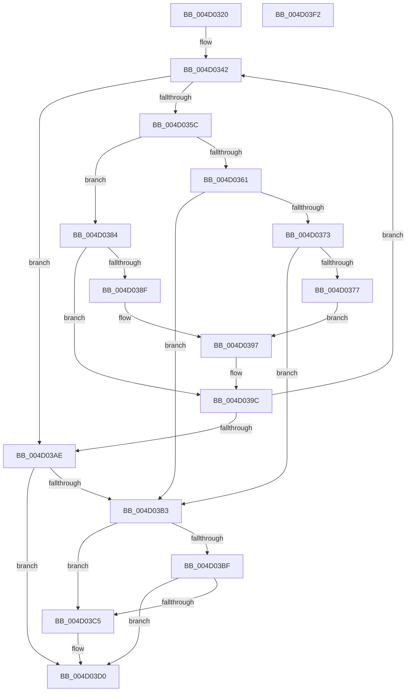

# RtlpHpLfhBucketUpdateStats

- RVA: `0x004D0320`–`0x004D03F3` (길이 `211` bytes)
- VA: `0x00000001404D0320`
- 실행 섹션: `.text`
- PDB 이름 있음: `예`; PDB Function 태그: `아니요`
- unwind 정보 RVA: `0x0005FD94`
- 디코드: `61`개 명령, `211/211` bytes 표시
- 미해석 바이트: `0` (있으면 어셈블리에 `.byte`로 보존)

> 이 문서는 커널 이미지의 기계어와 PDB 기호를 분석해 생성했습니다. 4번과 5번은 함수 원형과 자료형을 바이너리 사용 방식에서 추정한 C 해석이며 원본 소스 복구 결과는 아닙니다.

## 1. Dependencies

- 직접 호출 지점: **1**; 고유 호출 대상: **1**
- 직접 호출자로 확인된 함수: **1**
- RIP 상대 이미지 참조: **0**

### Outgoing calls
- `0x004D03CB` → [RtlpHpLfhBucketActivate](../60/RtlpHpLfhBucketActivate_function_0060453C.md) (function, `0x0060453C`)

### Direct callers
- [RtlpHpLfhBucketCheckAndUpdate](../4F/RtlpHpLfhBucketCheckAndUpdate_function_004FC894.md) at `0x004FC8B8`

### Static image references
- 디코드된 RIP-relative 메모리 참조가 없습니다.

## 2. Other-region calls and transfers

- 다른 실행 섹션으로 향하는 call: **0**
- 별도 외부 분기/꼬리 이동을 확인하지 못했습니다.

## 3. Assembly (complete function range)

```asm
004D0320  48 89 5C 24 10                  mov qword ptr [rsp + 0x10], rbx
004D0325  48 89 74 24 18                  mov qword ptr [rsp + 0x18], rsi
004D032A  57                              push rdi
004D032B  48 83 EC 20                     sub rsp, 0x20
004D032F  45 8B C8                        mov r9d, r8d
004D0332  44 8B D2                        mov r10d, edx
004D0335  48 8B F9                        mov rdi, rcx
004D0338  8B F2                           mov esi, edx
004D033A  33 DB                           xor ebx, ebx
004D033C  41 BB 00 FF 00 00               mov r11d, 0xff00
004D0342  4A 8B 94 D7 C0 01 00 00         mov rdx, qword ptr [rdi + r10*8 + 0x1c0]
004D034A  48 89 54 24 48                  mov qword ptr [rsp + 0x48], rdx
004D034F  48 8B CA                        mov rcx, rdx
004D0352  48 89 54 24 30                  mov qword ptr [rsp + 0x30], rdx
004D0357  F6 C2 01                        test dl, 1
004D035A  74 52                           je 0x1404d03ae
004D035C  45 85 C9                        test r9d, r9d
004D035F  74 23                           je 0x1404d0384
004D0361  4C 8B C2                        mov r8, rdx
004D0364  49 C1 E8 10                     shr r8, 0x10
004D0368  41 8A C0                        mov al, r8b
004D036B  24 1F                           and al, 0x1f
004D036D  66 45 3B C3                     cmp r8w, r11w
004D0371  77 40                           ja 0x1404d03b3
004D0373  3C 10                           cmp al, 0x10
004D0375  77 3C                           ja 0x1404d03b3
004D0377  66 41 83 C0 21                  add r8w, 0x21
004D037C  66 44 89 44 24 32               mov word ptr [rsp + 0x32], r8w
004D0382  EB 13                           jmp 0x1404d0397
004D0384  0F B7 44 24 4A                  movzx eax, word ptr [rsp + 0x4a]
004D0389  66 83 F8 01                     cmp ax, 1
004D038D  76 0D                           jbe 0x1404d039c
004D038F  66 FF C8                        dec ax
004D0392  66 89 44 24 32                  mov word ptr [rsp + 0x32], ax
004D0397  48 8B 4C 24 30                  mov rcx, qword ptr [rsp + 0x30]
004D039C  48 8B C2                        mov rax, rdx
004D039F  F0 4A 0F B1 8C D7 C0 01 00 00   lock cmpxchg qword ptr [rdi + r10*8 + 0x1c0], rcx
004D03A9  48 3B C2                        cmp rax, rdx
004D03AC  75 94                           jne 0x1404d0342
004D03AE  45 85 C9                        test r9d, r9d
004D03B1  74 1D                           je 0x1404d03d0
004D03B3  48 C1 E9 10                     shr rcx, 0x10
004D03B7  8A C1                           mov al, cl
004D03B9  24 1F                           and al, 0x1f
004D03BB  3C 10                           cmp al, 0x10
004D03BD  77 06                           ja 0x1404d03c5
004D03BF  66 41 3B CB                     cmp cx, r11w
004D03C3  76 0B                           jbe 0x1404d03d0
004D03C5  41 8B D2                        mov edx, r10d
004D03C8  48 8B CF                        mov rcx, rdi
004D03CB  E8 6C 41 13 00                  call 0x14060453c
004D03D0  48 8B 8C F7 C0 01 00 00         mov rcx, qword ptr [rdi + rsi*8 + 0x1c0]
004D03D8  48 8B 74 24 40                  mov rsi, qword ptr [rsp + 0x40]
004D03DD  F6 C1 01                        test cl, 1
004D03E0  48 0F 44 D9                     cmove rbx, rcx
004D03E4  48 8B C3                        mov rax, rbx
004D03E7  48 8B 5C 24 38                  mov rbx, qword ptr [rsp + 0x38]
004D03EC  48 83 C4 20                     add rsp, 0x20
004D03F0  5F                              pop rdi
004D03F1  C3                              ret
004D03F2  CC                              int3
```

## 4. C-style interpretation (structured pseudocode)

```c
__int64 __fastcall RtlpHpLfhBucketUpdateStats(__int64 a1, int a2, int a3)
{
    __int64 result;
    __int64 v_rbx;
    __int64 v_rsp;
    unsigned __int64 v_stack_p10;
    unsigned __int64 v_stack_p18;
    unsigned __int64 v_stack_p20;
    unsigned __int16 v_stack_p22;
    unsigned __int64 v_stack_p8;
    unsigned __int16 v_stack_pA;

    v_stack_p10 = v_rbx;
    v_stack_p18 = v_rsi;
    v_rsp = (v_rsp) - (32);
    v_rbx = 0;
loc_004D0342:
    v_stack_p20 = *(unsigned __int64 *)(a1 + (unsigned int)(a2) * 8 + 448);
    v_stack_p8 = *(unsigned __int64 *)(a1 + (unsigned int)(a2) * 8 + 448);
    if ((((unsigned __int8)(*(unsigned __int64 *)(a1 + (unsigned int)(a2) * 8 + 448))) & (1)) == 0) goto loc_004D03AE;
    if ((unsigned int)((unsigned int)(a3)) == 0) goto loc_004D0384;
    a3 = (*(unsigned __int64 *)(a1 + (unsigned int)(a2) * 8 + 448)) >> (16);
    result = (unsigned __int8)(((unsigned __int8)(a3)) & (31));
    if (((unsigned __int16)(a3)) > ((unsigned __int16)((unsigned int)(0xFF00ULL)))) goto loc_004D03B3;
    if (((unsigned __int8)(result)) > 16) goto loc_004D03B3;
    a3 = (unsigned __int16)((a3) + (33));
    v_stack_pA = (unsigned __int16)(a3);
    goto loc_004D0397;
loc_004D0384:
    if (((unsigned __int16)(v_stack_p22)) <= 1) goto loc_004D039C;
    result = (unsigned __int16)((v_stack_p22) - 1);
    v_stack_pA = (unsigned __int16)(result);
loc_004D0397:
loc_004D039C:
    if ((*(unsigned __int64 *)(a1 + (unsigned int)(a2) * 8 + 448)) != (*(unsigned __int64 *)(a1 + (unsigned int)(a2) * 8 + 448))) goto loc_004D0342;
loc_004D03AE:
    if ((unsigned int)((unsigned int)(a3)) == 0) goto loc_004D03D0;
loc_004D03B3:
    a1 = (v_stack_p8) >> (16);
    result = (unsigned __int8)(((unsigned __int8)(a1)) & (31));
    if (((unsigned __int8)(result)) > 16) goto loc_004D03C5;
    if (((unsigned __int16)(a1)) >= = ((unsigned __int16)((unsigned int)(0xFF00ULL)))) {
        a2 = (unsigned int)((unsigned int)(a2));
        a1 = a1;
        result = RtlpHpLfhBucketActivate(a1, a2, a3, (unsigned int)(a3));
    }
    if ((((unsigned __int8)(*(unsigned __int64 *)(a1 + (unsigned int)(a2) * 8 + 448))) & (1)) == 0) { v_rbx = *(unsigned __int64 *)(a1 + (unsigned int)(a2) * 8 + 448); }
    v_rsp = (v_rsp) + (32);
    return v_rbx;
}
```

## 5. (Beta) C Style

```c
int64_t RtlpHpLfhBucketUpdateStats(void *Arg1, int32_t Arg2, int32_t Arg3)
{
    uint8_t *arg1 = (uint8_t *)Arg1;

    int64_t result;
    int64_t local_rbx;
    int64_t local_rsp;
    uint64_t v_stack_p10;
    uint64_t v_stack_p18;
    uint64_t v_stack_p20;
    uint16_t v_stack_p22;
    uint64_t v_stack_p8;
    uint16_t v_stack_pA;

    v_stack_p10 = local_rbx;
    v_stack_p18 = local_rsi;
    local_rsp = (local_rsp) - (32);
    local_rbx = 0;
loc_004D0342:
    v_stack_p20 = *(uint64_t *)(arg1 + (uint32_t)(Arg2) * 8 + 0x1C0);
    v_stack_p8 = *(uint64_t *)(arg1 + (uint32_t)(Arg2) * 8 + 0x1C0);
    if ((((uint8_t)(*(uint64_t *)(arg1 + (uint32_t)(Arg2) * 8 + 0x1C0))) & (1)) == 0) goto loc_004D03AE;
    if ((uint32_t)((uint32_t)(Arg3)) == 0) goto loc_004D0384;
    Arg3 = (*(uint64_t *)(arg1 + (uint32_t)(Arg2) * 8 + 0x1C0)) >> (16);
    result = (uint8_t)(((uint8_t)(Arg3)) & (31));
    if (((uint16_t)(Arg3)) > ((uint16_t)((uint32_t)(0xFF00ULL)))) goto loc_004D03B3;
    if (((uint8_t)(result)) > 16) goto loc_004D03B3;
    Arg3 = (uint16_t)((Arg3) + (33));
    v_stack_pA = (uint16_t)(Arg3);
    goto loc_004D0397;
loc_004D0384:
    if (((uint16_t)(v_stack_p22)) <= 1) goto loc_004D039C;
    result = (uint16_t)((v_stack_p22) - 1);
    v_stack_pA = (uint16_t)(result);
loc_004D0397:
loc_004D039C:
    if ((*(uint64_t *)(arg1 + (uint32_t)(Arg2) * 8 + 0x1C0)) != (*(uint64_t *)(arg1 + (uint32_t)(Arg2) * 8 + 0x1C0))) goto loc_004D0342;
loc_004D03AE:
    if ((uint32_t)((uint32_t)(Arg3)) == 0) goto loc_004D03D0;
loc_004D03B3:
    Arg1 = (v_stack_p8) >> (16);
    result = (uint8_t)(((uint8_t)(Arg1)) & (31));
    if (((uint8_t)(result)) > 16) goto loc_004D03C5;
    if (((uint16_t)(Arg1)) >= = ((uint16_t)((uint32_t)(0xFF00ULL)))) {
        Arg2 = (uint32_t)((uint32_t)(Arg2));
        Arg1 = Arg1;
        result = RtlpHpLfhBucketActivate(Arg1, Arg2, Arg3, (uint32_t)(Arg3));
    }
    if ((((uint8_t)(*(uint64_t *)(arg1 + (uint32_t)(Arg2) * 8 + 0x1C0))) & (1)) == 0) { local_rbx = *(uint64_t *)(arg1 + (uint32_t)(Arg2) * 8 + 0x1C0); }
    local_rsp = (local_rsp) + (32);
    return local_rbx;
}
```

### 관측된 메모리 오프셋

구조체 형식이 확인되지 않은 접근은 인자 기준의 오프셋으로만 기록했습니다.

| 기준 인자 | 오프셋 표현 | 폭 (bit) | 접근 |
|---|---:|---:|---|
| `Arg1` | `+ 0x1C0 + r10*8` | `64` | `R` |
| `Arg1` | `+ 0x1C0 + rsi*8` | `64` | `R` |

## 6. Execution-region graph

[열기: 2D/3D 그래프와 함수 탐색 컨트롤 패널](../../../control-panel.html?section=text&rva=0x004D0320&view=graph)

- 2D 그래프는 위에서 아래로 흐르고, 3D 그래프는 빈 공간을 드래그해 회전합니다. Shift+드래그는 이동, 휠은 확대·축소, 함수 노드 선택은 대상 보고서 이동입니다.

### Static fallback


