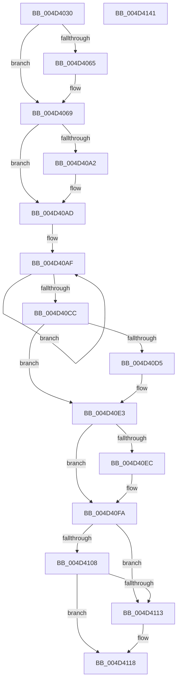

# RtlpHpVsContextInitialize

- RVA: `0x004D4030`–`0x004D4142` (길이 `274` bytes)
- VA: `0x00000001404D4030`
- 실행 섹션: `.text`
- PDB 이름 있음: `예`; PDB Function 태그: `아니요`
- unwind 정보 RVA: `0x0005C954`
- 디코드: `75`개 명령, `274/274` bytes 표시
- 미해석 바이트: `0` (있으면 어셈블리에 `.byte`로 보존)

> 이 문서는 커널 이미지의 기계어와 PDB 기호를 분석해 생성했습니다. 4번과 5번은 함수 원형과 자료형을 바이너리 사용 방식에서 추정한 C 해석이며 원본 소스 복구 결과는 아닙니다.

## 1. Dependencies

- 직접 호출 지점: **2**; 고유 호출 대상: **2**
- 직접 호출자로 확인된 함수: **2**
- RIP 상대 이미지 참조: **2**

### Outgoing calls
- `0x004D4056` → [memset](../6C/memset_function_006C6C40.md) (function, `0x006C6C40`)
- `0x004D40FE` → [RtlpHpVsCalculateAffinitySlotCount](../4F/RtlpHpVsCalculateAffinitySlotCount_function_004F6F34.md) (function, `0x004F6F34`)

### Direct callers
- [RtlpHpHeapCreate](../60/RtlpHpHeapCreate_function_00602FDC.md) at `0x00603254`
- [RtlpHpFixedHeapCreate](../60/RtlpHpFixedHeapCreate_function_006038A0.md) at `0x00603AE4`

### Static image references
- `0x004D40B4` → RVA `0x00E28300` (`.data`; read)
- `0x004D4108` → RVA `0x00F059A0` (`.data`; read)

## 2. Other-region calls and transfers

- 다른 실행 섹션으로 향하는 call: **0**
- 별도 외부 분기/꼬리 이동을 확인하지 못했습니다.

## 3. Assembly (complete function range)

```asm
004D4030  48 89 5C 24 08                  mov qword ptr [rsp + 8], rbx
004D4035  48 89 6C 24 10                  mov qword ptr [rsp + 0x10], rbp
004D403A  48 89 74 24 18                  mov qword ptr [rsp + 0x18], rsi
004D403F  57                              push rdi
004D4040  48 83 EC 20                     sub rsp, 0x20
004D4044  48 8B EA                        mov rbp, rdx
004D4047  49 8B F8                        mov rdi, r8
004D404A  33 D2                           xor edx, edx
004D404C  41 8B F1                        mov esi, r9d
004D404F  48 8B D9                        mov rbx, rcx
004D4052  44 8D 42 60                     lea r8d, [rdx + 0x60]
004D4056  E8 E5 2B 1F 00                  call 0x1406c6c40
004D405B  F7 44 24 58 00 00 00 08         test dword ptr [rsp + 0x58], 0x8000000
004D4063  74 04                           je 0x1404d4069
004D4065  C6 43 05 01                     mov byte ptr [rbx + 5], 1
004D4069  0F 10 07                        movups xmm0, xmmword ptr [rdi]
004D406C  4C 8B 44 24 68                  mov r8, qword ptr [rsp + 0x68]
004D4071  48 8B C3                        mov rax, rbx
004D4074  0F 10 4F 10                     movups xmm1, xmmword ptr [rdi + 0x10]
004D4078  48 33 C5                        xor rax, rbp
004D407B  40 88 73 03                     mov byte ptr [rbx + 3], sil
004D407F  48 89 43 08                     mov qword ptr [rbx + 8], rax
004D4083  48 8B 44 24 60                  mov rax, qword ptr [rsp + 0x60]
004D4088  0F 11 43 10                     movups xmmword ptr [rbx + 0x10], xmm0
004D408C  0F 10 47 20                     movups xmm0, xmmword ptr [rdi + 0x20]
004D4090  0F 11 4B 20                     movups xmmword ptr [rbx + 0x20], xmm1
004D4094  0F 11 43 30                     movups xmmword ptr [rbx + 0x30], xmm0
004D4098  8A 08                           mov cl, byte ptr [rax]
004D409A  88 4B 04                        mov byte ptr [rbx + 4], cl
004D409D  4D 85 C0                        test r8, r8
004D40A0  74 0B                           je 0x1404d40ad
004D40A2  41 0F B7 C0                     movzx eax, r8w
004D40A6  66 2B C3                        sub ax, bx
004D40A9  66 89 43 06                     mov word ptr [rbx + 6], ax
004D40AD  33 C9                           xor ecx, ecx
004D40AF  48 8B 44 CB 10                  mov rax, qword ptr [rbx + rcx*8 + 0x10]
004D40B4  48 33 05 45 42 95 00            xor rax, qword ptr [rip + 0x954245]
004D40BB  48 33 C3                        xor rax, rbx
004D40BE  48 89 44 CB 10                  mov qword ptr [rbx + rcx*8 + 0x10], rax
004D40C3  48 FF C1                        inc rcx
004D40C6  48 83 F9 04                     cmp rcx, 4
004D40CA  7C E3                           jl 0x1404d40af
004D40CC  48 8B 43 30                     mov rax, qword ptr [rbx + 0x30]
004D40D0  48 85 C0                        test rax, rax
004D40D3  74 0E                           je 0x1404d40e3
004D40D5  48 33 05 24 42 95 00            xor rax, qword ptr [rip + 0x954224]
004D40DC  48 33 C3                        xor rax, rbx
004D40DF  48 89 43 30                     mov qword ptr [rbx + 0x30], rax
004D40E3  48 8B 43 38                     mov rax, qword ptr [rbx + 0x38]
004D40E7  48 85 C0                        test rax, rax
004D40EA  74 0E                           je 0x1404d40fa
004D40EC  48 33 05 0D 42 95 00            xor rax, qword ptr [rip + 0x95420d]
004D40F3  48 33 C3                        xor rax, rbx
004D40F6  48 89 43 38                     mov qword ptr [rbx + 0x38], rax
004D40FA  8B 4C 24 50                     mov ecx, dword ptr [rsp + 0x50]
004D40FE  E8 31 2E 02 00                  call 0x1404f6f34
004D4103  4D 85 C0                        test r8, r8
004D4106  74 0B                           je 0x1404d4113
004D4108  8B 0D 92 18 A3 00               mov ecx, dword ptr [rip + 0xa31892]
004D410E  F6 C1 08                        test cl, 8
004D4111  75 05                           jne 0x1404d4118
004D4113  B8 01 00 00 00                  mov eax, 1
004D4118  48 8B 6C 24 38                  mov rbp, qword ptr [rsp + 0x38]
004D411D  FE C8                           dec al
004D411F  48 8B 74 24 40                  mov rsi, qword ptr [rsp + 0x40]
004D4124  0F 57 C0                        xorps xmm0, xmm0
004D4127  88 43 02                        mov byte ptr [rbx + 2], al
004D412A  0F 11 43 40                     movups xmmword ptr [rbx + 0x40], xmm0
004D412E  80 4B 43 01                     or byte ptr [rbx + 0x43], 1
004D4132  C6 43 42 10                     mov byte ptr [rbx + 0x42], 0x10
004D4136  48 8B 5C 24 30                  mov rbx, qword ptr [rsp + 0x30]
004D413B  48 83 C4 20                     add rsp, 0x20
004D413F  5F                              pop rdi
004D4140  C3                              ret
004D4141  CC                              int3
```

## 4. C-style interpretation (structured pseudocode)

```c
__int64 __fastcall RtlpHpVsContextInitialize(__int64 a1, __int64 a2, __int64 a3, int a4, unsigned int a5, unsigned int a6, __int64 a7, __int64 a8)
{
    __int64 result;
    __int64 v_rsp;
    unsigned __int64 v_stack_p10;
    unsigned __int64 v_stack_p18;
    unsigned __int64 v_stack_p8;

    v_stack_p8 = v_rbx;
    v_stack_p10 = v_rbp;
    v_stack_p18 = v_rsi;
    v_rsp = (v_rsp) - (32);
    a2 = 0;
    result = memset(a1, a2, a2 + 96, a4);
    if (((a6) & (0x8000000ULL)) != 0) {
        *(unsigned __int8 *)(a1 + 5) = 1;
    }
    result = (a1) ^ (0);
    *(unsigned __int8 *)(a1 + 3) = (unsigned __int8)((unsigned int)(a4));
    *(unsigned __int64 *)(a1 + 8) = result;
    *(unsigned __int64 *)(a1 + 16) = v_xmm0;
    *(unsigned __int64 *)(a1 + 32) = v_xmm1;
    *(unsigned __int64 *)(a1 + 48) = v_xmm0;
    *(unsigned __int8 *)(a1 + 4) = (unsigned __int8)(*(unsigned __int8 *)(a7));
    result = a7;
    if (a8 != 0) {
        result = (unsigned __int16)(a8);
        result = (unsigned __int16)((result) - ((unsigned __int16)(a1)));
        *(unsigned __int16 *)(a1 + 6) = (unsigned __int16)(result);
    }
    a1 = 0;
loc_004D40AF:
    result = (*(unsigned __int64 *)(a1 + a1 * 8 + 16)) ^ (*(unsigned __int64 *)(v_rip + 9781829));
    result = (result) ^ (0);
    *(unsigned __int64 *)(a1 + a1 * 8 + 16) = result;
    a1 = (a1) + 1;
    if (a1 < 4) goto loc_004D40AF;
    result = *(unsigned __int64 *)(a1 + 48);
    if (*(unsigned __int64 *)(a1 + 48) != 0) {
        result = (*(unsigned __int64 *)(a1 + 48)) ^ (*(unsigned __int64 *)(v_rip + 9781796));
        result = (result) ^ (a1);
        *(unsigned __int64 *)(a1 + 48) = result;
    }
    result = *(unsigned __int64 *)(a1 + 56);
    if (*(unsigned __int64 *)(a1 + 56) != 0) {
        result = (*(unsigned __int64 *)(a1 + 56)) ^ (*(unsigned __int64 *)(v_rip + 9781773));
        result = (result) ^ (a1);
        *(unsigned __int64 *)(a1 + 56) = result;
    }
    result = RtlpHpVsCalculateAffinitySlotCount((unsigned int)(a5), a2, a8, a4);
    if (a8 == 0) goto loc_004D4113;
    if ((((unsigned __int8)((unsigned int)(*(unsigned int *)(v_rip + 10688658)))) & (8)) == 0) {
        result = 1;
    }
    result = (unsigned __int8)((result) - 1);
    *(unsigned __int8 *)(a1 + 2) = (unsigned __int8)(result);
    *(unsigned __int64 *)(a1 + 64) = v_xmm0;
    *(unsigned __int8 *)(a1 + 66) = 16;
    v_rsp = (v_rsp) + (32);
    return result;
}
```

## 5. (Beta) C Style

```c
int64_t RtlpHpVsContextInitialize(void *Arg1, int64_t Arg2, void *Arg3, int32_t Arg4, uint32_t Arg5, uint32_t Arg6, void *Arg7, int64_t Arg8)
{
    uint8_t *arg1 = (uint8_t *)Arg1;
    uint8_t *arg3 = (uint8_t *)Arg3;
    uint8_t *arg7 = (uint8_t *)Arg7;

    int64_t result;
    int64_t local_rsp;
    uint64_t v_stack_p10;
    uint64_t v_stack_p18;
    uint64_t v_stack_p8;

    v_stack_p8 = local_rbx;
    v_stack_p10 = local_rbp;
    v_stack_p18 = local_rsi;
    local_rsp = (local_rsp) - (32);
    Arg2 = 0;
    result = memset(Arg1, Arg2, Arg2 + 96, Arg4);
    if (((Arg6) & (0x8000000ULL)) != 0) {
        *(uint8_t *)(arg1 + 0x5) = 1;
    }
    result = (Arg1) ^ (0);
    *(uint8_t *)(arg1 + 0x3) = (uint8_t)((uint32_t)(Arg4));
    *(uint64_t *)(arg1 + 0x8) = result;
    *(uint64_t *)(arg1 + 0x10) = v_xmm0;
    *(uint64_t *)(arg1 + 0x20) = v_xmm1;
    *(uint64_t *)(arg1 + 0x30) = v_xmm0;
    *(uint8_t *)(arg1 + 0x4) = (uint8_t)(*(uint8_t *)(arg7));
    result = Arg7;
    if (Arg8 != 0) {
        result = (uint16_t)(Arg8);
        result = (uint16_t)((result) - ((uint16_t)(Arg1)));
        *(uint16_t *)(arg1 + 0x6) = (uint16_t)(result);
    }
    Arg1 = 0;
loc_004D40AF:
    result = (*(uint64_t *)(arg1 + arg1 * 8 + 0x10)) ^ (*(uint64_t *)(v_rip + 0x954245));
    result = (result) ^ (0);
    *(uint64_t *)(arg1 + arg1 * 8 + 0x10) = result;
    Arg1 = (Arg1) + 1;
    if (Arg1 < 4) goto loc_004D40AF;
    result = *(uint64_t *)(arg1 + 0x30);
    if (*(uint64_t *)(arg1 + 0x30) != 0) {
        result = (*(uint64_t *)(arg1 + 0x30)) ^ (*(uint64_t *)(v_rip + 0x954224));
        result = (result) ^ (Arg1);
        *(uint64_t *)(arg1 + 0x30) = result;
    }
    result = *(uint64_t *)(arg1 + 0x38);
    if (*(uint64_t *)(arg1 + 0x38) != 0) {
        result = (*(uint64_t *)(arg1 + 0x38)) ^ (*(uint64_t *)(v_rip + 0x95420D));
        result = (result) ^ (Arg1);
        *(uint64_t *)(arg1 + 0x38) = result;
    }
    result = RtlpHpVsCalculateAffinitySlotCount((uint32_t)(Arg5), Arg2, Arg8, Arg4);
    if (Arg8 == 0) goto loc_004D4113;
    if ((((uint8_t)((uint32_t)(*(uint32_t *)(v_rip + 0xA31892)))) & (8)) == 0) {
        result = 1;
    }
    result = (uint8_t)((result) - 1);
    *(uint8_t *)(arg1 + 0x2) = (uint8_t)(result);
    *(uint64_t *)(arg1 + 0x40) = v_xmm0;
    *(uint8_t *)(arg1 + 0x42) = 16;
    local_rsp = (local_rsp) + (32);
    return result;
}
```

### 관측된 메모리 오프셋

구조체 형식이 확인되지 않은 접근은 인자 기준의 오프셋으로만 기록했습니다.

| 기준 인자 | 오프셋 표현 | 폭 (bit) | 접근 |
|---|---:|---:|---|
| `Arg1` | `+ 0x2` | `8` | `W` |
| `Arg1` | `+ 0x3` | `8` | `W` |
| `Arg1` | `+ 0x4` | `8` | `W` |
| `Arg1` | `+ 0x5` | `8` | `W` |
| `Arg1` | `+ 0x6` | `16` | `W` |
| `Arg1` | `+ 0x8` | `64` | `W` |
| `Arg1` | `+ 0x10` | `128` | `R` |
| `Arg1` | `+ 0x10 + rcx*8` | `64` | `R` |
| `Arg1` | `+ 0x10 + rcx*8` | `64` | `W` |
| `Arg1` | `+ 0x20` | `128` | `R` |
| `Arg1` | `+ 0x30` | `64` | `R` |
| `Arg1` | `+ 0x30` | `64` | `W` |
| `Arg1` | `+ 0x30` | `128` | `R` |
| `Arg1` | `+ 0x38` | `64` | `R` |
| `Arg1` | `+ 0x38` | `64` | `W` |
| `Arg1` | `+ 0x40` | `128` | `R` |
| `Arg1` | `+ 0x42` | `8` | `W` |
| `Arg1` | `+ 0x43` | `8` | `R/W` |
| `Arg3` | `+ 0x0` | `128` | `R` |
| `Arg3` | `+ 0x10` | `128` | `R` |
| `Arg3` | `+ 0x20` | `128` | `R` |
| `Arg7` | `+ 0x0` | `8` | `R` |

## 6. Execution-region graph

[열기: 2D/3D 그래프와 함수 탐색 컨트롤 패널](../../../control-panel.html?section=text&rva=0x004D4030&view=graph)

- 2D 그래프는 위에서 아래로 흐르고, 3D 그래프는 빈 공간을 드래그해 회전합니다. Shift+드래그는 이동, 휠은 확대·축소, 함수 노드 선택은 대상 보고서 이동입니다.

### Static fallback


