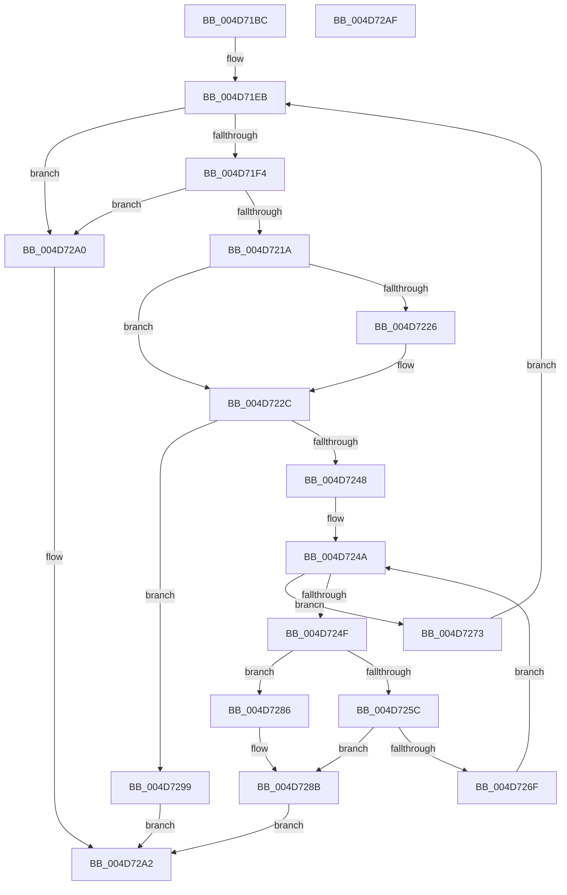

# ST_STORE&lt;SM_TRAITS&gt;::StDmEtaRefresh

- RVA: `0x004D71BC`–`0x004D72B0` (길이 `244` bytes)
- VA: `0x00000001404D71BC`
- 실행 섹션: `.text`
- PDB 이름 있음: `예`; PDB Function 태그: `아니요`
- unwind 정보 RVA: `0x000BE5C8`
- 디코드: `77`개 명령, `244/244` bytes 표시
- 미해석 바이트: `0` (있으면 어셈블리에 `.byte`로 보존)

> 이 문서는 커널 이미지의 기계어와 PDB 기호를 분석해 생성했습니다. 4번과 5번은 함수 원형과 자료형을 바이너리 사용 방식에서 추정한 C 해석이며 원본 소스 복구 결과는 아닙니다.

## 1. Dependencies

- 직접 호출 지점: **4**; 고유 호출 대상: **4**
- 직접 호출자로 확인된 함수: **2**
- RIP 상대 이미지 참조: **0**

### Outgoing calls
- `0x004D720D` → [StEtaCheckForRefresh](../60/StEtaCheckForRefresh_function_0060EE50.md) (function, `0x0060EE50`)
- `0x004D723F` → [StEtaStartRefresh](../60/StEtaStartRefresh_function_0060F0C0.md) (function, `0x0060F0C0`)
- `0x004D7252` → [ST_STORE<SM_TRAITS>::StDmPickRandomRegion](../60/ST_STORE_SM_TRAITS_StDmPickRandomRegion_function_0060DF34.md) (function, `0x0060DF34`)
- `0x004D7264` → [ST_STORE<SM_TRAITS>::StDmEtaPerformIo](../60/ST_STORE_SM_TRAITS_StDmEtaPerformIo_function_0060D448.md) (function, `0x0060D448`)

### Direct callers
- [sub_002061A0](../20/Unknown_function_002061A0.md) at `0x00206252`
- [sub_0020634E](../20/Unknown_function_0020634E.md) at `0x00206514`

### Static image references
- 디코드된 RIP-relative 메모리 참조가 없습니다.

## 2. Other-region calls and transfers

- 다른 실행 섹션으로 향하는 call: **0**
- 별도 외부 분기/꼬리 이동을 확인하지 못했습니다.

## 3. Assembly (complete function range)

```asm
004D71BC  40 53                           push rbx
004D71BE  55                              push rbp
004D71BF  56                              push rsi
004D71C0  57                              push rdi
004D71C1  41 56                           push r14
004D71C3  48 83 EC 20                     sub rsp, 0x20
004D71C7  83 64 24 58 00                  and dword ptr [rsp + 0x58], 0
004D71CC  BD FF FF 00 00                  mov ebp, 0xffff
004D71D1  83 64 24 50 00                  and dword ptr [rsp + 0x50], 0
004D71D6  48 8B D9                        mov rbx, rcx
004D71D9  83 64 24 60 00                  and dword ptr [rsp + 0x60], 0
004D71DE  8B 81 10 03 00 00               mov eax, dword ptr [rcx + 0x310]
004D71E4  3B C5                           cmp eax, ebp
004D71E6  0F 46 E8                        cmovbe ebp, eax
004D71E9  33 F6                           xor esi, esi
004D71EB  83 FE 0A                        cmp esi, 0xa
004D71EE  0F 83 AC 00 00 00               jae 0x1404d72a0
004D71F4  48 8B BB 58 05 00 00            mov rdi, qword ptr [rbx + 0x558]
004D71FB  4C 8D 4C 24 50                  lea r9, [rsp + 0x50]
004D7200  48 8B CF                        mov rcx, rdi
004D7203  4C 8D 44 24 58                  lea r8, [rsp + 0x58]
004D7208  48 8D 54 24 60                  lea rdx, [rsp + 0x60]
004D720D  E8 3E 7C 13 00                  call 0x14060ee50
004D7212  85 C0                           test eax, eax
004D7214  0F 84 86 00 00 00               je 0x1404d72a0
004D721A  8B 4C 24 58                     mov ecx, dword ptr [rsp + 0x58]
004D721E  8B 44 24 50                     mov eax, dword ptr [rsp + 0x50]
004D7222  85 C9                           test ecx, ecx
004D7224  74 06                           je 0x1404d722c
004D7226  2B C1                           sub eax, ecx
004D7228  D1 E8                           shr eax, 1
004D722A  03 C1                           add eax, ecx
004D722C  8B 54 24 60                     mov edx, dword ptr [rsp + 0x60]
004D7230  3B C5                           cmp eax, ebp
004D7232  44 8B F5                        mov r14d, ebp
004D7235  48 8B CF                        mov rcx, rdi
004D7238  44 0F 42 F0                     cmovb r14d, eax
004D723C  45 8B C6                        mov r8d, r14d
004D723F  E8 7C 7E 13 00                  call 0x14060f0c0
004D7244  85 C0                           test eax, eax
004D7246  74 51                           je 0x1404d7299
004D7248  33 FF                           xor edi, edi
004D724A  83 FF 20                        cmp edi, 0x20
004D724D  73 24                           jae 0x1404d7273
004D724F  48 8B CB                        mov rcx, rbx
004D7252  E8 DD 6C 13 00                  call 0x14060df34
004D7257  83 F8 FF                        cmp eax, -1
004D725A  74 2A                           je 0x1404d7286
004D725C  45 8B C6                        mov r8d, r14d
004D725F  8B D0                           mov edx, eax
004D7261  48 8B CB                        mov rcx, rbx
004D7264  E8 DF 61 13 00                  call 0x14060d448
004D7269  8B C8                           mov ecx, eax
004D726B  85 C0                           test eax, eax
004D726D  78 1C                           js 0x1404d728b
004D726F  FF C7                           inc edi
004D7271  EB D7                           jmp 0x1404d724a
004D7273  48 8B 83 58 05 00 00            mov rax, qword ptr [rbx + 0x558]
004D727A  F0 83 60 30 FE                  lock and dword ptr [rax + 0x30], 0xfffffffe
004D727F  FF C6                           inc esi
004D7281  E9 65 FF FF FF                  jmp 0x1404d71eb
004D7286  B9 78 01 00 C0                  mov ecx, 0xc0000178
004D728B  48 8B 83 58 05 00 00            mov rax, qword ptr [rbx + 0x558]
004D7292  F0 83 60 30 FE                  lock and dword ptr [rax + 0x30], 0xfffffffe
004D7297  EB 09                           jmp 0x1404d72a2
004D7299  B9 BB 00 00 C0                  mov ecx, 0xc00000bb
004D729E  EB 02                           jmp 0x1404d72a2
004D72A0  33 C9                           xor ecx, ecx
004D72A2  8B C1                           mov eax, ecx
004D72A4  48 83 C4 20                     add rsp, 0x20
004D72A8  41 5E                           pop r14
004D72AA  5F                              pop rdi
004D72AB  5E                              pop rsi
004D72AC  5D                              pop rbp
004D72AD  5B                              pop rbx
004D72AE  C3                              ret
004D72AF  CC                              int3
```

## 4. C-style interpretation (structured pseudocode)

```c
__int64 __fastcall ST_STORE_SM_TRAITS___StDmEtaRefresh(__int64 a1)
{
    __int64 result;
    __int64 v_r14;
    __int64 v_rbp;
    __int64 v_rdi;
    __int64 v_rsi;
    __int64 v_rsp;
    unsigned int v_stack_p10;
    unsigned int v_stack_p18;
    unsigned int v_stack_p8;

    v_rsp = (v_rsp) - (32);
    v_rbp = (unsigned int)(0xFFFFULL);
    if (((unsigned int)((unsigned int)(*(unsigned int *)(a1 + 784)))) <= ((unsigned int)((unsigned int)(0xFFFFULL)))) { v_rbp = (unsigned int)((unsigned int)(*(unsigned int *)(a1 + 784))); }
    v_rsi = 0;
loc_004D71EB:
    if (0 >= 10) goto loc_004D72A0;
    result = StEtaCheckForRefresh(*(unsigned __int64 *)(a1 + 1368), v_stack_p18, v_stack_p10, v_stack_p8);
    if ((unsigned int)(result) == 0) goto loc_004D72A0;
    result = (unsigned int)(v_stack_p8);
    if ((unsigned int)((unsigned int)(v_stack_p10)) != 0) {
        result = (unsigned int)(((unsigned int)(v_stack_p8)) - ((unsigned int)((unsigned int)(v_stack_p10))));
        result = (unsigned int)((result) >> (1));
        result = (unsigned int)((result) + ((unsigned int)((unsigned int)(v_stack_p10))));
    }
    v_r14 = (unsigned int)((unsigned int)(v_rbp));
    if (((unsigned int)(result)) < ((unsigned int)(v_rbp))) { v_r14 = (unsigned int)(result); }
    result = StEtaStartRefresh(*(unsigned __int64 *)(a1 + 1368), (unsigned int)(v_stack_p18), (unsigned int)((unsigned int)(v_r14)), v_stack_p8);
    if ((unsigned int)(result) == 0) goto loc_004D7299;
    v_rdi = 0;
loc_004D724A:
    if (0 >= 32) goto loc_004D7273;
    result = ST_STORE_SM_TRAITS___StDmPickRandomRegion(a1, (unsigned int)(v_stack_p18), (unsigned int)((unsigned int)(v_r14)), v_stack_p8);
    if (((unsigned int)(result)) == -1) goto loc_004D7286;
    result = ST_STORE_SM_TRAITS___StDmEtaPerformIo(a1, (unsigned int)((unsigned int)(result)), (unsigned int)((unsigned int)(v_r14)), v_stack_p8);
    if (sign_flag) goto loc_004D728B;
    v_rdi = (unsigned int)((v_rdi) + 1);
    goto loc_004D724A;
loc_004D7273:
    v_rsi = (unsigned int)((v_rsi) + 1);
    goto loc_004D71EB;
loc_004D7286:
loc_004D728B:
    goto loc_004D72A2;
loc_004D7299:
    goto loc_004D72A2;
loc_004D72A0:
    a1 = 0;
loc_004D72A2:
    v_rsp = (v_rsp) + (32);
    return 0;
}
```

## 5. (Beta) C Style

```c
int64_t ST_STORE_SM_TRAITS___StDmEtaRefresh(void *Arg1)
{
    uint8_t *arg1 = (uint8_t *)Arg1;

    int64_t result;
    int64_t local_r14;
    int64_t local_rbp;
    int64_t local_rdi;
    int64_t local_rsi;
    int64_t local_rsp;
    uint32_t v_stack_p10;
    uint32_t v_stack_p18;
    uint32_t v_stack_p8;

    local_rsp = (local_rsp) - (32);
    local_rbp = (uint32_t)(0xFFFFULL);
    if (((uint32_t)((uint32_t)(*(uint32_t *)(arg1 + 0x310)))) <= ((uint32_t)((uint32_t)(0xFFFFULL)))) { local_rbp = (uint32_t)((uint32_t)(*(uint32_t *)(arg1 + 0x310))); }
    local_rsi = 0;
loc_004D71EB:
    if (0 >= 10) goto loc_004D72A0;
    result = StEtaCheckForRefresh(*(uint64_t *)(arg1 + 0x558), v_stack_p18, v_stack_p10, v_stack_p8);
    if ((uint32_t)(result) == 0) goto loc_004D72A0;
    result = (uint32_t)(v_stack_p8);
    if ((uint32_t)((uint32_t)(v_stack_p10)) != 0) {
        result = (uint32_t)(((uint32_t)(v_stack_p8)) - ((uint32_t)((uint32_t)(v_stack_p10))));
        result = (uint32_t)((result) >> (1));
        result = (uint32_t)((result) + ((uint32_t)((uint32_t)(v_stack_p10))));
    }
    local_r14 = (uint32_t)((uint32_t)(local_rbp));
    if (((uint32_t)(result)) < ((uint32_t)(local_rbp))) { local_r14 = (uint32_t)(result); }
    result = StEtaStartRefresh(*(uint64_t *)(arg1 + 0x558), (uint32_t)(v_stack_p18), (uint32_t)((uint32_t)(local_r14)), v_stack_p8);
    if ((uint32_t)(result) == 0) goto loc_004D7299;
    local_rdi = 0;
loc_004D724A:
    if (0 >= 32) goto loc_004D7273;
    result = ST_STORE_SM_TRAITS___StDmPickRandomRegion(Arg1, (uint32_t)(v_stack_p18), (uint32_t)((uint32_t)(local_r14)), v_stack_p8);
    if (((uint32_t)(result)) == -1) goto loc_004D7286;
    result = ST_STORE_SM_TRAITS___StDmEtaPerformIo(Arg1, (uint32_t)((uint32_t)(result)), (uint32_t)((uint32_t)(local_r14)), v_stack_p8);
    if (sign_flag) goto loc_004D728B;
    local_rdi = (uint32_t)((local_rdi) + 1);
    goto loc_004D724A;
loc_004D7273:
    local_rsi = (uint32_t)((local_rsi) + 1);
    goto loc_004D71EB;
loc_004D7286:
loc_004D728B:
    goto loc_004D72A2;
loc_004D7299:
    goto loc_004D72A2;
loc_004D72A0:
    Arg1 = 0;
loc_004D72A2:
    local_rsp = (local_rsp) + (32);
    return 0;
}
```

### 관측된 메모리 오프셋

구조체 형식이 확인되지 않은 접근은 인자 기준의 오프셋으로만 기록했습니다.

| 기준 인자 | 오프셋 표현 | 폭 (bit) | 접근 |
|---|---:|---:|---|
| `Arg1` | `+ 0x310` | `32` | `R` |
| `Arg1` | `+ 0x558` | `64` | `R` |

## 6. Execution-region graph

[열기: 2D/3D 그래프와 함수 탐색 컨트롤 패널](../../../control-panel.html?section=text&rva=0x004D71BC&view=graph)

- 2D 그래프는 위에서 아래로 흐르고, 3D 그래프는 빈 공간을 드래그해 회전합니다. Shift+드래그는 이동, 휠은 확대·축소, 함수 노드 선택은 대상 보고서 이동입니다.

### Static fallback


