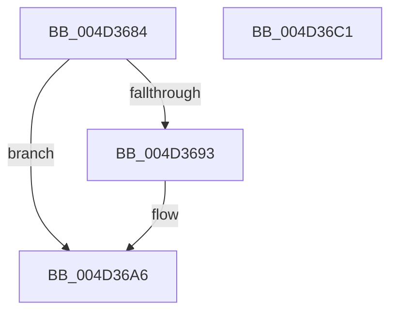

# ST_STORE&lt;SM_TRAITS&gt;::StDmIsCurrentRegion

- RVA: `0x004D3684`–`0x004D36C2` (길이 `62` bytes)
- VA: `0x00000001404D3684`
- 실행 섹션: `.text`
- PDB 이름 있음: `예`; PDB Function 태그: `아니요`
- unwind 정보 RVA: `0x000DB714`
- 디코드: `16`개 명령, `62/62` bytes 표시
- 미해석 바이트: `0` (있으면 어셈블리에 `.byte`로 보존)

> 이 문서는 커널 이미지의 기계어와 PDB 기호를 분석해 생성했습니다. 4번과 5번은 함수 원형과 자료형을 바이너리 사용 방식에서 추정한 C 해석이며 원본 소스 복구 결과는 아닙니다.

## 1. Dependencies

- 직접 호출 지점: **0**; 고유 호출 대상: **0**
- 직접 호출자로 확인된 함수: **3**
- RIP 상대 이미지 참조: **0**

### Outgoing calls
- 직접 디코드된 call 명령이 없습니다.

### Direct callers
- [ST_STORE&lt;SM_TRAITS&gt;::StDmDeviceIoCompletion](../4B/ST_STORE_SM_TRAITS_StDmDeviceIoCompletion_function_004BBB70.md) at `0x004BBD14`
- [ST_STORE&lt;SM_TRAITS&gt;::StDmRegionRemove](../60/ST_STORE_SM_TRAITS_StDmRegionRemove_function_0060E314.md) at `0x0060E38D`
- [sub_006F84D2](../6F/Unknown_function_006F84D2.md) at `0x006F84D7`

### Static image references
- 디코드된 RIP-relative 메모리 참조가 없습니다.

## 2. Other-region calls and transfers

- 다른 실행 섹션으로 향하는 call: **0**
- 별도 외부 분기/꼬리 이동을 확인하지 못했습니다.

## 3. Assembly (complete function range)

```asm
004D3684  45 33 C0                        xor r8d, r8d
004D3687  4C 8B C9                        mov r9, rcx
004D368A  44 38 81 08 03 00 00            cmp byte ptr [rcx + 0x308], r8b
004D3691  75 13                           jne 0x1404d36a6
004D3693  48 8B 81 78 05 00 00            mov rax, qword ptr [rcx + 0x578]
004D369A  44 8B C2                        mov r8d, edx
004D369D  46 0F B7 04 40                  movzx r8d, word ptr [rax + r8*2]
004D36A2  41 C1 E8 0D                     shr r8d, 0xd
004D36A6  41 8B C8                        mov ecx, r8d
004D36A9  B8 08 00 00 00                  mov eax, 8
004D36AE  48 03 C9                        add rcx, rcx
004D36B1  41 3B 94 C9 58 06 00 00         cmp edx, dword ptr [r9 + rcx*8 + 0x658]
004D36B9  44 0F 45 C0                     cmovne r8d, eax
004D36BD  41 8B C0                        mov eax, r8d
004D36C0  C3                              ret
004D36C1  CC                              int3
```

## 4. C-style interpretation (structured pseudocode)

```c
__int64 __fastcall ST_STORE_SM_TRAITS___StDmIsCurrentRegion(__int64 a1, int a2, int a3)
{
    __int64 result;

    a3 = 0;
    if ((*(unsigned __int8 *)(a1 + 776)) == 0) {
        result = *(unsigned __int64 *)(a1 + 1400);
        a3 = a2;
        a3 = *(unsigned __int16 *)(result + a3 * 2);
        a3 = (unsigned int)((a3) >> (13));
    }
    a1 = ((unsigned int)(a3)) + ((unsigned int)(a3));
    if (a2 != (*(unsigned int *)(a1 + a1 * 8 + 1624))) { a3 = 8; }
    return (unsigned int)(a3);
}
```

## 5. (Beta) C Style

```c
int64_t ST_STORE_SM_TRAITS___StDmIsCurrentRegion(void *Arg1, int32_t Arg2, int32_t Arg3)
{
    uint8_t *arg1 = (uint8_t *)Arg1;

    int64_t result;

    Arg3 = 0;
    if ((*(uint8_t *)(arg1 + 0x308)) == 0) {
        result = *(uint64_t *)(arg1 + 0x578);
        Arg3 = Arg2;
        Arg3 = *(uint16_t *)(result + Arg3 * 2);
        Arg3 = (uint32_t)((Arg3) >> (13));
    }
    Arg1 = ((uint32_t)(Arg3)) + ((uint32_t)(Arg3));
    if (Arg2 != (*(uint32_t *)(arg1 + arg1 * 8 + 0x658))) { Arg3 = 8; }
    return (uint32_t)(Arg3);
}
```

### 관측된 메모리 오프셋

구조체 형식이 확인되지 않은 접근은 인자 기준의 오프셋으로만 기록했습니다.

| 기준 인자 | 오프셋 표현 | 폭 (bit) | 접근 |
|---|---:|---:|---|
| `Arg1` | `+ 0x308` | `8` | `R` |
| `Arg1` | `+ 0x578` | `64` | `R` |
| `Arg1` | `+ 0x658 + rcx*8` | `32` | `R` |

## 6. Execution-region graph

[열기: 2D/3D 그래프와 함수 탐색 컨트롤 패널](../../../control-panel.html?section=text&rva=0x004D3684&view=graph)

- 2D 그래프는 위에서 아래로 흐르고, 3D 그래프는 빈 공간을 드래그해 회전합니다. Shift+드래그는 이동, 휠은 확대·축소, 함수 노드 선택은 대상 보고서 이동입니다.

### Static fallback


