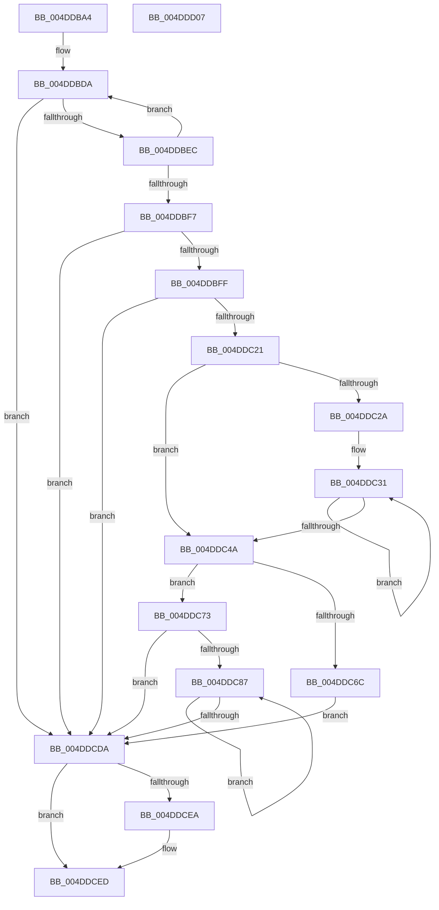

# SeRmReferenceFindCapName

- RVA: `0x004DDBA4`–`0x004DDD08` (길이 `356` bytes)
- VA: `0x00000001404DDBA4`
- 실행 섹션: `.text`
- PDB 이름 있음: `예`; PDB Function 태그: `아니요`
- unwind 정보 RVA: `0x000BB5F0`
- 디코드: `111`개 명령, `356/356` bytes 표시
- 미해석 바이트: `0` (있으면 어셈블리에 `.byte`로 보존)

> 이 문서는 커널 이미지의 기계어와 PDB 기호를 분석해 생성했습니다. 4번과 5번은 함수 원형과 자료형을 바이너리 사용 방식에서 추정한 C 해석이며 원본 소스 복구 결과는 아닙니다.

## 1. Dependencies

- 직접 호출 지점: **4**; 고유 호출 대상: **4**
- 직접 호출자로 확인된 함수: **1**
- RIP 상대 이미지 참조: **0**

### Outgoing calls
- `0x004DDBDD` → [SepValidateCAPID](../4F/SepValidateCAPID_function_004FA528.md) (function, `0x004FA528`)
- `0x004DDC0A` → [SepRmReferenceFindCap](../3A/SepRmReferenceFindCap_function_003A58EC.md) (function, `0x003A58EC`)
- `0x004DDC5F` → [ExAllocatePool2](../../poolcode/B8/ExAllocatePool2_function_00B820F0.md) (function, `0x00B820F0`)
- `0x004DDCC0` → [memcpy](../6C/memcpy_function_006C6840.md) (function, `0x006C6840`)

### Direct callers
- [AdtpBuildContextFromSecurityDescriptor](../69/AdtpBuildContextFromSecurityDescriptor_function_0069D99C.md) at `0x0069DA17`

### Static image references
- 디코드된 RIP-relative 메모리 참조가 없습니다.

## 2. Other-region calls and transfers

- 다른 실행 섹션으로 향하는 call: **1**
  - `0x004DDC5F` → [ExAllocatePool2](../../poolcode/B8/ExAllocatePool2_function_00B820F0.md) (`.text` → `POOLCODE`)
- 별도 외부 분기/꼬리 이동을 확인하지 못했습니다.

## 3. Assembly (complete function range)

```asm
004DDBA4  48 8B C4                        mov rax, rsp
004DDBA7  4C 89 40 18                     mov qword ptr [rax + 0x18], r8
004DDBAB  48 89 50 10                     mov qword ptr [rax + 0x10], rdx
004DDBAF  48 89 48 08                     mov qword ptr [rax + 8], rcx
004DDBB3  53                              push rbx
004DDBB4  55                              push rbp
004DDBB5  56                              push rsi
004DDBB6  57                              push rdi
004DDBB7  41 54                           push r12
004DDBB9  41 55                           push r13
004DDBBB  41 56                           push r14
004DDBBD  41 57                           push r15
004DDBBF  48 83 EC 28                     sub rsp, 0x28
004DDBC3  33 FF                           xor edi, edi
004DDBC5  4C 8D 70 08                     lea r14, [rax + 8]
004DDBC9  8B F7                           mov esi, edi
004DDBCB  48 89 78 20                     mov qword ptr [rax + 0x20], rdi
004DDBCF  44 8B EF                        mov r13d, edi
004DDBD2  44 8B FF                        mov r15d, edi
004DDBD5  8B DF                           mov ebx, edi
004DDBD7  4C 8B E1                        mov r12, rcx
004DDBDA  49 8B 0E                        mov rcx, qword ptr [r14]
004DDBDD  E8 46 C9 01 00                  call 0x1404fa528
004DDBE2  8B E8                           mov ebp, eax
004DDBE4  85 C0                           test eax, eax
004DDBE6  0F 88 EE 00 00 00               js 0x1404ddcda
004DDBEC  FF C3                           inc ebx
004DDBEE  49 83 C6 08                     add r14, 8
004DDBF2  83 FB 01                        cmp ebx, 1
004DDBF5  72 E3                           jb 0x1404ddbda
004DDBF7  85 C0                           test eax, eax
004DDBF9  0F 88 DB 00 00 00               js 0x1404ddcda
004DDBFF  48 8D 94 24 88 00 00 00         lea rdx, [rsp + 0x88]
004DDC07  49 8B CC                        mov rcx, r12
004DDC0A  E8 DD 7C EC FF                  call 0x1403a58ec
004DDC0F  48 8B B4 24 88 00 00 00         mov rsi, qword ptr [rsp + 0x88]
004DDC17  8B E8                           mov ebp, eax
004DDC19  85 C0                           test eax, eax
004DDC1B  0F 88 B9 00 00 00               js 0x1404ddcda
004DDC21  8B 46 3C                        mov eax, dword ptr [rsi + 0x3c]
004DDC24  8B D0                           mov edx, eax
004DDC26  85 C0                           test eax, eax
004DDC28  74 20                           je 0x1404ddc4a
004DDC2A  4C 8D 46 40                     lea r8, [rsi + 0x40]
004DDC2E  44 8B C8                        mov r9d, eax
004DDC31  49 8B 00                        mov rax, qword ptr [r8]
004DDC34  4D 8D 40 08                     lea r8, [r8 + 8]
004DDC38  0F B7 08                        movzx ecx, word ptr [rax]
004DDC3B  83 F9 02                        cmp ecx, 2
004DDC3E  0F 46 CF                        cmovbe ecx, edi
004DDC41  44 03 E9                        add r13d, ecx
004DDC44  49 83 E9 01                     sub r9, 1
004DDC48  75 E7                           jne 0x1404ddc31
004DDC4A  48 C1 E2 04                     shl rdx, 4
004DDC4E  B9 00 01 00 00                  mov ecx, 0x100
004DDC53  41 8B C5                        mov eax, r13d
004DDC56  41 B8 53 65 53 70               mov r8d, 0x70536553
004DDC5C  48 03 D0                        add rdx, rax
004DDC5F  E8 8C 44 6A 00                  call 0x140b820f0
004DDC64  4C 8B F8                        mov r15, rax
004DDC67  48 85 C0                        test rax, rax
004DDC6A  75 07                           jne 0x1404ddc73
004DDC6C  BD 17 00 00 C0                  mov ebp, 0xc0000017
004DDC71  EB 67                           jmp 0x1404ddcda
004DDC73  8B 46 3C                        mov eax, dword ptr [rsi + 0x3c]
004DDC76  44 8B E7                        mov r12d, edi
004DDC79  44 8B F0                        mov r14d, eax
004DDC7C  49 C1 E6 04                     shl r14, 4
004DDC80  4D 03 F7                        add r14, r15
004DDC83  85 C0                           test eax, eax
004DDC85  74 53                           je 0x1404ddcda
004DDC87  41 8B D4                        mov edx, r12d
004DDC8A  41 8B DC                        mov ebx, r12d
004DDC8D  48 03 DB                        add rbx, rbx
004DDC90  4D 89 74 DF 08                  mov qword ptr [r15 + rbx*8 + 8], r14
004DDC95  48 8B 44 D6 40                  mov rax, qword ptr [rsi + rdx*8 + 0x40]
004DDC9A  0F B7 08                        movzx ecx, word ptr [rax]
004DDC9D  66 83 F9 02                     cmp cx, 2
004DDCA1  66 0F 46 CF                     cmovbe cx, di
004DDCA5  44 0F B7 C1                     movzx r8d, cx
004DDCA9  49 8B CE                        mov rcx, r14
004DDCAC  66 45 89 44 DF 02               mov word ptr [r15 + rbx*8 + 2], r8w
004DDCB2  66 45 89 04 DF                  mov word ptr [r15 + rbx*8], r8w
004DDCB7  48 8B 54 D6 40                  mov rdx, qword ptr [rsi + rdx*8 + 0x40]
004DDCBC  48 8B 52 08                     mov rdx, qword ptr [rdx + 8]
004DDCC0  E8 7B 8B 1E 00                  call 0x1406c6840
004DDCC5  41 0F B7 04 DF                  movzx eax, word ptr [r15 + rbx*8]
004DDCCA  41 FF C4                        inc r12d
004DDCCD  48 D1 E8                        shr rax, 1
004DDCD0  4D 8D 34 46                     lea r14, [r14 + rax*2]
004DDCD4  44 3B 66 3C                     cmp r12d, dword ptr [rsi + 0x3c]
004DDCD8  72 AD                           jb 0x1404ddc87
004DDCDA  48 8B 84 24 80 00 00 00         mov rax, qword ptr [rsp + 0x80]
004DDCE2  4C 89 38                        mov qword ptr [rax], r15
004DDCE5  48 85 F6                        test rsi, rsi
004DDCE8  74 03                           je 0x1404ddced
004DDCEA  8B 7E 3C                        mov edi, dword ptr [rsi + 0x3c]
004DDCED  48 8B 44 24 78                  mov rax, qword ptr [rsp + 0x78]
004DDCF2  89 38                           mov dword ptr [rax], edi
004DDCF4  8B C5                           mov eax, ebp
004DDCF6  48 83 C4 28                     add rsp, 0x28
004DDCFA  41 5F                           pop r15
004DDCFC  41 5E                           pop r14
004DDCFE  41 5D                           pop r13
004DDD00  41 5C                           pop r12
004DDD02  5F                              pop rdi
004DDD03  5E                              pop rsi
004DDD04  5D                              pop rbp
004DDD05  5B                              pop rbx
004DDD06  C3                              ret
004DDD07  CC                              int3
```

## 4. C-style interpretation (structured pseudocode)

```c
__int64 __fastcall SeRmReferenceFindCapName(__int64 a1, __int64 a2, __int64 a3)
{
    __int64 result;
    __int64 v_r12;
    __int64 v_r13;
    __int64 v_r14;
    __int64 v_rbx;
    __int64 v_rdi;
    __int64 v_rsp;
    unsigned __int64 v_stack_p10;
    unsigned __int64 v_stack_p18;
    unsigned __int64 v_stack_p20;

    *(unsigned __int64 *)(v_rsp + 24) = a3;
    *(unsigned __int64 *)(v_rsp + 16) = a2;
    *(unsigned __int64 *)(v_rsp + 8) = a1;
    v_rsp = (v_rsp) - (40);
    v_rdi = 0;
    *(unsigned __int64 *)(v_rsp + 32) = 0;
loc_004DDBDA:
    result = SepValidateCAPID(*(unsigned __int64 *)(v_rsp + 8), a2, a3, a4);
    if (sign_flag) goto loc_004DDCDA;
    v_rbx = (unsigned int)((0) + 1);
    v_r14 = (v_rsp + 8) + (8);
    if (((unsigned int)(v_rbx)) < 1) goto loc_004DDBDA;
    if (sign_flag) goto loc_004DDCDA;
    result = SepRmReferenceFindCap(a1, v_stack_p20, a3, a4);
    if (sign_flag) goto loc_004DDCDA;
    if ((unsigned int)((unsigned int)(*(unsigned int *)(v_stack_p20 + 60))) == 0) goto loc_004DDC4A;
loc_004DDC31:
    a1 = *(unsigned __int16 *)(*(unsigned __int64 *)(v_stack_p20 + 64));
    if (((unsigned int)(*(unsigned __int16 *)(*(unsigned __int64 *)(v_stack_p20 + 64)))) <= 2) { a1 = 0; }
    v_r13 = (unsigned int)((0) + ((unsigned int)(a1)));
    a4 = ((unsigned int)((unsigned int)((unsigned int)(*(unsigned int *)(v_stack_p20 + 60))))) - (1);
    if (condition_is_not_equal) goto loc_004DDC31;
loc_004DDC4A:
    a2 = ((unsigned int)((unsigned int)((unsigned int)(*(unsigned int *)(v_stack_p20 + 60))))) << (4);
    a2 = (a2) + ((unsigned int)((unsigned int)(v_r13)));
    result = ExAllocatePool2(256, a2, (unsigned int)(0x70536553ULL), a4);
    if (result != 0) goto loc_004DDC73;
    goto loc_004DDCDA;
loc_004DDC73:
    v_r14 = ((unsigned int)((unsigned int)((unsigned int)(*(unsigned int *)(v_stack_p20 + 60))))) << (4);
    v_r14 = (v_r14) + (result);
    if ((unsigned int)((unsigned int)(*(unsigned int *)(v_stack_p20 + 60))) == 0) goto loc_004DDCDA;
loc_004DDC87:
    v_rbx = (0) + (0);
    *(unsigned __int64 *)(result + v_rbx * 8 + 8) = v_r14;
    a1 = *(unsigned __int16 *)(*(unsigned __int64 *)(v_stack_p20 + 0 * 8 + 64));
    if (((unsigned __int16)(*(unsigned __int16 *)(*(unsigned __int64 *)(v_stack_p20 + 0 * 8 + 64)))) <= 2) { a1 = 0; }
    *(unsigned __int16 *)(result + v_rbx * 8 + 2) = (unsigned __int16)((unsigned __int16)(a1));
    *(unsigned __int16 *)(result + v_rbx * 8) = (unsigned __int16)((unsigned __int16)(a1));
    result = memcpy(v_r14, *(unsigned __int64 *)(*(unsigned __int64 *)(v_stack_p20 + 0 * 8 + 64) + 8), (unsigned __int16)(a1), a4);
    v_r12 = (unsigned int)((0) + 1);
    result = (*(unsigned __int16 *)(result + v_rbx * 8)) >> (1);
    if (((unsigned int)(v_r12)) < (*(unsigned int *)(v_stack_p20 + 60))) goto loc_004DDC87;
loc_004DDCDA:
    *(unsigned __int64 *)(v_stack_p18) = result;
    if (v_stack_p20 != 0) {
        v_rdi = *(unsigned int *)(v_stack_p20 + 60);
    }
    *(unsigned int *)(v_stack_p10) = (unsigned int)(v_rdi);
    v_rsp = (v_rsp) + (40);
    return (unsigned int)((unsigned int)((unsigned int)(0xC0000017ULL)));
}
```

## 5. (Beta) C Style

```c
int64_t SeRmReferenceFindCapName(int64_t Arg1, int64_t Arg2, int64_t Arg3)
{
    int64_t result;
    int64_t local_r12;
    int64_t local_r13;
    int64_t local_r14;
    int64_t local_rbx;
    int64_t local_rdi;
    int64_t local_rsp;
    uint64_t v_stack_p10;
    uint64_t v_stack_p18;
    uint64_t v_stack_p20;

    *(uint64_t *)(local_rsp + 0x18) = Arg3;
    *(uint64_t *)(local_rsp + 0x10) = Arg2;
    *(uint64_t *)(local_rsp + 0x8) = Arg1;
    local_rsp = (local_rsp) - (40);
    local_rdi = 0;
    *(uint64_t *)(local_rsp + 0x20) = 0;
loc_004DDBDA:
    result = SepValidateCAPID(*(uint64_t *)(local_rsp + 0x8), Arg2, Arg3, a4);
    if (sign_flag) goto loc_004DDCDA;
    local_rbx = (uint32_t)((0) + 1);
    local_r14 = (local_rsp + 8) + (8);
    if (((uint32_t)(local_rbx)) < 1) goto loc_004DDBDA;
    if (sign_flag) goto loc_004DDCDA;
    result = SepRmReferenceFindCap(Arg1, v_stack_p20, Arg3, a4);
    if (sign_flag) goto loc_004DDCDA;
    if ((uint32_t)((uint32_t)(*(uint32_t *)(v_stack_p20 + 0x3C))) == 0) goto loc_004DDC4A;
loc_004DDC31:
    Arg1 = *(uint16_t *)(*(uint64_t *)(v_stack_p20 + 0x40));
    if (((uint32_t)(*(uint16_t *)(*(uint64_t *)(v_stack_p20 + 0x40)))) <= 2) { Arg1 = 0; }
    local_r13 = (uint32_t)((0) + ((uint32_t)(Arg1)));
    a4 = ((uint32_t)((uint32_t)((uint32_t)(*(uint32_t *)(v_stack_p20 + 0x3C))))) - (1);
    if (condition_is_not_equal) goto loc_004DDC31;
loc_004DDC4A:
    Arg2 = ((uint32_t)((uint32_t)((uint32_t)(*(uint32_t *)(v_stack_p20 + 0x3C))))) << (4);
    Arg2 = (Arg2) + ((uint32_t)((uint32_t)(local_r13)));
    result = ExAllocatePool2(256, Arg2, (uint32_t)(0x70536553ULL), a4);
    if (result != 0) goto loc_004DDC73;
    goto loc_004DDCDA;
loc_004DDC73:
    local_r14 = ((uint32_t)((uint32_t)((uint32_t)(*(uint32_t *)(v_stack_p20 + 0x3C))))) << (4);
    local_r14 = (local_r14) + (result);
    if ((uint32_t)((uint32_t)(*(uint32_t *)(v_stack_p20 + 0x3C))) == 0) goto loc_004DDCDA;
loc_004DDC87:
    local_rbx = (0) + (0);
    *(uint64_t *)(result + local_rbx * 8 + 0x8) = local_r14;
    Arg1 = *(uint16_t *)(*(uint64_t *)(v_stack_p20 + 0x0 * 8 + 0x40));
    if (((uint16_t)(*(uint16_t *)(*(uint64_t *)(v_stack_p20 + 0x0 * 8 + 0x40)))) <= 2) { Arg1 = 0; }
    *(uint16_t *)(result + local_rbx * 8 + 0x2) = (uint16_t)((uint16_t)(Arg1));
    *(uint16_t *)(result + local_rbx * 8) = (uint16_t)((uint16_t)(Arg1));
    result = memcpy(local_r14, *(uint64_t *)(*(uint64_t *)(v_stack_p20 + 0x0 * 8 + 0x40) + 0x8), (uint16_t)(Arg1), a4);
    local_r12 = (uint32_t)((0) + 1);
    result = (*(uint16_t *)(result + local_rbx * 8)) >> (1);
    if (((uint32_t)(local_r12)) < (*(uint32_t *)(v_stack_p20 + 0x3C))) goto loc_004DDC87;
loc_004DDCDA:
    *(uint64_t *)(v_stack_p18) = result;
    if (v_stack_p20 != 0) {
        local_rdi = *(uint32_t *)(v_stack_p20 + 0x3C);
    }
    *(uint32_t *)(v_stack_p10) = (uint32_t)(local_rdi);
    local_rsp = (local_rsp) + (40);
    return (uint32_t)((uint32_t)((uint32_t)(0xC0000017ULL)));
}
```

## 6. Execution-region graph

[열기: 2D/3D 그래프와 함수 탐색 컨트롤 패널](../../../control-panel.html?section=text&rva=0x004DDBA4&view=graph)

- 2D 그래프는 위에서 아래로 흐르고, 3D 그래프는 빈 공간을 드래그해 회전합니다. Shift+드래그는 이동, 휠은 확대·축소, 함수 노드 선택은 대상 보고서 이동입니다.

### Static fallback


