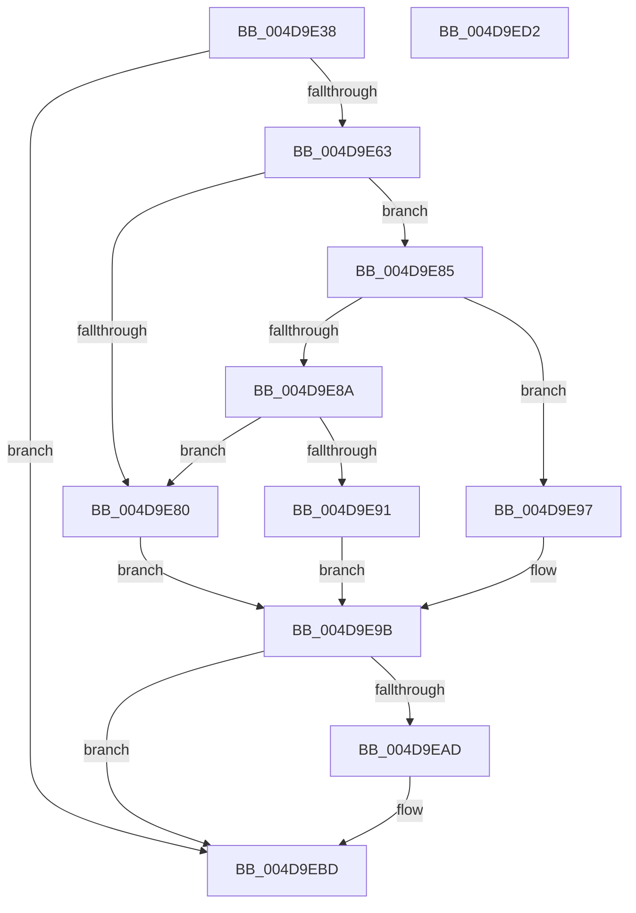

# SepBuildCapeSecurityDescriptor

- RVA: `0x004D9E38`–`0x004D9ED3` (길이 `155` bytes)
- VA: `0x00000001404D9E38`
- 실행 섹션: `.text`
- PDB 이름 있음: `예`; PDB Function 태그: `아니요`
- unwind 정보 RVA: `0x0005C954`
- 디코드: `49`개 명령, `155/155` bytes 표시
- 미해석 바이트: `0` (있으면 어셈블리에 `.byte`로 보존)

> 이 문서는 커널 이미지의 기계어와 PDB 기호를 분석해 생성했습니다. 4번과 5번은 함수 원형과 자료형을 바이너리 사용 방식에서 추정한 C 해석이며 원본 소스 복구 결과는 아닙니다.

## 1. Dependencies

- 직접 호출 지점: **3**; 고유 호출 대상: **3**
- 직접 호출자로 확인된 함수: **4**
- RIP 상대 이미지 참조: **0**

### Outgoing calls
- `0x004D9E58` → [RtlCreateSecurityDescriptor](../../page/9F/RtlCreateSecurityDescriptor_function_009F1DF0.md) (function, `0x009F1DF0`)
- `0x004D9EA4` → [RtlSetDaclSecurityDescriptor](../../page/9E/RtlSetDaclSecurityDescriptor_function_009EC210.md) (function, `0x009EC210`)
- `0x004D9EB8` → [RtlSetSaclSecurityDescriptor](../../page/A1/RtlSetSaclSecurityDescriptor_function_00A18B80.md) (function, `0x00A18B80`)

### Direct callers
- [SeAccessCheckWithHint](../3A/SeAccessCheckWithHint_function_003A6C30.md) at `0x003A73D1`
- [SeAccessCheckByType](../44/SeAccessCheckByType_function_00440BC8.md) at `0x00441FA4`
- [SepCommonAccessCheckEx](../47/SepCommonAccessCheckEx_function_0047602C.md) at `0x00476BD6`
- [SepCommonAccessCheckEx](../47/SepCommonAccessCheckEx_function_0047602C.md) at `0x00476D6D`
- [SepAccessCheckAndAuditAlarm](../../page/A1/SepAccessCheckAndAuditAlarm_function_00A1AF4C.md) at `0x00A1C270`
- [SepAccessCheckAndAuditAlarm](../../page/A1/SepAccessCheckAndAuditAlarm_function_00A1AF4C.md) at `0x00A1CB23`

### Static image references
- 디코드된 RIP-relative 메모리 참조가 없습니다.

## 2. Other-region calls and transfers

- 다른 실행 섹션으로 향하는 call: **3**
  - `0x004D9E58` → [RtlCreateSecurityDescriptor](../../page/9F/RtlCreateSecurityDescriptor_function_009F1DF0.md) (`.text` → `PAGE`)
  - `0x004D9EA4` → [RtlSetDaclSecurityDescriptor](../../page/9E/RtlSetDaclSecurityDescriptor_function_009EC210.md) (`.text` → `PAGE`)
  - `0x004D9EB8` → [RtlSetSaclSecurityDescriptor](../../page/A1/RtlSetSaclSecurityDescriptor_function_00A18B80.md) (`.text` → `PAGE`)
- 별도 외부 분기/꼬리 이동을 확인하지 못했습니다.

## 3. Assembly (complete function range)

```asm
004D9E38  48 89 5C 24 08                  mov qword ptr [rsp + 8], rbx
004D9E3D  48 89 6C 24 10                  mov qword ptr [rsp + 0x10], rbp
004D9E42  48 89 74 24 18                  mov qword ptr [rsp + 0x18], rsi
004D9E47  57                              push rdi
004D9E48  48 83 EC 20                     sub rsp, 0x20
004D9E4C  48 8B DA                        mov rbx, rdx
004D9E4F  49 8B F0                        mov rsi, r8
004D9E52  0F B6 12                        movzx edx, byte ptr [rdx]
004D9E55  48 8B F9                        mov rdi, rcx
004D9E58  E8 93 7F 51 00                  call 0x1409f1df0
004D9E5D  33 ED                           xor ebp, ebp
004D9E5F  85 C0                           test eax, eax
004D9E61  78 5A                           js 0x1404d9ebd
004D9E63  66 83 4F 02 03                  or word ptr [rdi + 2], 3
004D9E68  0F B7 43 02                     movzx eax, word ptr [rbx + 2]
004D9E6C  44 8A C8                        mov r9b, al
004D9E6F  0F B7 C8                        movzx ecx, ax
004D9E72  41 C0 E9 03                     shr r9b, 3
004D9E76  41 80 E1 01                     and r9b, 1
004D9E7A  66 83 E1 04                     and cx, 4
004D9E7E  75 05                           jne 0x1404d9e85
004D9E80  4C 8B C5                        mov r8, rbp
004D9E83  EB 16                           jmp 0x1404d9e9b
004D9E85  66 85 C0                        test ax, ax
004D9E88  79 0D                           jns 0x1404d9e97
004D9E8A  8B 43 10                        mov eax, dword ptr [rbx + 0x10]
004D9E8D  85 C0                           test eax, eax
004D9E8F  74 EF                           je 0x1404d9e80
004D9E91  4C 8D 04 03                     lea r8, [rbx + rax]
004D9E95  EB 04                           jmp 0x1404d9e9b
004D9E97  4C 8B 43 20                     mov r8, qword ptr [rbx + 0x20]
004D9E9B  66 85 C9                        test cx, cx
004D9E9E  48 8B CF                        mov rcx, rdi
004D9EA1  0F 95 C2                        setne dl
004D9EA4  E8 67 23 51 00                  call 0x1409ec210
004D9EA9  85 C0                           test eax, eax
004D9EAB  78 10                           js 0x1404d9ebd
004D9EAD  45 33 C9                        xor r9d, r9d
004D9EB0  4C 8B C6                        mov r8, rsi
004D9EB3  B2 01                           mov dl, 1
004D9EB5  48 8B CF                        mov rcx, rdi
004D9EB8  E8 C3 EC 53 00                  call 0x140a18b80
004D9EBD  48 8B 5C 24 30                  mov rbx, qword ptr [rsp + 0x30]
004D9EC2  48 8B 6C 24 38                  mov rbp, qword ptr [rsp + 0x38]
004D9EC7  48 8B 74 24 40                  mov rsi, qword ptr [rsp + 0x40]
004D9ECC  48 83 C4 20                     add rsp, 0x20
004D9ED0  5F                              pop rdi
004D9ED1  C3                              ret
004D9ED2  CC                              int3
```

## 4. C-style interpretation (structured pseudocode)

```c
__int64 __fastcall SepBuildCapeSecurityDescriptor(__int64 a1, __int64 a2, __int64 a3)
{
    __int64 result;
    __int64 v_rbp;
    __int64 v_rsp;
    unsigned __int64 v_stack_p10;
    unsigned __int64 v_stack_p18;
    unsigned __int64 v_stack_p8;

    v_stack_p8 = v_rbx;
    v_stack_p10 = v_rbp;
    v_stack_p18 = v_rsi;
    v_rsp = (v_rsp) - (32);
    result = RtlCreateSecurityDescriptor(a1, *(unsigned __int8 *)(a2), a3, a4);
    v_rbp = 0;
    if (sign_flag) goto loc_004D9EBD;
    a4 = (unsigned __int8)(((unsigned __int8)(*(unsigned __int16 *)(a2 + 2))) >> (3));
    a4 = (unsigned __int8)((a4) & (1));
    a1 = (unsigned __int16)(((unsigned __int16)(*(unsigned __int16 *)(a2 + 2))) & (4));
    if (condition_is_not_equal) goto loc_004D9E85;
loc_004D9E80:
    goto loc_004D9E9B;
loc_004D9E85:
    if (!sign_flag) goto loc_004D9E97;
    if ((unsigned int)((unsigned int)(*(unsigned int *)(a2 + 16))) == 0) goto loc_004D9E80;
    goto loc_004D9E9B;
loc_004D9E97:
loc_004D9E9B:
    a2 = ((unsigned __int16)(a1) != 0) ? 1 : 0;
    result = RtlSetDaclSecurityDescriptor(a1, a2, *(unsigned __int64 *)(a2 + 32), a4);
    if (!(sign_flag)) {
        a4 = 0;
        a3 = a3;
        a2 = 1;
        a1 = a1;
        result = RtlSetSaclSecurityDescriptor(a1, a2, a3, a4);
    }
    v_rsp = (v_rsp) + (32);
    return result;
}
```

## 5. (Beta) C Style

```c
int64_t SepBuildCapeSecurityDescriptor(void *Arg1, void *Arg2, int64_t Arg3)
{
    uint8_t *arg1 = (uint8_t *)Arg1;
    uint8_t *arg2 = (uint8_t *)Arg2;

    int64_t result;
    int64_t local_rbp;
    int64_t local_rsp;
    uint64_t v_stack_p10;
    uint64_t v_stack_p18;
    uint64_t v_stack_p8;

    v_stack_p8 = local_rbx;
    v_stack_p10 = local_rbp;
    v_stack_p18 = local_rsi;
    local_rsp = (local_rsp) - (32);
    result = RtlCreateSecurityDescriptor(Arg1, *(uint8_t *)(arg2), Arg3, a4);
    local_rbp = 0;
    if (sign_flag) goto loc_004D9EBD;
    a4 = (uint8_t)(((uint8_t)(*(uint16_t *)(arg2 + 0x2))) >> (3));
    a4 = (uint8_t)((a4) & (1));
    Arg1 = (uint16_t)(((uint16_t)(*(uint16_t *)(arg2 + 0x2))) & (4));
    if (condition_is_not_equal) goto loc_004D9E85;
loc_004D9E80:
    goto loc_004D9E9B;
loc_004D9E85:
    if (!sign_flag) goto loc_004D9E97;
    if ((uint32_t)((uint32_t)(*(uint32_t *)(arg2 + 0x10))) == 0) goto loc_004D9E80;
    goto loc_004D9E9B;
loc_004D9E97:
loc_004D9E9B:
    Arg2 = ((uint16_t)(Arg1) != 0) ? 1 : 0;
    result = RtlSetDaclSecurityDescriptor(Arg1, Arg2, *(uint64_t *)(arg2 + 0x20), a4);
    if (!(sign_flag)) {
        a4 = 0;
        Arg3 = Arg3;
        Arg2 = 1;
        Arg1 = Arg1;
        result = RtlSetSaclSecurityDescriptor(Arg1, Arg2, Arg3, a4);
    }
    local_rsp = (local_rsp) + (32);
    return result;
}
```

### 관측된 메모리 오프셋

구조체 형식이 확인되지 않은 접근은 인자 기준의 오프셋으로만 기록했습니다.

| 기준 인자 | 오프셋 표현 | 폭 (bit) | 접근 |
|---|---:|---:|---|
| `Arg1` | `+ 0x2` | `16` | `R/W` |
| `Arg2` | `+ 0x0` | `8` | `R` |
| `Arg2` | `+ 0x0 + rax*1` | `64` | `R` |
| `Arg2` | `+ 0x2` | `16` | `R` |
| `Arg2` | `+ 0x10` | `32` | `R` |
| `Arg2` | `+ 0x20` | `64` | `R` |

## 6. Execution-region graph

[열기: 2D/3D 그래프와 함수 탐색 컨트롤 패널](../../../control-panel.html?section=text&rva=0x004D9E38&view=graph)

- 2D 그래프는 위에서 아래로 흐르고, 3D 그래프는 빈 공간을 드래그해 회전합니다. Shift+드래그는 이동, 휠은 확대·축소, 함수 노드 선택은 대상 보고서 이동입니다.

### Static fallback


