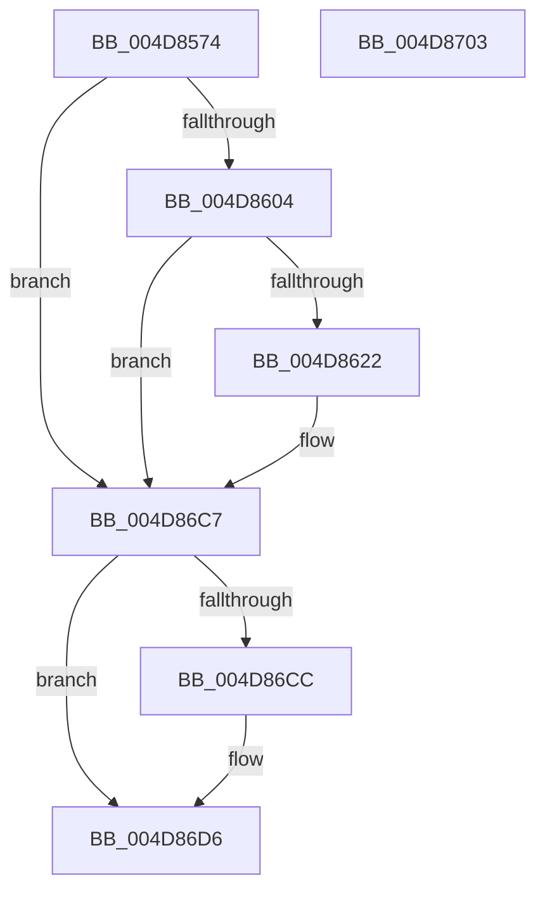

# SepLogUnmatchedSessionFlagImpersonationAttempt

- RVA: `0x004D8574`–`0x004D8704` (길이 `400` bytes)
- VA: `0x00000001404D8574`
- 실행 섹션: `.text`
- PDB 이름 있음: `예`; PDB Function 태그: `아니요`
- unwind 정보 RVA: `0x000BE7A4`
- 디코드: `91`개 명령, `400/400` bytes 표시
- 미해석 바이트: `0` (있으면 어셈블리에 `.byte`로 보존)

> 이 문서는 커널 이미지의 기계어와 PDB 기호를 분석해 생성했습니다. 4번과 5번은 함수 원형과 자료형을 바이너리 사용 방식에서 추정한 C 해석이며 원본 소스 복구 결과는 아닙니다.

## 1. Dependencies

- 직접 호출 지점: **5**; 고유 호출 대상: **5**
- 직접 호출자로 확인된 함수: **1**
- RIP 상대 이미지 참조: **4**

### Outgoing calls
- `0x004D85EE` → [EtwpQueryProcessCommandLine](../../page/8A/EtwpQueryProcessCommandLine_function_008A5C20.md) (function, `0x008A5C20`)
- `0x004D8615` → [tlgKeywordOn](../42/tlgKeywordOn_function_0042EAA0.md) (function, `0x0042EAA0`)
- `0x004D86C2` → [tlgWriteTransfer_EtwWriteTransfer](../42/tlgWriteTransfer_EtwWriteTransfer_function_004260E0.md) (function, `0x004260E0`)
- `0x004D86D1` → [ExFreePoolWithTag](../../poolcode/B8/ExFreePoolWithTag_function_00B82870.md) (function, `0x00B82870`)
- `0x004D86DD` → [_security_check_cookie](../6A/_security_check_cookie_function_006AC640.md) (function, `0x006AC640`)

### Direct callers
- [sub_008CC5C2](../../page/8C/Unknown_function_008CC5C2.md) at `0x008CC709`

### Static image references
- `0x004D8597` → RVA `0x00E0A740` (`.data`; read)
- `0x004D85A5` → RVA `0x006C8EC0` (` ?? ::FNODOBFM::`string'`; read)
- `0x004D85F3` → RVA `0x00E08908` (`.data`; read)
- `0x004D8629` → RVA `0x00053087` (`.rdata`; read)

## 2. Other-region calls and transfers

- 다른 실행 섹션으로 향하는 call: **2**
  - `0x004D85EE` → [EtwpQueryProcessCommandLine](../../page/8A/EtwpQueryProcessCommandLine_function_008A5C20.md) (`.text` → `PAGE`)
  - `0x004D86D1` → [ExFreePoolWithTag](../../poolcode/B8/ExFreePoolWithTag_function_00B82870.md) (`.text` → `POOLCODE`)
- 별도 외부 분기/꼬리 이동을 확인하지 못했습니다.

## 3. Assembly (complete function range)

```asm
004D8574  48 8B C4                        mov rax, rsp
004D8577  48 89 58 08                     mov qword ptr [rax + 8], rbx
004D857B  48 89 70 10                     mov qword ptr [rax + 0x10], rsi
004D857F  48 89 78 18                     mov qword ptr [rax + 0x18], rdi
004D8583  4C 89 60 20                     mov qword ptr [rax + 0x20], r12
004D8587  55                              push rbp
004D8588  41 56                           push r14
004D858A  41 57                           push r15
004D858C  48 8D 68 A1                     lea rbp, [rax - 0x5f]
004D8590  48 81 EC F0 00 00 00            sub rsp, 0xf0
004D8597  48 8B 05 A2 21 93 00            mov rax, qword ptr [rip + 0x9321a2]
004D859E  48 33 C4                        xor rax, rsp
004D85A1  48 89 45 37                     mov qword ptr [rbp + 0x37], rax
004D85A5  48 8D 05 14 09 1F 00            lea rax, [rip + 0x1f0914]
004D85AC  48 C7 45 8F 00 00 02 00         mov qword ptr [rbp - 0x71], 0x20000
004D85B4  48 89 45 97                     mov qword ptr [rbp - 0x69], rax
004D85B8  48 8D 7D 8F                     lea rdi, [rbp - 0x71]
004D85BC  65 48 8B 04 25 88 01 00 00      mov rax, qword ptr gs:[0x188]
004D85C5  4C 8B F1                        mov r14, rcx
004D85C8  48 8B F2                        mov rsi, rdx
004D85CB  0F 57 C0                        xorps xmm0, xmm0
004D85CE  45 33 FF                        xor r15d, r15d
004D85D1  48 8D 55 9F                     lea rdx, [rbp - 0x61]
004D85D5  0F 11 45 9F                     movups xmmword ptr [rbp - 0x61], xmm0
004D85D9  48 8B 88 B8 00 00 00            mov rcx, qword ptr [rax + 0xb8]
004D85E0  48 8B 81 50 03 00 00            mov rax, qword ptr [rcx + 0x350]
004D85E7  48 85 C0                        test rax, rax
004D85EA  48 0F 45 F8                     cmovne rdi, rax
004D85EE  E8 2D D6 3C 00                  call 0x1408a5c20
004D85F3  83 3D 0E 03 93 00 05            cmp dword ptr [rip + 0x93030e], 5
004D85FA  48 8B 5D A7                     mov rbx, qword ptr [rbp - 0x59]
004D85FE  0F 86 C3 00 00 00               jbe 0x1404d86c7
004D8604  48 BA 00 00 00 00 00 40 00 00   movabs rdx, 0x400000000000
004D860E  48 8D 0D F3 02 93 00            lea rcx, [rip + 0x9302f3]
004D8615  E8 86 64 F5 FF                  call 0x14042eaa0
004D861A  84 C0                           test al, al
004D861C  0F 84 A5 00 00 00               je 0x1404d86c7
004D8622  49 8B 86 D8 00 00 00            mov rax, qword ptr [r14 + 0xd8]
004D8629  48 8D 15 57 AA B7 FF            lea rdx, [rip - 0x4855a9]
004D8630  45 33 C9                        xor r9d, r9d
004D8633  45 33 C0                        xor r8d, r8d
004D8636  8B 48 28                        mov ecx, dword ptr [rax + 0x28]
004D8639  48 8D 45 87                     lea rax, [rbp - 0x79]
004D863D  48 89 45 D7                     mov qword ptr [rbp - 0x29], rax
004D8641  48 8B 86 D8 00 00 00            mov rax, qword ptr [rsi + 0xd8]
004D8648  89 4D 87                        mov dword ptr [rbp - 0x79], ecx
004D864B  48 C7 45 DF 04 00 00 00         mov qword ptr [rbp - 0x21], 4
004D8653  8B 48 28                        mov ecx, dword ptr [rax + 0x28]
004D8656  48 8D 45 8B                     lea rax, [rbp - 0x75]
004D865A  48 89 45 E7                     mov qword ptr [rbp - 0x19], rax
004D865E  48 8D 45 0F                     lea rax, [rbp + 0xf]
004D8662  48 89 45 F7                     mov qword ptr [rbp - 9], rax
004D8666  48 8B 47 08                     mov rax, qword ptr [rdi + 8]
004D866A  48 89 45 07                     mov qword ptr [rbp + 7], rax
004D866E  0F B7 07                        movzx eax, word ptr [rdi]
004D8671  89 45 0F                        mov dword ptr [rbp + 0xf], eax
004D8674  48 8D 45 2F                     lea rax, [rbp + 0x2f]
004D8678  48 89 45 17                     mov qword ptr [rbp + 0x17], rax
004D867C  0F B7 45 9F                     movzx eax, word ptr [rbp - 0x61]
004D8680  89 45 2F                        mov dword ptr [rbp + 0x2f], eax
004D8683  48 8D 45 B7                     lea rax, [rbp - 0x49]
004D8687  89 4D 8B                        mov dword ptr [rbp - 0x75], ecx
004D868A  48 8D 0D 77 02 93 00            lea rcx, [rip + 0x930277]
004D8691  48 89 44 24 28                  mov qword ptr [rsp + 0x28], rax
004D8696  C7 44 24 20 08 00 00 00         mov dword ptr [rsp + 0x20], 8
004D869E  48 C7 45 EF 04 00 00 00         mov qword ptr [rbp - 0x11], 4
004D86A6  48 C7 45 FF 02 00 00 00         mov qword ptr [rbp - 1], 2
004D86AE  44 89 7D 13                     mov dword ptr [rbp + 0x13], r15d
004D86B2  48 C7 45 1F 02 00 00 00         mov qword ptr [rbp + 0x1f], 2
004D86BA  48 89 5D 27                     mov qword ptr [rbp + 0x27], rbx
004D86BE  44 89 7D 33                     mov dword ptr [rbp + 0x33], r15d
004D86C2  E8 19 DA F4 FF                  call 0x1404260e0
004D86C7  48 85 DB                        test rbx, rbx
004D86CA  74 0A                           je 0x1404d86d6
004D86CC  33 D2                           xor edx, edx
004D86CE  48 8B CB                        mov rcx, rbx
004D86D1  E8 9A A1 6A 00                  call 0x140b82870
004D86D6  48 8B 4D 37                     mov rcx, qword ptr [rbp + 0x37]
004D86DA  48 33 CC                        xor rcx, rsp
004D86DD  E8 5E 3F 1D 00                  call 0x1406ac640
004D86E2  4C 8D 9C 24 F0 00 00 00         lea r11, [rsp + 0xf0]
004D86EA  49 8B 5B 20                     mov rbx, qword ptr [r11 + 0x20]
004D86EE  49 8B 73 28                     mov rsi, qword ptr [r11 + 0x28]
004D86F2  49 8B 7B 30                     mov rdi, qword ptr [r11 + 0x30]
004D86F6  4D 8B 63 38                     mov r12, qword ptr [r11 + 0x38]
004D86FA  49 8B E3                        mov rsp, r11
004D86FD  41 5F                           pop r15
004D86FF  41 5E                           pop r14
004D8701  5D                              pop rbp
004D8702  C3                              ret
004D8703  CC                              int3
```

## 4. C-style interpretation (structured pseudocode)

```c
__int64 __fastcall SepLogUnmatchedSessionFlagImpersonationAttempt(__int64 a1, __int64 a2, int a3, int a4)
{
    __int64 result;
    __int64 v_r15;
    __int64 v_rdi;
    __int64 v_rsp;
    unsigned __int64 v_stack_m18;
    unsigned __int64 v_stack_mE0;
    unsigned int v_stack_mE8;

    *(unsigned __int64 *)(v_rsp + 8) = v_rbx;
    *(unsigned __int64 *)(v_rsp + 16) = v_rsi;
    *(unsigned __int64 *)(v_rsp + 24) = v_rdi;
    *(unsigned __int64 *)(v_rsp + 32) = v_r12;
    v_rsp = (v_rsp) - (240);
    result = (*(unsigned __int64 *)(v_rip + 9642402)) ^ (v_rsp);
    *(unsigned __int64 *)(v_rsp - 95 + 55) = result;
    *(unsigned __int64 *)(v_rsp - 95 - 113) = 0x20000ULL;
    *(unsigned __int64 *)(v_rsp - 95 - 105) = v_rip + 2033940;
    v_r15 = 0;
    *(unsigned __int64 *)(v_rsp - 95 - 97) = v_xmm0;
    v_rdi = v_rsp - 95 - 113;
    if (*(unsigned __int64 *)(*(unsigned __int64 *)(*(unsigned __int64 *)(gs_base + (0 + 392)) + 184) + 848) != 0) { v_rdi = *(unsigned __int64 *)(*(unsigned __int64 *)(*(unsigned __int64 *)(gs_base + (0 + 392)) + 184) + 848); }
    result = EtwpQueryProcessCommandLine(*(unsigned __int64 *)(*(unsigned __int64 *)(gs_base + (0 + 392)) + 184), v_rsp - 95 - 97, a3, a4);
    if ((*(unsigned int *)(v_rip + 9634574)) <= 5) goto loc_004D86C7;
    result = tlgKeywordOn(v_rip + 9634547, v_rsp - 95 - 97, a3, a4);
    if ((unsigned __int8)(result) != 0) {
        result = *(unsigned __int64 *)(a1 + 216);
        a2 = v_rip - 4740521;
        a4 = 0;
        a3 = 0;
        a1 = *(unsigned int *)(result + 40);
        result = v_rsp - 95 - 121;
        *(unsigned __int64 *)(v_rsp - 95 - 41) = result;
        result = *(unsigned __int64 *)(a2 + 216);
        *(unsigned int *)(v_rsp - 95 - 121) = (unsigned int)(a1);
        *(unsigned __int64 *)(v_rsp - 95 - 33) = 4;
        a1 = *(unsigned int *)(result + 40);
        result = v_rsp - 95 - 117;
        *(unsigned __int64 *)(v_rsp - 95 - 25) = result;
        result = v_rsp - 95 + 15;
        *(unsigned __int64 *)(v_rsp - 95 - 9) = result;
        result = *(unsigned __int64 *)(v_rdi + 8);
        *(unsigned __int64 *)(v_rsp - 95 + 7) = result;
        result = *(unsigned __int16 *)(v_rdi);
        *(unsigned int *)(v_rsp - 95 + 15) = (unsigned int)(result);
        result = v_rsp - 95 + 47;
        *(unsigned __int64 *)(v_rsp - 95 + 23) = result;
        result = *(unsigned __int16 *)(v_rsp - 95 - 97);
        *(unsigned int *)(v_rsp - 95 + 47) = (unsigned int)(result);
        result = v_rsp - 95 - 73;
        *(unsigned int *)(v_rsp - 95 - 117) = (unsigned int)(a1);
        a1 = v_rip + 9634423;
        v_stack_mE0 = result;
        v_stack_mE8 = 8;
        *(unsigned __int64 *)(v_rsp - 95 - 17) = 4;
        *(unsigned __int64 *)(v_rsp - 95 - 1) = 2;
        *(unsigned int *)(v_rsp - 95 + 19) = 0;
        *(unsigned __int64 *)(v_rsp - 95 + 31) = 2;
        *(unsigned __int64 *)(v_rsp - 95 + 39) = *(unsigned __int64 *)(v_rsp - 95 - 89);
        *(unsigned int *)(v_rsp - 95 + 51) = 0;
        result = tlgWriteTransfer_EtwWriteTransfer(a1, a2, a3, a4);
    }
    if (*(unsigned __int64 *)(v_rsp - 95 - 89) != 0) {
        a2 = 0;
        a1 = *(unsigned __int64 *)(v_rsp - 95 - 89);
        result = ExFreePoolWithTag(a1, a2, a3, a4);
    }
    a1 = (*(unsigned __int64 *)(v_rsp - 95 + 55)) ^ (v_rsp);
    result = _security_check_cookie(a1, a2, a3, a4);
    return result;
}
```

## 5. (Beta) C Style

```c
int64_t SepLogUnmatchedSessionFlagImpersonationAttempt(void *Arg1, void *Arg2, int32_t Arg3, int32_t Arg4)
{
    uint8_t *arg1 = (uint8_t *)Arg1;
    uint8_t *arg2 = (uint8_t *)Arg2;

    int64_t result;
    int64_t local_r15;
    int64_t local_rdi;
    int64_t local_rsp;
    uint64_t v_stack_m18;
    uint64_t v_stack_mE0;
    uint32_t v_stack_mE8;

    *(uint64_t *)(local_rsp + 0x8) = local_rbx;
    *(uint64_t *)(local_rsp + 0x10) = local_rsi;
    *(uint64_t *)(local_rsp + 0x18) = local_rdi;
    *(uint64_t *)(local_rsp + 0x20) = local_r12;
    local_rsp = (local_rsp) - (240);
    result = (*(uint64_t *)(v_rip + 0x9321A2)) ^ (local_rsp);
    *(uint64_t *)(local_rsp - 0x5F + 0x37) = result;
    *(uint64_t *)(local_rsp - 0x5F - 0x71) = 0x20000ULL;
    *(uint64_t *)(local_rsp - 0x5F - 0x69) = v_rip + 2033940;
    local_r15 = 0;
    *(uint64_t *)(local_rsp - 0x5F - 0x61) = v_xmm0;
    local_rdi = local_rsp - 95 - 113;
    if (*(uint64_t *)(*(uint64_t *)(*(uint64_t *)(gs_base + (0 + 0x188)) + 0xB8) + 0x350) != 0) { local_rdi = *(uint64_t *)(*(uint64_t *)(*(uint64_t *)(gs_base + (0 + 0x188)) + 0xB8) + 0x350); }
    result = EtwpQueryProcessCommandLine(*(uint64_t *)(*(uint64_t *)(gs_base + (0 + 0x188)) + 0xB8), local_rsp - 95 - 97, Arg3, Arg4);
    if ((*(uint32_t *)(v_rip + 0x93030E)) <= 5) goto loc_004D86C7;
    result = tlgKeywordOn(v_rip + 9634547, local_rsp - 95 - 97, Arg3, Arg4);
    if ((uint8_t)(result) != 0) {
        result = *(uint64_t *)(arg1 + 0xD8);
        Arg2 = v_rip - 4740521;
        Arg4 = 0;
        Arg3 = 0;
        Arg1 = *(uint32_t *)(result + 0x28);
        result = local_rsp - 95 - 121;
        *(uint64_t *)(local_rsp - 0x5F - 0x29) = result;
        result = *(uint64_t *)(arg2 + 0xD8);
        *(uint32_t *)(local_rsp - 0x5F - 0x79) = (uint32_t)(Arg1);
        *(uint64_t *)(local_rsp - 0x5F - 0x21) = 4;
        Arg1 = *(uint32_t *)(result + 0x28);
        result = local_rsp - 95 - 117;
        *(uint64_t *)(local_rsp - 0x5F - 0x19) = result;
        result = local_rsp - 95 + 15;
        *(uint64_t *)(local_rsp - 0x5F - 0x9) = result;
        result = *(uint64_t *)(local_rdi + 0x8);
        *(uint64_t *)(local_rsp - 0x5F + 0x7) = result;
        result = *(uint16_t *)(local_rdi);
        *(uint32_t *)(local_rsp - 0x5F + 0xF) = (uint32_t)(result);
        result = local_rsp - 95 + 47;
        *(uint64_t *)(local_rsp - 0x5F + 0x17) = result;
        result = *(uint16_t *)(local_rsp - 0x5F - 0x61);
        *(uint32_t *)(local_rsp - 0x5F + 0x2F) = (uint32_t)(result);
        result = local_rsp - 95 - 73;
        *(uint32_t *)(local_rsp - 0x5F - 0x75) = (uint32_t)(Arg1);
        Arg1 = v_rip + 9634423;
        v_stack_mE0 = result;
        v_stack_mE8 = 8;
        *(uint64_t *)(local_rsp - 0x5F - 0x11) = 4;
        *(uint64_t *)(local_rsp - 0x5F - 0x1) = 2;
        *(uint32_t *)(local_rsp - 0x5F + 0x13) = 0;
        *(uint64_t *)(local_rsp - 0x5F + 0x1F) = 2;
        *(uint64_t *)(local_rsp - 0x5F + 0x27) = *(uint64_t *)(local_rsp - 0x5F - 0x59);
        *(uint32_t *)(local_rsp - 0x5F + 0x33) = 0;
        result = tlgWriteTransfer_EtwWriteTransfer(Arg1, Arg2, Arg3, Arg4);
    }
    if (*(uint64_t *)(local_rsp - 0x5F - 0x59) != 0) {
        Arg2 = 0;
        Arg1 = *(uint64_t *)(local_rsp - 0x5F - 0x59);
        result = ExFreePoolWithTag(Arg1, Arg2, Arg3, Arg4);
    }
    Arg1 = (*(uint64_t *)(local_rsp - 0x5F + 0x37)) ^ (local_rsp);
    result = _security_check_cookie(Arg1, Arg2, Arg3, Arg4);
    return result;
}
```

### 관측된 메모리 오프셋

구조체 형식이 확인되지 않은 접근은 인자 기준의 오프셋으로만 기록했습니다.

| 기준 인자 | 오프셋 표현 | 폭 (bit) | 접근 |
|---|---:|---:|---|
| `Arg1` | `+ 0xD8` | `64` | `R` |
| `Arg2` | `+ 0xD8` | `64` | `R` |

## 6. Execution-region graph

[열기: 2D/3D 그래프와 함수 탐색 컨트롤 패널](../../../control-panel.html?section=text&rva=0x004D8574&view=graph)

- 2D 그래프는 위에서 아래로 흐르고, 3D 그래프는 빈 공간을 드래그해 회전합니다. Shift+드래그는 이동, 휠은 확대·축소, 함수 노드 선택은 대상 보고서 이동입니다.

### Static fallback


