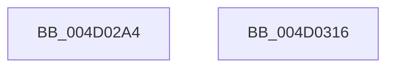

# SmCrAuthEncrypt

- RVA: `0x004D02A4`–`0x004D0317` (길이 `115` bytes)
- VA: `0x00000001404D02A4`
- 실행 섹션: `.text`
- PDB 이름 있음: `예`; PDB Function 태그: `아니요`
- unwind 정보 RVA: `0x0005CC98`
- 디코드: `25`개 명령, `115/115` bytes 표시
- 미해석 바이트: `0` (있으면 어셈블리에 `.byte`로 보존)

> 이 문서는 커널 이미지의 기계어와 PDB 기호를 분석해 생성했습니다. 4번과 5번은 함수 원형과 자료형을 바이너리 사용 방식에서 추정한 C 해석이며 원본 소스 복구 결과는 아닙니다.

## 1. Dependencies

- 직접 호출 지점: **1**; 고유 호출 대상: **1**
- 직접 호출자로 확인된 함수: **1**
- RIP 상대 이미지 참조: **0**

### Outgoing calls
- `0x004D030C` → [BCryptEncrypt](../4F/BCryptEncrypt_function_004F9D54.md) (function, `0x004F9D54`)

### Direct callers
- [ST_STORE&lt;SM_TRAITS&gt;::StDmpSinglePageAdd](../20/ST_STORE_SM_TRAITS_StDmpSinglePageAdd_function_0020502C.md) at `0x00205383`

### Static image references
- 디코드된 RIP-relative 메모리 참조가 없습니다.

## 2. Other-region calls and transfers

- 다른 실행 섹션으로 향하는 call: **0**
- 별도 외부 분기/꼬리 이동을 확인하지 못했습니다.

## 3. Assembly (complete function range)

```asm
004D02A4  48 8B C4                        mov rax, rsp
004D02A7  48 83 EC 58                     sub rsp, 0x58
004D02AB  45 33 DB                        xor r11d, r11d
004D02AE  C7 41 48 0C 00 00 00            mov dword ptr [rcx + 0x48], 0xc
004D02B5  44 89 5C 24 48                  mov dword ptr [rsp + 0x48], r11d
004D02BA  45 8B D1                        mov r10d, r9d
004D02BD  44 89 58 30                     mov dword ptr [rax + 0x30], r11d
004D02C1  4C 8D 49 38                     lea r9, [rcx + 0x38]
004D02C5  48 8B 84 24 80 00 00 00         mov rax, qword ptr [rsp + 0x80]
004D02CD  48 89 41 40                     mov qword ptr [rcx + 0x40], rax
004D02D1  48 8B 84 24 90 00 00 00         mov rax, qword ptr [rsp + 0x90]
004D02D9  48 89 41 60                     mov qword ptr [rcx + 0x60], rax
004D02DD  48 8D 84 24 88 00 00 00         lea rax, [rsp + 0x88]
004D02E5  48 89 44 24 40                  mov qword ptr [rsp + 0x40], rax
004D02EA  44 89 54 24 38                  mov dword ptr [rsp + 0x38], r10d
004D02EF  4C 89 44 24 30                  mov qword ptr [rsp + 0x30], r8
004D02F4  45 8B C2                        mov r8d, r10d
004D02F7  C7 41 68 10 00 00 00            mov dword ptr [rcx + 0x68], 0x10
004D02FE  48 8B 49 20                     mov rcx, qword ptr [rcx + 0x20]
004D0302  44 89 5C 24 28                  mov dword ptr [rsp + 0x28], r11d
004D0307  4C 89 5C 24 20                  mov qword ptr [rsp + 0x20], r11
004D030C  E8 43 9A 02 00                  call 0x1404f9d54
004D0311  48 83 C4 58                     add rsp, 0x58
004D0315  C3                              ret
004D0316  CC                              int3
```

## 4. C-style interpretation (structured pseudocode)

```c
__int64 __fastcall SmCrAuthEncrypt(__int64 a1, __int64 a2, __int64 a3, int a4, __int64 a5, __int64 a6, __int64 a7)
{
    __int64 result;
    __int64 v_r11;
    __int64 v_rsp;
    unsigned int v_stack_m10;
    unsigned __int64 v_stack_m18;
    unsigned int v_stack_m20;
    unsigned __int64 v_stack_m28;
    unsigned int v_stack_m30;
    unsigned __int64 v_stack_m38;

    v_rsp = (v_rsp) - (88);
    v_r11 = 0;
    *(unsigned int *)(a1 + 72) = 12;
    v_stack_m10 = 0;
    *(unsigned int *)(v_rsp + 48) = 0;
    *(unsigned __int64 *)(a1 + 64) = a5;
    *(unsigned __int64 *)(a1 + 96) = a7;
    v_stack_m18 = a6;
    v_stack_m20 = (unsigned int)((unsigned int)(a4));
    v_stack_m28 = a3;
    *(unsigned int *)(a1 + 104) = 16;
    v_stack_m30 = 0;
    v_stack_m38 = 0;
    result = BCryptEncrypt(*(unsigned __int64 *)(a1 + 32), a2, (unsigned int)((unsigned int)((unsigned int)(a4))), a1 + 56);
    v_rsp = (v_rsp) + (88);
    return result;
}
```

## 5. (Beta) C Style

```c
int64_t SmCrAuthEncrypt(void *Arg1, int64_t Arg2, int64_t Arg3, int32_t Arg4, int64_t Arg5, int64_t Arg6, int64_t Arg7)
{
    uint8_t *arg1 = (uint8_t *)Arg1;

    int64_t result;
    int64_t local_r11;
    int64_t local_rsp;
    uint32_t v_stack_m10;
    uint64_t v_stack_m18;
    uint32_t v_stack_m20;
    uint64_t v_stack_m28;
    uint32_t v_stack_m30;
    uint64_t v_stack_m38;

    local_rsp = (local_rsp) - (88);
    local_r11 = 0;
    *(uint32_t *)(arg1 + 0x48) = 12;
    v_stack_m10 = 0;
    *(uint32_t *)(local_rsp + 0x30) = 0;
    *(uint64_t *)(arg1 + 0x40) = Arg5;
    *(uint64_t *)(arg1 + 0x60) = Arg7;
    v_stack_m18 = Arg6;
    v_stack_m20 = (uint32_t)((uint32_t)(Arg4));
    v_stack_m28 = Arg3;
    *(uint32_t *)(arg1 + 0x68) = 16;
    v_stack_m30 = 0;
    v_stack_m38 = 0;
    result = BCryptEncrypt(*(uint64_t *)(arg1 + 0x20), Arg2, (uint32_t)((uint32_t)((uint32_t)(Arg4))), Arg1 + 56);
    local_rsp = (local_rsp) + (88);
    return result;
}
```

### 관측된 메모리 오프셋

구조체 형식이 확인되지 않은 접근은 인자 기준의 오프셋으로만 기록했습니다.

| 기준 인자 | 오프셋 표현 | 폭 (bit) | 접근 |
|---|---:|---:|---|
| `Arg1` | `+ 0x20` | `64` | `R` |
| `Arg1` | `+ 0x38` | `64` | `R` |
| `Arg1` | `+ 0x40` | `64` | `W` |
| `Arg1` | `+ 0x48` | `32` | `W` |
| `Arg1` | `+ 0x60` | `64` | `W` |
| `Arg1` | `+ 0x68` | `32` | `W` |

## 6. Execution-region graph

[열기: 2D/3D 그래프와 함수 탐색 컨트롤 패널](../../../control-panel.html?section=text&rva=0x004D02A4&view=graph)

- 2D 그래프는 위에서 아래로 흐르고, 3D 그래프는 빈 공간을 드래그해 회전합니다. Shift+드래그는 이동, 휠은 확대·축소, 함수 노드 선택은 대상 보고서 이동입니다.

### Static fallback


