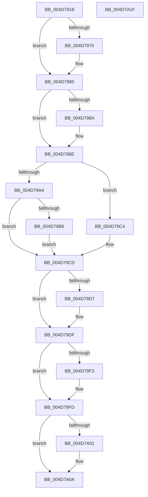

# SmHwAcceleratorPartitionMgrFreeDescriptor

- RVA: `0x004D7918`–`0x004D7A20` (길이 `264` bytes)
- VA: `0x00000001404D7918`
- 실행 섹션: `.text`
- PDB 이름 있음: `예`; PDB Function 태그: `아니요`
- unwind 정보 RVA: `0x000BE6C8`
- 디코드: `81`개 명령, `264/264` bytes 표시
- 미해석 바이트: `0` (있으면 어셈블리에 `.byte`로 보존)

> 이 문서는 커널 이미지의 기계어와 PDB 기호를 분석해 생성했습니다. 4번과 5번은 함수 원형과 자료형을 바이너리 사용 방식에서 추정한 C 해석이며 원본 소스 복구 결과는 아닙니다.

## 1. Dependencies

- 직접 호출 지점: **9**; 고유 호출 대상: **8**
- 직접 호출자로 확인된 함수: **4**
- RIP 상대 이미지 참조: **0**

### Outgoing calls
- `0x004D795F` → [KeAbPreAcquire](../21/KeAbPreAcquire_function_00210230.md) (function, `0x00210230`)
- `0x004D7980` → [ExfAcquirePushLockSharedEx](../21/ExfAcquirePushLockSharedEx_function_0021044C.md) (function, `0x0021044C`)
- `0x004D79AB` → [ExpInterlockedPushEntrySList](../6B/ExpInterlockedPushEntrySList_function_006BA5B0.md) (function, `0x006BA5B0`)
- `0x004D79C8` → [ExReleaseRundownProtection](../34/ExReleaseRundownProtection_function_00349E80.md) (function, `0x00349E80`)
- `0x004D79DA` → [ExfReleasePushLockShared](../26/ExfReleasePushLockShared_function_00263440.md) (function, `0x00263440`)
- `0x004D79E2` → [KeAbPostRelease](../2E/KeAbPostRelease_function_002E1600.md) (function, `0x002E1600`)
- `0x004D79E7` → [KeLeaveCriticalRegion](../25/KeLeaveCriticalRegion_function_0025D8B0.md) (function, `0x0025D8B0`)
- `0x004D79F8` → [SmHwAcceleratorPartitionMgrWakeDescriptorWaiters](../61/SmHwAcceleratorPartitionMgrWakeDescriptorWaiters_function_00611A48.md) (function, `0x00611A48`)
- `0x004D7A05` → [KeAbPostRelease](../2E/KeAbPostRelease_function_002E1600.md) (function, `0x002E1600`)

### Direct callers
- [SmStoreCompletePendingDecompress](SmStoreCompletePendingDecompress_function_004D7824.md) at `0x004D78F2`
- [sub_006D8FE6](../6D/Unknown_function_006D8FE6.md) at `0x006D8FED`
- [sub_006E6668](../6E/Unknown_function_006E6668.md) at `0x006E6AF5`
- [sub_006F54E6](../6F/Unknown_function_006F54E6.md) at `0x006F5511`

### Static image references
- 디코드된 RIP-relative 메모리 참조가 없습니다.

## 2. Other-region calls and transfers

- 다른 실행 섹션으로 향하는 call: **0**
- 별도 외부 분기/꼬리 이동을 확인하지 못했습니다.

## 3. Assembly (complete function range)

```asm
004D7918  48 89 5C 24 18                  mov qword ptr [rsp + 0x18], rbx
004D791D  55                              push rbp
004D791E  56                              push rsi
004D791F  57                              push rdi
004D7920  41 54                           push r12
004D7922  41 55                           push r13
004D7924  41 56                           push r14
004D7926  41 57                           push r15
004D7928  48 83 EC 20                     sub rsp, 0x20
004D792C  48 8B 6A 08                     mov rbp, qword ptr [rdx + 8]
004D7930  48 8D 59 18                     lea rbx, [rcx + 0x18]
004D7934  65 48 8B 04 25 88 01 00 00      mov rax, qword ptr gs:[0x188]
004D793D  4C 8B F2                        mov r14, rdx
004D7940  48 8B F1                        mov rsi, rcx
004D7943  45 33 E4                        xor r12d, r12d
004D7946  45 33 C0                        xor r8d, r8d
004D7949  4C 89 64 24 60                  mov qword ptr [rsp + 0x60], r12
004D794E  4C 63 7D 3C                     movsxd r15, dword ptr [rbp + 0x3c]
004D7952  33 D2                           xor edx, edx
004D7954  66 FF 88 E4 01 00 00            dec word ptr [rax + 0x1e4]
004D795B  48 8B CB                        mov rcx, rbx
004D795E  90                              nop
004D795F  E8 CC 88 D3 FF                  call 0x140210230
004D7964  48 8B F8                        mov rdi, rax
004D7967  45 8D 6C 24 11                  lea r13d, [r12 + 0x11]
004D796C  33 C0                           xor eax, eax
004D796E  F0 4C 0F B1 2B                  lock cmpxchg qword ptr [rbx], r13
004D7973  74 10                           je 0x1404d7985
004D7975  4C 8B CB                        mov r9, rbx
004D7978  4C 8B C7                        mov r8, rdi
004D797B  33 D2                           xor edx, edx
004D797D  48 8B CB                        mov rcx, rbx
004D7980  E8 C7 8A D3 FF                  call 0x14021044c
004D7985  48 85 FF                        test rdi, rdi
004D7988  74 04                           je 0x1404d798e
004D798A  C6 47 0A 01                     mov byte ptr [rdi + 0xa], 1
004D798E  49 8B 46 08                     mov rax, qword ptr [r14 + 8]
004D7992  4A 8D 3C FE                     lea rdi, [rsi + r15*8]
004D7996  41 8B 36                        mov esi, dword ptr [r14]
004D7999  83 E6 01                        and esi, 1
004D799C  8B 48 40                        mov ecx, dword ptr [rax + 0x40]
004D799F  F6 C1 01                        test cl, 1
004D79A2  75 20                           jne 0x1404d79c4
004D79A4  48 8D 4D 10                     lea rcx, [rbp + 0x10]
004D79A8  49 8B D6                        mov rdx, r14
004D79AB  E8 00 2C 1E 00                  call 0x1406ba5b0
004D79B0  4C 39 67 38                     cmp qword ptr [rdi + 0x38], r12
004D79B4  74 17                           je 0x1404d79cd
004D79B6  49 8B C4                        mov rax, r12
004D79B9  48 87 47 38                     xchg qword ptr [rdi + 0x38], rax
004D79BD  48 89 44 24 60                  mov qword ptr [rsp + 0x60], rax
004D79C2  EB 09                           jmp 0x1404d79cd
004D79C4  48 8D 4D 30                     lea rcx, [rbp + 0x30]
004D79C8  E8 B3 24 E7 FF                  call 0x140349e80
004D79CD  49 8B C5                        mov rax, r13
004D79D0  F0 4C 0F B1 23                  lock cmpxchg qword ptr [rbx], r12
004D79D5  74 08                           je 0x1404d79df
004D79D7  48 8B CB                        mov rcx, rbx
004D79DA  E8 61 BA D8 FF                  call 0x140263440
004D79DF  48 8B CB                        mov rcx, rbx
004D79E2  E8 19 9C E0 FF                  call 0x1402e1600
004D79E7  E8 C4 5E D8 FF                  call 0x14025d8b0
004D79EC  4C 39 64 24 60                  cmp qword ptr [rsp + 0x60], r12
004D79F1  74 0A                           je 0x1404d79fd
004D79F3  48 8D 4C 24 60                  lea rcx, [rsp + 0x60]
004D79F8  E8 4B A0 13 00                  call 0x140611a48
004D79FD  85 F6                           test esi, esi
004D79FF  74 09                           je 0x1404d7a0a
004D7A01  48 8D 4F 38                     lea rcx, [rdi + 0x38]
004D7A05  E8 F6 9B E0 FF                  call 0x1402e1600
004D7A0A  48 8B 5C 24 70                  mov rbx, qword ptr [rsp + 0x70]
004D7A0F  48 83 C4 20                     add rsp, 0x20
004D7A13  41 5F                           pop r15
004D7A15  41 5E                           pop r14
004D7A17  41 5D                           pop r13
004D7A19  41 5C                           pop r12
004D7A1B  5F                              pop rdi
004D7A1C  5E                              pop rsi
004D7A1D  5D                              pop rbp
004D7A1E  C3                              ret
004D7A1F  CC                              int3
```

## 4. C-style interpretation (structured pseudocode)

```c
__int64 __fastcall SmHwAcceleratorPartitionMgrFreeDescriptor(__int64 a1, __int64 a2, int a3)
{
    __int64 result;
    __int64 v_r12;
    __int64 v_rsi;
    __int64 v_rsp;
    unsigned __int64 v_stack_p18;
    unsigned __int64 v_stack_p8;

    v_stack_p18 = v_rbx;
    v_rsp = (v_rsp) - (32);
    v_r12 = 0;
    a3 = 0;
    v_stack_p8 = 0;
    a2 = 0;
    result = KeAbPreAcquire(a1 + 24, a2, a3, a4);
    result = 0;
    if (!(condition_is_equal)) {
        a4 = a1 + 24;
        a3 = 0;
        a2 = 0;
        a1 = a1 + 24;
        result = ExfAcquirePushLockSharedEx(a1, a2, a3, a4);
    }
    if (result != 0) {
        *(unsigned __int8 *)(result + 10) = 1;
    }
    v_rsi = (unsigned int)(((unsigned int)(*(unsigned int *)(a2))) & (1));
    if ((((unsigned __int8)((unsigned int)(*(unsigned int *)(*(unsigned __int64 *)(a2 + 8) + 64)))) & (1)) != 0) goto loc_004D79C4;
    result = ExpInterlockedPushEntrySList(*(unsigned __int64 *)(a2 + 8) + 16, 0, a3, a4);
    if ((*(unsigned __int64 *)(a1 + (int)(*(unsigned int *)(*(unsigned __int64 *)(a2 + 8) + 60)) * 8 + 56)) == 0) goto loc_004D79CD;
    v_stack_p8 = 0;
    goto loc_004D79CD;
loc_004D79C4:
    result = ExReleaseRundownProtection(*(unsigned __int64 *)(a2 + 8) + 48, 0, a3, a4);
loc_004D79CD:
    result = v_r12 + 17;
    if ((*(unsigned __int64 *)(a1 + (int)(*(unsigned int *)(*(unsigned __int64 *)(a2 + 8) + 60)) * 8 + 56)) != 0) {
        a1 = a1 + 24;
        result = ExfReleasePushLockShared(a1, 0, a3, a4);
    }
    result = KeAbPostRelease(a1 + 24, 0, a3, a4);
    result = KeLeaveCriticalRegion(a1 + 24, 0, a3, a4);
    if (v_stack_p8 != 0) {
        a1 = v_stack_p8;
        result = SmHwAcceleratorPartitionMgrWakeDescriptorWaiters(a1, 0, a3, a4);
    }
    if ((unsigned int)(v_rsi) != 0) {
        a1 = a1 + (int)(*(unsigned int *)(*(unsigned __int64 *)(a2 + 8) + 60)) * 8 + 56;
        result = KeAbPostRelease(a1, 0, a3, a4);
    }
    v_rsp = (v_rsp) + (32);
    return result;
}
```

## 5. (Beta) C Style

```c
int64_t SmHwAcceleratorPartitionMgrFreeDescriptor(void *Arg1, void *Arg2, int32_t Arg3)
{
    uint8_t *arg1 = (uint8_t *)Arg1;
    uint8_t *arg2 = (uint8_t *)Arg2;

    int64_t result;
    int64_t local_r12;
    int64_t local_rsi;
    int64_t local_rsp;
    uint64_t v_stack_p18;
    uint64_t v_stack_p8;

    v_stack_p18 = local_rbx;
    local_rsp = (local_rsp) - (32);
    local_r12 = 0;
    Arg3 = 0;
    v_stack_p8 = 0;
    Arg2 = 0;
    result = KeAbPreAcquire(Arg1 + 24, Arg2, Arg3, a4);
    result = 0;
    if (!(condition_is_equal)) {
        a4 = Arg1 + 24;
        Arg3 = 0;
        Arg2 = 0;
        Arg1 = Arg1 + 24;
        result = ExfAcquirePushLockSharedEx(Arg1, Arg2, Arg3, a4);
    }
    if (result != 0) {
        *(uint8_t *)(result + 0xA) = 1;
    }
    local_rsi = (uint32_t)(((uint32_t)(*(uint32_t *)(arg2))) & (1));
    if ((((uint8_t)((uint32_t)(*(uint32_t *)(*(uint64_t *)(arg2 + 0x8) + 0x40)))) & (1)) != 0) goto loc_004D79C4;
    result = ExpInterlockedPushEntrySList(*(uint64_t *)(arg2 + 0x8) + 16, 0, Arg3, a4);
    if ((*(uint64_t *)(arg1 + (int32_t)(*(uint32_t *)(*(uint64_t *)(arg2 + 0x8) + 0x3C)) * 8 + 0x38)) == 0) goto loc_004D79CD;
    v_stack_p8 = 0;
    goto loc_004D79CD;
loc_004D79C4:
    result = ExReleaseRundownProtection(*(uint64_t *)(arg2 + 0x8) + 48, 0, Arg3, a4);
loc_004D79CD:
    result = local_r12 + 17;
    if ((*(uint64_t *)(arg1 + (int32_t)(*(uint32_t *)(*(uint64_t *)(arg2 + 0x8) + 0x3C)) * 8 + 0x38)) != 0) {
        Arg1 = Arg1 + 24;
        result = ExfReleasePushLockShared(Arg1, 0, Arg3, a4);
    }
    result = KeAbPostRelease(Arg1 + 24, 0, Arg3, a4);
    result = KeLeaveCriticalRegion(Arg1 + 24, 0, Arg3, a4);
    if (v_stack_p8 != 0) {
        Arg1 = v_stack_p8;
        result = SmHwAcceleratorPartitionMgrWakeDescriptorWaiters(Arg1, 0, Arg3, a4);
    }
    if ((uint32_t)(local_rsi) != 0) {
        Arg1 = Arg1 + (int32_t)(*(uint32_t *)(*(uint64_t *)(arg2 + 0x8) + 0x3C)) * 8 + 56;
        result = KeAbPostRelease(Arg1, 0, Arg3, a4);
    }
    local_rsp = (local_rsp) + (32);
    return result;
}
```

### 관측된 메모리 오프셋

구조체 형식이 확인되지 않은 접근은 인자 기준의 오프셋으로만 기록했습니다.

| 기준 인자 | 오프셋 표현 | 폭 (bit) | 접근 |
|---|---:|---:|---|
| `Arg1` | `+ 0x0` | `64` | `R` |
| `Arg1` | `+ 0x0 + r15*8` | `64` | `R` |
| `Arg1` | `+ 0x18` | `64` | `R` |
| `Arg1` | `+ 0x38` | `64` | `R` |
| `Arg1` | `+ 0x38` | `64` | `R/W` |
| `Arg2` | `+ 0x0` | `32` | `R` |
| `Arg2` | `+ 0x8` | `64` | `R` |

## 6. Execution-region graph

[열기: 2D/3D 그래프와 함수 탐색 컨트롤 패널](../../../control-panel.html?section=text&rva=0x004D7918&view=graph)

- 2D 그래프는 위에서 아래로 흐르고, 3D 그래프는 빈 공간을 드래그해 회전합니다. Shift+드래그는 이동, 휠은 확대·축소, 함수 노드 선택은 대상 보고서 이동입니다.

### Static fallback


