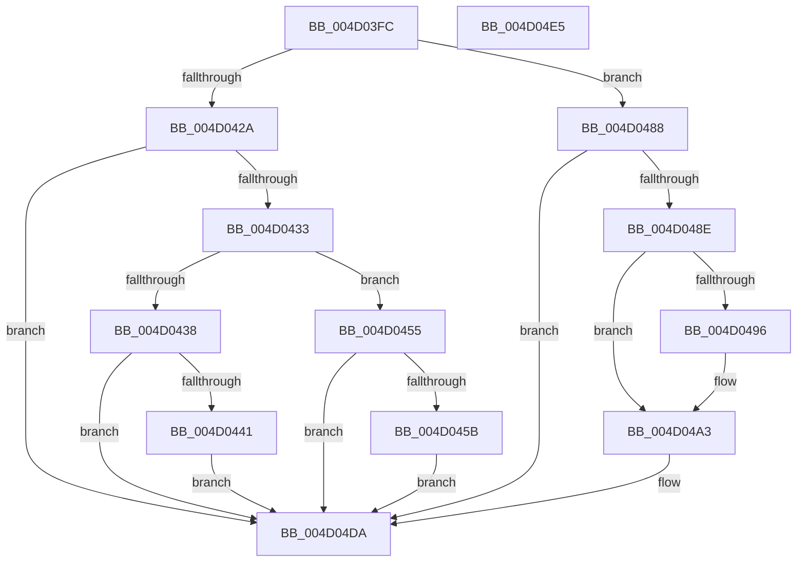

# SmKmStoreHelperCommandCleanup

- RVA: `0x004D03FC`–`0x004D04E6` (길이 `234` bytes)
- VA: `0x00000001404D03FC`
- 실행 섹션: `.text`
- PDB 이름 있음: `예`; PDB Function 태그: `아니요`
- unwind 정보 RVA: `0x0007D148`
- 디코드: `63`개 명령, `234/234` bytes 표시
- 미해석 바이트: `0` (있으면 어셈블리에 `.byte`로 보존)

> 이 문서는 커널 이미지의 기계어와 PDB 기호를 분석해 생성했습니다. 4번과 5번은 함수 원형과 자료형을 바이너리 사용 방식에서 추정한 C 해석이며 원본 소스 복구 결과는 아닙니다.

## 1. Dependencies

- 직접 호출 지점: **5**; 고유 호출 대상: **5**
- 직접 호출자로 확인된 함수: **1**
- RIP 상대 이미지 참조: **0**

### Outgoing calls
- `0x004D044B` → [guard_dispatch_icall](../6B/guard_dispatch_icall_function_006BAAD0.md) (function, `0x006BAAD0`)
- `0x004D0469` → [SmKmUnlockMdl](../37/SmKmUnlockMdl_function_00372A44.md) (function, `0x00372A44`)
- `0x004D0481` → [SmFpFree](../43/SmFpFree_function_00436350.md) (function, `0x00436350`)
- `0x004D049E` → [MmStoreDecommitVirtualMemory](../47/MmStoreDecommitVirtualMemory_function_00474BF0.md) (function, `0x00474BF0`)
- `0x004D04D5` → [SmKmStoreHelperCommandProcess](../3C/SmKmStoreHelperCommandProcess_function_003C3AA4.md) (function, `0x003C3AA4`)

### Direct callers
- [SmKmStoreHelperWorker](../3C/SmKmStoreHelperWorker_function_003C2BC0.md) at `0x003C2CD3`
- [SmKmStoreHelperWorker](../3C/SmKmStoreHelperWorker_function_003C2BC0.md) at `0x003C2CEA`

### Static image references
- 디코드된 RIP-relative 메모리 참조가 없습니다.

## 2. Other-region calls and transfers

- 다른 실행 섹션으로 향하는 call: **0**
- 별도 외부 분기/꼬리 이동을 확인하지 못했습니다.

## 3. Assembly (complete function range)

```asm
004D03FC  48 89 5C 24 08                  mov qword ptr [rsp + 8], rbx
004D0401  57                              push rdi
004D0402  48 83 EC 60                     sub rsp, 0x60
004D0406  0F 57 C0                        xorps xmm0, xmm0
004D0409  33 C0                           xor eax, eax
004D040B  48 89 44 24 50                  mov qword ptr [rsp + 0x50], rax
004D0410  49 8B D8                        mov rbx, r8
004D0413  48 8B F9                        mov rdi, rcx
004D0416  0F 11 44 24 20                  movups xmmword ptr [rsp + 0x20], xmm0
004D041B  0F 11 44 24 30                  movups xmmword ptr [rsp + 0x30], xmm0
004D0420  0F 11 44 24 40                  movups xmmword ptr [rsp + 0x40], xmm0
004D0425  83 EA 02                        sub edx, 2
004D0428  74 5E                           je 0x1404d0488
004D042A  83 EA 01                        sub edx, 1
004D042D  0F 84 A7 00 00 00               je 0x1404d04da
004D0433  83 EA 01                        sub edx, 1
004D0436  74 1D                           je 0x1404d0455
004D0438  83 FA 01                        cmp edx, 1
004D043B  0F 85 99 00 00 00               jne 0x1404d04da
004D0441  49 8B 00                        mov rax, qword ptr [r8]
004D0444  44 8B C2                        mov r8d, edx
004D0447  48 8B 53 08                     mov rdx, qword ptr [rbx + 8]
004D044B  E8 80 A6 1E 00                  call 0x1406baad0
004D0450  E9 85 00 00 00                  jmp 0x1404d04da
004D0455  41 39 40 30                     cmp dword ptr [r8 + 0x30], eax
004D0459  7C 7F                           jl 0x1404d04da
004D045B  48 8B 91 80 00 00 00            mov rdx, qword ptr [rcx + 0x80]
004D0462  4C 8B C7                        mov r8, rdi
004D0465  48 8B 4B 20                     mov rcx, qword ptr [rbx + 0x20]
004D0469  E8 D6 25 EA FF                  call 0x140372a44
004D046E  4C 8B 4B 20                     mov r9, qword ptr [rbx + 0x20]
004D0472  4C 8B C7                        mov r8, rdi
004D0475  48 8B 8F 80 00 00 00            mov rcx, qword ptr [rdi + 0x80]
004D047C  BA 02 00 00 00                  mov edx, 2
004D0481  E8 CA 5E F6 FF                  call 0x140436350
004D0486  EB 52                           jmp 0x1404d04da
004D0488  41 39 40 30                     cmp dword ptr [r8 + 0x30], eax
004D048C  7C 4C                           jl 0x1404d04da
004D048E  41 8B 40 28                     mov eax, dword ptr [r8 + 0x28]
004D0492  A8 01                           test al, 1
004D0494  75 0D                           jne 0x1404d04a3
004D0496  49 8B 50 08                     mov rdx, qword ptr [r8 + 8]
004D049A  49 8B 48 20                     mov rcx, qword ptr [r8 + 0x20]
004D049E  E8 4D 47 FA FF                  call 0x140474bf0
004D04A3  48 8B 43 20                     mov rax, qword ptr [rbx + 0x20]
004D04A7  4C 8D 44 24 20                  lea r8, [rsp + 0x20]
004D04AC  8B 4B 28                        mov ecx, dword ptr [rbx + 0x28]
004D04AF  BA 03 00 00 00                  mov edx, 3
004D04B4  48 89 44 24 20                  mov qword ptr [rsp + 0x20], rax
004D04B9  83 E1 01                        and ecx, 1
004D04BC  48 8B 43 08                     mov rax, qword ptr [rbx + 8]
004D04C0  48 89 44 24 28                  mov qword ptr [rsp + 0x28], rax
004D04C5  8B 44 24 30                     mov eax, dword ptr [rsp + 0x30]
004D04C9  83 E0 FE                        and eax, 0xfffffffe
004D04CC  0B C8                           or ecx, eax
004D04CE  89 4C 24 30                     mov dword ptr [rsp + 0x30], ecx
004D04D2  48 8B CF                        mov rcx, rdi
004D04D5  E8 CA 35 EF FF                  call 0x1403c3aa4
004D04DA  48 8B 5C 24 70                  mov rbx, qword ptr [rsp + 0x70]
004D04DF  48 83 C4 60                     add rsp, 0x60
004D04E3  5F                              pop rdi
004D04E4  C3                              ret
004D04E5  CC                              int3
```

## 4. C-style interpretation (structured pseudocode)

```c
__int64 __fastcall SmKmStoreHelperCommandCleanup(__int64 a1, int a2, __int64 a3)
{
    __int64 result;
    __int64 v_rsp;
    unsigned __int64 v_stack_m18;
    unsigned __int64 v_stack_m28;
    unsigned __int64 v_stack_m38;
    unsigned __int64 v_stack_m40;
    unsigned __int64 v_stack_m48;
    unsigned __int64 v_stack_p8;

    v_stack_p8 = v_rbx;
    v_rsp = (v_rsp) - (96);
    result = 0;
    v_stack_m18 = 0;
    v_stack_m48 = v_xmm0;
    v_stack_m38 = v_xmm0;
    v_stack_m28 = v_xmm0;
    a2 = (unsigned int)((a2) - (2));
    if (condition_is_equal) goto loc_004D0488;
    a2 = (unsigned int)((a2) - (1));
    if (condition_is_equal) goto loc_004D04DA;
    a2 = (unsigned int)((a2) - (1));
    if (condition_is_equal) goto loc_004D0455;
    if (a2 != 1) goto loc_004D04DA;
    result = guard_dispatch_icall(a1, *(unsigned __int64 *)(a3 + 8), (unsigned int)(a2), a4);
    goto loc_004D04DA;
loc_004D0455:
    if ((*(unsigned int *)((unsigned int)(a2) + 48)) < ((unsigned int)(result))) goto loc_004D04DA;
    result = SmKmUnlockMdl(*(unsigned __int64 *)(a3 + 32), *(unsigned __int64 *)(a1 + 128), a1, a4);
    result = SmFpFree(*(unsigned __int64 *)(a1 + 128), 2, a1, *(unsigned __int64 *)(a3 + 32));
    goto loc_004D04DA;
loc_004D0488:
    if ((*(unsigned int *)(a1 + 48)) < ((unsigned int)(result))) goto loc_004D04DA;
    result = (unsigned int)(*(unsigned int *)(a1 + 40));
    if ((((unsigned __int8)((unsigned int)(*(unsigned int *)(a1 + 40)))) & (1)) == 0) {
        a2 = *(unsigned __int64 *)(a1 + 8);
        a1 = *(unsigned __int64 *)(a1 + 32);
        result = MmStoreDecommitVirtualMemory(a1, a2, a1, *(unsigned __int64 *)(a3 + 32));
    }
    v_stack_m48 = *(unsigned __int64 *)(a3 + 32);
    a1 = (unsigned int)(((unsigned int)(*(unsigned int *)(a3 + 40))) & (1));
    v_stack_m40 = *(unsigned __int64 *)(a3 + 8);
    result = (unsigned int)(((unsigned int)(v_stack_m38)) & (0xFFFFFFFEULL));
    a1 = (unsigned int)((a1) | ((unsigned int)(result)));
    v_stack_m38 = (unsigned int)(a1);
    result = SmKmStoreHelperCommandProcess(a1, 3, v_stack_m48, *(unsigned __int64 *)(a3 + 32));
loc_004D04DA:
    v_rsp = (v_rsp) + (96);
    return result;
}
```

## 5. (Beta) C Style

```c
int64_t SmKmStoreHelperCommandCleanup(void *Arg1, int32_t Arg2, void *Arg3)
{
    uint8_t *arg1 = (uint8_t *)Arg1;
    uint8_t *arg3 = (uint8_t *)Arg3;

    int64_t result;
    int64_t local_rsp;
    uint64_t v_stack_m18;
    uint64_t v_stack_m28;
    uint64_t v_stack_m38;
    uint64_t v_stack_m40;
    uint64_t v_stack_m48;
    uint64_t v_stack_p8;

    v_stack_p8 = local_rbx;
    local_rsp = (local_rsp) - (96);
    result = 0;
    v_stack_m18 = 0;
    v_stack_m48 = v_xmm0;
    v_stack_m38 = v_xmm0;
    v_stack_m28 = v_xmm0;
    Arg2 = (uint32_t)((Arg2) - (2));
    if (condition_is_equal) goto loc_004D0488;
    Arg2 = (uint32_t)((Arg2) - (1));
    if (condition_is_equal) goto loc_004D04DA;
    Arg2 = (uint32_t)((Arg2) - (1));
    if (condition_is_equal) goto loc_004D0455;
    if (Arg2 != 1) goto loc_004D04DA;
    result = guard_dispatch_icall(Arg1, *(uint64_t *)(arg3 + 0x8), (uint32_t)(Arg2), a4);
    goto loc_004D04DA;
loc_004D0455:
    if ((*(uint32_t *)((uint32_t)(Arg2) + 0x30)) < ((uint32_t)(result))) goto loc_004D04DA;
    result = SmKmUnlockMdl(*(uint64_t *)(arg3 + 0x20), *(uint64_t *)(arg1 + 0x80), Arg1, a4);
    result = SmFpFree(*(uint64_t *)(arg1 + 0x80), 2, Arg1, *(uint64_t *)(arg3 + 0x20));
    goto loc_004D04DA;
loc_004D0488:
    if ((*(uint32_t *)(arg1 + 0x30)) < ((uint32_t)(result))) goto loc_004D04DA;
    result = (uint32_t)(*(uint32_t *)(arg1 + 0x28));
    if ((((uint8_t)((uint32_t)(*(uint32_t *)(arg1 + 0x28)))) & (1)) == 0) {
        Arg2 = *(uint64_t *)(arg1 + 0x8);
        Arg1 = *(uint64_t *)(arg1 + 0x20);
        result = MmStoreDecommitVirtualMemory(Arg1, Arg2, Arg1, *(uint64_t *)(arg3 + 0x20));
    }
    v_stack_m48 = *(uint64_t *)(arg3 + 0x20);
    Arg1 = (uint32_t)(((uint32_t)(*(uint32_t *)(arg3 + 0x28))) & (1));
    v_stack_m40 = *(uint64_t *)(arg3 + 0x8);
    result = (uint32_t)(((uint32_t)(v_stack_m38)) & (0xFFFFFFFEULL));
    Arg1 = (uint32_t)((Arg1) | ((uint32_t)(result)));
    v_stack_m38 = (uint32_t)(Arg1);
    result = SmKmStoreHelperCommandProcess(Arg1, 3, v_stack_m48, *(uint64_t *)(arg3 + 0x20));
loc_004D04DA:
    local_rsp = (local_rsp) + (96);
    return result;
}
```

### 관측된 메모리 오프셋

구조체 형식이 확인되지 않은 접근은 인자 기준의 오프셋으로만 기록했습니다.

| 기준 인자 | 오프셋 표현 | 폭 (bit) | 접근 |
|---|---:|---:|---|
| `Arg1` | `+ 0x80` | `64` | `R` |
| `Arg3` | `+ 0x0` | `64` | `R` |
| `Arg3` | `+ 0x8` | `64` | `R` |
| `Arg3` | `+ 0x20` | `64` | `R` |
| `Arg3` | `+ 0x28` | `32` | `R` |
| `Arg3` | `+ 0x30` | `32` | `R` |

## 6. Execution-region graph

[열기: 2D/3D 그래프와 함수 탐색 컨트롤 패널](../../../control-panel.html?section=text&rva=0x004D03FC&view=graph)

- 2D 그래프는 위에서 아래로 흐르고, 3D 그래프는 빈 공간을 드래그해 회전합니다. Shift+드래그는 이동, 휠은 확대·축소, 함수 노드 선택은 대상 보고서 이동입니다.

### Static fallback


