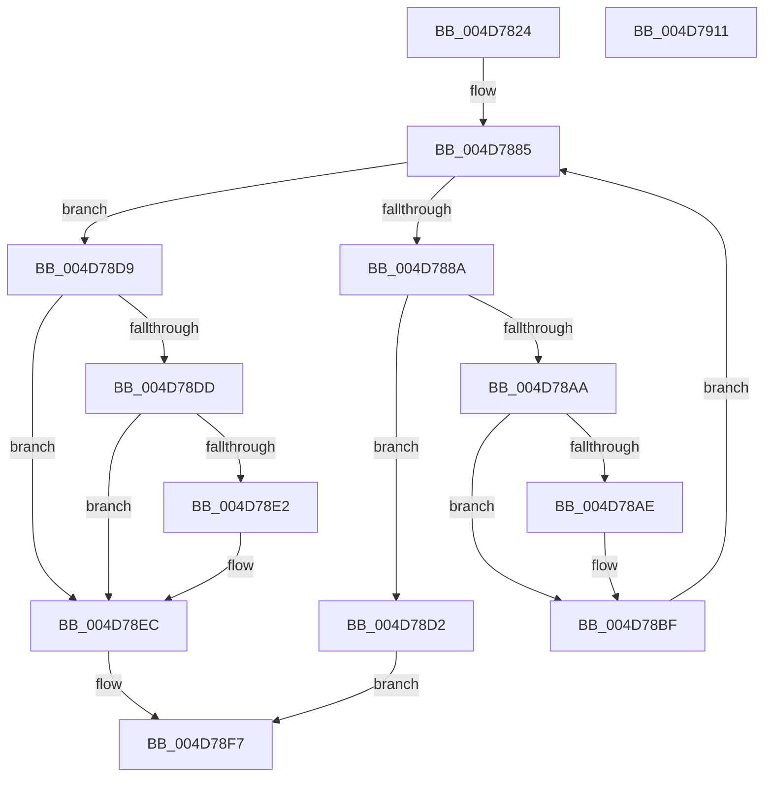

# SmStoreCompletePendingDecompress

- RVA: `0x004D7824`–`0x004D7912` (길이 `238` bytes)
- VA: `0x00000001404D7824`
- 실행 섹션: `.text`
- PDB 이름 있음: `예`; PDB Function 태그: `아니요`
- unwind 정보 RVA: `0x000BE6AC`
- 디코드: `75`개 명령, `238/238` bytes 표시
- 미해석 바이트: `0` (있으면 어셈블리에 `.byte`로 보존)

> 이 문서는 커널 이미지의 기계어와 PDB 기호를 분석해 생성했습니다. 4번과 5번은 함수 원형과 자료형을 바이너리 사용 방식에서 추정한 C 해석이며 원본 소스 복구 결과는 아닙니다.

## 1. Dependencies

- 직접 호출 지점: **2**; 고유 호출 대상: **2**
- 직접 호출자로 확인된 함수: **2**
- RIP 상대 이미지 참조: **0**

### Outgoing calls
- `0x004D789E` → [SmHwAcceleratorWaitForRequest](../61/SmHwAcceleratorWaitForRequest_function_00611A7C.md) (function, `0x00611A7C`)
- `0x004D78F2` → [SmHwAcceleratorPartitionMgrFreeDescriptor](SmHwAcceleratorPartitionMgrFreeDescriptor_function_004D7918.md) (function, `0x004D7918`)

### Direct callers
- [ST_STORE&lt;SM_TRAITS&gt;::StDmSinglePageCopy](../31/ST_STORE_SM_TRAITS_StDmSinglePageCopy_function_00317F44.md) at `0x003180F7`
- [ST_STORE&lt;SM_TRAITS&gt;::StDmCompletePendingReads](../60/ST_STORE_SM_TRAITS_StDmCompletePendingReads_function_0060D174.md) at `0x0060D1E5`

### Static image references
- 디코드된 RIP-relative 메모리 참조가 없습니다.

## 2. Other-region calls and transfers

- 다른 실행 섹션으로 향하는 call: **0**
- 별도 외부 분기/꼬리 이동을 확인하지 못했습니다.

## 3. Assembly (complete function range)

```asm
004D7824  48 8B C4                        mov rax, rsp
004D7827  48 89 58 20                     mov qword ptr [rax + 0x20], rbx
004D782B  4C 89 40 18                     mov qword ptr [rax + 0x18], r8
004D782F  55                              push rbp
004D7830  56                              push rsi
004D7831  57                              push rdi
004D7832  41 54                           push r12
004D7834  41 55                           push r13
004D7836  41 56                           push r14
004D7838  41 57                           push r15
004D783A  48 83 EC 30                     sub rsp, 0x30
004D783E  83 60 08 00                     and dword ptr [rax + 8], 0
004D7842  33 F6                           xor esi, esi
004D7844  83 60 10 00                     and dword ptr [rax + 0x10], 0
004D7848  41 BC 00 08 00 00               mov r12d, 0x800
004D784E  48 8B 81 90 1D 00 00            mov rax, qword ptr [rcx + 0x1d90]
004D7855  41 8B E9                        mov ebp, r9d
004D7858  4C 8B F2                        mov r14, rdx
004D785B  4C 8B A8 E0 07 00 00            mov r13, qword ptr [rax + 0x7e0]
004D7862  8B 81 C0 12 00 00               mov eax, dword ptr [rcx + 0x12c0]
004D7868  83 F8 02                        cmp eax, 2
004D786B  B9 00 10 00 00                  mov ecx, 0x1000
004D7870  44 0F 45 E1                     cmovne r12d, ecx
004D7874  45 33 FF                        xor r15d, r15d
004D7877  83 F8 02                        cmp eax, 2
004D787A  41 0F 94 C7                     sete r15b
004D787E  33 DB                           xor ebx, ebx
004D7880  41 FF C7                        inc r15d
004D7883  33 FF                           xor edi, edi
004D7885  41 3B FF                        cmp edi, r15d
004D7888  73 4F                           jae 0x1404d78d9
004D788A  48 8D 44 24 78                  lea rax, [rsp + 0x78]
004D788F  8B D7                           mov edx, edi
004D7891  4C 8D 4C 24 70                  lea r9, [rsp + 0x70]
004D7896  48 89 44 24 20                  mov qword ptr [rsp + 0x20], rax
004D789B  49 8B CE                        mov rcx, r14
004D789E  E8 D9 A1 13 00                  call 0x140611a7c
004D78A3  3D 02 01 00 00                  cmp eax, 0x102
004D78A8  74 28                           je 0x1404d78d2
004D78AA  85 C0                           test eax, eax
004D78AC  78 11                           js 0x1404d78bf
004D78AE  44 39 64 24 70                  cmp dword ptr [rsp + 0x70], r12d
004D78B3  B9 02 01 00 C0                  mov ecx, 0xc0000102
004D78B8  0F 45 C1                        cmovne eax, ecx
004D78BB  03 74 24 78                     add esi, dword ptr [rsp + 0x78]
004D78BF  4C 8B 84 24 80 00 00 00         mov r8, qword ptr [rsp + 0x80]
004D78C7  FF C7                           inc edi
004D78C9  85 C0                           test eax, eax
004D78CB  0F 49 C3                        cmovns eax, ebx
004D78CE  8B D8                           mov ebx, eax
004D78D0  EB B3                           jmp 0x1404d7885
004D78D2  BB 02 01 00 00                  mov ebx, 0x102
004D78D7  EB 1E                           jmp 0x1404d78f7
004D78D9  85 DB                           test ebx, ebx
004D78DB  78 0F                           js 0x1404d78ec
004D78DD  83 FD FF                        cmp ebp, -1
004D78E0  74 0A                           je 0x1404d78ec
004D78E2  3B EE                           cmp ebp, esi
004D78E4  B8 3F 00 00 C0                  mov eax, 0xc000003f
004D78E9  0F 45 D8                        cmovne ebx, eax
004D78EC  49 8B D6                        mov rdx, r14
004D78EF  49 8B CD                        mov rcx, r13
004D78F2  E8 21 00 00 00                  call 0x1404d7918
004D78F7  8B C3                           mov eax, ebx
004D78F9  48 8B 9C 24 88 00 00 00         mov rbx, qword ptr [rsp + 0x88]
004D7901  48 83 C4 30                     add rsp, 0x30
004D7905  41 5F                           pop r15
004D7907  41 5E                           pop r14
004D7909  41 5D                           pop r13
004D790B  41 5C                           pop r12
004D790D  5F                              pop rdi
004D790E  5E                              pop rsi
004D790F  5D                              pop rbp
004D7910  C3                              ret
004D7911  CC                              int3
```

## 4. C-style interpretation (structured pseudocode)

```c
__int64 __fastcall SmStoreCompletePendingDecompress(__int64 a1, __int64 a2, __int64 a3, int a4)
{
    __int64 result;
    __int64 v_r12;
    __int64 v_r15;
    __int64 v_rbx;
    __int64 v_rdi;
    __int64 v_rsi;
    __int64 v_rsp;
    unsigned __int64 v_stack_m48;
    unsigned __int64 v_stack_p10;
    unsigned __int64 v_stack_p18;
    unsigned __int64 v_stack_p20;
    unsigned __int64 v_stack_p8;

    *(unsigned __int64 *)(v_rsp + 32) = v_rbx;
    *(unsigned __int64 *)(v_rsp + 24) = a3;
    v_rsp = (v_rsp) - (48);
    v_rsi = 0;
    v_r12 = (unsigned int)(0x800ULL);
    if (((unsigned int)((unsigned int)(*(unsigned int *)(a1 + 4800)))) != 2) { v_r12 = (unsigned int)((unsigned int)(0x1000ULL)); }
    v_r15 = 0;
    v_r15 = (((unsigned int)((unsigned int)(*(unsigned int *)(a1 + 4800)))) == 2) ? 1 : 0;
    v_rbx = 0;
    v_r15 = (unsigned int)((v_r15) + 1);
    v_rdi = 0;
loc_004D7885:
    if (0 >= ((unsigned int)(v_r15))) goto loc_004D78D9;
    v_stack_m48 = v_stack_p10;
    result = SmHwAcceleratorWaitForRequest(a2, 0, a3, v_stack_p8);
    if (((unsigned int)(result)) == 258) goto loc_004D78D2;
    if (!(sign_flag)) {
        a1 = 0xC0000102ULL;
        if (v_stack_p8 != ((unsigned int)(v_r12))) { result = (unsigned int)(a1); }
        v_rsi = (unsigned int)((v_rsi) + (v_stack_p10));
    }
    v_rdi = (unsigned int)((v_rdi) + 1);
    if (!sign_flag) { result = 0; }
    goto loc_004D7885;
loc_004D78D2:
    goto loc_004D78F7;
loc_004D78D9:
    if (sign_flag) goto loc_004D78EC;
    v_rbx = 258;
    if (((unsigned int)((unsigned int)(a4))) != -1) {
        result = 0xC000003FULL;
        v_rbx = 258;
        if (((unsigned int)((unsigned int)(a4))) != ((unsigned int)(v_rsi))) { v_rbx = (unsigned int)(result); }
    }
    result = SmHwAcceleratorPartitionMgrFreeDescriptor(*(unsigned __int64 *)(*(unsigned __int64 *)(a1 + 7568) + 2016), a2, v_stack_p18, v_stack_p8);
loc_004D78F7:
    v_rsp = (v_rsp) + (48);
    return (unsigned int)((unsigned int)(v_rbx));
}
```

## 5. (Beta) C Style

```c
int64_t SmStoreCompletePendingDecompress(void *Arg1, int64_t Arg2, int64_t Arg3, int32_t Arg4)
{
    uint8_t *arg1 = (uint8_t *)Arg1;

    int64_t result;
    int64_t local_r12;
    int64_t local_r15;
    int64_t local_rbx;
    int64_t local_rdi;
    int64_t local_rsi;
    int64_t local_rsp;
    uint64_t v_stack_m48;
    uint64_t v_stack_p10;
    uint64_t v_stack_p18;
    uint64_t v_stack_p20;
    uint64_t v_stack_p8;

    *(uint64_t *)(local_rsp + 0x20) = local_rbx;
    *(uint64_t *)(local_rsp + 0x18) = Arg3;
    local_rsp = (local_rsp) - (48);
    local_rsi = 0;
    local_r12 = (uint32_t)(0x800ULL);
    if (((uint32_t)((uint32_t)(*(uint32_t *)(arg1 + 0x12C0)))) != 2) { local_r12 = (uint32_t)((uint32_t)(0x1000ULL)); }
    local_r15 = 0;
    local_r15 = (((uint32_t)((uint32_t)(*(uint32_t *)(arg1 + 0x12C0)))) == 2) ? 1 : 0;
    local_rbx = 0;
    local_r15 = (uint32_t)((local_r15) + 1);
    local_rdi = 0;
loc_004D7885:
    if (0 >= ((uint32_t)(local_r15))) goto loc_004D78D9;
    v_stack_m48 = v_stack_p10;
    result = SmHwAcceleratorWaitForRequest(Arg2, 0, Arg3, v_stack_p8);
    if (((uint32_t)(result)) == 258) goto loc_004D78D2;
    if (!(sign_flag)) {
        Arg1 = 0xC0000102ULL;
        if (v_stack_p8 != ((uint32_t)(local_r12))) { result = (uint32_t)(Arg1); }
        local_rsi = (uint32_t)((local_rsi) + (v_stack_p10));
    }
    local_rdi = (uint32_t)((local_rdi) + 1);
    if (!sign_flag) { result = 0; }
    goto loc_004D7885;
loc_004D78D2:
    goto loc_004D78F7;
loc_004D78D9:
    if (sign_flag) goto loc_004D78EC;
    local_rbx = 258;
    if (((uint32_t)((uint32_t)(Arg4))) != -1) {
        result = 0xC000003FULL;
        local_rbx = 258;
        if (((uint32_t)((uint32_t)(Arg4))) != ((uint32_t)(local_rsi))) { local_rbx = (uint32_t)(result); }
    }
    result = SmHwAcceleratorPartitionMgrFreeDescriptor(*(uint64_t *)(*(uint64_t *)(arg1 + 0x1D90) + 0x7E0), Arg2, v_stack_p18, v_stack_p8);
loc_004D78F7:
    local_rsp = (local_rsp) + (48);
    return (uint32_t)((uint32_t)(local_rbx));
}
```

### 관측된 메모리 오프셋

구조체 형식이 확인되지 않은 접근은 인자 기준의 오프셋으로만 기록했습니다.

| 기준 인자 | 오프셋 표현 | 폭 (bit) | 접근 |
|---|---:|---:|---|
| `Arg1` | `+ 0x12C0` | `32` | `R` |
| `Arg1` | `+ 0x1D90` | `64` | `R` |

## 6. Execution-region graph

[열기: 2D/3D 그래프와 함수 탐색 컨트롤 패널](../../../control-panel.html?section=text&rva=0x004D7824&view=graph)

- 2D 그래프는 위에서 아래로 흐르고, 3D 그래프는 빈 공간을 드래그해 회전합니다. Shift+드래그는 이동, 휠은 확대·축소, 함수 노드 선택은 대상 보고서 이동입니다.

### Static fallback


