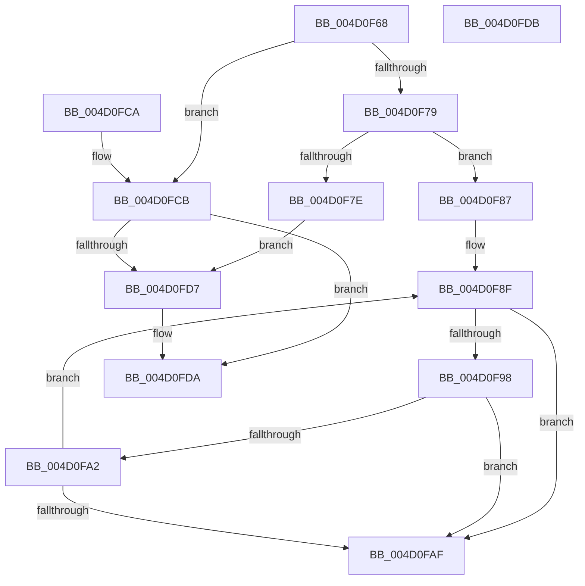

# StringCchCopyNW

- RVA: `0x004D0F68`–`0x004D0FDC` (길이 `116` bytes)
- VA: `0x00000001404D0F68`
- 실행 섹션: `.text`
- PDB 이름 있음: `예`; PDB Function 태그: `아니요`
- unwind 정보 RVA: `0x000DB714`
- 디코드: `40`개 명령, `116/116` bytes 표시
- 미해석 바이트: `0` (있으면 어셈블리에 `.byte`로 보존)

> 이 문서는 커널 이미지의 기계어와 PDB 기호를 분석해 생성했습니다. 4번과 5번은 함수 원형과 자료형을 바이너리 사용 방식에서 추정한 C 해석이며 원본 소스 복구 결과는 아닙니다.

## 1. Dependencies

- 직접 호출 지점: **0**; 고유 호출 대상: **0**
- 직접 호출자로 확인된 함수: **3**
- RIP 상대 이미지 참조: **0**

### Outgoing calls
- 직접 디코드된 call 명령이 없습니다.

### Direct callers
- [DownLevelLangIDToLanguageName](../4B/DownLevelLangIDToLanguageName_function_004BBAA8.md) at `0x004BBB5E`
- [LdrpGetParentLangId](../4B/LdrpGetParentLangId_function_004BDAC0.md) at `0x004BDB64`
- [DownLevelGetParentLanguageName](../66/DownLevelGetParentLanguageName_function_00661E94.md) at `0x00661F2B`

### Static image references
- 디코드된 RIP-relative 메모리 참조가 없습니다.

## 2. Other-region calls and transfers

- 다른 실행 섹션으로 향하는 call: **0**
- 별도 외부 분기/꼬리 이동을 확인하지 못했습니다.

## 3. Assembly (complete function range)

```asm
004D0F68  48 8D 42 FF                     lea rax, [rdx - 1]
004D0F6C  4C 8B D2                        mov r10, rdx
004D0F6F  BA FE FF FF 7F                  mov edx, 0x7ffffffe
004D0F74  48 3B C2                        cmp rax, rdx
004D0F77  77 52                           ja 0x1404d0fcb
004D0F79  4C 3B CA                        cmp r9, rdx
004D0F7C  76 09                           jbe 0x1404d0f87
004D0F7E  B8 57 00 07 80                  mov eax, 0x80070057
004D0F83  33 D2                           xor edx, edx
004D0F85  EB 50                           jmp 0x1404d0fd7
004D0F87  4D 2B CA                        sub r9, r10
004D0F8A  4C 2B C1                        sub r8, rcx
004D0F8D  33 D2                           xor edx, edx
004D0F8F  4B 8D 04 11                     lea rax, [r9 + r10]
004D0F93  48 85 C0                        test rax, rax
004D0F96  74 17                           je 0x1404d0faf
004D0F98  41 0F B7 04 08                  movzx eax, word ptr [r8 + rcx]
004D0F9D  66 85 C0                        test ax, ax
004D0FA0  74 0D                           je 0x1404d0faf
004D0FA2  66 89 01                        mov word ptr [rcx], ax
004D0FA5  48 83 C1 02                     add rcx, 2
004D0FA9  49 83 EA 01                     sub r10, 1
004D0FAD  75 E0                           jne 0x1404d0f8f
004D0FAF  4D 85 D2                        test r10, r10
004D0FB2  48 8D 41 FE                     lea rax, [rcx - 2]
004D0FB6  48 0F 45 C1                     cmovne rax, rcx
004D0FBA  49 F7 DA                        neg r10
004D0FBD  66 89 10                        mov word ptr [rax], dx
004D0FC0  1B C0                           sbb eax, eax
004D0FC2  F7 D0                           not eax
004D0FC4  25 7A 00 07 80                  and eax, 0x8007007a
004D0FC9  C3                              ret
004D0FCA  CC                              int3
004D0FCB  33 D2                           xor edx, edx
004D0FCD  B8 57 00 07 80                  mov eax, 0x80070057
004D0FD2  4D 85 D2                        test r10, r10
004D0FD5  74 03                           je 0x1404d0fda
004D0FD7  66 89 11                        mov word ptr [rcx], dx
004D0FDA  C3                              ret
004D0FDB  CC                              int3
```

## 4. C-style interpretation (structured pseudocode)

```c
__int64 __fastcall StringCchCopyNW(__int64 a1, __int64 a2, __int64 a3, __int64 a4)
{
    __int64 result;
    __int64 v_r10;

    if ((a2 - 1) > ((unsigned int)(0x7FFFFFFEULL))) goto loc_004D0FCB;
    if (a4 <= ((unsigned int)(0x7FFFFFFEULL))) goto loc_004D0F87;
    a2 = 0;
    goto loc_004D0FD7;
loc_004D0F87:
    a4 = (a4) - (0);
    a3 = (a3) - (a1);
    a2 = 0;
loc_004D0F8F:
    if (a4 + a2 * 1 == 0) goto loc_004D0FAF;
    if ((unsigned __int16)(*(unsigned __int16 *)(a3 + a1 * 1)) == 0) goto loc_004D0FAF;
    *(unsigned __int16 *)(a1) = (unsigned __int16)(*(unsigned __int16 *)(a3 + a1 * 1));
    a1 = (a1) + (2);
    v_r10 = (a2) - (1);
    if (condition_is_not_equal) goto loc_004D0F8F;
loc_004D0FAF:
    result = a1 - 2;
    if (v_r10 != 0) { result = a1; }
    v_r10 = -(v_r10);
    *(unsigned __int16 *)(result) = 0;
    result = (unsigned int)(~(result));
    result = (unsigned int)((result) & (0x8007007AULL));
    return result;
loc_004D0FCB:
    a2 = 0;
    if (v_r10 != 0) {
        *(unsigned __int16 *)(a1) = 0;
    }
    return (unsigned int)(0x80070057ULL);
}
```

## 5. (Beta) C Style

```c
int64_t StringCchCopyNW(void *Arg1, void *Arg2, void *Arg3, int64_t Arg4)
{
    uint8_t *arg1 = (uint8_t *)Arg1;
    uint8_t *arg2 = (uint8_t *)Arg2;
    uint8_t *arg3 = (uint8_t *)Arg3;

    int64_t result;
    int64_t local_r10;

    if ((Arg2 - 1) > ((uint32_t)(0x7FFFFFFEULL))) goto loc_004D0FCB;
    if (Arg4 <= ((uint32_t)(0x7FFFFFFEULL))) goto loc_004D0F87;
    Arg2 = 0;
    goto loc_004D0FD7;
loc_004D0F87:
    Arg4 = (Arg4) - (0);
    Arg3 = (Arg3) - (Arg1);
    Arg2 = 0;
loc_004D0F8F:
    if (Arg4 + Arg2 * 1 == 0) goto loc_004D0FAF;
    if ((uint16_t)(*(uint16_t *)(arg3 + arg1 * 1)) == 0) goto loc_004D0FAF;
    *(uint16_t *)(arg1) = (uint16_t)(*(uint16_t *)(arg3 + arg1 * 1));
    Arg1 = (Arg1) + (2);
    local_r10 = (Arg2) - (1);
    if (condition_is_not_equal) goto loc_004D0F8F;
loc_004D0FAF:
    result = Arg1 - 2;
    if (local_r10 != 0) { result = Arg1; }
    local_r10 = -(local_r10);
    *(uint16_t *)(result) = 0;
    result = (uint32_t)(~(result));
    result = (uint32_t)((result) & (0x8007007AULL));
    return result;
loc_004D0FCB:
    Arg2 = 0;
    if (local_r10 != 0) {
        *(uint16_t *)(arg1) = 0;
    }
    return (uint32_t)(0x80070057ULL);
}
```

### 관측된 메모리 오프셋

구조체 형식이 확인되지 않은 접근은 인자 기준의 오프셋으로만 기록했습니다.

| 기준 인자 | 오프셋 표현 | 폭 (bit) | 접근 |
|---|---:|---:|---|
| `Arg1` | `- 0x2` | `64` | `R` |
| `Arg1` | `+ 0x0` | `16` | `W` |
| `Arg2` | `- 0x1` | `64` | `R` |
| `Arg3` | `+ 0x0 + rcx*1` | `16` | `R` |

## 6. Execution-region graph

[열기: 2D/3D 그래프와 함수 탐색 컨트롤 패널](../../../control-panel.html?section=text&rva=0x004D0F68&view=graph)

- 2D 그래프는 위에서 아래로 흐르고, 3D 그래프는 빈 공간을 드래그해 회전합니다. Shift+드래그는 이동, 휠은 확대·축소, 함수 노드 선택은 대상 보고서 이동입니다.

### Static fallback


